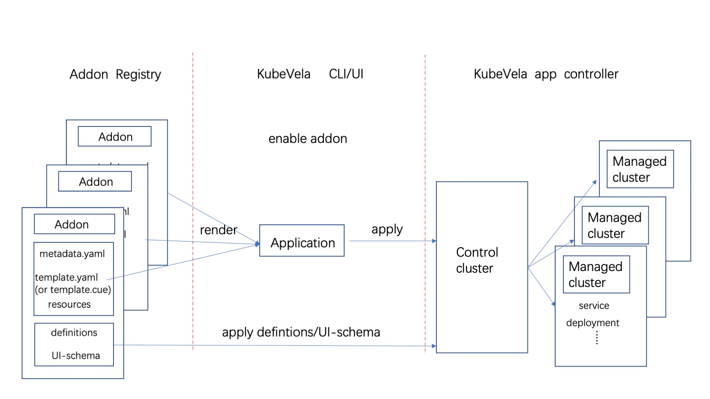

An addon is a packaged extension for KubeVela: the controllers a capability needs, plus the component types, traits, policies and workflow steps that let an Application use them. Enable the `fluxcd` addon, for example, and your cluster gets the Flux controllers and two new component types, `helm` and `kustomize`.

This section covers the addons in the community catalog, [kubevela/catalog](https://github.com/kubevela/catalog), and how to write your own.

## Who it's for

| You want to | Start with |
| --- | --- |
| Add a capability to your platform, such as Helm charts from Flux, canary releases or TLS certificates | [Install addons](./install.md), then the [Quick Start](./quick-start.md) |
| See what's in the catalog and what each addon installs | The [Addon Catalog](../overview.md) |
| Package your own operator and definitions so others can enable them with one command | [Make Your Own Addon](../developer/make-your-own-addon.md) |
| Contribute an addon to the community catalog | [Contribute to the catalog](../developer/contribute.md) |

## How it relates to KubeVela

An addon is not a separate product. The `vela addon` commands, the addon format and the registries are all part of KubeVela, and an enabled addon is just an Application:

1. You run `vela addon enable <name>`, or click **Enable** in [VelaUX](/velaux/overview).
2. The CLI fetches the addon from a registry (or reads it from a local directory), renders it, and applies its definitions and UI schemas to the hub cluster.
3. It also applies an Application named `addon-<name>` in `vela-system`, which installs the addon's controllers. The Application controller delivers it like any other Application, so `vela status addon-<name> -n vela-system` shows its health.

KubeVela's own releases don't pin addon versions. Each addon carries its own version in the catalog, and its `metadata.yaml` says which KubeVela versions it works with; the [Versions](../reference/versions.md) page lists them.

## Verified and experimental

The catalog has two registries:

| Registry | Source | Registered by default | Enable with |
| --- | --- | --- | --- |
| `KubeVela` | [`addons/`](https://github.com/kubevela/catalog/tree/master/addons) | Yes, by the vela-core chart | `vela addon enable <name>` |
| `experimental` | [`experimental/addons/`](https://github.com/kubevela/catalog/tree/master/experimental/addons) | No | `vela addon enable experimental/<name>`, once you've [added it](./install.md#add-the-experimental-registry) |

Every addon starts as experimental. It's promoted to verified once the catalog's CI shows it enables cleanly and it has a page in these docs. Both registries are published to GitHub Pages from the catalog's `master` branch on every merge, at `https://kubevela.github.io/catalog/official` and `https://kubevela.github.io/catalog/experimental`.

You can run your own registry too, in an OCI registry, a Helm repository, Git or a bucket. See [Build your Own Registry](../developer/addon-registry.md).
