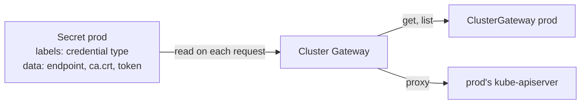

Cluster Gateway has no store of its own. A cluster is a Secret on the hub, in the namespace the gateway reads (`--secret-namespace`), and a `ClusterGateway` is that Secret read back through the gateway's API. The Secret's name is the cluster's name.

| Installed with | Secret namespace |
| --- | --- |
| The standalone chart | `open-cluster-management-credentials` |
| KubeVela | `vela-system`, written by `vela cluster join` |

## What the gateway reads

| Field | Key | What it holds |
| --- | --- | --- |
| Label | `cluster.core.oam.dev/cluster-credential-type` | **Required.** `X509Certificate`, `ServiceAccountToken` or `Dynamic`. A Secret without it is not a cluster: it's left out of the list, and reads of it return NotFound. |
| Label | `cluster.core.oam.dev/cluster-endpoint-type` | `Const` (the default) or `ClusterProxy`, for clusters reached through OCM's cluster-proxy. |
| Data | `endpoint` | **Required for `Const`.** The member cluster's kube-apiserver URL, as the gateway's pods can reach it. |
| Data | `ca.crt` (or `ca`) | The CA that signed the member's serving certificate. Leave it out and the gateway skips TLS verification. |
| Data | `tls.crt`, `tls.key` | The client certificate and key, for `X509Certificate`. |
| Data | `token` | The bearer token, for `ServiceAccountToken`. |
| Data | `exec` | A kubeconfig exec configuration as JSON, for `Dynamic`. |
| Data | `proxy-url` | An HTTP or SOCKS5 proxy to reach the member cluster through. |
| Annotation | `cluster.core.oam.dev/cluster-gateway-proxy-configuration` | Per-cluster [identity exchange](../guides/identity-exchange.md) rules, with `ClientIdentityPenetration` on. |
| Annotation | `status.cluster.core.oam.dev/healthy`, `status.cluster.core.oam.dev/healthy-reason` | The health status, with `HealthinessCheck` on. The gateway shows it; something else writes it. |
| Annotation | `cluster.core.oam.dev/cluster-alias` | The alias shown by `virtualclusters`. |

The `endpoint` is dialled from inside the gateway's pod, so it must be an address the hub's pod network can reach. `https://127.0.0.1:6443` from your laptop's kubeconfig is the gateway's own pod.

The Secret's `type` doesn't matter to the gateway: `Opaque` is the usual choice.

## The three credential types

| Type | The gateway sends | Fits |
| --- | --- | --- |
| `ServiceAccountToken` | `Authorization: Bearer <token>` | A ServiceAccount on the member with a long-lived token. The most common choice, and what `vela cluster join` writes for a token kubeconfig. |
| `X509Certificate` | A client certificate | An admin kubeconfig with client certificate data, such as the one k3d, kind or kubeadm give you. |
| `Dynamic` | Whatever the `exec` command prints: a token, or a certificate and key | Short-lived credentials from a command, the way kubectl runs a kubeconfig `exec` plugin. The command runs inside the gateway's container. |

How to write each one is in [Register Clusters](../guides/register-clusters.md).

## When a change takes effect

With the `SecretCache` feature gate on, which is the default, the gateway watches the Secret namespace and reads Secrets from that cache, so a new, changed or deleted Secret takes effect as soon as the watch delivers it. With the gate off, it reads the Secret from the hub on every request. Either way there is nothing to restart.

A `Dynamic` credential is the exception: the gateway caches the credential the command prints until a minute before its `expirationTimestamp`, and each gateway replica keeps its own cache.

## Who can read a cluster's credential

Anyone who can read the Secret has the cluster's credential, and so does anyone who can `get` the `ClusterGateway`: the object carries the endpoint and the credential in `spec.access`. Treat `get` and `list` on `clustergateways` like `get` on Secrets in the Secret namespace, and give hub users `clustergateways/proxy` instead, which uses the credential without showing it.

## With OCM

With `--ocm-integration`, the gateway takes each cluster's endpoint and CA from the OCM `ManagedCluster` of the same name, and lists only clusters that have one. The Secret still holds the credential. The [OCM Cluster-Gateway Manager](/addons/ocm-gateway-manager-addon) addon sets this up for clusters registered with Open Cluster Management.
