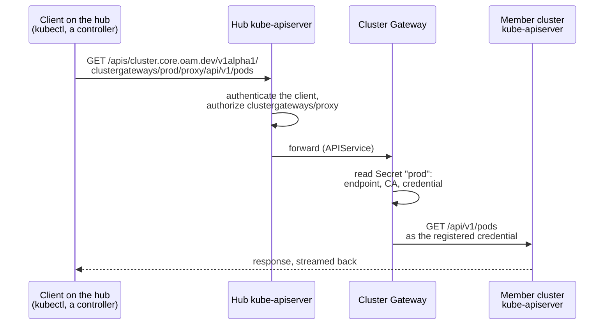

Every request to a member cluster goes to that cluster's `proxy` subresource on the hub. The hub's kube-apiserver authenticates the caller and checks they may use the proxy; the gateway reads the cluster's Secret and sends the request on to the member with the credential in it.

## How a request travels



The proxy path for a cluster is the cluster's URL with the member's API path appended:

```
/apis/cluster.core.oam.dev/v1alpha1/clustergateways/<cluster>/proxy/<path on the member cluster>
```

So `/apis/cluster.core.oam.dev/v1alpha1/clustergateways/prod/proxy/apis/apps/v1/namespaces/default/deployments` lists the Deployments in `default` on `prod`. Anything after `proxy` is passed through untouched, with any HTTP method, so a client that is pointed at `.../clustergateways/prod/proxy` as its server works against `prod` as if it were talking to it directly. Upgrades are passed through too, which is why `exec`, `port-forward`, `logs -f` and `watch` work.

The request is streamed, not buffered, and the hub treats it as long-running, so a watch through the proxy isn't cut off by the hub's request timeout.

## Whose identity the member sees

The hub authorizes the `clustergateways/proxy` subresource, not the request inside it. Once a client may use the proxy for a cluster, the member cluster sees the credential in that cluster's Secret, so whatever that credential may do, the client may do.

| Hub RBAC on `clustergateways/proxy` | Member sees | Member RBAC applies to |
| --- | --- | --- |
| Default | The registered credential | The registered credential |
| With `ClientIdentityPenetration` | The hub user, impersonated by the registered credential | The hub user |
| With `--authorize-proxy-subpath` | The registered credential, after the hub has also checked the inner request against the hub user's own RBAC | The registered credential |

That makes the hub's RBAC on `clustergateways/proxy` the thing that matters. A Role can name clusters with `resourceNames`:

```yaml
apiVersion: rbac.authorization.k8s.io/v1
kind: ClusterRole
metadata:
  name: proxy-to-staging
rules:
  - apiGroups: ["cluster.core.oam.dev"]
    resources: ["clustergateways/proxy"]
    resourceNames: ["staging"]
    verbs: ["*"]
```

The verb checked on the hub is the HTTP verb mapped the usual way (`get`, `create`, `update`, `patch`, `delete`), whatever the inner request is, so a `get` on the proxy is enough to read anything the credential can read.

[Identity Exchange](../guides/identity-exchange.md) covers `ClientIdentityPenetration` and the rules that change who is impersonated. [Narrow a member credential](../examples/read-only-member.md) shows the simpler approach: give the registered credential no more than its users need.

## The API

| Resource | What it is |
| --- | --- |
| `clustergateways` | One per registered cluster, cluster-scoped, read-only (`get` and `list`; no `watch`). Columns: credential type, endpoint type, healthy. |
| `clustergateways/proxy` | Any HTTP method, passed through to the member cluster's kube-apiserver. |
| `clustergateways/health` | A health status stored in the cluster Secret's annotations, shown only with the `HealthinessCheck` feature gate on. Something else has to write it, such as the OCM addon: the gateway does not probe clusters itself. |
| `virtualclusters` | The same clusters as a plain list (alias, credential type, endpoint, labels), plus the hub itself as `local`. |

Field by field, in [API](../reference/api.md).

## The hub's side of the connection

The hub's kube-apiserver reaches the gateway through an APIService, `v1alpha1.cluster.core.oam.dev`, pointing at the gateway's Service. If the APIService isn't available, every request in the group fails with `the server is currently unable to handle the request`. The gateway has to run in the hub cluster, where the hub's kube-apiserver can reach its Service.

The gateway reaches member clusters from its own pod, so a member's `endpoint` has to be an address the hub's pod network can reach. KubeVela's controller can skip the hub's kube-apiserver and call the gateway's Service directly, which saves a hop on every request (`multicluster.clusterGateway.direct`, on by default).
