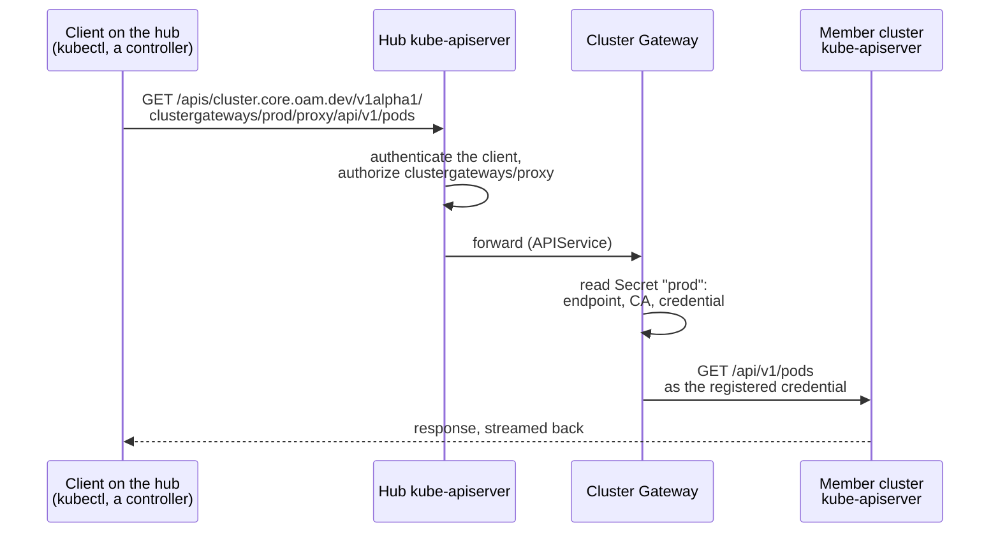

Cluster Gateway gives a hub cluster a single Kubernetes API for reaching its member clusters. It is an aggregated API server: it registers the `cluster.core.oam.dev/v1alpha1` API group with the hub's kube-apiserver, and any request sent to a cluster's `proxy` subresource is passed on to that cluster's kube-apiserver with the credential the hub holds for it.

It has no etcd and stores nothing. Each cluster is a Secret on the hub, and the gateway builds the `ClusterGateway` object from that Secret every time it is read. Adding a cluster is creating a Secret; removing it is deleting one.

KubeVela installs it as part of vela-core and reaches every managed cluster through it. It also runs on its own, without KubeVela, for anyone who wants one hub endpoint in front of several clusters.

## How a request travels



The hub authorizes the `clustergateways/proxy` subresource, not the request inside it. Once a client may use the proxy for a cluster, the member cluster sees the credential in that cluster's Secret, so whatever that credential may do, the client may do. Two settings narrow that, both covered in [Configuration](./configuration.md):

* `ClientIdentityPenetration` makes the gateway impersonate the original hub user on the member cluster, so the member's own RBAC applies to them.
* `--authorize-proxy-subpath` makes the gateway check the inner request against the hub's RBAC as well.

## The API

| Resource | What it is |
| --- | --- |
| `clustergateways` | One per registered cluster, cluster-scoped, read-only (`get` and `list`; no `watch`). Columns: credential type, endpoint type, healthy. |
| `clustergateways/proxy` | Any HTTP method, passed through to the member cluster's kube-apiserver. Upgrades work, so `exec`, `port-forward` and `watch` work through it. |
| `clustergateways/health` | A health status stored in the cluster Secret's annotations, shown only with the `HealthinessCheck` feature gate on. Something else has to write it, such as the OCM addon: the gateway does not probe clusters itself. |
| `virtualclusters` | The same clusters as a plain list (alias, credential type, endpoint, labels), plus the hub itself as `local`. |

The proxy path for a cluster is the cluster's URL with the member's API path appended:

```
/apis/cluster.core.oam.dev/v1alpha1/clustergateways/<cluster>/proxy/<path on the member cluster>
```

So `/apis/cluster.core.oam.dev/v1alpha1/clustergateways/prod/proxy/apis/apps/v1/namespaces/default/deployments` lists the Deployments in `default` on `prod`. Pointing `kubectl --server` at the proxy path for a cluster gives you kubectl against that cluster through the hub: see [Check a cluster through the proxy](./clusters.md#check-a-cluster-through-the-proxy).

## How KubeVela uses it

The vela-core chart installs Cluster Gateway beside the controller, with `multicluster.enabled` on by default. From there:

* `vela cluster join` writes the cluster Secret into `vela-system`, the namespace the gateway reads.
* The controller sends every request for a managed cluster to the gateway's proxy path. By default it calls the gateway's Service directly instead of going through the hub's kube-apiserver (the chart's `multicluster.clusterGateway.direct`).
* vela-core creates and renews the gateway's serving certificate and writes its CA into the APIService.
* With `authentication.enabled`, the chart turns on `ClientIdentityPenetration`, so resources reach managed clusters as the user who owns the Application.

How to use multiple clusters from KubeVela lives in the KubeVela docs:

* [Deploy to Multiple Clusters](/docs/next/end-user/policies/multi-cluster)
* [Manage Clusters](/docs/next/platform-engineers/system-operation/managing-clusters): `vela cluster join`, list, detach.
* [Working with OCM](/docs/next/platform-engineers/system-operation/working-with-ocm), and the [OCM Cluster-Gateway Manager](/addons/ocm-gateway-manager-addon) addon for clusters registered with Open Cluster Management.
* [Underlying Mechanism](/docs/next/platform-engineers/auth/advance) of authentication, for how the identity travels through the gateway.

## Versions

Each KubeVela release pins one Cluster Gateway version, as the Go module in `go.mod` and as the image in the vela-core chart (`oamdev/cluster-gateway`):

| KubeVela | Cluster Gateway |
| --- | --- |
| 1.12 | 1.10.0-alpha.1 |
| 1.11 | 1.9.2 |
| 1.10 | 1.9.2 |
| 1.9 | 1.9.0-alpha.2 |

These pages describe 1.10.0-alpha.1. Where 1.9.2 behaves differently, the page says so. The API, the Secret format and the gateway's own flags are the same in both: 1.10.0-alpha.1 builds the server on `k8s.io/apiserver` directly, in place of the `apiserver-runtime` library 1.9.2 used, and moves to Kubernetes 0.37 and Go 1.27.

The source is [oam-dev/cluster-gateway](https://github.com/oam-dev/cluster-gateway).
