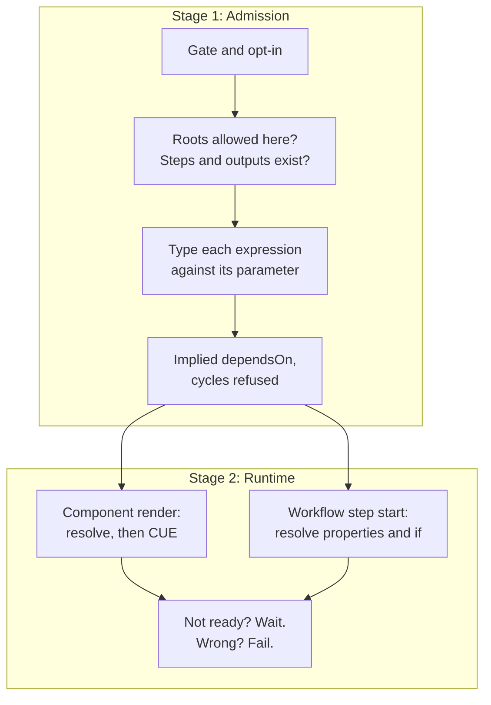
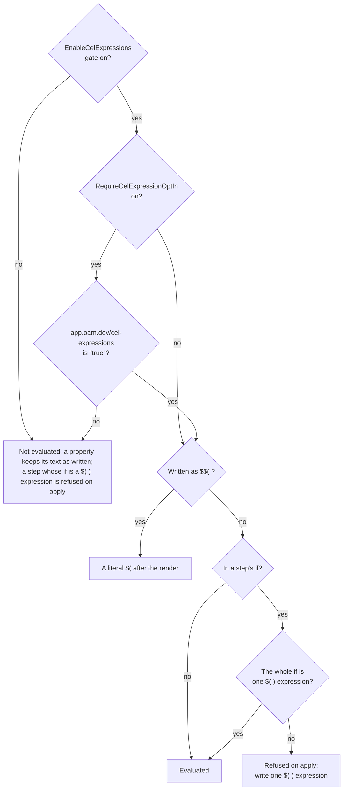
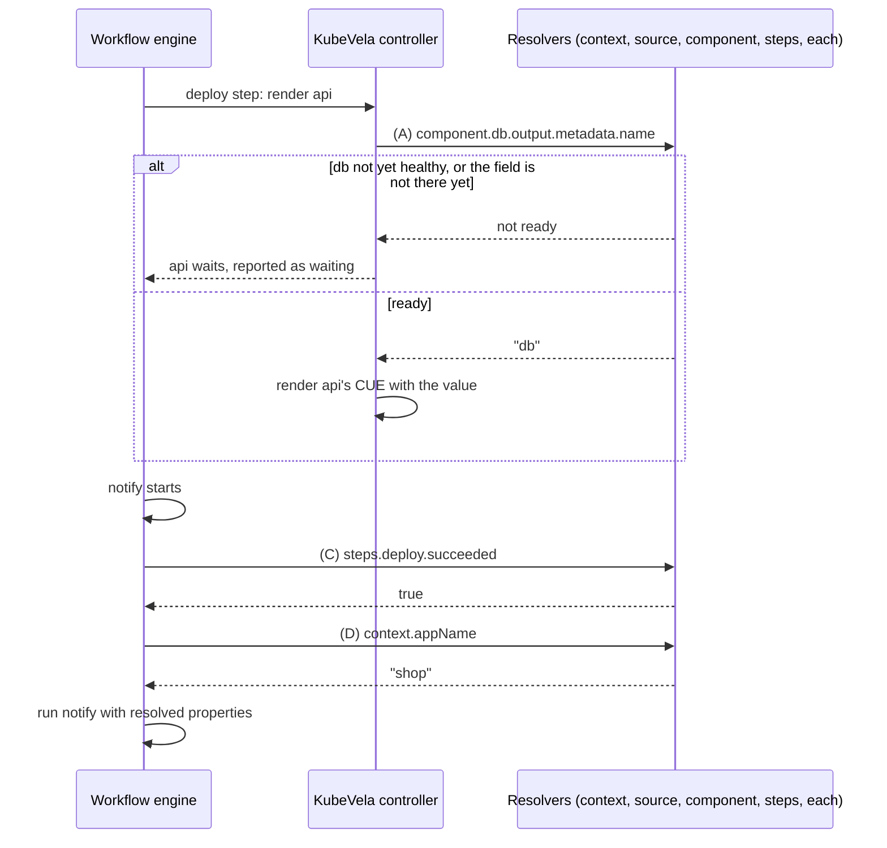

A `$( )` expression is checked twice before its value reaches a workload: by the Application webhook when you apply it, and by the controller each time it renders. The controller knows more than the webhook, so it catches what the webhook could not.

This page explains what happens at each stage and why. To write expressions, start with [Property Expressions](./cel-expressions.md); for workflow steps and conditions, see [Expressions in Workflow Steps](./workflow/expressions.md).

## The two stages at a glance



| Stage | Runs in | Knows | Catches |
| --- | --- | --- | --- |
| Admission | KubeVela's Application webhook | Every definition and its parameter schema, the whole Application | Anything a value can never satisfy: unknown roots or steps, type mismatches, unanswerable reads, cycles |
| Runtime | KubeVela controller, workflow engine | Live objects, health, source data, step results | Values that are not ready yet (it waits) and values that fail to resolve (it fails) |

Both use the same expression engine, the CEL engine in `kubevela/pkg`, so a given expression parses and types the same way at every stage. What changes from stage to stage is how much data is available.

## Turning them on

Expressions are off by default: `$(VAR_NAME)` is Kubernetes' own syntax for dependent environment variables, so an installation that has never heard of this feature must not have its values read as expressions. The three states and how an Application opts in are on [Property Expressions](./cel-expressions.md#turning-them-on); this table adds the switches outside the KubeVela controller too.

| Where | Switch | Default |
| --- | --- | --- |
| KubeVela controller | `featureGates.enableCelExpressions` (gate `EnableCelExpressions`) | `false` |
| KubeVela controller | `featureGates.requireCelExpressionOptIn` (gate `RequireCelExpressionOptIn`) | `true` |
| Application | annotation `app.oam.dev/cel-expressions: "true"` | absent |
| Standalone workflow controller | `workflow.enableCelExpressions` | `false` |
| WorkflowRun | annotation `workflowrun.oam.dev/cel-expressions: "true"` | absent |

To see which gates a cluster runs:

```bash
kubectl get configmap kubevela-feature-gates -n vela-system -o yaml
```

With the gate on and opt-in required, only annotated Applications are read. Turn `requireCelExpressionOptIn` off and every Application is. The webhook and the render apply the same rule, so an Application can never be admitted under one reading and rendered under the other. Write `$$(` where you need a literal `$(`.

### Will my expression be evaluated?



With expressions off for an Application, a step whose `if` is a `$( )` expression is refused when you apply it, with a message naming the switch to turn on:

```
a $( ) condition needs expressions, and this Application has not opted in to them; set the app.oam.dev/cel-expressions annotation to "true"
```

With the gate off for the whole cluster, the message says so instead:

```
a $( ) condition needs expressions, which are not enabled on this cluster; an operator enables them with the EnableCelExpressions feature gate
```

For a standalone WorkflowRun, read the workflow controller's `EnableCelExpressions` and the `workflowrun.oam.dev/cel-expressions` annotation in place of the first three questions: a WorkflowRun always needs its annotation. Without it, a `$( )` `if` is refused the same way, with the message naming that annotation.

Admission is not the only check. A run admitted without it, say with the validating webhook turned off, fails such a step rather than skipping it:

```
this step's if is a $( ) condition, which needs expressions, and this run does not read them; turn them on for it, or write the if in CUE
```

## A worked example

The rest of this page follows one Application through the two stages.

```yaml
apiVersion: core.oam.dev/v1beta1
kind: Application
metadata:
  name: shop
  annotations:
    app.oam.dev/cel-expressions: "true"
spec:
  components:
    - name: db
      type: webservice
      properties:
        image: postgres:16
        env:
          - name: POSTGRES_PASSWORD
            value: example
    - name: api
      type: webservice
      properties:
        image: nginx:1.27-alpine
        env:
          - name: DB_HOST
            value: "$(component.db.output.metadata.name)"   # (A) a component read
          - name: APP
            value: "$(context.appName)"                     # (B) a context read
  workflow:
    steps:
      - name: deploy
        type: deploy
        properties:
          policies: []
      - name: notify
        type: notification
        if: "$(steps.deploy.succeeded)"                     # (C) a condition
        properties:
          slack:
            url:
              value: https://hooks.slack.com/services/example
            message:
              text: "$(context.appName) is live"            # (D) a step property
```

## 1. Admission: the Application webhook

When the Application is applied, the webhook checks every expression without resolving any of them. Values are re-resolved on every reconcile, so the only thing worth judging at admission is whether a value could ever fit.

| Check | In the example | Refused, for instance |
| --- | --- | --- |
| The root exists on this surface | (A), (B) on a component; (C), (D) on a step | `$(steps.deploy...)` in a component's properties |
| A step read names a step, and an output that step declares | (C) names `deploy` | `$(steps.deplyo.succeeded)` |
| The result fits the parameter | (B) is a string into a string field; (C) is a bool; (A) is not typed, since `webservice`'s output declares no `metadata.name` | `$(component.db.output.spec.selector)` into `DB_HOST`'s `value`: an object into a string |
| A read that may be absent is guarded, where it feeds a required parameter or decides an `if` | | An unguarded read of an optional source field in a required step property, or in an `if` |
| The read can ever be answered | | A step reading itself, a later step in a `StepByStep` workflow, or a cycle |

### How a component read is typed

To CEL, a component's live object is `dyn`: it holds fields no template declares, such as `metadata.uid` and `status`, so it cannot be a closed type. Instead, the webhook looks up the kind of a single whole-value read, such as `$(component.db.output.spec.selector)`, in the producer's output schema, generated from its definition (including the revision named by `type@vN`, and any `extends` chain). The lookup lives in KubeVela's `pkg/schema`.

The rule is one-sided: an expression is refused only when its kind is known, from the producer's schema or from CEL itself, and that kind disagrees with the parameter.

| Read | Typed as |
| --- | --- |
| `component.<c>.output.<path>` | The kind at `<path>` in `<c>`'s output schema |
| `component.<c>.outputs.<resource>.<path>` | The kind in the `outputs` schema of `<c>`'s definition, or of the trait that renders `<resource>` |
| Anything under `status` | Not typed: its controller writes it |
| A path the schema does not declare | Not typed |
| `output` of a component with a `patch` trait | Not typed: the trait may change it |
| `outputs` of a component with a `patchOutputs` trait | Not typed: the trait may change them |
| `each.index` | int |
| `each.key` | string |
| `each.item.<path>` | The kind shared by every literal item at `<path>`, or the list schema of the source the items are read from |
| A computed expression | Typed when CEL can tell its result type, whatever the read: `component.db.output.spec.replicas * 2` is an int, `component.db.output.metadata.name + "-svc"` a string. Otherwise not typed |

"Not typed" means admitted, and left for the render to judge.

### Implied ordering

A read is a dependency:

- `api` reads `db`, so `api` waits for `db` as if it had `dependsOn: [db]`. Reads are listed in `status.dependencies` with source `expression`.
- `notify` reads `deploy` in its `if`, so in a `DAG` workflow it gains `dependsOn: [deploy]`. In a `StepByStep` workflow the order is already fixed: no edge is added and the read is only recorded, under `status.workflow.dependencies`.
- These edges are applied when the Application runs and recorded in status; your spec is not changed, so do not look for a `dependsOn` there.
- A read that would close a cycle is refused at admission, rather than waiting forever at runtime.

## 2. Runtime: render and step start

Nothing is resolved ahead of time. Each value is read at the moment it is needed, in the controller for components and in the workflow engine for steps.



### Components and traits

A component's properties are resolved just before its CUE template renders, on every render, whether for the workflow or for status collection, so a read means the same thing everywhere.

- A component read answers from what the producer **actually applied**, fetched live, and only once the producer reports healthy at the placement the read names (`.cluster()` / `.namespace()`, or alongside the reader by default).
- If the producer is not healthy, the reader is held back by its implied dependency: `local///api is waiting dependents`. Once the producer is healthy but the field is not there yet (a status field is often filled in later), the read itself waits: `waiting for component.db.output.status.x: component "db" has no such field yet`. Either way the reader is waiting, not failed.
- The resolved value then goes through the definition's CUE `parameter` as any written value would, so a mismatch the webhook could not type is caught here.

`vela dry-run` has no live producers: component reads render as their own text, `<component.db.output.metadata.name>`, while `context` and `source` still evaluate.

### Workflow steps

The workflow engine (`kubevela/workflow`) resolves a step's properties, its `forEach.items` and its `$( )` `if` when the step starts. KubeVela gives the engine its own roots, `context` and `source`, and the engine adds `steps` and `each`.

| Root | Read when | Same value for the whole run? |
| --- | --- | --- |
| `context` | step start | yes, it does not change |
| `source.<name>` | first use in the run | yes: pinned for the run, stored in the workflow's context under `kubevela-pinned-sources`, and kept across a controller restart. A new run, or a new revision, resolves the source again, through its cache, so it can get the cached value rather than the live one. How long a cached value lasts is in [Caching](../platform-engineers/source/caching-and-operations.md#how-a-value-is-resolved) |
| `steps.<name>.outputs.<x>`, `steps.<name>.<status>` | step start | no, it reads what the run has produced so far |
| `each.item`, `each.index`, `each.key` | start of each pass | per pass |

What a step does when a read cannot be answered. Each message is prefixed by the read, for example `steps.deploy.outputs.x: step deploy was skipped`, and a failure has reason `Rendering`.

| Situation | Step |
| --- | --- |
| The producer has not finished | waits: `waiting for step deploy` |
| The producer succeeded, but its `valueFrom` found nothing | reads `null` at once, which `has()` counts as present. Unguarded, it lands in a whole-value property as `null`, and inside text it fails the render with reason `Rendering`, as a list or a map does. Guard it with `has(o) && o != null ? o : "none"`, which also covers a skipped producer |
| The producer failed | fails at once: `step deploy failed`. The one exception is a producer whose step errored while running (its apply or call failed) and is being retried: the read waits until it succeeds or runs out of retries (`FailedAfterRetries`). Under `EnableSuspendOnFailure` the run suspends instead |
| The producer was skipped, and the read is unguarded | fails: `step deploy was skipped` |
| The producer was skipped, and the read is guarded with `has()` | takes its default |
| A source fails to resolve | fails |

A `$( )` `if` must be exactly one expression that evaluates to a bool. Any other `if` is a CUE condition, so existing conditions keep working. With the controller's `EnableSuspendOnFailure` gate on, no `if` is evaluated at all; see [Conditions](./workflow/expressions.md#conditions).

## Which repository does what

| Repository | Owns |
| --- | --- |
| `kubevela/pkg` | The CEL engine: parsing `$( )`, planning reads, type checking, evaluation. It knows no roots by name; each host declares its own |
| `kubevela/workflow` | The `steps` and `each` roots, resolving step properties, `forEach.items` and conditions at step start, implied step ordering, and WorkflowRun admission |
| `kubevela/kubevela` | The `context`, `source` and `component` roots, the context registry per surface, typing reads from definition schemas (`pkg/schema`), the Application webhook, component-read delivery and source pinning |

A standalone `WorkflowRun` uses the workflow engine on its own. It gets `context`, `steps` and `each`, but not `source` or `component`, which only KubeVela provides.

## See also

- [Property Expressions](./cel-expressions.md): the language, escaping, types and the roots table
- [Reading External Data with Sources](../platform-engineers/source/using-sources.md): how a source value is fetched, cached and kept fresh, the inside of the resolvers above
- [Reading Other Components](./reading-components.md)
- [Expressions in Workflow Steps](./workflow/expressions.md)
- [If Conditions](./workflow/if-condition.md)

{/* PENDING: the Sources links resolve once kubevela.github.io#1469 merges. */}

{/* PENDING: add VelaUX's expression editor (completions, live checks, the opt-in switch) as a stage before admission once a VelaUX release ships velaux#967 and #979. */}
