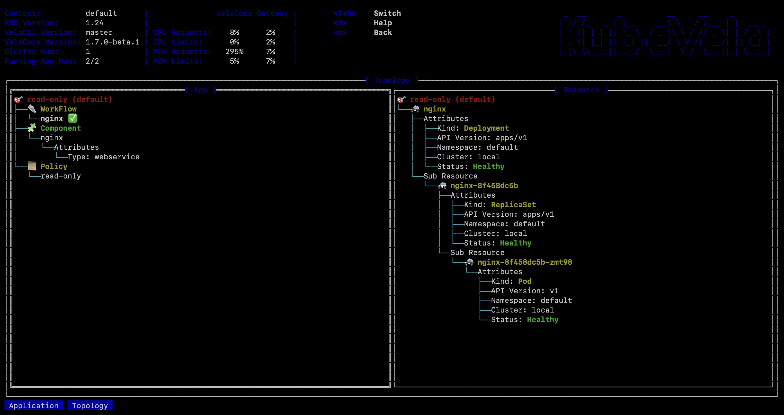
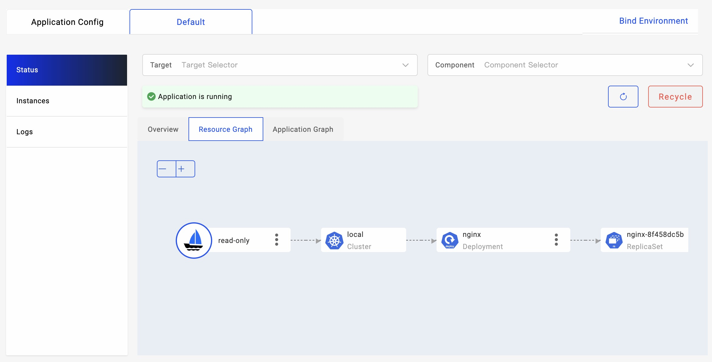

There are times that you might want to use KubeVela application to adopt existing resources or from other sources like Helm release. In this case, you can leverage the capability of resource adoption in KubeVela.

## Use in Application

By default, when KubeVela application tries to dispatch (create or update) one resource, it will first check if this resource belongs to itself. This check is done by comparing the label values of `app.oam.dev/name` & `app.oam.dev/namespace` and see whether they are equal to the application's name & namespace.

If this resource does not belongs to the application itself (belongs to no one or some other application), the application will stop the dispatch operation and report an error. This mechanism is designed to prevent unintended edits to resources managed by other operators or systems.

If the resource is currently managed by other applications, you can refer to [shared-resource](./shared-resource.md) policy and read more about sharing resources across multiple applications.

If the resource is managed by no one, to allow KubeVela application to manage the resource, you can leverage the `read-only` policy or `take-over` policy to enforce resource adoption on these resources.

The `read-only`, `take-over` and `resource-update` policies pick resources with rules and selectors; see [Resource Selectors](./resource-selectors.md) for the fields.

### ReadOnly Policy

With `read-only` policy, you can select resources that could be adopted by the current application. For example, in the below application, Deployment typed resources are treated as read-only resources and are able to be adopted by the given application.

```yaml
apiVersion: core.oam.dev/v1beta1
kind: Application
metadata:
  name: read-only
spec:
  components:
    - name: nginx
      type: webservice
      properties:
        image: nginx
  policies:
    - type: read-only
      name: read-only
      properties:
        rules:
          - selector:
              resourceTypes: ["Deployment"]
```

The component must render an object with the same kind, name and namespace as the existing one; that object is the one adopted. Here the `webservice` component `nginx` renders a Deployment named `nginx` in the Application's namespace, so it adopts the existing `nginx` Deployment.

The `read-only` policy allows application to read the selected resources but will skip all edits to the target resource. Error will be reported if the target resource does not exist.

The target resource will **NOT** be attached with the application's label. It is possible for multiple applications to use the same resource with `read-only` policy concurrently. The deletion of the application will also skip the recycle process of the target resources.

Although the resources selected in the `read-only` policy will not be editable through application, both health check and resource topology graph can work normally. Therefore, you can use KubeVela application with `read-only` policy to build "monitoring group" for underlying resources and leverage tools such as `vela top` or `velaux` to observe them, without any modification.

<details>
<summary>practice</summary>

1. First create the nginx deployment.
```bash
kubectl create deploy nginx --image=nginx
```

2. Deploy the application with `read-only` policy.
```bash
cat <<EOF | vela up -f -
apiVersion: core.oam.dev/v1beta1
kind: Application
metadata:
  name: read-only
spec:
  components:
    - name: nginx
      type: webservice
      properties:
        image: nginx
  policies:
    - type: read-only
      name: read-only
      properties:
        rules:
          - selector:
              resourceTypes: ["Deployment"]
EOF
```

3. Check the running status of the application.
```bash
vela status read-only
```

4. Use `vela top` to see the resource topology of the application.


5. Use `velaux` to see the resource topology graph of the application.


</details>

### TakeOver Policy

In the case you not only want KubeVela application to observe underlying resource but also want the application to be able to edit them, you can use the `take-over` policy in replace of the `read-only` policy.

```yaml
apiVersion: core.oam.dev/v1beta1
kind: Application
metadata:
  name: take-over
spec:
  components:
    - name: nginx-take-over
      type: k8s-objects
      properties:
        objects:
          - apiVersion: apps/v1
            kind: Deployment
            metadata:
              name: nginx
      traits:
        - type: scaler
          properties:
            replicas: 3
  policies:
    - type: take-over
      name: take-over
      properties:
        rules:
          - selector:
              resourceTypes: ["Deployment"]
```

In the above application, the `nginx` deployment will be added with owner labels and marked as belonged to the current app. The attached `scaler` trait in the application will modify the replica number of the target deployment to 3, while keeping all other fields untouched.
 
After the resource is taken over by the application, the application will control the upgrades and deletion of the target resource. Therefore, differ from `read-only` policy, each resource can only be managed by one application with `take-over` policy.

The `take-over` policy is helpful when you want to let the application to take the complete control for the given resources.

<details>
<summary>practice</summary>

1. First create the nginx deployment
```bash
kubectl create deploy nginx --image=nginx
```
2. Deploy the application with `take-over` policy.
```bash
cat <<EOF | vela up -f -
apiVersion: core.oam.dev/v1beta1
kind: Application
metadata:
  name: take-over
spec:
  components:
    - name: nginx-take-over
      type: k8s-objects
      properties:
        objects:
          - apiVersion: apps/v1
            kind: Deployment
            metadata:
              name: nginx
      traits:
        - type: scaler
          properties:
            replicas: 3
  policies:
    - type: take-over
      name: take-over
      properties:
        rules:
          - selector:
              resourceTypes: ["Deployment"]
EOF
```

3. Check the application running status.
```bash
vela status take-over
```
</details>

## Use in CLI

The `read-only` and `take-over` policies adopt resources from inside an Application you write yourself. To build the Application from the existing resources instead, including everything a Helm release installed, use the `vela adopt` command: see [Adopt Resources with vela adopt](./resource-adoption-cli.md).
