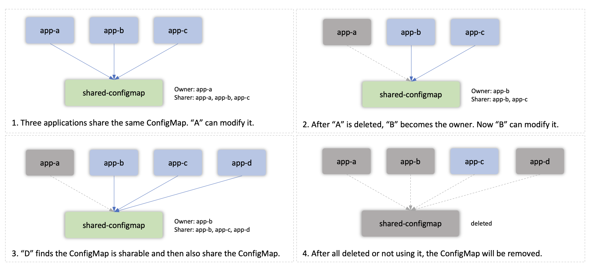
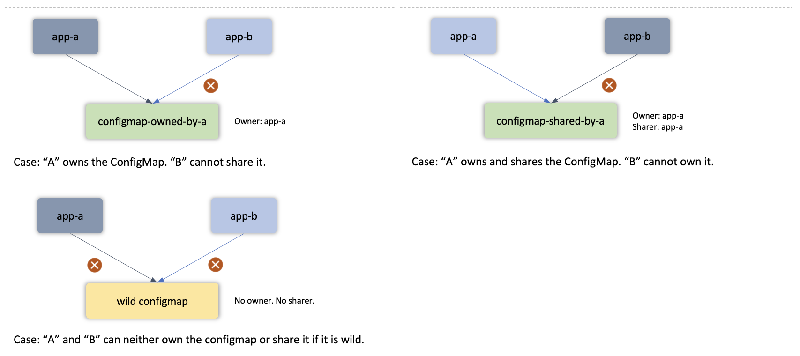

## Background

In KubeVela, by default, application owns resources.
It means that resources an Application creates should only be controlled by the application that creates it.

So there are basically two requirements for application creating resources:

1. The resource must not exist before the application creating it. If it exists already, the Application reports a conflict.
2. The resource is expected to be only manageable through its creator. *Others* should not be able to modify it or edit it.

While dispatching resources, the application will

1. Check if resource exists. If exists, check its owner labels.
If they name this Application, the resource was created by the same Application and the dispatch becomes an update.
2. If resource exists, but no owner label found, then this resource is created before this application. At this time, the application will report a resource conflict error.
3. If resource exists, and the labels point to another application, then this resource is managed by other applications. At this time, the current application will also report a resource conflict error.
With these checks, different applications cannot manage the same resource.

A resource an Application owns carries two sets of owner labels:

| Labels | Example | Read |
| --- | --- | --- |
| `owner.oam.dev/kind`, `owner.oam.dev/namespace`, `owner.oam.dev/name` | `Application`, `default`, `app1` | First. These decide who owns the resource. |
| `app.oam.dev/name`, `app.oam.dev/namespace` | `app1`, `default` | Only when the resource has no `owner.oam.dev/*` labels, as on resources written by older releases. |

To hand a resource to another Application by hand, change the `owner.oam.dev/*` labels; changing only `app.oam.dev/*` has no effect while the `owner.oam.dev/*` labels are there. When ownership of a shared resource passes to the next sharer, KubeVela replaces both sets for you.

## Usage

However, there are scenarios that these two requirements are not met. One of the scenarios is sharing across different Applications.

For example, each application wants to create a ConfigMap, but their ConfigMaps are the same.

To achieve that, KubeVela application could utilize the `shared-resource` policy to make it possible.

### create
When one resource is created as sharing resource, one special annotation `app.oam.dev/shared-by` will be added to the resource.
It will record the **sharer** of the resource in time order. The application that firstly creates the resource will set its owner labels to itself.

Then it will add itself to the sharer annotation.

### share
When another application comes and wants to share the resource, it will check if the resource is sharable, aka there is at least one sharer in the sharer annotation.

If it is sharable, it will add itself to the sharer annotation, but not modify the content of the resource.

### delete
With this mechanism, only the owner of the resource can modify the resource (including updating and state-keeping). Other sharer can only see that resource.

When the owner of the resource is gone (application is deleted or do not use this resource anymore), ownership passes to the next sharer. If no sharer exists, it will finally delete that resource.

See the following figures for details.





## Example

```yaml
apiVersion: core.oam.dev/v1beta1
kind: Application
metadata:
  name: app1
spec:
  components:
    - name: ns1
      type: k8s-objects
      properties:
        objects:
          - apiVersion: v1
            kind: Namespace
            metadata:
              name: example
    - name: cm1
      type: k8s-objects
      properties:
        objects:
          - apiVersion: v1
            kind: ConfigMap
            metadata:
              name: cm1
              namespace: example
            data:
              key: value1
  policies:
    - name: shared-resource
      type: shared-resource
      properties:
        rules:
          - selector:
              resourceTypes: ["Namespace"]
```

```yaml
apiVersion: core.oam.dev/v1beta1
kind: Application
metadata:
  name: app2
spec:
  components:
    - name: ns2
      type: k8s-objects
      properties:
        objects:
          - apiVersion: v1
            kind: Namespace
            metadata:
              name: example
    - name: cm2
      type: k8s-objects
      properties:
        objects:
          - apiVersion: v1
            kind: ConfigMap
            metadata:
              name: cm2
              namespace: example
            data:
              key: value2
  policies:
    - name: shared-resource
      type: shared-resource
      properties:
        rules:
          - selector:
              resourceTypes: ["Namespace"]
```

Each rule's `selector` picks the resources to share; see [Resource selectors](./resource-selectors.md) for its fields.

The above two applications will dispatch the same namespace "example". They will create two different ConfigMap inside namespace "example" respectively.

Both application use the shared-resource policy and declared the namespace resource as shared. In this way, there will be no conflict for creating the same namespace. If the shared-resource policy is not used, the second application will report error after it finds that the namespace "example" is managed by the first application.

Once both Applications have applied, the Namespace records both sharers:

```bash
$ kubectl get ns example -o jsonpath='{.metadata.annotations.app\.oam\.dev/shared-by}'
default/app1,default/app2
```

The namespace will only be recycled when both applications are removed.

:::caution
When the last sharer is deleted, KubeVela deletes the Namespace and everything in it, including anything created by hand. Share a Namespace only if its contents belong to the sharing Applications; see [Garbage collection](./gc.md) to keep it.
:::

## Notice

1. When multiple applications share the same resource, the first one who creates it can make updates to its content. The others cannot modify it. Once the first application does not use it anymore (for example, the first application is deleted), then the second one will become the owner, which means it is now able to modify the content. **This will not take effect immediately.** But when StateKeep happens, or application re-runs its workflow (for example, it is updated), it will set the resource content to be its desired state.

2. Sharing a resource does not make anything outside KubeVela aware of the sharers. A shared Namespace is still deleted, with its contents, once the last sharer is gone (see the caution under the example).
