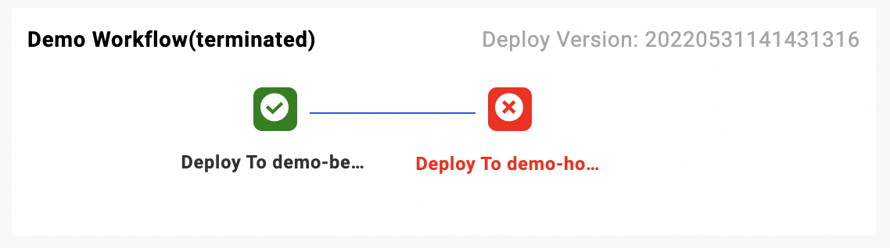

Without a workflow, KubeVela applies every component at once, apart from the order that dependencies set: `dependsOn`, `inputs` and `$(component.<name>)` reads each hold a component back until what it waits on is ready. An Application's workflow lets you choose the order, wait for approval, branch on conditions and pass data from one step to the next.

The workflow engine is [KubeVela Workflow](/workflow/next/overview), which vela-core embeds. Its docs cover how steps behave, and they behave the same in an Application and in a WorkflowRun: suspend and resume, ordering, `forEach`, data passing, `if` conditions and timeouts, with a first workflow to try. This page covers what is particular to an Application. Each KubeVela release embeds one Workflow version:

| KubeVela | Workflow |
| :--- | :--- |
| 1.12 | [0.8](/workflow/next/overview) |
| 1.11 | [0.7](/workflow/overview) |
| 1.10, 1.9 | [0.6](/workflow/0.6/overview) |

A workflow is a list of steps. Each step has a type: one of the [built-in step types](./built-in-workflow-defs.md) (`deploy`, `suspend`, `notification`, `step-group` and more), or a type your platform team has added.

:::note
The `webhook` step and the HTTP channels of the `notification` step (DingTalk, Lark, Slack) block cloud metadata and link-local destinations by default. See [Workflow Outbound HTTP Protection](../../platform-engineers/system-operation/workflow-http-protection.md).
:::

## The default workflow

If you declare no workflow, KubeVela generates one when it runs the Application:

- With `topology` policies, it adds one `deploy` step per topology policy, named `deploy-<policy name>`, which also applies any `override` policies.
- With `override` policies or a `ref-objects` component but no `topology` policy, it adds a single `deploy` step.
- Otherwise, it adds one `apply-component` step per component, named after the component. A component's `dependsOn` carries over to its step.

`vela status` lists the generated steps in its `Workflow` section, the same as steps you write yourself.

## State of Application and Workflow

An Application's phase is in `status.status`, and its workflow's phase in `status.workflow.status`. From the moment the workflow starts, the two move together:

| Application | Workflow | Description |
| :--- | :--- | :--- |
| `starting` | | KubeVela has picked up the Application and is preparing to reconcile it. |
| `rendering` | | KubeVela is rendering the components and traits. |
| `generatingPolicy` | | KubeVela is generating the Application's policies. |
| `runningWorkflow` | `executing` | The workflow is running. |
| `workflowSuspending` | `suspending` | The workflow is suspended, by a `suspend` step or by `vela workflow suspend`. |
| `workflowTerminated` | `terminated` | The workflow was terminated. |
| `workflowFailed` | `failed` | A step failed and the workflow has finished. |
| `running` | `succeeded` | Every step succeeded and every component is healthy. |
| `unhealthy` | `succeeded` | Every step succeeded, but at least one component is not healthy. |
| `deleting` | | The Application is being deleted. |

VelaUX shows each step's state; here the first step succeeded and the second failed:

## What you can do with a workflow

| I want to... | Page |
| :--- | :--- |
| Write a first workflow | [Workflow overview](/workflow/next/overview#a-first-workflow) |
| Wait for approval before carrying on | [Suspend and Resume](/workflow/next/steps/suspend) |
| Run steps in parallel, in a set order, or in groups | [Order Steps](/workflow/next/steps/order-steps) |
| Repeat steps over a list | [Repeating Steps with forEach](/workflow/next/steps/for-each) |
| Run a step only when an earlier one failed, or skip it | [If Conditions](/workflow/next/steps/if-condition) |
| Pass a value from one step to the next | [Data Passing](/workflow/next/steps/inputs-outputs) |
| Order components, and pass data between them | [Order Components and Pass Data Between Them](./component-dependency-parameter.md) |
| Stop a step that hangs | [Timeout of Step](/workflow/next/steps/timeout) |
| Suspend, resume, terminate, restart or roll back a running workflow | [Workflow Operations](./operations.md) |
| Find out why a step failed | [Debug Workflow](../../platform-engineers/debug/debug.md) |

## Next steps

- [Built-in step types](./built-in-workflow-defs.md): every step type an Application can use, and its parameters.
- [Custom workflow steps](/workflow/next/authoring/step-definition): for platform engineers adding step types of their own.
