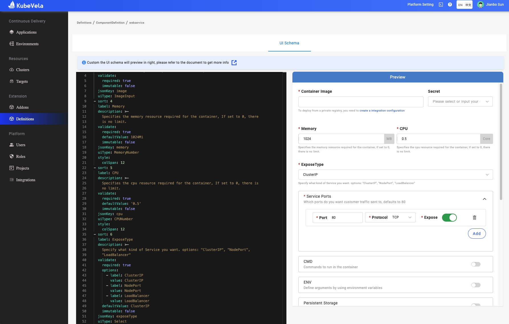

import DefinitionCapabilities from '@site/src/components/DefinitionCapabilities';

A definition is a reusable building block. It declares the parameters developers fill in and the Kubernetes resources KubeVela creates from them. The built-in `webservice` component type is one; your platform team can write more.

<DefinitionCapabilities />

The picture above is an example of `helm` definition, we can use [FluxCD](https://fluxcd.io/) or [ArgoCD](https://argo-cd.readthedocs.io/) as Helm capability provider. Once the platform builder registered the definition written by [CUE](https://cuelang.org/), the end user can discover the helm capability and define application by referring to the type.

There are five kinds: `ComponentDefinition`, `TraitDefinition`, `PolicyDefinition`, `WorkflowStepDefinition` and `SourceDefinition`. As an end user, you can get out-of-box definitions from KubeVela community.

## How to get out-of-box Definitions?

There're two sources to get out-of-box definitions:

* Built-in definitions will be installed along with KubeVela helm chart. You can refer to the following links to learn more about built-in definitions.
    - [Component Definition](../end-user/components/references.md)
    - [Trait Definition](../end-user/traits/references.md)
    - [Policy Definition](../end-user/policies/references.md)
    - [Workflow Step Definition](../end-user/workflow/built-in-workflow-defs.md)
* Install [Addons](/addons/overview), they're scenario-oriented system extensions of KubeVela, each addon contains a bunch of definitions along its CRD controllers.
    - The community has a [verified addon registry](https://github.com/kubevela/catalog) which contains a large catalog of addons, the registry is maintained by the KubeVela team.

## Lifecycle of a Definition

A definition's lifecycle usually has 3 stages:

### Discovery

When definitions installed in the system, they can be discovered by end user immediately.

* Check the definition list

```
vela def list
```

<details>
<summary>expected output</summary>

```
NAME        	TYPE                  	NAMESPACE  	DESCRIPTION
webservice  	ComponentDefinition   	vela-system	Describes long-running, scalable, containerized services
            	                      	           	that have a stable network endpoint to receive external
            	                      	           	network traffic from customers.
gateway     	TraitDefinition       	vela-system	Enable public web traffic for the component, the ingress API
            	                      	           	matches K8s v1.20+.
topology    	PolicyDefinition      	vela-system	Describe the destination where components should be deployed
            	                      	           	to.
notification	WorkflowStepDefinition	vela-system	Send notifications to Email, DingTalk, Slack, Lark or
            	                      	           	webhook in your workflow.
...snip...
```
</details>

* Show property details of one definition

```
vela show webservice
```

<details>
<summary>expected output</summary>

```
# Specification
+------------------+-------------------------------------------------------------------------------------------+---------------------------------------+----------+---------+-----------+
|       NAME       |                                        DESCRIPTION                                        |                 TYPE                  | REQUIRED | DEFAULT | IMMUTABLE |
+------------------+-------------------------------------------------------------------------------------------+---------------------------------------+----------+---------+-----------+
| labels           | Specify the labels in the workload.                                                       | map[string]string                     | false    |         |           |
| annotations      | Specify the annotations in the workload.                                                  | map[string]string                     | false    |         |           |
| image            | Which image would you like to use for your service.                                       | string                                | true     |         |           |
| imagePullPolicy  | Specify image pull policy for your service.                                               | "Always" or "Never" or "IfNotPresent" | false    |         |           |
| imagePullSecrets | Specify image pull secrets for your service.                                              | []string                              | false    |         |           |
| ports            | Which ports do you want customer traffic sent to, defaults to 80.                         | [[]ports](#ports)                     | false    |         |           |
| cmd              | Commands to run in the container.                                                         | []string                              | false    |         |           |
| args             | Arguments to the entrypoint.                                                              | []string                              | false    |         |           |
| env              | Define arguments by using environment variables.                                          | [[]env](#env)                         | false    |         |           |
| cpu              | Number of CPU units for the service, like `0.5` (0.5 CPU core), `1` (1 CPU core).         | string                                | false    |         |           |
| memory           | Specifies the attributes of the memory resource required for the container.               | string                                | false    |         |           |
| limit            |                                                                                           | [limit](#limit)                       | false    |         |           |
| volumeMounts     |                                                                                           | [volumeMounts](#volumemounts)         | false    |         |           |
| volumes          | Deprecated field, use volumeMounts instead.                                               | [[]volumes](#volumes)                 | false    |         |           |
| livenessProbe    | Instructions for assessing whether the container is alive.                                | [livenessProbe](#livenessprobe)       | false    |         |           |
| readinessProbe   | Instructions for assessing whether the container is in a suitable state to serve traffic. | [readinessProbe](#readinessprobe)     | false    |         |           |
| hostAliases      | Specify the hostAliases to add.                                                           | [[]hostAliases](#hostaliases)         | false    |         |           |
+------------------+-------------------------------------------------------------------------------------------+---------------------------------------+----------+---------+-----------+
...snip...
```
</details>

You can also view the details from documentation website, the following command will launch a server and invoke your browser automatically:

```
vela show webservice --web
```

* Discover in UI console ([`velaux`](/velaux/install))

Once installed, these definitions can be discovered and generated with forms by the UI console automatically. More than that, you can even customize the layout by defining the [ui schema](/velaux/extend/ui-schema) like below.




### Use

Using definition on UI console is very straight forward, just click along with the application creation process.

1. Create Application and choose Component type which is actually choosing which component definition to use.
2. Fill the properties of component is actually fill the parameter of component definition.
3. The same step for trait, policy and workflow.

Finally, the UI console will compose the whole deployment plan in the format of OAM like below, then KubeVela controller will take care of the rest things:

```
apiVersion: core.oam.dev/v1beta1
kind: Application
metadata:
  name: first-vela-app
spec:
  components:
    - name: express-server
      type: webservice
      properties:
        image: oamdev/hello-world
        ports:
         - port: 8000
           expose: true
      traits:
        - type: scaler
          properties:
            replicas: 1
  policies:
    - name: target-default
      type: topology
      properties:
        clusters: ["local"]
        namespace: "default"
    - name: target-prod
      type: topology
      properties:
        clusters: ["local"]
        namespace: "prod"
    - name: deploy-ha
      type: override
      properties:
        components:
          - type: webservice
            traits:
              - type: scaler
                properties:
                  replicas: 2
  workflow:
    steps:
      - name: deploy2default
        type: deploy
        properties:
          policies: ["target-default"]
      - name: manual-approval
        type: suspend
      - name: deploy2prod
        type: deploy
        properties:
          policies: ["target-prod", "deploy-ha"]
```

On the command line it works the same way: save the Application above as `first-app.yaml`, create the `prod` namespace its `target-prod` policy deploys to, and apply it with `vela up`:

```
kubectl create namespace prod
vela up -f first-app.yaml
```

Application is also one kind of Kubernetes CRD, you can also use `kubectl apply` or invoke Kubernetes API to integrate with vela application.

### Customize

:::caution
In most cases, you don't need to customize any definitions **unless you're going to extend the capability of KubeVela**. Before that, you should check the built-in definitions and addons to confirm if they can fit your needs.
:::

A new definition is built in a declarative template in [CUE configuration language](https://cuelang.org/). If you're not familiar with CUE, you can refer to [CUE Basic](../platform-engineers/cue/basic.md) for some knowledge. 

A definition declares its inputs (`parameter`) and the resources it creates (`output`). To write one, follow [Component Definition](../platform-engineers/components/custom-component.md).
You can refer to detail docs about [how to manage definition](../platform-engineers/cue/definition-edit.md) or learn the [definition protocol](../platform-engineers/oam/x-definition.md).

