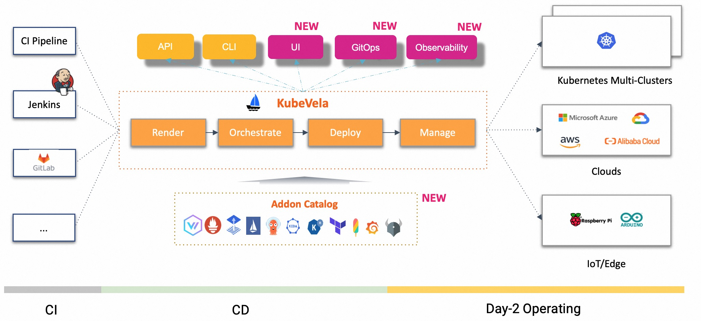

## What is KubeVela?

KubeVela is an application delivery platform that runs on Kubernetes. Your platform team defines the building blocks (a web service, a database, a canary rollout); developers describe their app with those blocks in one YAML file, and KubeVela deploys it, to one cluster or many, and keeps it that way.

```yaml
apiVersion: core.oam.dev/v1beta1
kind: Application
metadata:
  name: hello-world
spec:
  components:
    - name: hello-world
      type: webservice
      properties:
        image: oamdev/hello-world
        ports:
          - port: 8000
            expose: true
      traits:
        - type: scaler
          properties:
            replicas: 2
```

That's an Application: KubeVela turns it into a Deployment and a Service, runs the delivery workflow and reports health back.



## Why KubeVela?

* The modern application should be able to deploy across hybrid environments including Kubernetes, cloud, or even IoT devices in a simple and robust way.
* The app delivery control plane should be able to adapt to any existing infrastructure or extend with modular and reusable building blocks per users’ needs.
* The developers should have an application platform that is vendor agnostic, consistent experience, and has a large number of reusable building blocks and best practices.


## Key Features

* **Applications as code**: describe an app, its components, traits, policies and delivery workflow, in one Application file. See [Core Concepts](./getting-started/core-concept).
* **Your own building blocks**: component types, traits, policies and workflow steps are definitions your platform team writes and shares. See [Definitions](./getting-started/definition).
* **Multi-cluster and multi-environment delivery**: deploy the same Application to many clusters and environments, with per-target overrides. See [Multi-cluster Application Delivery](../end-user/policies/multi-cluster.md).
* **Workflows with approvals and checks**: order the delivery in steps, with manual approvals, conditions and notifications. See [Workflow](./end-user/workflow/overview).

The default install is the controller and the cluster gateway; see [Performance tuning](./platform-engineers/system-operation/performance-finetuning) for sizing.


## KubeVela vs. Other Software

### KubeVela vs. CI/CD (GitHub Actions, GitLab, CircleCI, Jenkins, etc.)

KubeVela is a continuous delivery platform that works at downstream of your CI process. So you will reuse the CI process you already adopted, and KubeVela will take over CD process by empowering it with modern application delivery best practices, such as declarative deployment plan as workflow, hybrid/multi-cloud resource provision/binding, security and compliance, and much more. It natively supports GitOps if you want.

> Feel free to check the [Integrating with Jenkins](../how-to/dashboard/trigger/overview.md#example-jenkins) or [GitOps](../case-studies/gitops.md) documentation for more details.

### KubeVela vs. GitOps (ArgoCD, FluxCD, etc.)

KubeVela adopts your GitOps process and improves it by adding multi-cluster/hybrid-cloud capabilities:

* KubeVela has a user-friendly workflow that allows you to extend, re-program or share any of your delivery process, including security and compliance flows. 
* KubeVela regards multi-cloud/hybrid-environments app delivery as first-class citizen, it provides rich deployment strategies across clusters and clouds with fully managed cloud environments provision.

### KubeVela vs. PaaS (Heroku, Cloud Foundry, etc.)

KubeVela shares the same goal with the traditional PaaS to provide full application deployment and management capabilities and aim to improve developer experience and efficiency.

Though the biggest difference lies in **flexibility**.

KubeVela is fully programmable, all of its deployment workflow and component feature set are LEGO-style CUE modules and can be extended or removed in-place when your needs change. As a CD control plane, KubeVela allow you to take full control over your infrastructure and tooling.

### KubeVela vs. Helm 

Helm is a package manager for Kubernetes that provides package, install, and upgrade a set of YAML files for Kubernetes as a unit. 

KubeVela as a modern software delivery control plane can naturally deploy Helm charts. For example, you could use KubeVela to define an application that is composed by a WordPress chart and a AWS RDS Terraform module, orchestrate the components' topology, and then deploy them to multiple environments following certain strategy.

Of course, KubeVela also supports other encapsulation formats including Kustomize etc.


### KubeVela vs. Kubernetes

KubeVela is a modern application delivery system built with cloud native stack. It leverages [Open Application Model](https://github.com/oam-dev/spec) and Kubernetes as control plane to resolve a hard problem - making shipping applications enjoyable.


## Development Status

KubeVela is being actively developed by the community, our releases can be found [here](https://github.com/kubevela/kubevela/releases).

## Adoption

Organizations who have officially adopted KubeVela can be found [here](https://github.com/kubevela/community/blob/main/ADOPTERS.md).

## What's Next

- [Install KubeVela](./install), then [deploy your first application](./quick-start).
- Learn [Core Concepts](./getting-started/core-concept) to know more about how it works.