This page walks through an application's life in VelaUX, as the `velaux` addon ships it (VelaUX 1.9.5): create it, add components and traits, bind environments, deploy, check how it's running, roll it back, and clean it up.

## Create the application

Open **Applications** under **Continuous Delivery** and click **New Application**. The drawer has two steps.

The first step sets who owns the application and where it deploys:

| Field | What it sets |
| --- | --- |
| Name | The application's name: lower-case letters, digits and hyphens, starting with a letter. |
| Alias, Description | A display name and a note, shown in VelaUX only. |
| Project | The project that owns the application. |
| Main Component Type | The type of the application's first component, such as `webservice` for a container service or `helm` for a chart. If the type you want isn't listed, **Go to enable addon** opens the Addons page. |
| Bind Environments | One or more environments to deploy to. **New Environment** creates one without leaving the drawer. |

Click **Next Step**. VelaUX builds a form from the component type, so a `webservice` asks for an image and ports, and a `helm` component asks for a chart. Below is the form for `webservice`.

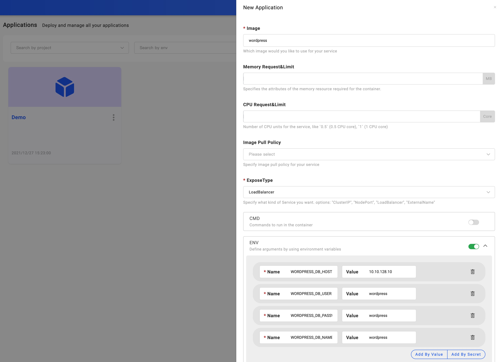

Click **Create**. VelaUX saves the application with that one component, named after the application, and opens its **Application Config** page. Nothing is deployed yet.

## Add components and traits

An application can run any number of components; the main component is only the first. On the **Application Config** page, the **Properties** tab lists them under **Components**.

- **New Component** adds another. Pick its **Type**, give it a **Name** (and optionally an alias and description), and set **Depends On** if it must wait for another component. Then fill in its properties.
- **Add a trait**, on a component's card, attaches a trait to it, for example `gateway` to give it a domain. Click a trait to edit it.

The same tab holds **Policies** (**New Policy**), which set where the application deploys and what it overrides there, and **Triggers** (**New Trigger**), webhooks that start a workflow from outside VelaUX, such as a CI job.

## Bind environments

The environments an application is bound to sit beside **Application Config** at the top of its page, one tab each. To deploy somewhere new, click the **+** after the last environment, pick an environment (or create one with **New Environment**) and click **Submit**.

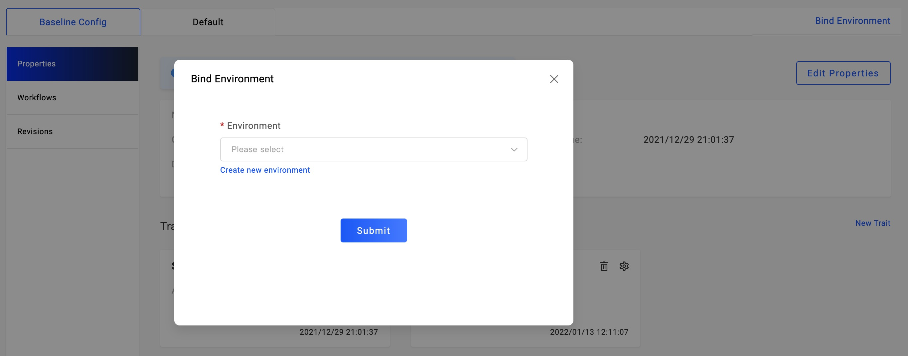

VelaUX creates a workflow for each environment you bind, so the application is ready to deploy there straight away.

## Deploy the application {#deploy-application}

Open an environment's tab. If the application hasn't been deployed there yet, the page says so and shows a **Deploy** button.

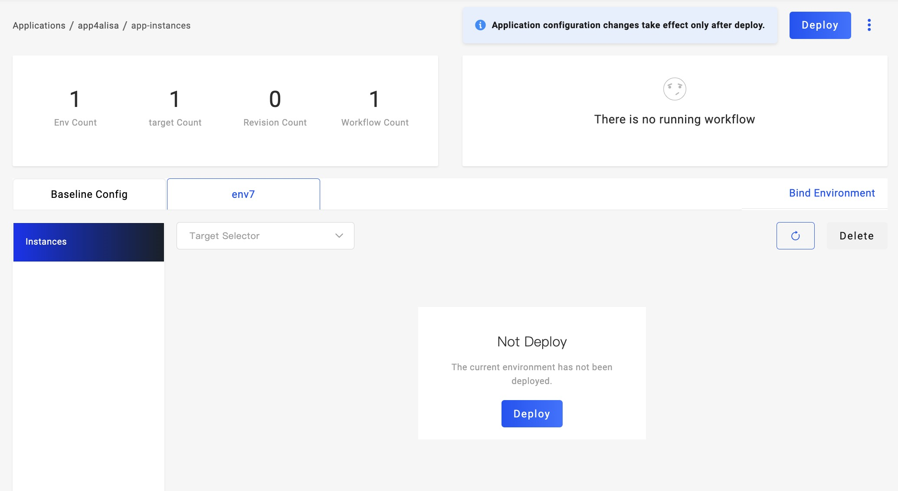

The **Deploy** button at the top right of the application's page works from anywhere. It opens **Select Workflow**: pick the **Environment** and, where it has more than one, the workflow to run, then click **Deploy**. **DryRun** shows what would be applied without applying it.

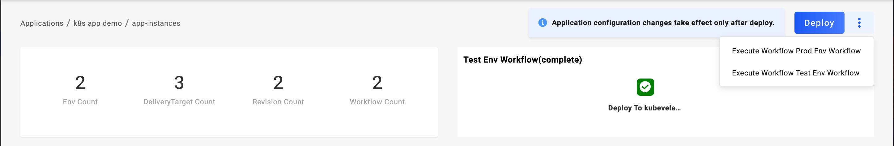

VelaUX opens the environment's **Workflow** tab on the new run. Each step shows its status; click a step for its detail, properties, inputs and outputs. A step that fails turns red, and its message says why.

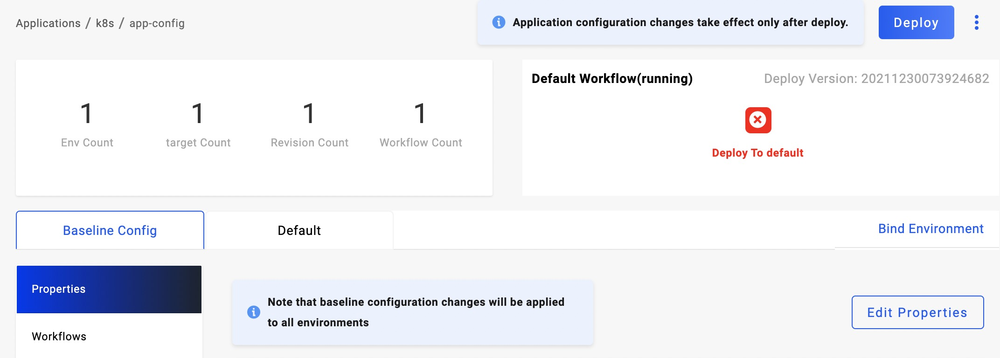

When the workflow reaches a `suspend` step, it stops there and the run says it needs your approval. Check the application, then click:

- **Continue** to approve the step and carry on.
- **Terminate** to stop the run.
- **Rollback** to go back to the last revision that was ready.

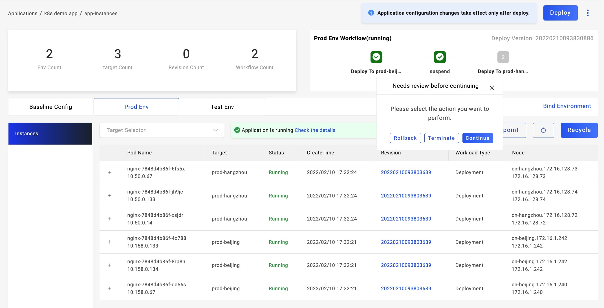

You can deploy again at any time, whatever state the application is in. If a workflow is still running, VelaUX asks whether to force a restart.

## Edit a workflow

Each environment has its own workflow. The **Workflows** tab of **Application Config** lists them with their environment, mode and step count. To change one, click its name, or click **Launch Workflow Studio** on the environment's **Workflow** tab.

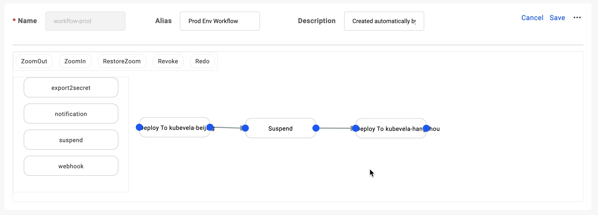

In the studio:

1. Click the **+** on the line where the new step should go, pick the step type (for example `notification`), and give it a name.
2. Fill in the step's properties in the form that opens. Click any step later to change it.
3. Set **Mode** to **StepByStep** to run the steps in order, or **DAG** to run them as their dependencies allow.
4. Click **Save**.

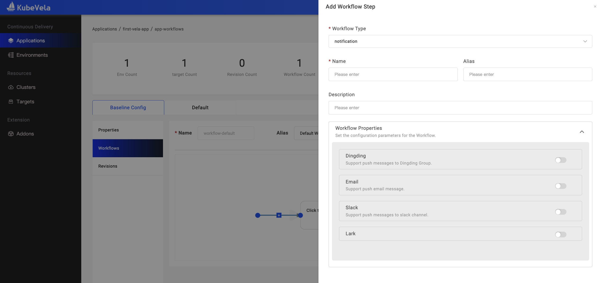

Deploy the application to run the changed workflow.

## Check the application in an environment

An environment's tab has four views:

| View | Shows |
| --- | --- |
| Workflow | The workflow runs in this environment. Pick an older run from the list. |
| Status | **Overview**: each component's health, cluster and traits, the **Applied Resources**, and the application's **Conditions**. **Resource Graph** and **Application Graph** draw the same resources and how they relate. |
| Instances | The pods, with their target, component, status, revision and node. Filter by target or component at the top. Expand a pod for its containers and events, and a container's log. Cloud resources show instead, with a **Console** link to the cloud provider. |
| Logs | A container's logs. See [View application logs](#view-application-logs). |

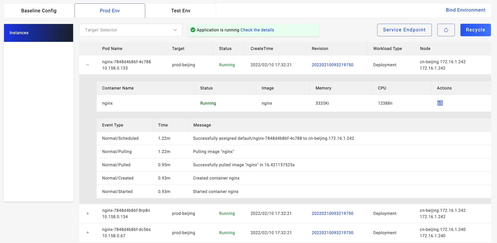

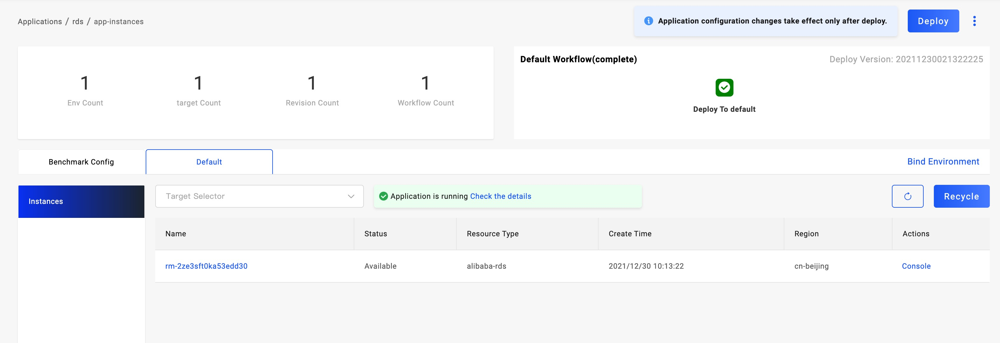

From the command line, `vela status <app_name> -n <namespace> --tree` lists the same resources.

### View application logs {#view-application-logs}

Open the **Logs** view and pick the **Component**, **Pod** and **Container**. The logs refresh every 5 seconds while **Auto-refresh** is ticked. Tick **Show timestamps** if your logs don't carry their own, and the menu beside it has **Show previous logs** for a container that restarted. The download button saves what's shown.

From the command line:

```bash
vela logs <app_name> -n <namespace>
```

### Get the service endpoint

When a component exposes a service, the **Service Endpoint** button appears at the top of the **Status** and **Instances** views. Hover over it for the addresses.

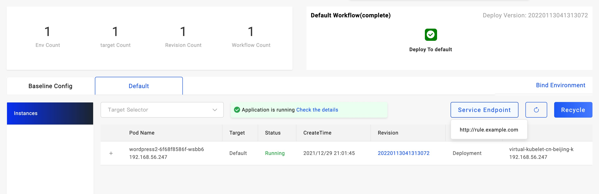

There are two common ways to expose a component:

- On a `webservice` component, set **ExposeType** to `LoadBalancer` or `NodePort`, and turn on **Expose** for the ports to publish.

  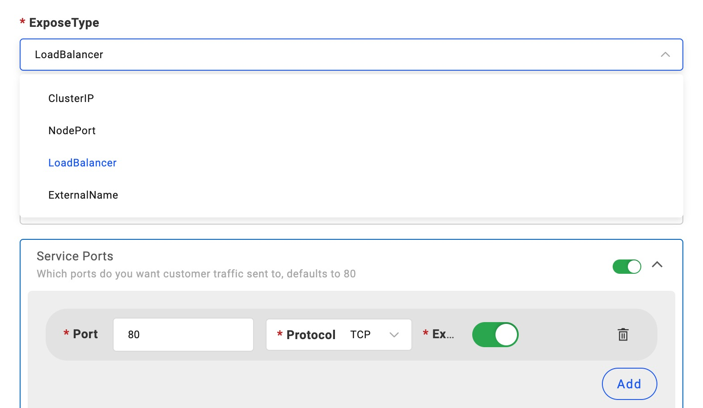

- Add a `gateway` trait with a **Domain** and the routes under **Http** (for example `/` to port `80`). It works on `webservice`, `worker` and `task` components, for HTTP and HTTPS, and needs an ingress controller in the cluster. Point your DNS for the domain at the cluster's gateway.

  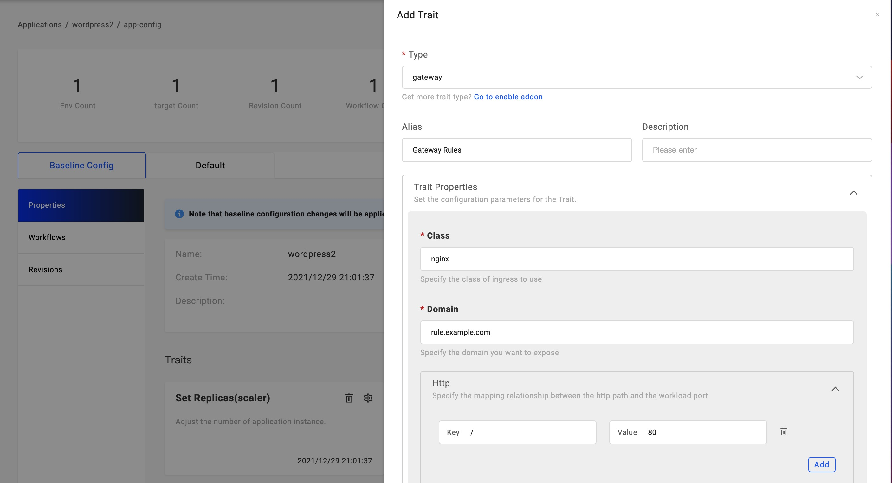

Other component types expose services their own way; a Helm chart, for example, does it through its values.

## Roll back to a revision

Every deploy records a revision. The **Revisions** tab of **Application Config** lists them with their deploy user, status, trigger type, publish time and environment. Filter by environment or status at the top.

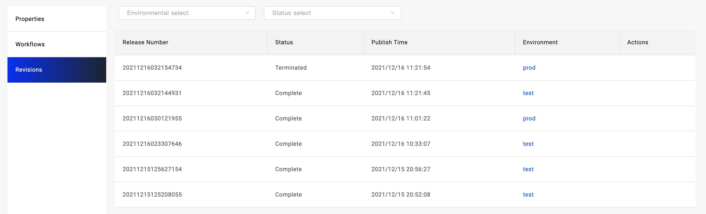

For each revision:

- **Detail** shows the configuration it deployed.
- **Diff** compares it with the application deployed in the cluster, or with the latest configuration in VelaUX.
- **Rollback** deploys that revision's configuration to its environment again, and opens the workflow run so you can follow it. Rolling back to a revision that was terminated asks you to confirm first.

When VelaUX is wired to a CI system through a trigger, a revision also shows the commit it came from.

## Recycle an environment

Recycle deletes every resource the application created in that environment. Back up any data you need first; it can't be undone.

To recycle, open the environment's **Status** or **Instances** view, click **Recycle** and confirm. The environment stays bound, so you can deploy there again later. Once it isn't deployed, a **Delete** button in the same place removes the binding.

## Remove the application

VelaUX refuses to remove an application that is still deployed anywhere, so recycle every environment first. Then open **Application Config**, click **Remove** beside **Edit**, and confirm.

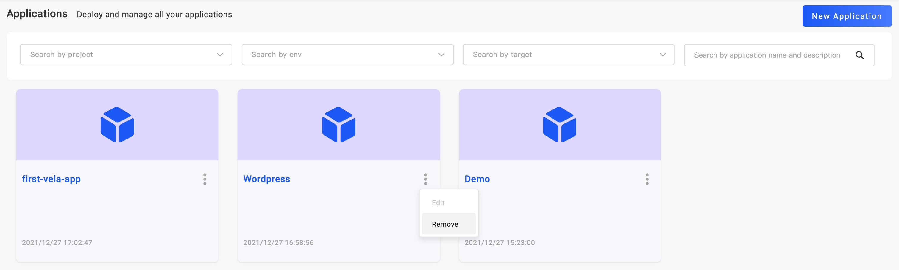
