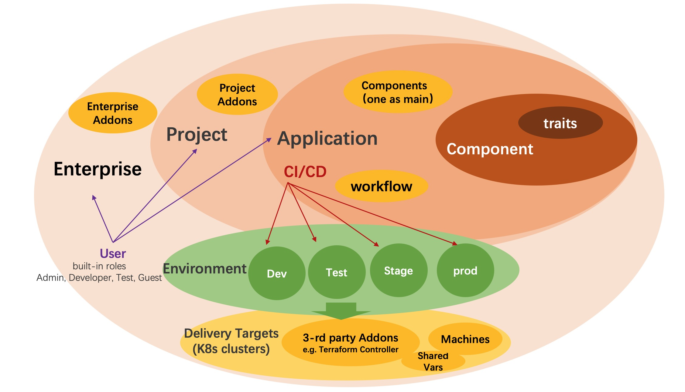

VelaUX is the UI console for KubeVela, and a ready-made platform for the people who ship applications on it. On top of KubeVela's own model it adds a few concepts for working as a team: projects, environments and delivery targets, and a lifecycle for applications.

## Project

A project is where a team manages its applications and works together. Each project is its own scope, kept apart from other projects.

## Environment

An environment is a stage such as development, testing or production, and can hold several delivery targets. Only applications in the same environment can reach and share resources with each other.

You can bind an application to several environments, and set different parameters for each one.

## Delivery target

A delivery target is where an application's resources are actually delivered: one Kubernetes cluster and namespace. For cloud providers it can also describe a region or VPC, with its shared variables and machine resources.

Within one target, the credentials of any cloud resources created are delivered to the Kubernetes cluster for you.

## Application

An application in VelaUX has a lifecycle on top of the KubeVela Application:

- **Create** records the application's metadata. Nothing runs in a cluster yet.
- **Deploy** binds the application to an environment and creates its resources in the environment's clusters.
- **Recycle** deletes the running instance and removes its resources from the clusters.
- **Delete** removes the application's metadata.

Everything else about a VelaUX application works as it does in KubeVela.
