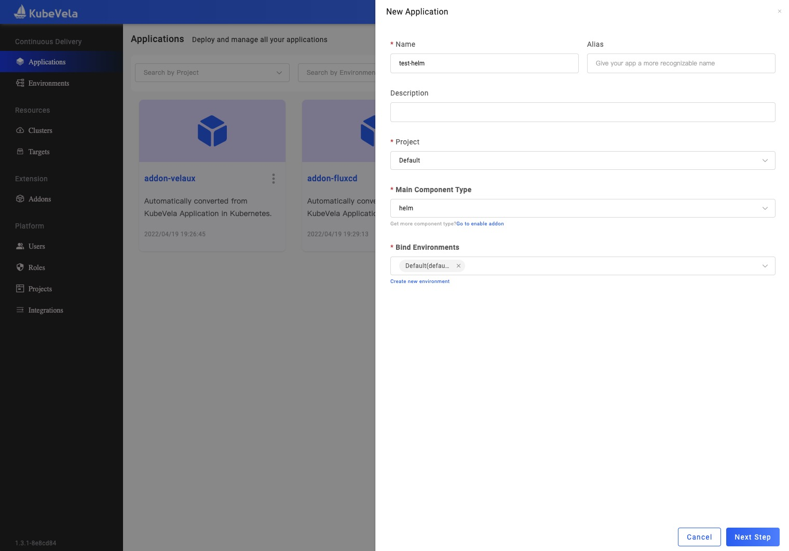
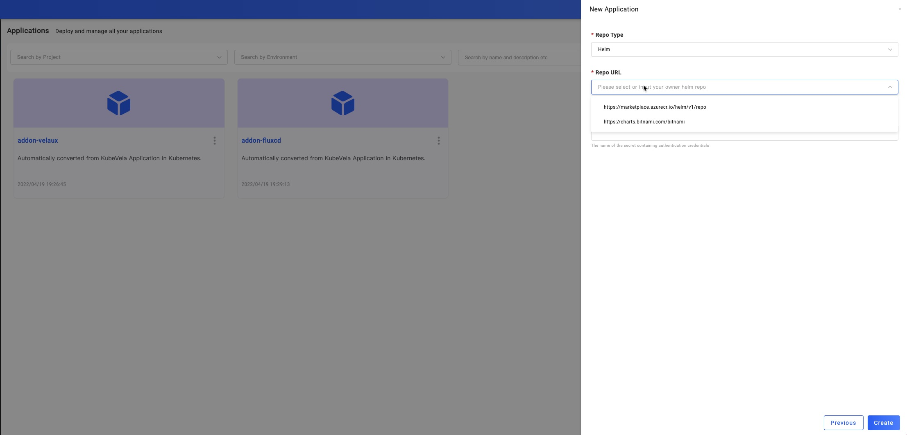

In this guide, we will introduce how to use Config to connect a private helm repository and create an application with Helm type to use this repository.

:::info
You must enable the [fluxcd](/addons/fluxcd) addon first.
:::

Check that the [config template](../../../reference/config-template.md) exists:

```bash
vela config-template list | grep helm-repository
```

## Create a Helm Repository config

Create the config in **Admin Dashboard > Global Configs** to share it with every project, or in the **Configs** panel of a project's **Summary** page for that project only.

You can set the URL of your private repository in the `URL` field. If your repository has set up the HTTP basic authentication, you can set the `Username` and `Password` for it.

For a self-signed certificate, paste the CA into **CaFile**.


You can also create the config with the CLI. It creates a `Config` resource, and the config controller renders its Secret (see [Config Template](../../../reference/config-template.md)):

```bash
vela config create <Config Name> -t helm-repository url=<Repo URL> username=<Username> password=<password>
```
:::caution
With VelaUX 1.9.5 on KubeVela 1.12, edit configs made by the CLI with `vela config create` or `kubectl`, not in VelaUX: VelaUX accepts the edit and shows the new values, but the Config and its Secret stay as they were. Configs you create in VelaUX are stored the legacy way, as a Secret, until you run [`vela config-template migrate`](../../../upgrade-guides/v1.12/config-migration.md).
:::


List all Helm Repositories:

```bash
vela config list -t helm-repository
```

## Distribute the config

A config's Secret lives in one namespace of the hub cluster. A Helm application creates a `HelmRepository` that reads that Secret, so the Secret must exist in the namespace and cluster of every target the application deploys to. Distributing the config copies it there.

Let's go to the project summary page for which you want to create the Application.


Click the `Distribute` button and select the targets that you want to distribute the config.

Also, you could distribute the config via CLI:

```bash
vela config distribute <Config Name> --target <cluster/namespace>
```

## Create an application with this repository

You can follow the [application creation guide](/velaux/guides/applications/operations) to create a helm type application in project `default`. eg:



Then you can choose the helm repo url configured before like this image, and use the available charts in this repo.

