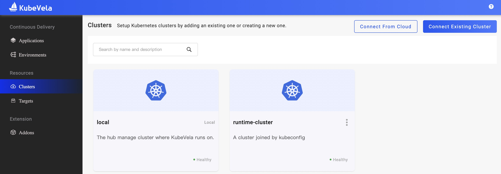
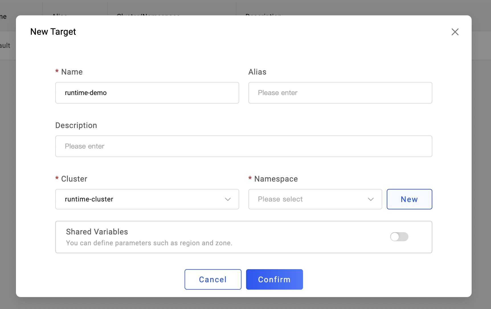
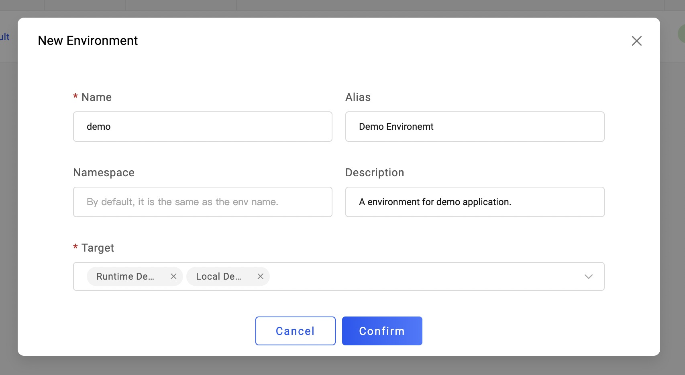
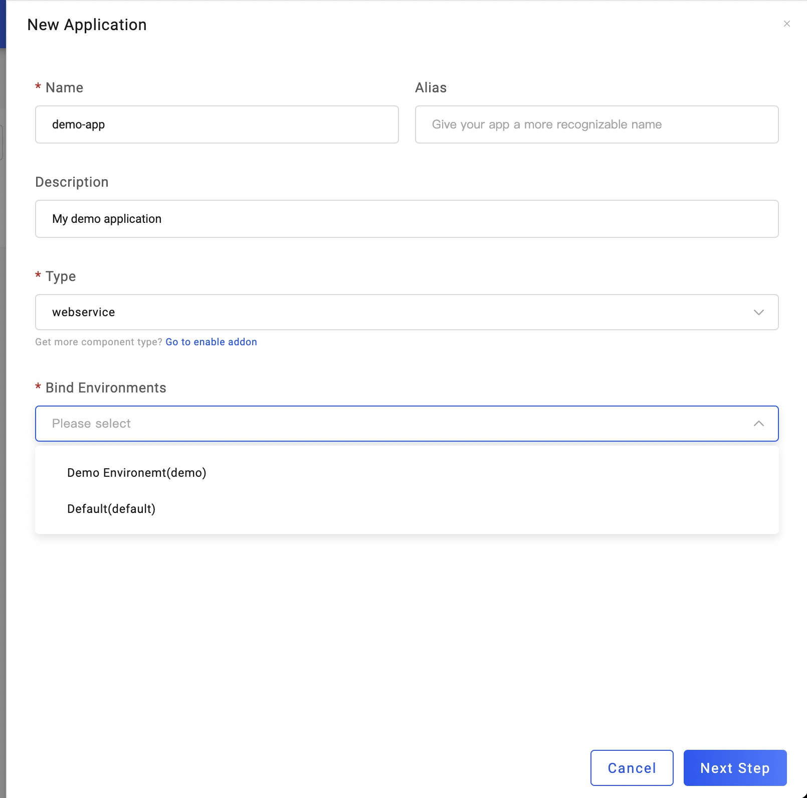
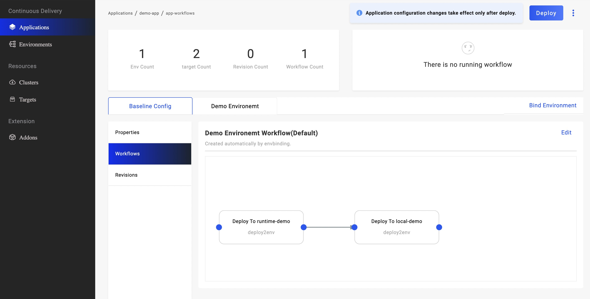

> This docs requires you to have [velaux](../../../reference/addons/velaux.md) installed.

VelaUX deploys an application in three layers:

- A **cluster** is a Kubernetes cluster joined to KubeVela.
- A **[delivery target](../concepts.md#delivery-target)** is one namespace in one cluster, plus optional cloud provider details such as region and VPC.
- An **environment** groups targets. By default, an application deploys to every target in the environments it uses; you can change that in each environment's workflow.

Set them up in that order.

## 1. Manage clusters

Open the **Clusters** page. The **local** cluster is the one the KubeVela control plane runs on. Users with cluster management permissions can add or detach other clusters here, in two ways:

* Connect an existing Kubernetes cluster by providing its KubeConfig.
* Connect an Alibaba Cloud ACK cluster. VelaUX saves the cluster's cloud details (region, VPC, dashboard address), and a target created on it inherits them, so cloud service applications can use them.

Once a cluster is added, you can edit its description, or disconnect it when no application runs on it.

## 2. Create delivery targets {#manage-delivery-target}

Now you can create a target for deploying your applications. A target identifies a specific namespace in one cluster. If the namespace does not exist in the cluster, you can create it by clicking the **New** button.

To use cloud resources (such as RDS from Alibaba Cloud), set the target's *Shared Variables* with the provider name and region. Make sure the matching Terraform addon is installed first.

## 3. Bind targets to an environment

Go to the **Environment** page and bind the targets you created to an environment.

Then create an application with that environment:

The new application's workflow contains one step per target, here two:

When you deploy the application, its components are dispatched to the namespace of each target, in each target's cluster.
