In KubeVela, you can put CI steps such as building code and pushing an image straight into a declarative workflow, or use triggers to connect an external CI system, such as Jenkins or an image registry.

## Use declarative workflow with CI steps

KubeVela has a built-in step for building images. See [Unified Declarative CI/CD](../../../tutorials/s2i.md).

## Use triggers to integrate with CI systems

You can use triggers from the [VelaUX addon](../../../reference/addons/velaux.md) to integrate with different CI systems. VelaUX creates a default trigger when you create an application; you can delete it and create your own. Each trigger has a **Payload Type**, which says what sends the request:

- [Custom](#custom-trigger): any CI tool that can send an HTTP request. See [the Jenkins example](#example-jenkins).
- [ACR](#acr-trigger)
- [Harbor](#harbor-trigger): see [Deploy When an Image Is Pushed to Harbor](../../../tutorials/trigger.md) for a worked example.
- [DockerHub](#dockerhub-trigger)
- [JFrog](#jfrog-trigger)

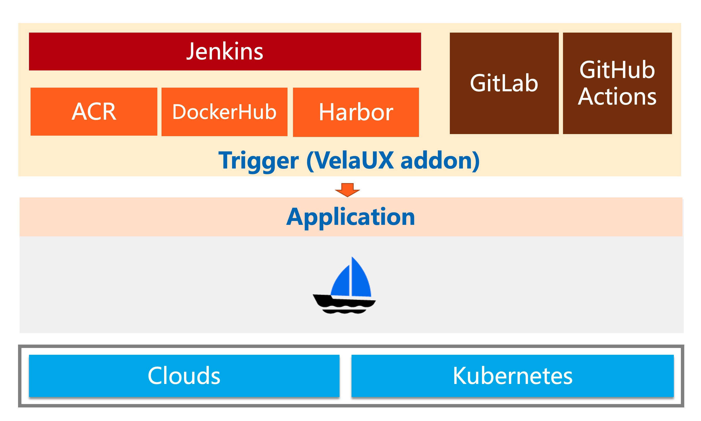

Every trigger has a webhook URL of the form `http://<velaux-address>/api/v1/webhook/<token>`. A request to it deploys the application with the trigger's **Execution Workflow**. The registry triggers (ACR, Harbor, DockerHub, JFrog) also set the `image` property of the trigger's **Component** to the image that was pushed.

### Custom Trigger

A custom trigger gives you a webhook URL that your CI tool calls with a JSON body you control.

The default trigger is a custom trigger. Click `Manual Trigger` to see its details:

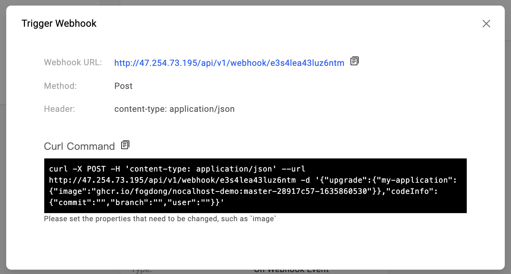

The webhook URL is the address of the trigger, and the `Curl Command` example shows a request body like this:

```json
{
  "upgrade": {
    "<component-name>": {
      "image": "<image-name>"
    }
  },
  "codeInfo": {
    "commit": "<commit-id>",
    "branch": "<branch>",
    "user": "<user>"
  }
}
```

| Field | Required | Meaning |
| --- | --- | --- |
| `action` | No | What to do: `execute` (the default when left out), `approve`, `terminate` or `rollback`. See [other actions](#other-actions). |
| `upgrade` | No | A map from component name to the properties to merge into that component before deploying, for example `upgrade.<component-name>.image`. You can set any property of the component, not only `image`. The component must exist in the application. |
| `codeInfo.commit` | No | The commit the deployment was built from. VelaUX shows it on the deployment record. |
| `codeInfo.branch` | No | The branch the deployment was built from. |
| `codeInfo.user` | No | Who made the change. |
| `step` | No | For `approve`: the name of the suspended step to resume. |

Here is a custom trigger in GitLab CI, using environment variables for the values:

```yaml
webhook-request:
  stage: request
  before_script:
    - apk add --update curl && rm -rf /var/cache/apk/*
  script:
    - |
      curl -X POST -H "Content-Type: application/json" -d '{"upgrade":{"'"$COMPONENT_NAME"'":{"image":"'"$BUILD_IMAGE"'"}},"codeInfo":{"user":"'"$CI_COMMIT_AUTHOR"'","commit":"'"$CI_COMMIT_SHA"'","branch":"'"$CI_COMMIT_BRANCH"'"}}' $WEBHOOK_URL
```

When the job runs, VelaUX deploys the application and shows the code info on the deployment:

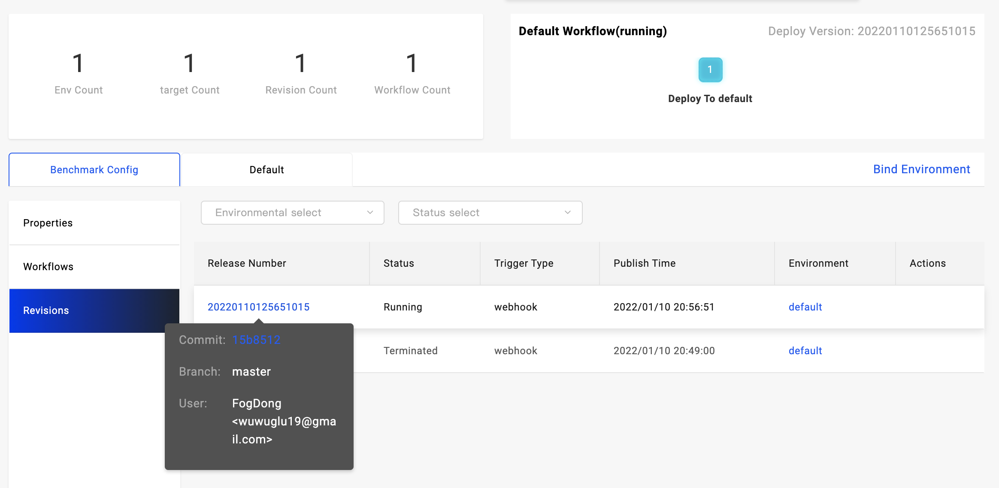

#### Example: Jenkins

To deploy from a Jenkins pipeline, VelaUX has to be reachable from your Jenkins runner. Open the application in VelaUX and click **Manual Trigger** on its default trigger to copy the webhook URL:

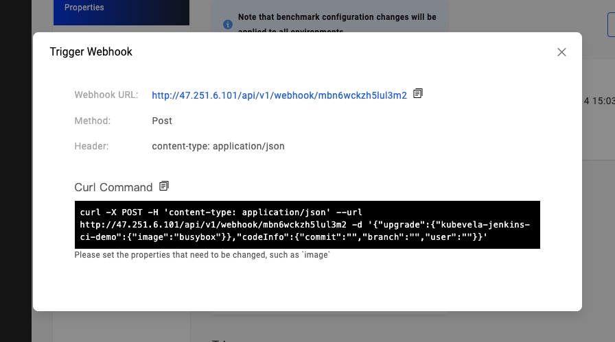

The webhook URL lets anyone who has it deploy the application. Store it as a Jenkins `Secret text` credential (here with the ID `velaux-webhook-url`) and read it with `withCredentials`, rather than pasting it into the job:

```groovy
stage('Deploy') {
    steps {
        withCredentials([string(credentialsId: 'velaux-webhook-url', variable: 'VELAUX_WEBHOOK_URL')]) {
            sh '''#!/bin/bash
                set -e
                curl -X POST -H 'content-type: application/json' --url "$VELAUX_WEBHOOK_URL" -d '{"upgrade":{"kubevela-jenkins-ci-demo":{"image":"busybox"}},"codeInfo":{"commit":"'"$GIT_COMMIT"'","branch":"'"$GIT_BRANCH"'","user":""}}'
            '''
        }
    }
}
```

Replace `kubevela-jenkins-ci-demo` with your component's name and `busybox` with the image your build produced. In a *Freestyle* project, tick **Use secret text(s) or file(s)** under **Build Environment**, bind the credential to `VELAUX_WEBHOOK_URL`, then add an **Execute Shell** build step with the same `curl` command.

When Jenkins runs the step, VelaUX runs the application's workflow:

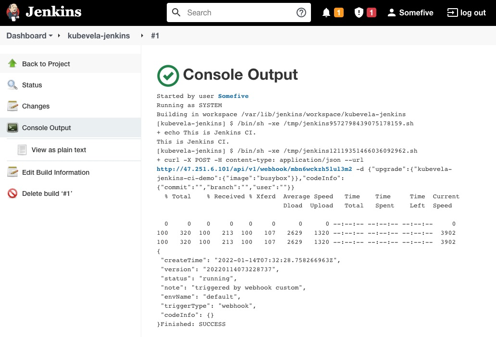

To check it worked, open the application in VelaUX and go to **Revisions**. A new revision is listed with the trigger type `webhook`; expand it to see the commit and branch Jenkins sent in `codeInfo`.

#### Other actions

Set `action` to do something other than deploy.

**Execute the workflow.** The same as leaving `action` out:

```json
{
  "action": "execute",
  "upgrade": {
    "<component-name>": {
      "image": "<image-name>"
    }
  },
  "codeInfo": {
    "commit": "<commit-id>",
    "branch": "<branch>",
    "user": "<user>"
  }
}
```

**Approve a suspended step.** While a workflow step is suspended, resume it. `step` names the step:

```json
{
  "action": "approve",
  "step": "suspend"
}
```

**Terminate the workflow.** While a workflow step is suspended, stop the workflow:

```json
{
  "action": "terminate"
}
```

**Roll back.** While a workflow step is suspended, roll the application back to its last revision that succeeded:

```json
{
  "action": "rollback"
}
```

### Harbor Trigger

A Harbor trigger takes the webhook Harbor sends when an artifact is pushed. See [Deploy When an Image Is Pushed to Harbor](../../../tutorials/trigger.md) for the full setup.

### ACR Trigger

An ACR trigger takes the webhook that Alibaba Cloud Container Registry sends when an image is pushed.

Create a trigger with **Payload Type** `ACR` and choose the workflow to run as the **Execution Workflow**. If your images are pulled from an address other than `registry.<region>.aliyuncs.com` (an enterprise instance, for example), set the trigger's **Registry** to that address.

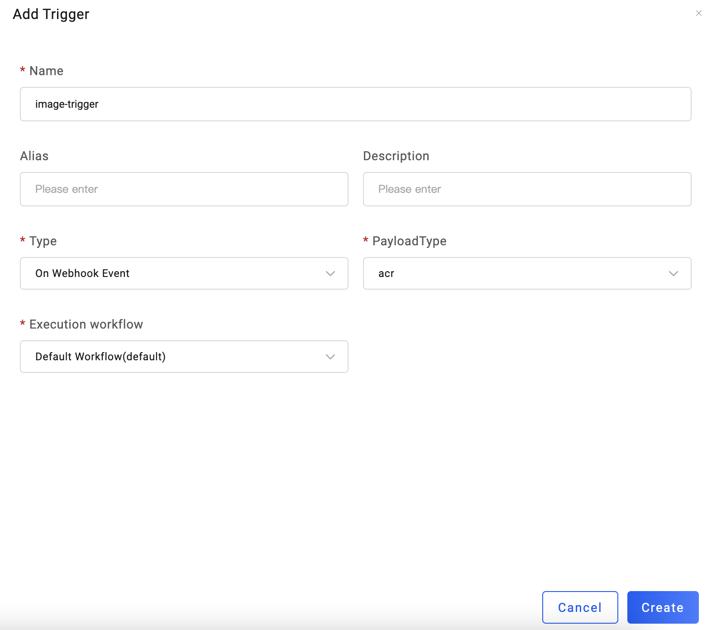

Then add a trigger to the ACR repository: in the repository's **Triggers** page, create one with the trigger's webhook URL as the URL, and choose to fire it on every tag (or the tags you want to deploy).

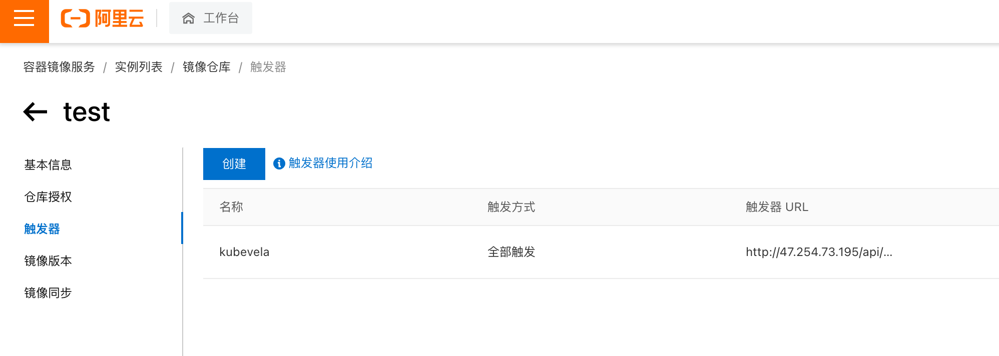

Each push now creates a new deployment, with the image set to `<registry>/<namespace>/<repository>:<tag>`:

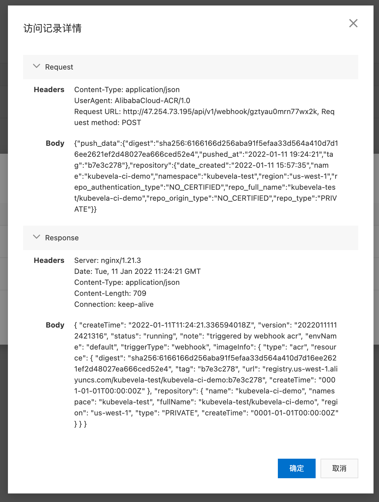

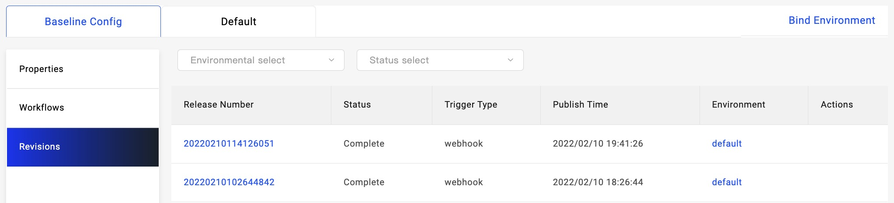

### DockerHub Trigger

A DockerHub trigger takes the webhook Docker Hub sends when an image is pushed.

Create a trigger with **Payload Type** `DockerHub` and choose the **Execution Workflow**.

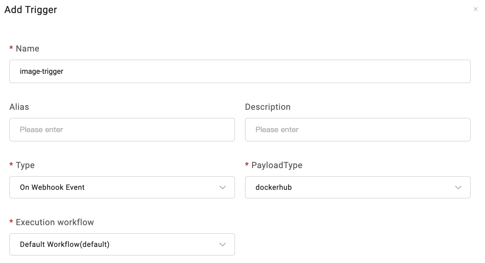

Then, in the Docker Hub repository, open **Webhooks**, give the webhook a name, and paste the trigger's webhook URL. Docker Hub calls it on every push.

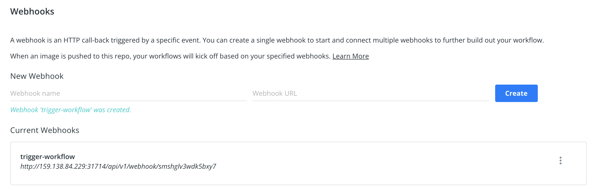

Each push now creates a new deployment, with the image set to `docker.io/<namespace>/<repository>:<tag>`:

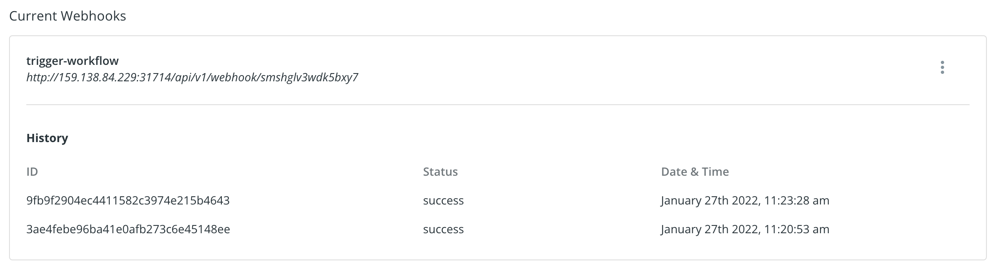

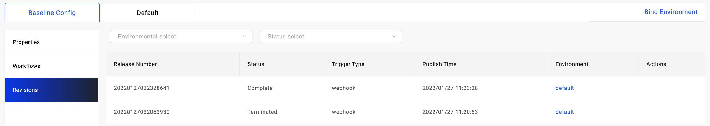

### JFrog Trigger

A JFrog trigger takes the webhook JFrog Artifactory sends when a Docker image is pushed.

Create a trigger with **Payload Type** `JFrog` and choose the **Execution Workflow**.

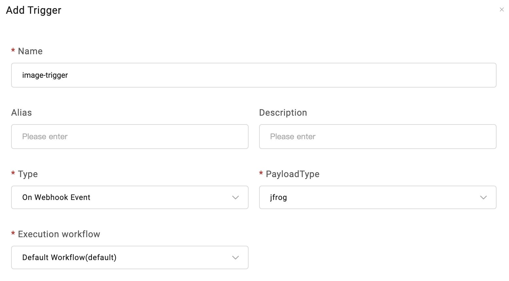

Then create a webhook in Artifactory with the trigger's webhook URL, the **Docker** domain and the **Tag was pushed** event. VelaUX ignores every other domain and event.

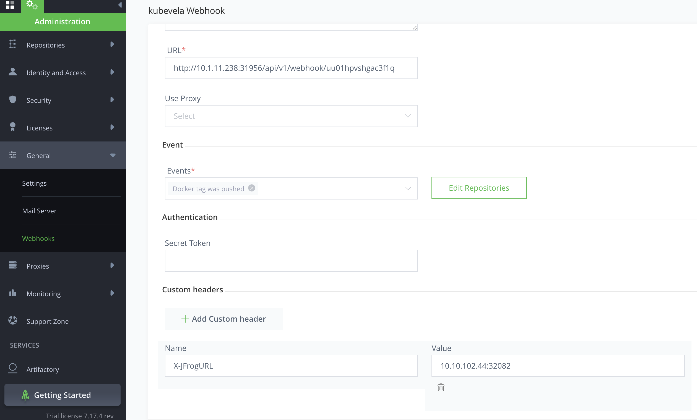

JFrog's webhook body does not include the Artifactory address, so add a custom header `X-JFrogURL` to the webhook with the address your cluster pulls from (for example `mycompany.jfrog.io`). VelaUX puts it in front of the image name: `<X-JFrogURL>/<repository>/<image>:<tag>`. Without the header, the image has no registry address.
