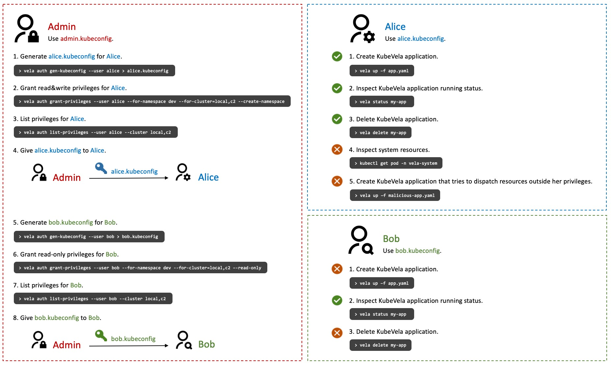

By default vela-core applies every Application as itself. With authentication on, it applies each one as the user who last changed it, so an Application can only do what its author could do with `kubectl`.

:::caution
By default vela-core runs as `cluster-admin`, so anyone who can create an Application can create anything in any cluster KubeVela manages. Turn on `authentication.enabled` to apply each Application with its submitter's permissions.
:::

This page turns authentication on, then walks through two users: Alice, who can write to the `dev` namespace, and Bob, who can only read it.

## Installation

To enable Authentication & Authorization in your KubeVela system, you need to do the following steps

1. Upgrade the controller with authentication on, and wait for it to finish:
  ```
  helm upgrade --install kubevela kubevela/vela-core --create-namespace -n vela-system --set authentication.enabled=true --set authentication.withUser=true --wait
  ```

  Helm removes the `cluster-admin` binding when you set `authentication.enabled=true`, since vela-core no longer needs it. Check it's gone afterwards; this should return `NotFound`:
  ```
  kubectl get clusterrolebinding kubevela-vela-core:manager-rolebinding
  ```

2. Make sure your version Vela CLI v1.4.1+, refer to [the installation guide](../../install.mdx#2-install-kubevela-cli).

3. (Optional) Install [vela-prism](https://github.com/kubevela/prism) through running the following commands, which will allow you to enjoy the advanced API extensions in KubeVela.
  ```bash
  helm repo remove kubevela 2>/dev/null || true
  helm repo add kubevela https://kubevela.github.io/charts
  helm repo update
  helm install vela-prism kubevela/vela-prism -n vela-system
  ```

## Usage

0. Before we start, assume we already have two managed clusters joined in KubeVela, called `c2` and `c3`. You can refer to the [multi-cluster document](../system-operation/managing-clusters.md#manage-the-cluster-via-cli) and see how to join managed clusters into KubeVela control plane.

```bash
$ vela cluster list
CLUSTER ALIAS   TYPE              ENDPOINT                      ACCEPTED   LABELS
local           Internal          -                             true
c3              X509Certificate   <c3 apiserver url>            true
c2              X509Certificate   <c2 apiserver url>            true
```

The following procedures are illustrated in the following figure. The operations below are associated with different users, which are identified by switching `KUBECONFIG` environment variable. (Each `KUBECONFIG` corresponds to one user.)



### Create User

1. Let's start with a new coming user named Alice. As the system administrator, you can assign a KubeConfig for Alice to use.

```bash
$ vela auth gen-kubeconfig --user alice > alice.kubeconfig
Private key generated.
Certificate request generated.
Certificate signing request alice generated.
Certificate signing request alice approved.
Signed certificate retrieved.
```

### Grant Privileges

2. Now alice is unable to do anything in the cluster with the given KubeConfig. We can grant her the privileges of Read/Write resources in the `dev` namespace of the control plane and managed cluster `c2`.

```bash
$ vela auth grant-privileges --user alice --for-namespace dev --for-cluster=local,c2 --create-namespace
ClusterRole kubevela:writer created in local.
RoleBinding dev/kubevela:writer:binding created in local.
ClusterRole kubevela:writer created in c2.
RoleBinding dev/kubevela:writer:binding created in c2.
Privileges granted.
```

3. We can check the privileges of Alice by the following command

```bash
$ vela auth list-privileges --user alice --cluster local,c2
User=alice
├── [Cluster]  local
│   └── [ClusterRole]  kubevela:writer
│       ├── [Scope]  
│       │   └── [Namespaced]  dev (RoleBinding kubevela:writer:binding)
│       └── [PolicyRules]  
│           ├── APIGroups:       *
│           │   Resources:       *
│           │   Verb:            get, list, watch, create, update, patch, delete
│           └── NonResourceURLs: *
│               Verb:            get, list, watch, create, update, patch, delete
└── [Cluster]  c2
    └── [ClusterRole]  kubevela:writer
        ├── [Scope]  
        │   └── [Namespaced]  dev (RoleBinding kubevela:writer:binding)
        └── [PolicyRules]  
            ├── APIGroups:       *
            │   Resources:       *
            │   Verb:            get, list, watch, create, update, patch, delete
            └── NonResourceURLs: *
                Verb:            get, list, watch, create, update, patch, delete
```

### Use Privileges

4. Alice can create an application in the dev namespace now. It deploys to the `dev` namespace of both the control plane (`local`) and cluster `c2`.

```bash
cat <<EOF | KUBECONFIG=alice.kubeconfig vela up -f -
apiVersion: core.oam.dev/v1beta1
kind: Application
metadata:
  name: podinfo
  namespace: dev
spec:
  components:
  - name: podinfo
    type: webservice
    properties:
      image: stefanprodan/podinfo:6.0.1
  policies:
  - type: topology
    name: topology
    properties:
      clusters: ["local", "c2"]
EOF
```

5. Alice can see the the application is successfully deployed.

```bash
$ KUBECONFIG=alice.kubeconfig vela status podinfo -n dev
About:

  Name:         podinfo                      
  Namespace:    dev                          
  Created at:   2022-05-31 17:06:14 +0800 CST
  Status:       running                      

Workflow:

  mode: DAG
  finished: true
  Suspend: false
  Terminated: false
  Steps
  - id:rk3npcpycl
    name:deploy-topology
    type:deploy
    phase:succeeded 
    message:

Services:

  - Name: podinfo  
    Cluster: local  Namespace: dev
    Type: webservice
    Healthy Ready:1/1
    No trait applied

  - Name: podinfo  
    Cluster: c2  Namespace: dev
    Type: webservice
    Healthy Ready:1/1
    No trait applied
```

### Unauthorized access forbidden

6. If Alice wants to access resources outside the dev namespace, she will be forbidden to do so.

```bash
KUBECONFIG=alice.kubeconfig kubectl get pod -n vela-system
Error from server (Forbidden): pods is forbidden: User "alice" cannot list resource "pods" in API group "" in the namespace "vela-system"
```

7. If Alice try to create a application in the dev namespace and the application intends to dispatch resources in `c3` cluster (which Alice does not have the privileges), the application will not be able to do so.

Alice create the application `podinfo-bad`
```bash
$ cat <<EOF | KUBECONFIG=alice.kubeconfig vela up -f -
apiVersion: core.oam.dev/v1beta1
kind: Application
metadata:
  name: podinfo-bad
  namespace: dev
spec:
  components:
  - name: podinfo-bad
    type: webservice
    properties:
      image: stefanprodan/podinfo:6.0.1
  policies:
  - type: topology
    name: topology
    properties:
      clusters: ["c3"]
EOF
```

Alice checks the status of `podinfo-bad`, the error message will be shown.
```bash
$ KUBECONFIG=alice.kubeconfig vela status podinfo-bad -n dev
About:

  Name:         podinfo-bad                  
  Namespace:    dev                          
  Created at:   2022-05-31 17:09:16 +0800 CST
  Status:       runningWorkflow              

Workflow:

  mode: DAG
  finished: false
  Suspend: false
  Terminated: false
  Steps
  - id:tw539smx7m
    name:deploy-topology
    type:deploy
    phase:failed 
    message:step deploy: run step(provider=multicluster,do=deploy): Found 1 errors. [(error encountered in cluster c3: HandleComponentsRevision: controllerrevisions.apps is forbidden: User "alice" cannot list resource "controllerrevisions" in API group "apps" in the namespace "dev")]

Services:
```

### Readonly Access

8. Let's create a new KubeConfig for another new User Bob. Bob will only be granted with the readonly privileges for the resources in the dev namespace of the control plane and cluster `c2`.

```bash
$ vela auth gen-kubeconfig --user bob > bob.kubeconfig
Private key generated.
Certificate request generated.
Certificate signing request bob generated.
Certificate signing request bob approved.
Signed certificate retrieved.

$ vela auth grant-privileges --user bob --for-namespace dev --for-cluster=local,c2 --readonly
ClusterRole kubevela:reader created in local.
RoleBinding dev/kubevela:reader:binding created in local.
ClusterRole kubevela:reader created in c2.
RoleBinding dev/kubevela:reader:binding created in c2.
Privileges granted.
```

9. User Bob can see the applications and their status under the namespace of dev.

```bash
$ KUBECONFIG=bob.kubeconfig vela ls -n dev
APP             COMPONENT       TYPE            TRAITS  PHASE                   HEALTHY STATUS          CREATED-TIME                 
podinfo         podinfo         webservice              running                 healthy Ready:1/1       2022-05-31 17:06:14 +0800 CST
podinfo-bad     podinfo-bad     webservice              runningWorkflow                                 2022-05-31 17:09:16 +0800 CST

$ KUBECONFIG=bob.kubeconfig vela status podinfo -n dev
About:

  Name:         podinfo                      
  Namespace:    dev                          
  Created at:   2022-05-31 17:06:14 +0800 CST
  Status:       running                      

Workflow:

  mode: DAG
  finished: true
  Suspend: false
  Terminated: false
  Steps
  - id:rk3npcpycl
    name:deploy-topology
    type:deploy
    phase:succeeded 
    message:

Services:

  - Name: podinfo  
    Cluster: local  Namespace: dev
    Type: webservice
    Healthy Ready:1/1
    No trait applied

  - Name: podinfo  
    Cluster: c2  Namespace: dev
    Type: webservice
    Healthy Ready:1/1
    No trait applied
```

10. But he is forbidden to do any mutating actions, such as deleting application in dev namespace.

```bash
$ KUBECONFIG=bob.kubeconfig vela delete podinfo-bad -n dev
Deleting Application "podinfo-bad"
Error: delete application err: applications.core.oam.dev "podinfo-bad" is forbidden: User "bob" cannot delete resource "applications" in API group "core.oam.dev" in the namespace "dev"
2022/05/31 17:17:51 delete application err: applications.core.oam.dev "podinfo-bad" is forbidden: User "bob" cannot delete resource "applications" in API group "core.oam.dev" in the namespace "dev"
```

11. Instead, User Alice can delete application.

```bash
$ KUBECONFIG=alice.kubeconfig vela delete podinfo-bad -n dev
application.core.oam.dev "podinfo-bad" deleted
```

### Listing resources in Application

12. (Optional) After `vela-prism` installed, you will be able to list resources of the application through the following command

```bash
$ KUBECONFIG=bob.kubeconfig vela status podinfo -n dev --tree --detail
CLUSTER       NAMESPACE     RESOURCE           STATUS    APPLY_TIME          DETAIL
c2        ─── dev       ─── Deployment/podinfo updated   2022-05-31 17:06:14 Ready: 1/1  Up-to-date: 1  Available: 1  Age: 13m
local     ─── dev       ─── Deployment/podinfo updated   2022-05-31 17:06:14 Ready: 1/1  Up-to-date: 1  Available: 1  Age: 13m
```

> Notice that if `vela-prism` is not installed, Alice and Bob will be forbidden to run this listing command.

### Revoke access

13. The CLI has no command to revoke privileges. `grant-privileges` gives each namespace one RoleBinding per access level, `kubevela:writer:binding` and `kubevela:reader:binding`, in every cluster it was granted for. To take Alice's write access to `dev` away, delete her binding in both clusters:

```bash
vela kube delete rolebinding kubevela:writer:binding -n dev --cluster local --cluster c2
```

The binding is shared by everyone granted write access to `dev`, so deleting it revokes it for all of them. To revoke Alice alone, edit the binding with each cluster's kubeconfig and remove her from `subjects`:

```bash
kubectl edit rolebinding kubevela:writer:binding -n dev
```

Bob's read-only access is in `kubevela:reader:binding`, and is revoked the same way.

## Extension Reading

The guide above demonstrates how system operators can grant limited privileges for users and therefore restrict the access of their created applications. For more detail explanation on how this capability is achieved, read the [Underlying Mechanism](./advance.md) article.

> As the platform builder, you may want to bind KubeVela application with your customized identity. For example, using a manual specified ServiceAccount for the application. If you want to do so, it is not mandatory to enable the Authentication feature flag in KubeVela. Read the [System Integration](./integration.md) for more details.