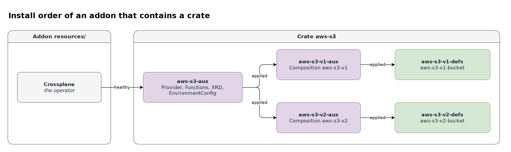

An addon can install crates. Use this when a crate needs infrastructure, such as an operator. The addon installs the operator from `resources/`. Then the addon installs the crate.

For example, one addon can install Crossplane, and then the [aws-s3 crate](./crate-crossplane.md). The crate brings the AWS provider and the functions in its auxiliary objects.

If you do not know addons, read [Make Your Own Addon](/addons/developer/make-your-own-addon) first.

## Before you start

- Turn on `EnableCrateComponent` and `EnableAddonComponent`:

  ```shell
  helm upgrade kubevela kubevela/vela-core -n vela-system \
    --version <chart-version> \
    --reset-then-reuse-values \
    --set featureGates.enableCrateComponent=true \
    --set featureGates.enableAddonComponent=true
  ```

  `--reset-then-reuse-values` (Helm 3.14 or later) starts from the default values of the chart, applies the values that you set on the current release, then applies the `--set` flags. The gates that are already on stay on. `--version` stops Helm from moving the installation to a different chart version.

- Read [Make Your Own Addon](/addons/developer/make-your-own-addon) for the addon layout.
- Follow the addon `crossplane-storage` on this page. It includes the crate `aws-s3`. Most examples import the crate. [Inline crates](#inline-crates) shows the other layout, where the same crate is an inline crate and `crates/_imports.cue` has no entry for it.

:::caution
Only a `type: addon` component installs the crates of an addon. `vela addon enable` installs the other parts of the addon, but it ignores `crates/`. This is true for an addon from a registry and for an addon in a local directory.
:::

## Two ways to include a crate

| Way | Where | KubeVela fetches the crate |
| --- | --- | --- |
| Inline crate | A crate directory in `crates/<name>/` of the addon | No. The crate is part of the addon. |
| Imported crate | An entry in `crates/_imports.cue` | Yes, from a crate registry |

An addon can use both ways at the same time.

## Inline crates

Put the crate directory under `crates/`. It is the same layout as a published crate. See [Build and Publish a Crate](./crate-author.md).

This tree is the addon with `aws-s3` as an inline crate. This addon does not also import `aws-s3`.

```text
crossplane-storage/
  metadata.yaml
  template.cue
  resources/
    crossplane.cue           Crossplane, the operator
  crates/
    aws-s3/
      _crate.cue
      auxiliary/
        packages.yaml
        xrd.yaml
        settings.yaml
      v1/
        _version.cue
        auxiliary/
          composition.yaml
        definitions/
          bucket.cue
```

Each directory directly under `crates/` must contain `_crate.cue`. If one does not, the addon does not load:

```text
crates/broken: missing _crate.cue; every directory directly under crates/ must be an inline crate (external references belong in crates/_imports.cue instead)
```

### When to use an inline crate

| Use an inline crate when | Use an imported crate when |
| --- | --- |
| Only this addon uses the crate. | More than one addon, or a user, installs the crate. |
| The crate and the addon change together and release together. | The crate has its own versions and its own release. |
| You do not want to run a crate registry. | The crate must go to other clusters than the addon. |

### Install an addon that has an inline crate

An addon with an inline crate installs like any other addon. The feature gates `EnableAddonComponent` and `EnableCrateComponent` must be on. You need an addon registry. You do not need a crate registry, because KubeVela reads the crate from the addon package.

```yaml
apiVersion: core.oam.dev/v1beta1
kind: Application
metadata:
  name: storage-platform
  namespace: team-a
spec:
  components:
    - name: crossplane-storage
      type: addon
      properties:
        registry: addons
        version: "1.0.0"
```

See [Install the addon](#install-the-addon) for the namespace step that this example needs.

### What KubeVela creates

| Object | Where | Notes |
| --- | --- | --- |
| Addon Application `addon-crossplane-storage` | `vela-system` | It has one `k8s-objects` component for each inline crate. The component has the name of the crate, `aws-s3`. |
| Owned Application `crate-aws-s3` | `vela-system` | The `aws-s3` component contains it. It has the same tiers as a crate that you install with `vela crate deploy`. |
| Definitions, for example `aws-s3-v1-bucket` | `team-a` | The namespace of the Application that installs the addon. |
| Namespaced crate objects with no `metadata.namespace` | `team-a` | An object that sets a namespace keeps it. A cluster-scoped object, such as an XRD, has no namespace. |

Each installed definition has the label `definition.oam.dev/crate`. The owned Application `crate-aws-s3` has the annotation `definition.oam.dev/crate-version`. The version is the `version` in the `_crate.cue` of the inline crate, not the version of the addon.

```shell
kubectl -n vela-system get application addon-crossplane-storage -o jsonpath='{.spec.components[*].name}'
vela status crate-aws-s3 -n vela-system
kubectl -n team-a get componentdefinitions -l definition.oam.dev/crate=aws-s3
```

Applications in `team-a` use the definitions in the same way as for a published crate, for example `type: aws-s3/v1/bucket`. See [Use the definitions](./crate-install.md#use-the-definitions).

### Change an inline crate

KubeVela does not fetch an inline crate, so it changes only with the addon. Change the files under `crates/aws-s3/`, set a new `version` in `metadata.yaml` of the addon, push the addon, and set the new addon version in the Application. Set a new `version` in `_crate.cue` too, so that the installed definitions show which crate version they come from.

When you delete the Application that installs the addon, KubeVela deletes the addon Application, the owned Application, the definitions and the crate objects.

### Placement

An inline crate has no placement of its own, because you write it together with the addon. It follows the `placement` on the `type: addon` component: its runtime objects go to the clusters that the addon selects, and its hub objects and definitions stay on the hub. To put a crate on other clusters than its addon, publish the crate and import it. See [Placement on the type: addon component](#3-placement-on-the-type-addon-component).

## Imported crates

Import a crate that you published to a crate registry. Each entry becomes one `type: crate` component in the addon Application.

```cue
// crates/_imports.cue
imports: [{
	crate: "aws-s3"
	sources: [{registry: "catalog", version: "1.0.0"}]
}, {
	crate:   "aws-rds"
	enabled: false
	sources: [{registry: "catalog", version: "2.3.0"}]
}]
```

| Field | Meaning |
| --- | --- |
| `crate` | Required. The crate name. |
| `enabled` | Optional. `false` skips the crate. The default is `true`. |
| `sources` | Required. Exactly one entry. |
| `sources[].registry` | A name from `vela crate registry add` on the cluster that installs the addon. If you omit it, KubeVela selects the registry in the same way as for a `type: crate` component. See [How KubeVela selects the registry](./crate-registry.md#how-kubevela-selects-the-registry). |
| `sources[].version` | The package version. Use an exact version, for example `1.0.0`. Do not use a range. |
| `placement` | Optional. Where the runtime objects of the crate go. See [Place the crates of an addon](#place-the-crates-of-an-addon). |

`sources[].versions` is accepted, but KubeVela does not enforce it yet. Every enabled line of the crate installs, and the controller logs a warning.

Declare each crate name one time in an addon. A crate name can come from an import, from an inline `crates/<name>/` directory, or from a `type: crate` component that you write in `template.cue`. If one name is declared two times, the full addon render fails. No declaration replaces another. The error names each place. For example, when `aws-s3` is an import and also an inline crate, the error ends with:

```text
crate "aws-s3" is declared more than once: crates/_imports.cue, inline crate "crates/aws-s3"
```

## One owner for each crate

A crate has one owner in a cluster. This is the same for an inline crate and for an imported crate. When a second addon includes a crate that another addon installed, the crate component of the second addon fails with this message:

```text
existing object Application vela-system/crate-aws-s3 is managed by other application vela-system/addon-crossplane-storage
```

The other crates of the second addon still install. After you remove the first owner, restart the workflow of the second addon Application:

```shell
vela workflow restart addon-<second-addon> -n vela-system
```

## Install the addon

Install the addon with a `type: addon` component. The parameters of the addon go in `properties.properties`.

With the default chart values, only Applications in `vela-system` can use the `addon` component. To install an addon from a team namespace, do these two steps first:

1. Add the namespace to `definitionRestrictions.overrides.addon.namespaces` in the vela-core chart values. The default is `["vela-system"]`.

   ```shell
   helm upgrade kubevela kubevela/vela-core -n vela-system \
     --version <chart-version> \
     --reset-then-reuse-values \
     --set 'definitionRestrictions.overrides.addon.namespaces={vela-system,team-a}'
   ```

2. Make sure that the user who applies the Application has the right to create Applications in `vela-system`. Admission refuses the `addon` component for a user without that right, because the addon Application installs in `vela-system`.

```yaml
apiVersion: core.oam.dev/v1beta1
kind: Application
metadata:
  name: storage-platform
  namespace: team-a
spec:
  components:
    - name: crossplane-storage
      type: addon
      properties:
        registry: addons
        version: "1.0.0"
        properties: {}
```

KubeVela creates the addon Application `addon-crossplane-storage` in `vela-system`. The crate definitions install into the namespace of the installing Application, `team-a` in this example. KubeVela also creates the owned Application `crate-<name>` of each crate in `vela-system`.

The install namespace of an imported crate travels on the annotation `crates.oam.dev/install-namespace`, which KubeVela sets on the addon Application. KubeVela uses the annotation only on the Application of an addon, and admission refuses it when a user sets, changes, or removes it. You cannot use it to send a crate to a different namespace.

## Install order

The crate components depend on all components from `resources/`. KubeVela installs the crates only after the addon resources are healthy.



In the diagram, the grey box is the addon resource. The purple boxes are the auxiliary tiers of the crate, and the green boxes are the definitions tiers of lines `v1` and `v2`. Inside the crate, each tier starts after KubeVela applies the tier before it.

The health of a resource depends on its component type. A `k8s-objects` component is healthy when the cluster accepts its objects.

In the addon Application, an imported crate is a `type: crate` component. An inline crate is a `k8s-objects` component that contains the owned Application of the crate.

## Place the crates of an addon

On a hub with managed clusters, the runtime objects of an imported crate can follow the addon to the managed clusters. The crate marks its objects as `hub` or `runtime`, in the same way as a crate that you install directly. See [Crate Multi-Cluster Placement](./crate-multicluster.md).

There are three ways to select the clusters.

### 1. A literal placement on an import

```cue
imports: [{
	crate: "aws-s3"
	sources: [{registry: "catalog", version: "1.1.0"}]
	placement: clusterLabelSelector: region: "east"
}]
```

`placement` takes `clusters`, `clusterLabelSelector`, and `allowEmpty`, with the same rules as the `type: crate` component.

### 2. Copy the topology of the addon

Most multi-cluster addons have a topology policy that their parameters fill, for example `clusters`. `fromPolicy` copies the clusters of that policy, so the crate goes where the addon goes.

```cue
// template.cue
output: {
	apiVersion: "core.oam.dev/v1beta1"
	kind:       "Application"
	spec: {
		components: []
		policies: [{
			name: "deploy-topology"
			type: "topology"
			properties: clusters: parameter.clusters
		}]
	}
}
```

```cue
// crates/_imports.cue
imports: [{
	crate: "aws-s3"
	sources: [{registry: "catalog", version: "1.1.0"}]
	placement: fromPolicy: "deploy-topology"
}]
```

```yaml
    - name: crossplane-storage
      type: addon
      properties:
        registry: addons
        version: "1.0.0"
        properties:
          clusters: [east-1, east-2]
```

`fromPolicy` copies `clusters`, `clusterLabelSelector`, and `allowEmpty` from the policy. It does not copy `namespace`. A namespaced crate object that does not set `metadata.namespace` uses the install namespace. An object that sets `metadata.namespace` keeps that namespace.

Do not use `fromPolicy` together with `clusters`, `clusterLabelSelector`, or `allowEmpty` on the same import.

### 3. Placement on the type: addon component

When the addon has no topology policy, the installer can place the full addon. This example installs from the namespace `default`, so add `default` to `definitionRestrictions.overrides.addon.namespaces` first. See [Install the addon](#install-the-addon).

```yaml
apiVersion: core.oam.dev/v1beta1
kind: Application
metadata:
  name: storage-platform
  namespace: default
spec:
  components:
    - name: crossplane-storage
      type: addon
      properties:
        registry: addons
        version: "1.0.0"
        placement:
          clusterLabelSelector:
            region: east
```

KubeVela adds the topology policy `addon-placement` to the addon Application. The `resources/` components go to the selected clusters. KubeVela copies the same placement to each imported crate that sets no `placement` of its own. An inline crate in `crates/<name>/` follows the addon placement too: its runtime objects go to the selected clusters. Its hub objects, its definitions and its owned Application stay on the hub.

KubeVela refuses this `placement` in two cases. The addon decides its own clusters in these cases.

| The addon has | Error |
| --- | --- |
| A topology policy | `addon "<name>" places itself with its topology policy "<policy>", so placement cannot be set; use the addon's own parameters instead` |
| A workflow | `addon "<name>" defines its own workflow, so placement cannot be set; use the addon's own parameters instead` |

For a refused request, KubeVela does not change the addon Application. The error is in the workflow step of the installing Application.

### The crate components stay on the hub

A crate component creates the owned Application of the crate. That Application must be on the hub, where KubeVela runs. When an addon has a topology policy and no workflow, KubeVela adds these policies and steps to the addon Application:

| Name | Kind | Contents |
| --- | --- | --- |
| `addon-components` | Override policy | Selects the components that are not crates |
| `addon-crates-hub` | Topology policy | Selects the cluster `local` |
| `addon-crates` | Override policy | Selects the crate components |
| `deploy-<policy>` | Workflow step | One step for each topology policy of the addon. It deploys the components that are not crates. |
| `deploy-addon-crates` | Workflow step | Deploys the crate components to the hub |

The owned Application of each crate then sends its runtime objects to the clusters of its placement.

### Errors in fromPolicy

A wrong `fromPolicy` stops the addon render. The error is in the workflow step of the installing Application:

| Problem | Error |
| --- | --- |
| The policy does not exist | `crates/_imports.cue: crate "aws-s3": placement.fromPolicy "<name>": no such policy` |
| The policy is not a topology policy | `crates/_imports.cue: crate "aws-s3": placement.fromPolicy "<name>" is a <type> policy, not topology` |
| The policy selects no clusters | `crates/_imports.cue: crate "aws-s3": placement.fromPolicy "<name>": placement must set clusters or clusterLabelSelector` |
| The policy sets only the old `clusterSelector` field | `... the policy sets the deprecated clusterSelector, which is ignored unless the DeprecatedPolicySpec feature gate is on; use clusterLabelSelector` |
| `fromPolicy` with other placement fields | `crates/_imports.cue: crate "aws-s3": placement.fromPolicy cannot be combined with clusters, clusterLabelSelector or allowEmpty` |

## Check the addon

```shell
vela status storage-platform -n team-a
vela addon status crossplane-storage
kubectl -n vela-system get application addon-crossplane-storage -o yaml
vela status crate-aws-s3 -n vela-system
```

The `addon` component of the installing Application can show `Ready` before a crate finishes its install. Read the status of each owned Application `crate-<name>` to see its tiers.

### After a KubeVela upgrade

KubeVela writes the workflow of each addon Application into its spec. The first render after you upgrade from a version that did not do this adds the workflow. Each addon that is installed with the `addon` component then gets one new ApplicationRevision and deploys again once. This applies to all such addons, with or without crates or placement.

## Uninstall the addon

Delete the installing Application. KubeVela deletes the addon Application, the owned Applications of the crates, the definitions, and the objects on the managed clusters.

```shell
kubectl -n team-a delete application storage-platform
```
