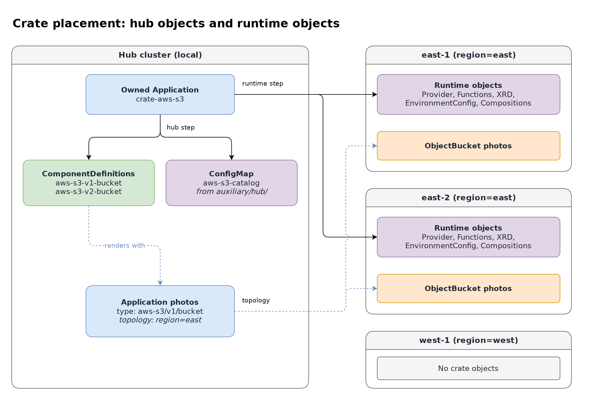
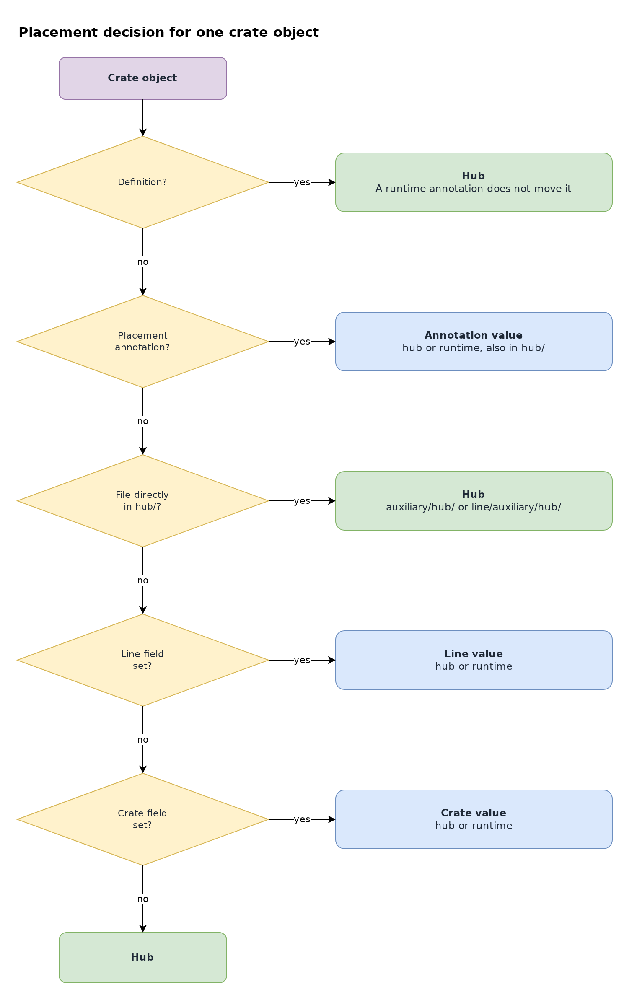

In a multi-cluster setup, KubeVela runs on one cluster, the hub. The hub sends workloads to managed clusters. A crate can send some of its objects to the managed clusters and keep other objects on the hub.

This page uses these words:

| Word | Meaning |
| --- | --- |
| Hub | The cluster where KubeVela runs. Its cluster name is `local`. |
| Managed cluster | A cluster that you added with `vela cluster join`. |
| Hub object | A crate object that installs only on the hub. |
| Runtime object | A crate object that installs on the clusters that the installer selects. |

## Why placement is necessary

KubeVela renders Applications on the hub, so the definitions must be on the hub. Some supporting objects must be on the cluster where the workload runs.

The [Crossplane example](./crate-crossplane.md) shows this. An Application on the hub sends an `ObjectBucket` to a managed cluster. Crossplane on that cluster needs the provider, the functions, the XRD, the Compositions, and the EnvironmentConfig on the same cluster. If those objects are only on the hub, the bucket is never created.



In this diagram, the installer selects the clusters with the label `region=east`. The hub step installs the definitions of lines `v1` and `v2` and the catalog ConfigMap on the hub. The runtime step installs the Crossplane objects on `east-1` and `east-2`. The cluster `west-1` does not match, so it receives no crate objects. The Application `photos` uses a topology policy to send its `ObjectBucket` to the same clusters.

The purple boxes are crate objects, and the green box holds the definitions. The blue boxes are Applications. The orange boxes are the objects that `photos` creates.

The crate author and the installer each make one decision:

| Who | Decision | Where |
| --- | --- | --- |
| Crate author | Which objects are hub objects, and which are runtime objects | Files and fields in the crate |
| Installer | Which clusters receive the runtime objects | `placement` on the `type: crate` component, or `vela crate deploy` flags |

Definitions always install on the hub. Hub objects always install on the hub.

## Before you start

1. Use a KubeVela version that supports crate placement, with `EnableCrateComponent` on. See [Crate Registries](./crate-registry.md#turn-the-feature-on).
2. Join the managed clusters and add labels. See [Lifecycle of Managed Cluster](../system-operation/managing-clusters.md).

   ```shell
   vela cluster join east-1.kubeconfig --name east-1
   vela cluster join east-2.kubeconfig --name east-2
   vela cluster labels add east-1 region=east
   vela cluster labels add east-2 region=east
   vela cluster list
   ```

   The hub must be able to reach the API server address in each joined kubeconfig.

3. Install Crossplane on each managed cluster before you install the crate. The crate sends the provider and the functions. After the provider is Healthy, create the credentials Secret and the `ClusterProviderConfig` on that cluster. See [Add the AWS credentials](./crate-crossplane.md#add-the-aws-credentials).
4. Create the install namespace on the hub, because `vela crate deploy -n platform` fails when the namespace does not exist. Then create the namespaces on each managed cluster. KubeVela does not create them:
   - The install namespace, if the runtime objects include namespaced objects.
   - Each namespace that a runtime object sets in `metadata.namespace`.
   - The namespace of each Application that sends workloads to the cluster.

   `vela cluster join` creates only `vela-system`. See [The namespace of runtime objects](#the-namespace-of-runtime-objects).

### The namespace of runtime objects

:::caution Runtime objects and namespaces
Read these rules before you select an install namespace for a crate with runtime objects.

- A namespaced runtime object that does not set `metadata.namespace` goes into the install namespace. A cluster-scoped object stays cluster-scoped. The install namespace is the namespace of the installer Application. KubeVela also creates the definitions of the crate in this namespace. The owned Application `crate-<name>` stays in `vela-system`.
- The definitions stay on the hub, in the install namespace.
- KubeVela does not create the install namespace on a managed cluster. `vela-system` exists on each managed cluster, because `vela cluster join` creates it. Any other install namespace, for example `platform`, must exist on each managed cluster before you install.
- An object that sets `metadata.namespace` keeps that namespace.
:::

If the install namespace does not exist on a selected cluster, the runtime step fails. The hub step succeeds, so the definitions are available on the hub:

```text
Step deploy-crate-runtime failed: function call error for deploy: Found 1 errors. [(error encountered in cluster east-1: Dispatch: pre-dispatch dryrun failed: Found 1 errors. [(cannot create object: namespaces "platform" not found)])]
```

To recover, create the namespace on the managed cluster. Then start the workflow of the owned Application again:

```shell
kubectl create namespace platform   # on the managed cluster
vela workflow restart crate-aws-s3 -n vela-system
```

If you run `vela crate deploy` again with the same flags, the failed step does not start again, and the command shows the same error.

## Mark the objects in a crate

KubeVela sets the class of each object with these rules. The first rule that matches sets the class.

1. A definition stays on the hub. A runtime annotation on the definition does not move it.
2. The annotation `resource.oam.dev/placement` on the object. The value `hub` or `runtime` wins. This includes a file inside `hub/`.
3. The file is directly in `auxiliary/hub/` or in a line `auxiliary/hub/` directory. The object stays on the hub.
4. The `placement` field in `<line>/_version.cue`.
5. The `placement` field in `_crate.cue`.
6. No earlier rule matches. The object stays on the hub.



Yellow is a decision, green stays on the hub, and blue uses the annotation, the line field, or the crate field.

The only values are `hub` and `runtime`.

With rule 6, a crate with no marks keeps all objects on the hub. Crates that you published before this feature continue to install on the hub only.

For example, a crate `store` sets `placement: "runtime"` in `_crate.cue`. Line `v1` sets `placement: "runtime"` in `v1/_version.cue`, and line `v2` sets `placement: "hub"` in `v2/_version.cue`. The installer selects the cluster `east-1`.

| File | Directory | Annotation on the object | Where it lands | Rule |
| --- | --- | --- | --- | --- |
| `auxiliary/defaults.yaml` | Crate root `auxiliary/` | None | `east-1` | 5 |
| `auxiliary/hub/admission.yaml` | Crate root `auxiliary/hub/` | None | Hub | 3 |
| `auxiliary/hub/agent.yaml` | Crate root `auxiliary/hub/` | `runtime` | `east-1` | 2 |
| `v1/auxiliary/bucket-defaults.yaml` | Line `v1/auxiliary/` | None | `east-1` | 4 |
| `v1/auxiliary/pinned.yaml` | Line `v1/auxiliary/` | `hub` | Hub | 2 |
| `v1/auxiliary/hub/controller.yaml` | Line `v1/auxiliary/hub/` | None | Hub | 3 |
| `v2/auxiliary/migration.yaml` | Line `v2/auxiliary/` | None | Hub | 4 |
| `v1/definitions/bucket.cue` | Line `v1/definitions/` | `runtime` | Hub | 1 |

The line field applies only to the files of that line. The file in `v2/auxiliary/` stays on the hub, while the file in the crate root `auxiliary/` goes to `east-1`. All runtime objects of one install go to the same clusters.

### Example: the aws-s3 crate for managed clusters

This is the crate from the Crossplane example, with lines `v1` and `v2`. The provider, the functions, the XRD, the two Compositions, and the EnvironmentConfig must go to the managed clusters. A ConfigMap for a service catalog on the hub must stay on the hub.

```text
aws-s3/
  _crate.cue                   placement: "runtime"
  auxiliary/
    packages.yaml              runtime, from _crate.cue
    xrd.yaml                   runtime, from _crate.cue
    settings.yaml              runtime, from _crate.cue
    hub/
      catalog-entry.yaml       hub, from the hub/ directory
  v1/
    _version.cue
    auxiliary/
      composition.yaml         runtime, from _crate.cue
    definitions/
      bucket.cue               hub. Definitions always install on the hub.
  v2/
    _version.cue
    auxiliary/
      composition.yaml         runtime, from _crate.cue
    definitions/
      bucket.cue               hub. Definitions always install on the hub.
```

The list above is the full order. This example uses the crate field and a `hub/` directory. It does not show every row.

`_crate.cue`. Package `1.1.0` is package `1.0.1` of the Crossplane example, with the new `placement` field:

```cue
crate:     "aws-s3"
version:   "1.1.0"
placement: "runtime"
```

`auxiliary/hub/catalog-entry.yaml`:

```yaml
apiVersion: v1
kind: ConfigMap
metadata:
  name: aws-s3-catalog
data:
  owner: team-storage
  summary: S3 buckets through Crossplane
  types: aws-s3/v1/bucket, aws-s3/v2/bucket
```

To make one object a hub object in a runtime crate, you can also add the annotation:

```yaml
metadata:
  annotations:
    resource.oam.dev/placement: hub
```

### Rules for the hub directory

- KubeVela reads only the files directly in `hub/`. It does not read subdirectories of `hub/`.
- KubeVela ignores other subdirectories of `auxiliary/`.
- An annotation on an object is stronger than the `hub/` directory. A file in `hub/` with `resource.oam.dev/placement: runtime` is a runtime object.

`vela crate publish` shows a warning for each of these cases:

```text
Warning: auxiliary/skipped is not a recognized folder and is ignored; only hub/ is recognized under auxiliary/
Warning: auxiliary/hub/nested is not read; hub/ does not recurse into sub-folders
Warning: auxiliary/hub/keep-runtime.yaml is in hub/ but its own placement annotation is "runtime"; the annotation wins, so it is not hub-only
```

### Wrong values

`vela crate publish` rejects a value that is not `hub` or `runtime`. An empty string is also wrong.

```text
Error: parse crate: read placement: _crate.cue: placement "spoke" is invalid, must be "hub" or "runtime"
Error: parse crate: read placement: _crate.cue: placement is empty, must be "hub" or "runtime"
Error: parse crate: read auxiliary: auxiliary/xrd.yaml: placement "edge" is invalid, must be "hub" or "runtime"
```

A definition with a placement annotation is accepted. The annotation stays on the definition, and the definition installs on the hub. For the value `runtime`, `vela crate publish` shows a warning:

```text
Warning: v1/definitions/bucket.cue has placement annotation "runtime"; a definition stays on the hub, so the annotation is ignored
```

## Select the clusters

### With the CLI

`--registry` names a crate registry you already added. See [Add a registry](./crate-registry.md#add-a-registry). These commands use `ghcr`. They install into the namespace `platform`, so the installer Application is `crate-aws-s3-deploy` in `platform`.

```shell
# Send the runtime objects to two clusters by name.
vela crate deploy aws-s3 --registry ghcr --version 1.1.0 --clusters east-1,east-2 -n platform

# Send them to all clusters with a label.
vela crate deploy aws-s3 --registry ghcr --version 1.1.0 --cluster-selector region=east -n platform

# Succeed when no cluster has the label yet.
vela crate deploy aws-s3 --registry ghcr --version 1.1.0 --cluster-selector tier=gpu --allow-empty -n platform
```

`--cluster-selector` takes one or more `key=value` pairs, separated by commas. A cluster must have all the labels.

`--dry-run` shows the `placement` property:

```shell
vela crate deploy aws-s3 --registry ghcr --version 1.1.0 --cluster-selector region=east -n platform --dry-run
```

```yaml
apiVersion: core.oam.dev/v1beta1
kind: Application
metadata:
  name: crate-aws-s3-deploy
  namespace: platform
spec:
  components:
  - name: aws-s3
    properties:
      crate: aws-s3
      placement:
        clusterLabelSelector:
          region: east
      registry: ghcr
      version: 1.1.0
    type: crate
status: {}
```

The CLI checks the flags before it applies the Application:

| Flags | Error |
| --- | --- |
| `--clusters` and `--cluster-selector` together | `--clusters and --cluster-selector cannot be used together` |
| `--allow-empty` with no `--clusters` and no `--cluster-selector` | `--allow-empty needs --clusters or --cluster-selector` |
| `--clusters 'east-1,'` | `placement clusters must not contain an empty name` |

### With an Application

```yaml
apiVersion: core.oam.dev/v1beta1
kind: Application
metadata:
  name: crate-aws-s3-deploy
  namespace: platform
spec:
  components:
    - name: aws-s3
      type: crate
      properties:
        registry: ghcr
        version: "1.1.0"
        placement:
          clusterLabelSelector:
            region: east
          # Or select clusters by name:
          # clusters: [east-1, east-2]
          # Succeed when clusterLabelSelector matches no cluster.
          # An unknown name in clusters still fails:
          # allowEmpty: true
```

Set `clusters` or `clusterLabelSelector`. Do not set both. The rule is the same as the rule of a [topology policy](../../end-user/policies/references.md#topology).

Admission rejects a wrong `placement`. The error contains one of these messages:

| `placement` | Message |
| --- | --- |
| `clusters` and `clusterLabelSelector` | `placement must set clusters or clusterLabelSelector, not both` |
| `{}` | `placement must set clusters or clusterLabelSelector` |
| `clusters: []` | `placement clusters must name at least one cluster` |

### Results

| `placement` | Runtime objects go to |
| --- | --- |
| Not set | The hub, with the hub objects |
| `clusters: [local]` | The hub |
| `clusters: [east-1, east-2]` | `east-1` and `east-2` only |
| `clusterLabelSelector: {region: east}` | All clusters with the label `region=east` |
| `clusterLabelSelector: {}` | All clusters, including the hub |
| A selector that matches no cluster | The runtime step fails. Objects already placed stay. |
| A selector that matches no cluster, with `allowEmpty: true` | The install succeeds. KubeVela deletes the runtime objects already placed. The tier shows `Not placed` and `no cluster selected`. |
| A cluster name that does not exist | No cluster. The runtime step fails. |

All runtime objects of one install go to the same clusters. To send different objects to different clusters, use two crates.

## What KubeVela creates

When the install has a placement, the owned Application `crate-aws-s3` has two deploy steps:

1. `deploy-crate-hub` installs the hub objects and the definitions on the hub.
2. `deploy-crate-runtime` installs the runtime objects on the selected clusters.

Each auxiliary tier splits by class. The runtime part keeps the tier name. The name of the hub part ends with `-hub`, also when the tier has only hub objects. A definitions tier does not split. It is always a hub tier, and it keeps its name with no `-hub`.

| Tier | Class | Contents in the example |
| --- | --- | --- |
| `aws-s3-aux` | runtime | Provider, Functions, XRD, EnvironmentConfig |
| `aws-s3-aux-hub` | hub | ConfigMap `aws-s3-catalog` |
| `aws-s3-v1-aux` | runtime | Composition `aws-s3-v1` |
| `aws-s3-v1-defs` | hub | ComponentDefinition `aws-s3-v1-bucket` |
| `aws-s3-v2-aux` | runtime | Composition `aws-s3-v2` |
| `aws-s3-v2-defs` | hub | ComponentDefinition `aws-s3-v2-bucket` |

The order inside a class does not change. A hub tier waits for the hub tier before it. A runtime tier waits for the runtime tier before it.

:::caution
The hub step runs first. The definitions are available on the hub before the runtime step finishes. An Application that uses the definitions at that time can wait for the runtime objects on the managed cluster. Wait until the install is complete before you deliver workloads.
:::

Look at the policies and the steps:

```shell
kubectl -n vela-system get application crate-aws-s3 -o yaml
vela status crate-aws-s3 -n vela-system
```

| Policy | Contents |
| --- | --- |
| `crate-hub` | Topology that selects the cluster `local` |
| `crate-hub-override` | Selects the hub tiers |
| `crate-runtime` | Topology with the `placement` of the installer, with no changes |
| `crate-runtime-override` | Selects the runtime tiers |
| `crate-state-keep` | Apply-once policy with `enable: false`. Every owned Application has it, with or without a placement. |

`vela status crate-aws-s3 -n vela-system` shows the cluster of each tier. The Namespace column prints `vela-system` for every tier. The catalog ConfigMap and the definitions are in the install namespace. The column does not print the install namespace.

### Command output

`vela crate deploy` waits for both steps. It shows one row for each tier, with no cluster column. With `--allow-empty`, a runtime tier that went to no cluster shows `Not placed` with the message `no cluster selected`. KubeVela also deletes the runtime objects already placed. A failed selector does not delete those objects.

Run `vela workflow restart crate-<name> -n vela-system` to retry a failed runtime step. A second `vela crate deploy` with the same flags does not run the failed step again.

If the runtime step fails, the command shows the failed step and returns an error:

```text
Step deploy-crate-runtime failed: function call error for deploy: failed to find any cluster matches given labels
Error: application vela-system/crate-aws-s3 is in phase workflowFailed: step deploy-crate-runtime failed: function call error for deploy: failed to find any cluster matches given labels
```

```text
Step deploy-crate-runtime failed: function call error for deploy: failed to get cluster east-9: virtualclusters.cluster.core.oam.dev "east-9" not found
```

## Send workloads to the managed clusters

The definitions are on the hub. Write the Application on the hub, in the install namespace, and send the workload with a [topology policy](../../end-user/policies/multi-cluster.md#choose-the-clusters):

```yaml
apiVersion: core.oam.dev/v1beta1
kind: Application
metadata:
  name: photos
  namespace: platform
spec:
  components:
    - name: photos
      type: aws-s3/v1/bucket
      properties:
        region: us-east-2
  policies:
    - name: east
      type: topology
      properties:
        clusterLabelSelector:
          region: east
```

KubeVela renders the `ObjectBucket` on the hub with `aws-s3-v1-bucket`. Then it sends the `ObjectBucket` to the `region=east` clusters. Crossplane on those clusters uses the Composition that the crate installed there, and creates the S3 bucket in `us-east-2`.

The namespace `platform` must exist on each selected cluster. If it does not exist, the workflow step fails:

```text
function call error for deploy: Found 1 errors. [(error encountered in cluster east-1: Dispatch: pre-dispatch dryrun failed: Found 1 errors. [(cannot create object: namespaces "platform" not found)])]
```

Create the namespace, then run `vela workflow restart photos -n platform`.

Use the same selector for the crate and for the Applications. If an Application sends a workload to a cluster that does not have the runtime objects, the workload does not work on that cluster.

## Change the clusters

Change `placement` on the installer Application, or run `vela crate deploy` again with new flags:

```shell
vela crate deploy aws-s3 --registry ghcr --version 1.1.0 --cluster-selector region=west -n platform
```

KubeVela installs the runtime objects on the new clusters. It deletes them from the clusters that the new placement does not select.

A label change on a cluster does not move an install. All topology policies work in this way.

- A cluster with a new matching label receives the runtime objects the next time the owned workflow runs. To run it now, restart the workflow:

  ```shell
  vela workflow restart crate-aws-s3 -n vela-system
  ```

- A cluster that loses a matching label keeps its objects. A workflow restart does not delete them.

## Uninstall a crate

Delete the installer Application. KubeVela deletes the owned Application and the crate objects on the hub and on all managed clusters.

```shell
kubectl -n platform delete application crate-aws-s3-deploy
```

## Next steps

- Place the crates of an addon: [Crates in Addons](./crate-addon.md#place-the-crates-of-an-addon).
- Learn about multi-cluster Applications: [Multi-cluster Application Delivery](../../end-user/policies/multi-cluster.md).
