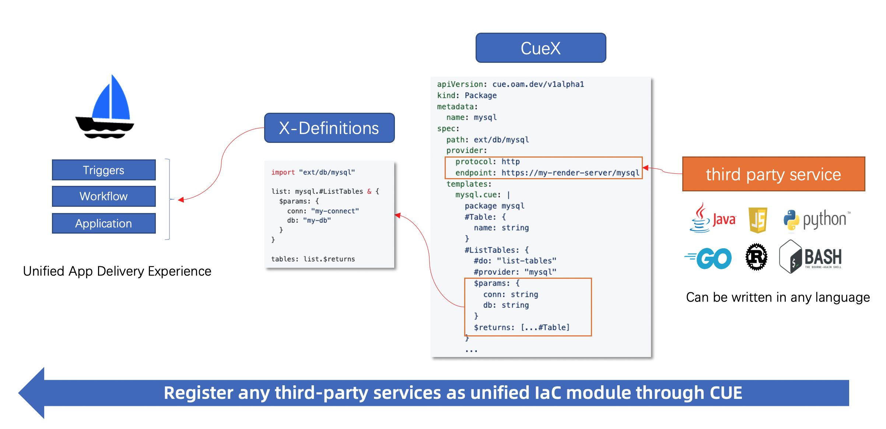

A `Package` resource registers functions that a definition can import. Each call is an HTTP POST to a service you run, the *provider*. CueX is the CUE engine in KubeVela that resolves these calls.

With a Package you can:
- Fetch data from APIs, databases or other services while a definition renders.
- Share one function between many definitions instead of repeating the logic in each.
- Write the provider in any language that can serve JSON over HTTP.

Every definition type can import a Package: components, traits, policies, workflow steps and sources.

## Structure of a Package
A `Package` in CueX is a Kubernetes CustomResource (CRD) that defines an external function provider and the functions it exposes. The key attributes of `Packages` are:

#### metadata.name
- The name of the `Package`, used to reference it in the `#provider` field.
- This must match the `#provider` value within function templates.

#### spec.path
- Defines the import path of the package within CUE definitions.
- In the example below, `ext/example` means functions from this package can be referenced as:

   ```cue
   import "ext/example"

   result: example.#ExampleFunctionName & {
        $params: { example_param: "value" }
   }
   ```

#### spec.provider
Specifies where CueX should send function calls.
- `spec.provider.protocol`: `http` or `https`.
- `spec.provider.endpoint`: The root endpoint of the function provider (e.g. http://my-cuex-server:8443/api/v1)
    >   e.g. If `#do: "api/example-fn-name"` is defined in a function, CueX will send `POST {provider_endpoint}/api/example-fn-name`.
- `spec.provider.header`: Optional headers to send with the request in string map format. 

#### spec.templates
- Defines CUE function templates that describe available functions.
- Each function includes:
   - `#do`: The function path that CueX will call (appended to `spec.provider.endpoint` at execution time).
   - `#provider`: The name of the package (must match `metadata.name`).
   - `$params`: The expected input format.
   - `$returns`: The expected output format.

### Example
```
apiVersion: cue.oam.dev/v1alpha1
kind: Package
metadata:
  name: external-package                  # Unique package name
spec:
  path: ext/example                       # Import path for CueX to reference
  provider:
    protocol: http                        # http or https
    endpoint: http://my-cuex-server:8443  # Root endpoint of the provider service
    header:
      User-Agent: CueX                    # Custom headers to send to the Provider service
  templates:
    utils.cue: |                          # The filename inside the package
      package example                     // Recommended to match the final segment of the {spec.path} value

      #ExampleFunctionName: {             // Available in Cue as example.#ExampleFunctionName
        #do: "api/example-fn-name"        // CueX will call `{spec.provider.endpoint}/api/example-fn-name`
        #provider: "external-package"     // Must match metadata.name
        $params: {
          example_param: string           // Structure should match the parameters of the Fn
        }
        $returns: {
          example_result: number          // Structure should match the return structure of the Fn
        }
      }
```

---

## How CueX Resolves Calls
For the above package, when CueX encounters:
```cue
import "ext/example"

result: example.#ExampleFunctionName & {
  $params: { example_param: "A string value.."  }
}
```

It will:
1. Look up the `#provider` (_"external-package"_).
2. Identify that `#do: "api/example-fn-name"` maps to the provider’s POST _\{endpoint\}/api/example-fn-name_.
3. Send a POST _http://my-cuex-server:8443/api/example-fn-name_ request with this payload:
   ```json
   { "example_param":  "A string value.." }
   ```
4. Expect a response like:
   ```json
   { "example_result": 42 }
   ```
5. Populate `$returns` in the CUE template with the received result.

---

## Implementing a Provider

External function providers can be written in any programming language, as long as they expose HTTP POST endpoints that match CueX’s expected request/response format.

### Provider Requirements
1. **Expose an HTTP API with matching paths**: Each function must be available at an HTTP POST endpoint, and the value specified in **#do** within the CUE Package must match the request path on the provider’s service. 

   For example, if `#do: "example"` is specified in the CUE package, the provider must expose a corresponding `/example` HTTP endpoint that handles the request.

2. **Accept JSON input**: The request payload should be a JSON object with a structure matching `$params`.

3. **Return JSON output**: The response should be a JSON object with a structure matching `$returns`.

### The provider contract

CueX calls a provider in a fixed way, and a few of its rules decide how you write `$returns`:

- The request is a `POST` to `{spec.provider.endpoint}/{#do}`, with `$params` as the JSON body, `Content-Type: application/json`, and any `spec.provider.header` values.
- With `https`, CueX does not verify the provider's TLS certificate.
- The HTTP status is not checked. CueX reads any response body, so an error page with status 500 is treated as a reply.
- The body must be a JSON object. An array, a bare value or an HTML page fails the call.
- Numbers come back as floating point. Declare numeric fields in `$returns` as `number`, not `int`: `7` arrives as `7.0` and conflicts with `int`.
- CueX sets no timeout of its own on the call, so a provider that hangs holds up the render.



---

## Example: Simple CUE Provider & Package
Lets define a very simple function `"sum"` which accepts two inputs and returns the sum. 
The function definition will look this:
```cue
#Sum: {                          
  #do: "sum"                     
  #provider: "external-cuex-package"
  $params: {
    x: number                    
    y: number
  }
  $returns: {
    result: number               
  }
}
```

### Implementing the Provider
#### Implementing the Provider in Go
Here’s an example of a very simple external CueX Provider written as a Go service. 

It implements the logic for the `"sum"` function and exposes it at `/sum`.

```go
package main

import (
	"encoding/json"
	"net/http"
)

type input struct {
	X int `json:"x"`                            // Matches the $params structure
	Y int `json:"y"`
}

type output struct {
	Result int `json:"result"`                  // Matches the $returns structure
}

func sumHandler(w http.ResponseWriter, r *http.Request) {
	var in input
	json.NewDecoder(r.Body).Decode(&in)

	out := output{Result: in.X + in.Y}
	w.Header().Set("Content-Type", "application/json")
	json.NewEncoder(w).Encode(out)
}

func main() {
	http.HandleFunc("/sum", sumHandler)         // Path must match `#do: "sum"`
	http.ListenAndServe(":8443", nil)
}
```

> **Note**: KubeVela provides a [simple server package](https://github.com/kubevela/pkg/blob/main/cue/cuex/externalserver/server.go) that can be utilised. 

#### Implementing the Provider in Python
For comparison, here’s the same CueX Provider implemented as a simple Python service:

```python
from flask import Flask, request, jsonify

app = Flask(__name__)

@app.route("/sum", methods=["POST"])            # Path must match `#do: "sum"`
def sum_numbers():
    data = request.json
    x = data.get("x", 0)                        # Extract values specified in $params
    y = data.get("y", 0)
    return jsonify({"result": x + y})           # Return JSON response as structure matching $returns

if __name__ == "__main__":
    app.run(host="0.0.0.0", port=8443) 
```

### Registering the Provider as a Package
Once the provider is running, it can be registered in Kubernetes as a `Package`:

```
apiVersion: cue.oam.dev/v1alpha1
kind: Package
metadata:
  name: external-cuex-package 
spec:
  path: ext/utils                               # Import path for CueX to reference
  provider:
    protocol: http
    endpoint: http://my-cuex-server:8443        # URL of the running provider service
  templates:
    utils.cue: |
      package utils

      #Sum: {                                   // Function name exposed to templates
        #do: "sum"                              // Function path to the provider services endpoint
        #provider: "external-cuex-package"      // The function provider (should match `metadata.name`)
        $params: {
          x: number
          y: number
        }
        $returns: {
          result: number
        }
      }

```

### Using the Package
With the Package registered, any definition can import `ext/utils` and call `utils.#Sum`. Here it is in a workflow step:

```cue
import (
	"ext/utils"                                             // The external provider
	"vela/op"
)

"example-workflow-step": {
	type: "workflow-step"
	description: "Workflow Step using external package"
}

template: {
	parameter: {}

	sum: utils.#Sum & {                                     // The exposed package & function                              
		$params: {
			"x": 2,
			"y": 5
		}
	} @step(1)

	msg: op.#Message & {
	    message: "The result is \(sum.$returns.result)"     // sum.$returns = { "result": 7 }
	} @step(2)
}
```

---

## When a call fails

A failed call fails the render, and the error says why:

| What went wrong | Where you see it | The error contains |
| --- | --- | --- |
| The provider is down or the endpoint doesn't resolve | The workflow step's message in `vela status <app>`; for a component, trait or policy, the Application's status | `Post "http://my-cuex-server:8443/sum": dial tcp ...` |
| The provider returned something other than a JSON object | Same places | A JSON decoding error, such as `invalid character '<' looking for beginning of value` |
| A field in the reply doesn't match `$returns` | Same places | `conflicting values`, naming the field, such as `float` against `int` |
| The import path doesn't match any Package's `spec.path` | Same places | `builtin package "ext/utils" undefined` |

To check a provider by hand, send it what CueX would:

```shell
curl -s -X POST http://my-cuex-server:8443/sum -H 'Content-Type: application/json' -d '{"x": 2, "y": 5}'
```

## What the controller sends

The call is made by the vela-core pod, whenever a definition that uses the Package renders, which for an Application can be every reconcile. It sends the `$params` you write, and the provider sees vela-core's network address. The [workflow HTTP limits](../workflow/workflow.md#http-limits) cover the built-in `vela/http` provider, not Package calls, so run providers inside the cluster or on an endpoint you trust. TLS isn't verified, so don't send secrets in `$params` to a provider outside a network you control.

## Configuration Flags

The following vela-core flags control external Packages in CueX:

| Flag                                                  | Type | Default  | Description                                                                   |
|-------------------------------------------------------|------|----------|-------------------------------------------------------------------------------|
| `enable-external-package-for-default-compiler`        | bool | `true`   | Enables the use of external packages.                                         |
| `enable-external-package-watch-for-default-compiler`  | bool | `false`  | Allows automatic reloading of external packages without restarting KubeVela.  |
