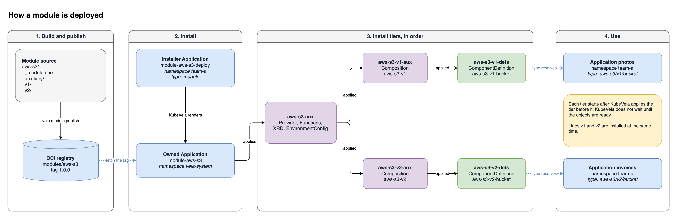

A module is a versioned package of KubeVela definitions. The package also carries the Kubernetes objects that those definitions need to work. Examples of these objects are Crossplane XRDs, Compositions, ConfigMaps, and RBAC rules.

You publish a module to an OCI registry, the same type of registry that holds container images and Helm charts. You install the module into a namespace with one component of type `module`. KubeVela then installs the objects in a fixed order and makes the definitions available to the Applications in that namespace.

:::note
Modules are new in KubeVela v1.12. The first release that contains them is `v1.12.0-alpha.1`. The feature is off by default. To turn it on, see [Turn the feature on](./module-registry.md#turn-the-feature-on).
:::

## Why modules

Definitions are the contract between a platform team and the application teams. An application team writes `type: bucket` and gives some parameters. The platform team owns the template behind that type.

Without modules, this contract is difficult to change safely:

- An addon upgrade replaces the definitions in place. A breaking change to a parameter applies to every Application at the same time.
- To prevent this, teams copy a definition to a new name, such as `bucket-v2`. Over time, the cluster collects many copies with no clear owner and no clear version.
- A definition often needs other objects to work, such as a Crossplane Composition. You must install those objects separately, and in the necessary order.
- An Application cannot tell which release of a definition it uses.

A module solves these problems with three ideas:

1. **API lines.** A module has one or more API lines, for example `v1` and `v2`. Each line is a stable contract. A breaking change goes into a new line. The old line stays installed until all Applications move to the new line.
2. **One package for each release.** The definitions and the objects that they need are in one package with one version tag. Install a tag, and you receive all the parts of that release.
3. **Ordered install.** KubeVela installs the supporting objects first and the definitions last.

## Inspiration

Modules use patterns that Kubernetes and Go users already know.

| Pattern | Where you know it from | How a module uses it |
| --- | --- | --- |
| More than one served version | A CRD can serve more than one version at the same time. Each client selects one. | A module can install API lines `v1` and `v2` at the same time. An Application selects one in its `type`, for example `aws-s3/v1/bucket`. Line names use the Kubernetes version format, for example `v1` or `v1beta1`. |
| Major version in the import path | A Go module puts a breaking release at a new path, for example `example.com/lib/v2`. | A breaking change goes into a new API line, so the `type` changes from `aws-s3/v1/bucket` to `aws-s3/v2/bucket`. |
| OCI artifacts | Container images and Helm charts are stored in OCI registries, with tags. | A module release is an OCI artifact. The tag is the package version, for example `1.2.0`. |

## Terms

| Term | Meaning |
| --- | --- |
| Module | A package with a name, for example `aws-s3`. The name is a DNS-1123 label. |
| Package version | The release of the package, for example `1.2.0`. It is the OCI tag. It tells you which files are in the package. |
| API line | A stable contract in the module. A line name has the form `vN`, `vNalphaN`, or `vNbetaN`, for example `v1` or `v2beta1`. Applications bind to an API line, not to a package version. |
| Capability | One definition in an API line, for example `bucket`. |
| Auxiliary object | A Kubernetes object that the module installs to support its definitions. Examples are an XRD, a Composition, or a ConfigMap. |
| Module registry | A name for an OCI location that holds modules. You add it with `vela module registry add`. |
| Installer Application | The Application that contains the `type: module` component. You create it with YAML or with `vela module deploy`. Its namespace is the install namespace. |
| Owned Application | The Application `module-<name>` in `vela-system`. KubeVela creates it from the installer Application. It installs the objects of the module. |

The package version and the API line are different numbers. Package `1.0.0` of `aws-s3` contains lines `v1` and `v2`. Package `1.0.1` can fix a bug in line `v1`. Applications that use `aws-s3/v1/bucket` receive the fix and do not change.

## How a module is deployed

The diagram shows the path of the `aws-s3` module from the source directory to the Applications that use it. The module has two API lines, `v1` and `v2`. Purple boxes are objects that the module installs, green boxes are definitions, and blue boxes are Applications.



1. The module author runs `vela module publish`. The CLI parses the directory and pushes it to the registry as one OCI artifact. The tag is the `version` in `_module.cue`.
2. You create the installer Application in a namespace, for example `team-a`. You can write the YAML, or run `vela module deploy`.
3. KubeVela fetches the package tag from the registry. It renders the owned Application `module-aws-s3` in `vela-system`.
4. The owned Application applies the objects in tiers:
   - `<module>-aux`: the objects that all API lines share, from `auxiliary/`. For `aws-s3`, these are the Crossplane provider, the functions, the XRD, and the EnvironmentConfig.
   - `<module>-<line>-aux`: the objects for one API line, from `v1/auxiliary/` or `v2/auxiliary/`. For `aws-s3`, each line has its own Composition.
   - `<module>-<line>-defs`: the definitions of that line.
5. Applications in `team-a` can now use `type: aws-s3/v1/bucket` and `type: aws-s3/v2/bucket`.

Each tier starts after KubeVela applies the tier before it. The two lines do not wait for each other. KubeVela does not wait until the objects in a tier are ready. For example, the definitions can be available before Crossplane installs the provider.

KubeVela creates the definitions in the install namespace. An auxiliary object that does not set `metadata.namespace` also goes into the install namespace.

The owned Application keeps the state of the installed objects. If a person deletes one of these objects, KubeVela applies it again at the next reconcile.

A cluster holds one install of each module name. To install the module in a different namespace, uninstall it first. See [Change the namespace of an install](./module-install.md#change-the-namespace-of-an-install).

## What a module can contain

A module can carry any Kubernetes object and any type of KubeVela definition. These are some typical modules:

| Module | Auxiliary objects | Definitions |
| --- | --- | --- |
| Cloud resources with Crossplane | Provider, Functions, XRD, Composition, EnvironmentConfig | A component that creates a composite resource, for example a bucket or a database |
| Resource graphs with KRO | ResourceGraphDefinition | A component that creates an instance of the graph |
| Team conventions | ConfigMaps with defaults, RBAC rules | Traits that add labels or annotations, and policies |
| Delivery steps | Secrets or ConfigMaps for an external system | Workflow steps that call that system |

## Example: S3 buckets with Crossplane

The next pages use this example. A platform team gives application teams an S3 bucket. Crossplane creates the bucket in AWS. The module has two API lines, and one cluster serves both lines at the same time:

- Line `v1` takes an optional `region` and some tags.
- Line `v2` changes the name of `region` to `location`, and it adds the required parameter `owner`. These are breaking changes, so they are in a new line.

```text
aws-s3/
  _module.cue                  module: "aws-s3", version: "1.0.0"
  auxiliary/                   Objects that both lines share
    packages.yaml              Crossplane Provider and Functions
    xrd.yaml                   Crossplane XRD: the ObjectBucket API
    settings.yaml              EnvironmentConfig: default region and tags
  v1/
    _version.cue               apiVersion: "v1"
    auxiliary/
      composition.yaml         Composition aws-s3-v1
    definitions/
      bucket.cue               ComponentDefinition: region, tags
  v2/
    _version.cue               apiVersion: "v2"
    auxiliary/
      composition.yaml         Composition aws-s3-v2
    definitions/
      bucket.cue               ComponentDefinition: location, owner, tags
```

Two application teams in `team-a` use the two lines at the same time. Each Application selects its line in `type`:

```yaml
apiVersion: core.oam.dev/v1beta1
kind: Application
metadata:
  name: photos
  namespace: team-a
spec:
  components:
    - name: photos
      type: aws-s3/v1/bucket
      properties:
        region: eu-west-1
        tags:
          team: photos
---
apiVersion: core.oam.dev/v1beta1
kind: Application
metadata:
  name: invoices
  namespace: team-a
spec:
  components:
    - name: invoices
      type: aws-s3/v2/bucket
      properties:
        location: eu-central-1
        owner: team-billing
        tags:
          team: invoices
```

Each definition selects the Composition of its line, so each Application receives its own bucket. Later, the `photos` team can move to `v2`. When no Application uses `v1`, the platform team retires `v1` in a new package version.

The full module, with every file and each of these steps, is in [Example: S3 Buckets with Crossplane](./module-crossplane.md).

## Quick start

These commands publish a module, install it, and use it. The next pages explain each command.

```shell
# Register the OCI location of your modules. Do this one time for each cluster.
vela module registry add catalog oci://ghcr.io/myorg/modules

# Create a module. Edit the files, and set version: "1.0.0" in _module.cue.
vela module init aws-s3
vela module publish ./aws-s3 --registry catalog

# Install the module into the namespace team-a. The namespace must exist.
kubectl create namespace team-a
vela module deploy aws-s3 --registry catalog --version 1.0.0 -n team-a

# Check the install.
vela status module-aws-s3-deploy -n team-a
```

## Next steps

- [Module Registries](./module-registry.md): turn on the feature, install the CLI, add a registry, and set publish credentials.
- [Install and Use a Module](./module-install.md): install with the CLI or with YAML, use the definitions, upgrade, and uninstall.
- [Build and Publish a Module](./module-author.md): the package layout, the files, and the publish rules.
- [Example: S3 Buckets with Crossplane](./module-crossplane.md): a full module, from files to a bucket.
- [Module Multi-Cluster Placement](./module-multicluster.md): send the supporting objects to managed clusters.
- [Modules in Addons](./module-addon.md): include modules in an addon.
- The `module` component fields: [built-in components](../../end-user/components/references.md#module).
