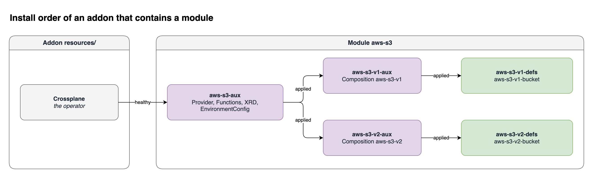

An addon can install modules. Use this when a module needs infrastructure, such as an operator. The addon installs the operator from `resources/`. Then the addon installs the module.

For example, one addon can install Crossplane, and then the [aws-s3 module](./module-crossplane.md). The module brings the AWS provider and the functions in its auxiliary objects.

If you do not know addons, read [Make Your Own Addon](../addon/intro.md) first.

## Before you start

- Turn on `EnableModuleComponent` and `EnableAddonComponent`:

  ```shell
  helm upgrade kubevela kubevela/vela-core -n vela-system --reuse-values \
    --set featureGates.enableModuleComponent=true \
    --set featureGates.enableAddonComponent=true
  ```

- Read [Make Your Own Addon](../addon/intro.md) for the addon layout.
- Follow the addon `crossplane-storage` on this page. It imports the module `aws-s3`.

An OCI addon registry looks for a catalog index. `vela addon registry add` for an OCI registry requested `kubevela-addon-catalog`, logged HTTP 404, and did not finish. Stopping it after 90 seconds left only the default Helm registry in `vela addon registry list`. The registry was not saved. The GHCR URL in the [module registry example](./module-registry.md#example-private-packages-on-ghcr) does not provide that index. This page does not show a completed OCI addon registry add.

`vela addon enable` on a local addon directory ignores `modules/`. Use a local directory only for those ignored parts. This page does not show a completed `type: addon` install.

:::caution
Only a `type: addon` component installs the modules of an addon. `vela addon enable` installs the other parts of the addon, but it ignores `modules/`. This is true for an addon from a registry and for an addon in a local directory.
:::

## Two ways to include a module

| Way | Where | KubeVela fetches the module |
| --- | --- | --- |
| Inline module | A module directory in `modules/<name>/` of the addon | No. The module is part of the addon. |
| Imported module | An entry in `modules/_imports.cue` | Yes, from a module registry |

An addon can use both ways at the same time.

## Inline modules

Put the module directory under `modules/`. It is the same layout as a published module. See [Build and Publish a Module](./module-author.md).

```text
crossplane-storage/
  metadata.yaml
  template.cue
  resources/
    crossplane.cue           Crossplane, the operator
  modules/
    aws-s3/
      _module.cue
      auxiliary/
        packages.yaml
        xrd.yaml
        settings.yaml
      v1/
        _version.cue
        auxiliary/
          composition.yaml
        definitions/
          bucket.cue
```

Each directory directly under `modules/` must contain `_module.cue`. If one does not, the addon does not load:

```text
modules/broken: missing _module.cue; every directory directly under modules/ must be an inline module (external references belong in modules/_imports.cue instead)
```

An inline module always installs on the hub. A `placement` on the `type: addon` component does not apply to it.

## Imported modules

Import a module that you published to a module registry. Each entry becomes one `type: module` component in the addon Application.

```cue
// modules/_imports.cue
imports: [{
	module: "aws-s3"
	sources: [{registry: "catalog", version: "1.0.0"}]
}, {
	module:  "aws-rds"
	enabled: false
	sources: [{registry: "catalog", version: "2.3.0"}]
}]
```

| Field | Meaning |
| --- | --- |
| `module` | Required. The module name. |
| `enabled` | Optional. `false` skips the module. The default is `true`. |
| `sources` | Required. Exactly one entry. |
| `sources[].registry` | A name from `vela module registry add` on the cluster that installs the addon. If you omit it, KubeVela selects the registry in the same way as for a `type: module` component. See [How KubeVela selects the registry](./module-registry.md#how-kubevela-selects-the-registry). |
| `sources[].version` | The package version. Use an exact version, for example `1.0.0`. Do not use a range. |
| `placement` | Optional. Where the runtime objects of the module go. See [Place the modules of an addon](#place-the-modules-of-an-addon). |

## Install the addon

Install the addon with a `type: addon` component. The parameters of the addon go in `properties.properties`.

```yaml
apiVersion: core.oam.dev/v1beta1
kind: Application
metadata:
  name: storage-platform
  namespace: team-a
spec:
  components:
    - name: crossplane-storage
      type: addon
      properties:
        registry: addons
        version: "1.0.0"
        properties: {}
```

KubeVela creates the addon Application `addon-crossplane-storage` in `vela-system`. The module definitions install into the namespace of the installing Application, `team-a` in this example. KubeVela also creates the owned Application `module-<name>` of each module in `vela-system`.

## Install order

The module components depend on all components from `resources/`. KubeVela installs the modules only after the addon resources are healthy.



In the diagram, the grey box is the addon resource. The purple boxes are the auxiliary tiers of the module, and the green boxes are the definitions tiers of lines `v1` and `v2`. Inside the module, each tier starts after KubeVela applies the tier before it.

The health of a resource depends on its component type. A `k8s-objects` component is healthy when the cluster accepts its objects.

In the addon Application, an imported module is a `type: module` component. An inline module is a `k8s-objects` component that contains the owned Application of the module.

## Place the modules of an addon

On a hub with managed clusters, the runtime objects of an imported module can follow the addon to the managed clusters. The module marks its objects as `hub` or `runtime`, in the same way as a module that you install directly. See [Module Multi-Cluster Placement](./module-multicluster.md).

There are three ways to select the clusters.

### 1. A literal placement on an import

```cue
imports: [{
	module: "aws-s3"
	sources: [{registry: "catalog", version: "1.1.0"}]
	placement: clusterLabelSelector: region: "east"
}]
```

`placement` takes `clusters`, `clusterLabelSelector`, and `allowEmpty`, with the same rules as the `type: module` component.

### 2. Copy the topology of the addon

Most multi-cluster addons have a topology policy that their parameters fill, for example `clusters`. `fromPolicy` copies the clusters of that policy, so the module goes where the addon goes.

```cue
// template.cue
output: {
	apiVersion: "core.oam.dev/v1beta1"
	kind:       "Application"
	spec: {
		components: []
		policies: [{
			name: "deploy-topology"
			type: "topology"
			properties: clusters: parameter.clusters
		}]
	}
}
```

```cue
// modules/_imports.cue
imports: [{
	module: "aws-s3"
	sources: [{registry: "catalog", version: "1.1.0"}]
	placement: fromPolicy: "deploy-topology"
}]
```

```yaml
    - name: crossplane-storage
      type: addon
      properties:
        registry: addons
        version: "1.0.0"
        properties:
          clusters: [east-1, east-2]
```

`fromPolicy` copies `clusters`, `clusterLabelSelector`, and `allowEmpty` from the policy. It does not copy `namespace`. The module objects always use the install namespace.

Do not use `fromPolicy` together with `clusters`, `clusterLabelSelector`, or `allowEmpty` on the same import.

### 3. Placement on the type: addon component

When the addon has no topology policy, the installer can place the full addon:

```yaml
apiVersion: core.oam.dev/v1beta1
kind: Application
metadata:
  name: storage-platform
  namespace: default
spec:
  components:
    - name: crossplane-storage
      type: addon
      properties:
        registry: addons
        version: "1.0.0"
        placement:
          clusterLabelSelector:
            region: east
```

KubeVela adds the topology policy `addon-placement` to the addon Application. The `resources/` components go to the selected clusters. KubeVela copies the same placement to each imported module that sets no `placement` of its own. An inline module in `modules/<name>/` does not follow the addon placement, so its runtime objects and its owned Application stay on the hub.

KubeVela refuses this `placement` in two cases. The addon decides its own clusters in these cases.

| The addon has | Error |
| --- | --- |
| A topology policy | `addon "<name>" places itself with its topology policy "<policy>", so placement cannot be set; use the addon's own parameters instead` |
| A workflow | `addon "<name>" defines its own workflow, so placement cannot be set; use the addon's own parameters instead` |

For a refused request, KubeVela does not change the addon Application. The error is in the workflow step of the installing Application.

### The module components stay on the hub

A module component creates the owned Application of the module. That Application must be on the hub, where KubeVela runs. When an addon has a topology policy and no workflow, KubeVela adds these policies and steps to the addon Application:

| Name | Kind | Contents |
| --- | --- | --- |
| `addon-components` | Override policy | Selects the components that are not modules |
| `addon-modules-hub` | Topology policy | Selects the cluster `local` |
| `addon-modules` | Override policy | Selects the module components |
| `deploy-<policy>` | Workflow step | One step for each topology policy of the addon. It deploys the components that are not modules. |
| `deploy-addon-modules` | Workflow step | Deploys the module components to the hub |

The owned Application of each module then sends its runtime objects to the clusters of its placement.

### Errors in fromPolicy

A wrong `fromPolicy` stops the addon render. The error is in the workflow step of the installing Application:

| Problem | Error |
| --- | --- |
| The policy does not exist | `modules/_imports.cue: module "aws-s3": placement.fromPolicy "<name>": no such policy` |
| The policy is not a topology policy | `modules/_imports.cue: module "aws-s3": placement.fromPolicy "<name>" is a <type> policy, not topology` |
| The policy selects no clusters | `modules/_imports.cue: module "aws-s3": placement.fromPolicy "<name>": placement must set clusters or clusterLabelSelector` |
| The policy sets only the old `clusterSelector` field | `... the policy sets the deprecated clusterSelector, which is ignored unless the DeprecatedPolicySpec feature gate is on; use clusterLabelSelector` |
| `fromPolicy` with other placement fields | `modules/_imports.cue: module "aws-s3": placement.fromPolicy cannot be combined with clusters, clusterLabelSelector or allowEmpty` |

## Check the addon

```shell
vela status storage-platform -n team-a
vela addon status crossplane-storage
kubectl -n vela-system get application addon-crossplane-storage -o yaml
vela status module-aws-s3 -n vela-system
```

The `addon` component of the installing Application can show `Ready` before a module finishes its install. Read the status of each owned Application `module-<name>` to see its tiers.

## Uninstall the addon

Delete the installing Application. KubeVela deletes the addon Application, the owned Applications of the modules, the definitions, and the objects on the managed clusters.

```shell
kubectl -n team-a delete application storage-platform
```
