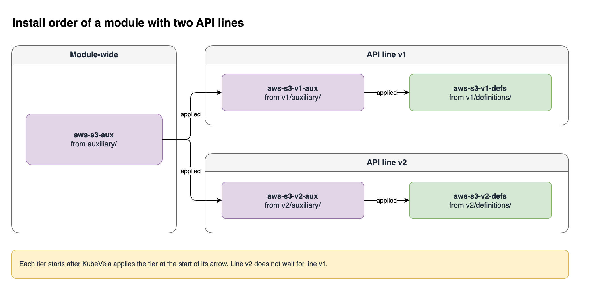

This page is for module authors. It describes the package layout, the files in it, and how to publish a package version. For a full example, see [Example: S3 Buckets with Crossplane](./module-crossplane.md).

## Create the directory

`vela module init` creates a module directory that the parser accepts:

```shell
vela module init aws-s3
vela module init aws-s3 --path ./modules
```

```text
aws-s3/
  _module.cue          version "0.1.0", with TODO markers
  README.md
  auxiliary/           empty
  v1/
    _version.cue       apiVersion "v1"
    auxiliary/         empty
    definitions/
      example.cue
```

Edit the `TODO` markers. Rename `example.cue` and its `"example"` key to the name of your capability. Put supporting objects in `auxiliary/` and `v1/auxiliary/`, or delete the empty directories.

If the target directory exists and is not empty, the command fails.

## The layout

```text
aws-s3/
  _module.cue          Module name and package version. Required.
  auxiliary/           Objects for all API lines. Optional.
  v1/                  API line v1.
    _version.cue       Line name and enabled flag. Required for each line.
    auxiliary/         Objects for line v1 only. Optional.
    definitions/       Definitions of line v1. One or more files.
  v2/
    _version.cue
    definitions/
```

KubeVela installs the parts in this order. Purple boxes are auxiliary objects, and green boxes are definitions.



Each tier starts after KubeVela applies the tier before it. API lines do not wait for each other. Line `v2` does not wait for line `v1`.

This order gives you two guarantees:

- Objects in `auxiliary/` exist before the objects of a line that use them. For example, a Crossplane XRD exists before a Composition that refers to it.
- The objects of a line exist before the definitions of that line.

KubeVela does not wait until an object is ready. A definition can be available before the objects under it are ready. For example, Crossplane can still download a provider when Application teams can already use the definition. Tell the operators of your module what to wait for.

## _module.cue

```cue
module:      "aws-s3"
version:     "1.0.0"
description: "S3 buckets through Crossplane"
owners: ["team-storage"]
```

| Field | Rule |
| --- | --- |
| `module` | Required. A DNS-1123 label: lowercase letters, digits, and `-`. |
| `version` | Required. `major.minor.patch`, with no `v` in front. It is the OCI tag. |
| `placement` | Optional. `hub` or `runtime`. See [Module Multi-Cluster Placement](./module-multicluster.md). |

The parser ignores other fields, such as `description` and `owners`. People who read the package can still use them.

## _version.cue

Each directory at the root of the module whose name starts with `v` is an API line. The directory must contain `_version.cue`. KubeVela does not read the other directories at the root, for example a directory `x1`.

```cue
apiVersion: "v1"
enabled:    true
```

| Field | Rule |
| --- | --- |
| `apiVersion` | Required. The name of the line, in the form `vN`, `vNalphaN`, or `vNbetaN`. `N` is a number. |
| `enabled` | Optional. The default is `true`. If `false`, the line is in the package, but KubeVela does not install it. |
| `placement` | Optional. `hub` or `runtime`. It replaces the `placement` of the module for the objects of this line. |

:::note
The `apiVersion` in `_version.cue` is the name of the line. The directory name is not the line name. It only has to start with `v`. KubeVela uses `apiVersion` in the type and in the installed names. Give the directory the same name as the line, so that people can find the files of a line.

A line name is `v` and a number. Then, optionally, `alpha` or `beta` and a second number. A line name has no hyphen. Accepted names are `v1`, `v2`, `v10`, `v1alpha1`, `v1alpha2`, and `v1beta1`.
:::

Use `vN` for a stable contract. Use an `alpha` or `beta` line for a preview of a new contract, for example `v2beta1` before `v2`. A breaking change goes into a new line, also when the line is a preview. Each name is a separate line, so `aws-s3/v2beta1/bucket` and `aws-s3/v2/bucket` are different definitions.

Publish stops when `apiVersion` does not have one of these forms, for example `"1"`, `"one"`, or `"v1-alpha1"`. The error contains this text:

```text
apiVersion "1" in v1/_version.cue is invalid, must match ^v\d+(alpha\d+|beta\d+)?$
```

Publish also stops when two lines have the same `apiVersion`, also when their directories have different names:

```text
Error: parse module: duplicate line "v1" (from directory v2)
```

Use `enabled: false` for two purposes:

- To ship a line before it is ready. A later package version sets `enabled: true`.
- To retire a line. The files stay in the package, and KubeVela deletes the installed definitions and auxiliary objects of the line. For an example, see [Retire line v1](./module-crossplane.md#retire-line-v1).

Install that later package with `--version`. The command is in [Select a package version](#select-a-package-version).

## Definitions

Each file in `<line>/definitions/` is one definition. A line must have one or more definitions.

### CUE format

A CUE file has a key and a `template` block. The key is the capability name.

```cue
"bucket": {
	type:        "component"
	description: "AWS S3 bucket. Crossplane creates the bucket."
	attributes: workload: type: "autodetects.core.oam.dev"
}

template: {
	output: {
		apiVersion: "storage.example.org/v1alpha1"
		kind:       "ObjectBucket"
		metadata: name: context.name
		spec: region: parameter.region
	}
	parameter: region: *"us-east-1" | string
}
```

`type` is `component`, `trait`, `policy`, `workflow-step`, or `workload`. The format is the same as the format of `vela def`. See [Manage Definition](../cue/definition-edit.md).

:::tip
Use `workload: type: "autodetects.core.oam.dev"` when the output kind comes from a CRD that the module creates. With `workload: definition`, the CRD must exist when KubeVela applies the definition. A CRD that a controller creates later, such as the CRD that Crossplane creates from an XRD, can be absent at that time. The definitions tier then fails with an error like this:

```text
admission webhook "mutating.core.oam-dev.v1beta1.componentdefinitions" denied the request: no matches for kind "Ghost" in version "storage.example.org/v1alpha1"
```
:::

### YAML format

A YAML file is a full definition object, the same object that you can apply with `kubectl`. `metadata.name` is the capability name. Use this format when another tool generates the definition.

```yaml
apiVersion: core.oam.dev/v1beta1
kind: TraitDefinition
metadata:
  name: tags
  annotations:
    definition.oam.dev/description: Add tags to a bucket.
spec:
  appliesToWorkloads:
    - "*"
  schematic:
    cue:
      template: |
        patch: spec: tags: parameter.tags
        parameter: tags: [string]: string
```

The parser checks that `metadata.name` is a valid name. The cluster checks the rest of a YAML definition when KubeVela applies it.

### The installed name

KubeVela installs each definition as `<module>-<apiVersion>-<capability>`, for example `aws-s3-v1-bucket`. It also adds the labels `definition.oam.dev/module`, `definition.oam.dev/module-api-version`, and `definition.oam.dev/name`. Application teams use the type `aws-s3/v1/bucket`.

## Auxiliary objects

Put an object in `auxiliary/` when all lines use it. Put an object in `<line>/auxiliary/` when only that line uses it.

| Use | Location |
| --- | --- |
| Crossplane XRD. One XRD serves all versions of a composite type. | `auxiliary/` |
| Crossplane Provider and Function packages | `auxiliary/` |
| Crossplane Composition for one API line | `<line>/auxiliary/` |
| KRO ResourceGraphDefinition | `<line>/auxiliary/` |
| ConfigMap or Crossplane EnvironmentConfig with defaults | `auxiliary/`, or `<line>/auxiliary/` when the defaults are different for each line |
| RBAC rules | The location of the objects that need them |

A file is `.yaml`, `.yml`, or `.cue`. Publish stops on a file with a different extension.

- A YAML file contains one or more Kubernetes objects, separated by `---`.
- A CUE file contains one object at its root. Do not put the object under a key.

```cue
apiVersion: "v1"
kind:       "ConfigMap"
metadata: name: "aws-s3-v1-settings"
data: line: "v1"
```

KubeVela installs every file directly in `auxiliary/` and in `<line>/auxiliary/`. It does not read subdirectories, with one exception: `auxiliary/hub/`. See [Module Multi-Cluster Placement](./module-multicluster.md).

If a namespaced object does not set `metadata.namespace`, KubeVela creates it in the install namespace. If the object sets a namespace, KubeVela keeps that namespace. A cluster-scoped object, such as an XRD, has no namespace.

## Publish

`vela module publish` parses the directory, checks it, and pushes it. The tag is the `version` field in `_module.cue`.

Add the registry before you publish. The URL is a positional argument. There is no `--url` flag. Read the password from stdin. For GitHub Container Registry, the password is a GitHub token with the `read:packages` scope or the `write:packages` scope. Use your GitHub user name as the username.

```shell
printf '%s' "$GITHUB_TOKEN" | vela module registry add ghcr oci://ghcr.io/myorg/modules \
  --username my-github-user --password-stdin
```

The registry page documents the Secret and a private package. See [Example: private packages on GHCR](./module-registry.md#example-private-packages-on-ghcr). For publish with no cluster connection, see [Publish credentials](./module-registry.md#publish-credentials).

```shell
vela module publish ./aws-s3 --registry ghcr
```

Check the target and the package annotations first. `--dry-run` does not push:

```shell
vela module publish ./aws-s3 --registry ghcr --dry-run
```

```text
Would publish ghcr.io/myorg/modules/aws-s3:1.0.0
  modules.oam.dev/enabled-lines: v1,v2
  modules.oam.dev/lines: v1,v2
  modules.oam.dev/module: aws-s3
```

The registry name in the command and the host in that output are the same registry. Here both are `ghcr`.

An omitted `--registry` uses the selected default. That default is the wrong registry when you publish somewhere else. Pass `--registry` with the registry you publish to. The rules are in [How KubeVela selects the registry](./module-registry.md#how-kubevela-selects-the-registry).

`lines` lists all lines in the package. `enabled-lines` lists the lines that KubeVela installs. After a line is retired with `enabled: false`, the line is in `lines` but not in `enabled-lines`.

### Version rules

A published tag is immutable. To publish a change, increase `version` in `_module.cue` and publish again. If the tag exists, publish stops with this error:

```text
ghcr.io/myorg/modules/aws-s3:1.0.0 is already published; bump version in ./aws-s3/_module.cue and publish again, or pass --force to overwrite
```

| Flag | Use |
| --- | --- |
| `--version 1.1.0-rc1` | Push with a different tag. The `version` inside the package does not change. The value must be semver. |
| `--force` | Replace a tag that exists. Use it only for test tags, for example a release candidate. |

### Select a package version

Use the package version to show the operator what changed:

| Change | Package version | API line |
| --- | --- | --- |
| Fix a template. The parameters do not change. | Increase the patch number, for example `1.0.1`. | Same line |
| Add an optional parameter. | Increase the minor number, for example `1.1.0`. | Same line |
| Rename a parameter, or add a required parameter. | Increase the minor number. | New line, for example `v2`. Keep `v1`. |
| Retire line `v1`, after all Applications use `v2`. | Increase the major number, for example `2.0.0`. | Delete the `v1` directory, or set `enabled: false`. |

An API line is a promise to Application teams. Do not make a breaking change to a line that you published. KubeVela does not check that a change to a line is compatible.

When you publish a new package version, install that version with `--version`. This includes a package that sets `enabled: false` on a line.

A first install with no `--version` selects the highest semver tag, for example `1.10.0` before `1.2.0`, and stores `version` as `""`. A later deploy with no `--version` leaves that empty value. The installed package stays. A tag you publish later stays unused until you pass `--version`.

If the Application already stores a version, a deploy with no `--version` writes `""` over that version. KubeVela then selects the highest semver tag.

```shell
vela module deploy aws-s3 --registry ghcr --version 2.0.0 -n module-test
```

## Test a module

1. Add the registry with the command in [Publish](#publish).
2. Publish the package to that registry.
3. Install the module with `vela module deploy` into a test namespace.
4. Apply an Application that uses the `bucket` definition.
5. Run `vela status` on your Application, on the installer, and on the owned Application.

A first install can omit `--version`. KubeVela selects the highest semver tag and stores `version` as `""`. To install a later package, pass `--version`, as in [Select a package version](#select-a-package-version).

```shell
printf '%s' "$GITHUB_TOKEN" | vela module registry add ghcr oci://ghcr.io/myorg/modules \
  --username my-github-user --password-stdin
vela module publish ./aws-s3 --registry ghcr
kubectl create namespace module-test
vela module deploy aws-s3 --registry ghcr -n module-test
```

For a registry with no TLS, pass an `http://` URL and no password:

```shell
vela module registry add dev http://registry.local:5000/modules
vela module publish ./aws-s3 --registry dev
vela module deploy aws-s3 --registry dev -n module-test
```

The registry URL must work from your workstation and from the cluster. See [A registry URL must work from two places](./module-registry.md#a-registry-url-must-work-from-two-places).

An omitted `--registry` uses the selected default. That default is the wrong registry when you publish somewhere else. See [How KubeVela selects the registry](./module-registry.md#how-kubevela-selects-the-registry).

The `bucket` definition takes a `region` property. Apply this Application in the install namespace:

```yaml
apiVersion: core.oam.dev/v1beta1
kind: Application
metadata:
  name: photos
  namespace: module-test
spec:
  components:
    - name: photos
      type: aws-s3/v1/bucket
      properties:
        region: eu-west-1
```

Pass `-n` on each `vela status` command. The CLI prints the Application name and the namespace.

```shell
vela status photos -n module-test
vela status module-aws-s3-deploy -n module-test
vela status module-aws-s3 -n vela-system
```

`photos` is your Application in `module-test`. The installer name is `module-aws-s3-deploy` in that same namespace. The owned Application name is `module-aws-s3` in `vela-system`.

```text
About:

  Name:      	photos
  Namespace: 	module-test
```

```text
About:

  Name:      	module-aws-s3-deploy
  Namespace: 	module-test
```

```text
About:

  Name:      	module-aws-s3
  Namespace: 	vela-system
```

Read the tiers from the owned Application and from the tier table that `vela module deploy` prints. The `Ready:N/N` message on the installer can stay at an old count. Use the tier table and the owned Application as the completion check. See [Check the install](./module-install.md#check-the-install).
