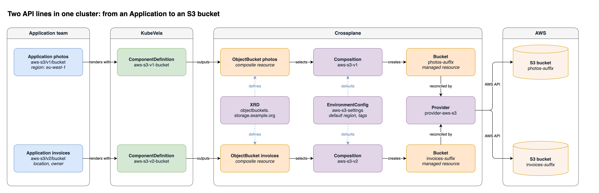

This example builds the `aws-s3` module with two API lines, `v1` and `v2`. One package installs both lines in the same cluster. Application teams in one namespace can use `aws-s3/v1/bucket` and `aws-s3/v2/bucket` at the same time. They do not need to know Crossplane.

The two lines are two contracts for the same S3 bucket:

| Line | Type | Parameters |
| --- | --- | --- |
| `v1` | `aws-s3/v1/bucket` | `region` (optional) and `tags` |
| `v2` | `aws-s3/v2/bucket` | `location` (required), `owner` (required), and `tags` |

Line `v2` changes the name of `region` to `location`, and it adds the required parameter `owner`. These are breaking changes, so they are in a new line. Applications that use `v1` do not change.

The module contains:

- The Crossplane packages that the buckets need: the AWS S3 provider and three composition functions. Both lines use them.
- A Crossplane XRD. It defines the `ObjectBucket` API. Both lines use it.
- A Crossplane EnvironmentConfig. It holds the default region and the default tags of the platform. Both lines use it.
- One Crossplane Composition for each line, `aws-s3-v1` and `aws-s3-v2`. A Composition changes an `ObjectBucket` into an AWS S3 `Bucket`.
- One KubeVela ComponentDefinition for each line, `aws-s3-v1-bucket` and `aws-s3-v2-bucket`. A definition changes a component of an Application into an `ObjectBucket`.

## How the parts work together



The diagram shows two Applications in the namespace `team-a`. `photos` uses line `v1`, and `invoices` uses line `v2`. Follow each row from left to right:

1. KubeVela renders the component with the definition of its line, `aws-s3-v1-bucket` or `aws-s3-v2-bucket`.
2. The definition outputs an `ObjectBucket` in the namespace of the Application.
3. The `ObjectBucket` selects the Composition of the same line, `aws-s3-v1` or `aws-s3-v2`.
4. The Composition reads the defaults from the EnvironmentConfig `aws-s3-settings`. Crossplane compositions read an EnvironmentConfig, not a ConfigMap. An EnvironmentConfig holds key-value data in the same way as a ConfigMap.
5. The Composition creates a `Bucket` managed resource.
6. The provider `provider-aws-s3` creates the bucket in AWS.

The middle row shows the objects that the two lines share: the XRD, the EnvironmentConfig, and the provider. Each line has its own definition and its own Composition.

In the diagram, the module installs the purple objects. The green objects are the definitions from the module. Crossplane creates the orange objects for each bucket. The blue objects are the Applications of the application teams.

## Before you start

The module installs the provider, the functions, and the Crossplane objects. You must supply two items that the module cannot carry:

- Crossplane v2 on the cluster. See [Install Crossplane](https://docs.crossplane.io/latest/get-started/install/). Crossplane serves the `Provider` and `Function` APIs, so it must be on the cluster before the module.
- AWS credentials for the provider. The credentials are secret and are different for each cluster, so do not put them in the module. You add them after the provider is Healthy. See [Add the AWS credentials](#add-the-aws-credentials).

To install Crossplane and the module together, put Crossplane in the `resources/` directory of an addon, and put the module in the same addon. See [Modules in Addons](./module-addon.md).

:::note
We tested this page with Crossplane v2.4, `provider-aws-s3` v2.9.0, and the function versions in `packages.yaml`. Check the fields against the versions that you use.
:::

## The files

```text
aws-s3/
  _module.cue
  auxiliary/
    packages.yaml
    xrd.yaml
    settings.yaml
  v1/
    _version.cue
    auxiliary/
      composition.yaml
    definitions/
      bucket.cue
  v2/
    _version.cue
    auxiliary/
      composition.yaml
    definitions/
      bucket.cue
```

### _module.cue

```cue
module:  "aws-s3"
version: "1.0.0"
```

### auxiliary/packages.yaml

The provider and the functions are Crossplane packages. All API lines use them, so they are in `auxiliary/`. One file can contain many objects. Separate them with `---`.

```yaml
apiVersion: pkg.crossplane.io/v1
kind: Provider
metadata:
  name: provider-aws-s3
spec:
  package: xpkg.crossplane.io/crossplane-contrib/provider-aws-s3:v2.9.0
---
apiVersion: pkg.crossplane.io/v1
kind: Function
metadata:
  name: function-environment-configs
spec:
  package: xpkg.crossplane.io/crossplane-contrib/function-environment-configs:v0.9.2
---
apiVersion: pkg.crossplane.io/v1
kind: Function
metadata:
  name: function-patch-and-transform
spec:
  package: xpkg.crossplane.io/crossplane-contrib/function-patch-and-transform:v0.11.2
---
apiVersion: pkg.crossplane.io/v1
kind: Function
metadata:
  name: function-auto-ready
spec:
  package: xpkg.crossplane.io/crossplane-contrib/function-auto-ready:v0.7.3
```

To upgrade the provider or a function, change the package tag in this file and publish a new module version. The provider and the functions are cluster-scoped, so they have no namespace.

### auxiliary/xrd.yaml

One XRD serves all versions of a composite type, so the XRD is in `auxiliary/`. All API lines share it.

```yaml
apiVersion: apiextensions.crossplane.io/v2
kind: CompositeResourceDefinition
metadata:
  name: objectbuckets.storage.example.org
spec:
  group: storage.example.org
  names:
    kind: ObjectBucket
    plural: objectbuckets
  scope: Namespaced
  versions:
    - name: v1alpha1
      served: true
      referenceable: true
      schema:
        openAPIV3Schema:
          type: object
          properties:
            spec:
              type: object
              properties:
                region:
                  type: string
                  description: AWS region. Empty uses the platform default.
                tags:
                  type: object
                  additionalProperties:
                    type: string
```

### auxiliary/settings.yaml

The platform team keeps its defaults here. Both lines read this object. To change a default, edit this file and publish a new package version. Application teams do not change.

```yaml
apiVersion: apiextensions.crossplane.io/v1beta1
kind: EnvironmentConfig
metadata:
  name: aws-s3-settings
data:
  defaultRegion: us-east-1
  tags:
    managed-by: kubevela
    cost-center: platform
```

### v1/_version.cue and v2/_version.cue

Each line has its own `_version.cue`. Both lines are enabled.

```cue
apiVersion: "v1"
enabled:    true
```

```cue
apiVersion: "v2"
enabled:    true
```

### v1/auxiliary/composition.yaml

The Composition is the logic behind line `v1`, so it is in `v1/auxiliary/`. KubeVela applies it after the XRD.

```yaml
apiVersion: apiextensions.crossplane.io/v1
kind: Composition
metadata:
  name: aws-s3-v1
spec:
  compositeTypeRef:
    apiVersion: storage.example.org/v1alpha1
    kind: ObjectBucket
  mode: Pipeline
  pipeline:
    - step: load-settings
      functionRef:
        name: function-environment-configs
      input:
        apiVersion: environmentconfigs.fn.crossplane.io/v1beta1
        kind: Input
        spec:
          environmentConfigs:
            - type: Reference
              ref:
                name: aws-s3-settings
    - step: bucket
      functionRef:
        name: function-patch-and-transform
      input:
        apiVersion: pt.fn.crossplane.io/v1beta1
        kind: Resources
        resources:
          - name: bucket
            base:
              apiVersion: s3.aws.m.upbound.io/v1beta1
              kind: Bucket
              spec:
                forProvider: {}
            patches:
              - type: FromEnvironmentFieldPath
                fromFieldPath: defaultRegion
                toFieldPath: spec.forProvider.region
              - type: FromEnvironmentFieldPath
                fromFieldPath: tags
                toFieldPath: spec.forProvider.tags
              - type: FromCompositeFieldPath
                fromFieldPath: spec.region
                toFieldPath: spec.forProvider.region
              - type: FromCompositeFieldPath
                fromFieldPath: spec.tags
                toFieldPath: spec.forProvider.tags
                policy:
                  toFieldPath: MergeObjects
    - step: ready
      functionRef:
        name: function-auto-ready
```

The patches run in order. The default region applies first. If the `ObjectBucket` sets `spec.region`, that value replaces the default. The tags of the Application merge with the tags of the platform.

### v2/auxiliary/composition.yaml

This file is a copy of `v1/auxiliary/composition.yaml`. Only `metadata.name` is different:

```yaml
metadata:
  name: aws-s3-v2
```

Each line has its own Composition. The platform team can then change the Composition of `v2`, and the buckets of `v1` do not change.

### v1/definitions/bucket.cue

This file is the contract of line `v1`. It has two parameters, `region` and `tags`.

```cue
"bucket": {
	type:        "component"
	description: "AWS S3 bucket. Crossplane creates the bucket."
	attributes: {
		workload: type: "autodetects.core.oam.dev"
		status: healthPolicy: #"""
			isHealth: *false | bool
			if context.output.status.conditions != _|_ {
				isHealth: len([for c in context.output.status.conditions if c.type == "Ready" && c.status == "True" {c}]) > 0
			}
			"""#
	}
}

template: {
	output: {
		apiVersion: "storage.example.org/v1alpha1"
		kind:       "ObjectBucket"
		metadata: name: context.name
		spec: {
			crossplane: compositionRef: name: "aws-s3-v1"
			if parameter.region != _|_ {
				region: parameter.region
			}
			tags: parameter.tags
		}
	}
	parameter: {
		// +usage=AWS region. If you do not set it, the platform default applies.
		region?: string
		// +usage=Tags to add to the bucket. They merge with the platform tags.
		tags: *{} | {[string]: string}
	}
}
```

### v2/definitions/bucket.cue

This file is the contract of line `v2`. `location` replaces `region`, and it is required. `owner` is required. KubeVela adds the owner to the bucket as the tag `owner`.

```cue
"bucket": {
	type:        "component"
	description: "AWS S3 bucket with a required owner. Crossplane creates the bucket."
	attributes: {
		workload: type: "autodetects.core.oam.dev"
		status: healthPolicy: #"""
			isHealth: *false | bool
			if context.output.status.conditions != _|_ {
				isHealth: len([for c in context.output.status.conditions if c.type == "Ready" && c.status == "True" {c}]) > 0
			}
			"""#
	}
}

template: {
	output: {
		apiVersion: "storage.example.org/v1alpha1"
		kind:       "ObjectBucket"
		metadata: name: context.name
		spec: {
			crossplane: compositionRef: name: "aws-s3-v2"
			region: parameter.location
			tags: parameter.tags & {owner: parameter.owner}
		}
	}
	parameter: {
		// +usage=AWS region of the bucket
		location: string
		// +usage=Team that owns the bucket. KubeVela adds it as the tag "owner".
		owner: string
		// +usage=Other tags to add to the bucket
		tags: *{} | {[string]: string}
	}
}
```

The two definitions have these points in common:

- `workload: type: "autodetects.core.oam.dev"` is necessary. Crossplane creates the `ObjectBucket` CRD from the XRD after KubeVela applies the XRD. With `workload: definition`, admission rejects the definition while that CRD does not exist. The error is `no matches for kind "ObjectBucket" in version "storage.example.org/v1alpha1"`.
- `compositionRef` selects the Composition of the line. Each line selects its own Composition, so a change to one line does not change the buckets of the other line.
- `healthPolicy` makes the component healthy only when Crossplane reports that the bucket is `Ready`.

Both lines write the same XRD version, `v1alpha1`. An API line is the contract of the KubeVela definition. It does not have to match a version of the XRD.

## Publish and install

Add a module registry before these commands. `--registry` names a registry you added. See [Add a registry](./module-registry.md#add-a-registry).

These commands use the name `ghcr`.

Do not treat the name `catalog` as that registry. On the cluster used to check this page, `catalog` was `http://modreg.localhost:5055/modules`. Nothing listened on that port. Deploy with `--registry catalog` failed with `connection refused`. Deploy with `--registry ghcr` succeeded. That registry URL is `oci://ghcr.io/roguepikachu/vela-modules`.

Create the install namespace before you deploy:

```shell
kubectl create namespace team-a
```

Check the package first. The dry run lists both lines, and both lines are enabled:

```shell
vela module publish ./aws-s3 --registry ghcr --dry-run
```

```text
Would publish ghcr.io/myorg/modules/aws-s3:1.0.0
  modules.oam.dev/enabled-lines: v1,v2
  modules.oam.dev/lines: v1,v2
  modules.oam.dev/module: aws-s3
```

The host in that output is the URL of the registry you added. The name in the command and that host are the same registry.

Publish the package and install it in `team-a`:

```shell
vela module publish ./aws-s3 --registry ghcr
vela module deploy aws-s3 --registry ghcr --version 1.0.0 -n team-a
```

```text
Applied Application team-a/module-aws-s3-deploy
TIER          	STATUS 	MESSAGE
aws-s3-aux    	Healthy
aws-s3-v1-aux 	Healthy
aws-s3-v1-defs	Healthy
aws-s3-v2-aux 	Healthy
aws-s3-v2-defs	Healthy
Module "aws-s3" (version 1.0.0) is installed in namespace "team-a"
```

Each line has an auxiliary tier and a definitions tier. Both lines start after `aws-s3-aux`. Line `v2` does not wait for line `v1`.

Check the installed objects:

```shell
kubectl get providers.pkg.crossplane.io provider-aws-s3
kubectl get functions.pkg.crossplane.io
kubectl get compositeresourcedefinitions objectbuckets.storage.example.org
kubectl get environmentconfigs aws-s3-settings
kubectl get compositions
kubectl -n team-a get componentdefinitions -l definition.oam.dev/module=aws-s3
```

The last two commands show one Composition and one definition for each line:

```text
NAME        XR-KIND        XR-APIVERSION                  AGE
aws-s3-v1   ObjectBucket   storage.example.org/v1alpha1   1m
aws-s3-v2   ObjectBucket   storage.example.org/v1alpha1   1m

NAME               WORKLOAD-KIND   DESCRIPTION
aws-s3-v1-bucket                   AWS S3 bucket. Crossplane creates the bucket.
aws-s3-v2-bucket                   AWS S3 bucket with a required owner. Crossplane creates the bucket.
```

The `aws-s3-aux` tier is healthy when the cluster accepts its objects. Crossplane needs more time to download the provider and the functions, and to create the `ObjectBucket` CRD from the XRD. Wait for these before you create the first bucket:

```shell
kubectl wait providers.pkg.crossplane.io/provider-aws-s3 \
  --for=condition=Healthy --timeout=5m
kubectl wait functions.pkg.crossplane.io --all \
  --for=condition=Healthy --timeout=5m
kubectl wait compositeresourcedefinitions objectbuckets.storage.example.org \
  --for=condition=Established --timeout=2m
```

Crossplane also installs `crossplane-contrib-provider-family-aws`, a dependency of `provider-aws-s3`. It is not a module object. KubeVela does not delete it when you uninstall the module.

## Add the AWS credentials

A namespaced `Bucket` uses the `ClusterProviderConfig` named `default` when the `Bucket` does not name a provider config.

Create the Secret and the `ClusterProviderConfig` after the provider is Healthy. The provider installs the `ClusterProviderConfig` CRD. Create both objects after that CRD exists.

`./aws-credentials.ini` is an AWS shared credentials file. It has one profile and two keys. A real cluster uses real credentials. This page does not give a working key pair. The key names are in the [AWS credentials file](https://docs.aws.amazon.com/cli/latest/userguide/cli-configure-files.html). The provider reads the file from the Secret key `credentials`.

```ini
[default]
aws_access_key_id = <access-key-id>
aws_secret_access_key = <secret-access-key>
```

```shell
kubectl -n crossplane-system create secret generic aws-creds \
  --from-file=credentials=./aws-credentials.ini
```

Apply one `ClusterProviderConfig`. Do not merge the two specs below.

For AWS, save this spec as `cluster-provider-config.yaml`:

```yaml
apiVersion: aws.m.upbound.io/v1beta1
kind: ClusterProviderConfig
metadata:
  name: default
spec:
  credentials:
    source: Secret
    secretRef:
      namespace: crossplane-system
      name: aws-creds
      key: credentials
```

```shell
kubectl apply -f cluster-provider-config.yaml
```

:::tip
To test the module with no AWS account, use [LocalStack](https://docs.localstack.cloud/). Save this spec instead. It is the full object. It includes the Secret reference and the LocalStack endpoint:

```yaml
apiVersion: aws.m.upbound.io/v1beta1
kind: ClusterProviderConfig
metadata:
  name: default
spec:
  credentials:
    source: Secret
    secretRef:
      namespace: crossplane-system
      name: aws-creds
      key: credentials
  endpoint:
    hostnameImmutable: true
    url:
      type: Static
      static: http://localstack.internal:4566
    services: [s3, s3control, sts]
  skip_credentials_validation: true
  skip_metadata_api_check: true
  skip_requesting_account_id: true
  s3_use_path_style: true
```

```shell
kubectl apply -f cluster-provider-config.yaml
```

The cluster that runs the provider must resolve `localstack.internal`. Resolve that hostname, not an IP address. On this page the provider runs on the hub. On managed clusters, each cluster that runs the provider must resolve it. The provider calls S3 Control at `<account-id>.<endpoint host>`. The `services` list must include `s3control`. This page does not include a CoreDNS manifest.
:::

## Use both lines at the same time

Two application teams in `team-a` create a bucket each. The `photos` team uses line `v1`:

```yaml
apiVersion: core.oam.dev/v1beta1
kind: Application
metadata:
  name: photos
  namespace: team-a
spec:
  components:
    - name: photos
      type: aws-s3/v1/bucket
      properties:
        region: eu-west-1
        tags:
          team: photos
```

The `invoices` team uses line `v2`:

```yaml
apiVersion: core.oam.dev/v1beta1
kind: Application
metadata:
  name: invoices
  namespace: team-a
spec:
  components:
    - name: invoices
      type: aws-s3/v2/bucket
      properties:
        location: eu-central-1
        owner: team-billing
        tags:
          team: invoices
```

Save the first Application as `photos.yaml`. Save the second Application as `invoices.yaml`. Apply both files:

```shell
kubectl apply -f photos.yaml
kubectl apply -f invoices.yaml
```

Each definition writes an `ObjectBucket` that selects the Composition of its line:

```shell
kubectl -n team-a get objectbuckets -o custom-columns=NAME:.metadata.name,COMPOSITION:.spec.crossplane.compositionRef.name,REGION:.spec.region,TAGS:.spec.tags
```

```text
NAME       COMPOSITION   REGION         TAGS
invoices   aws-s3-v2     eu-central-1   map[owner:team-billing team:invoices]
photos     aws-s3-v1     eu-west-1      map[team:photos]
```

The two lines write the same `ObjectBucket` fields from different parameters. Line `v1` copies `region` when the component sets it. Line `v2` copies `location` to `region`, and it adds `owner` to the tags.

Crossplane creates one `Bucket` managed resource for each `ObjectBucket`, and the provider creates the S3 bucket. Crossplane gives each `Bucket` a generated name, for example `photos-6f9223c41fe1`. The S3 bucket has the same name. Check the result:

```shell
vela status photos -n team-a
vela status invoices -n team-a
kubectl -n team-a get buckets.s3.aws.m.upbound.io
```

Each S3 bucket also has the platform tags `managed-by: kubevela` and `cost-center: platform`. The provider adds `crossplane-*` tags.

If a component on line `v2` does not set `owner`, admission accepts the Application, but the workflow step fails with `Parameter errors`.

To delete a bucket, delete its Application. Crossplane then deletes the S3 bucket.

## Change the defaults

Both lines read the EnvironmentConfig `aws-s3-settings`. A change to a default applies to the buckets of both lines.

To change a default, edit `auxiliary/settings.yaml`, change `version` in `_module.cue` to `1.0.1`, and publish. For example, change the tag `cost-center` to `storage`:

```yaml
data:
  defaultRegion: us-east-1
  tags:
    managed-by: kubevela
    cost-center: storage
```

```shell
vela module publish ./aws-s3 --registry ghcr
vela module deploy aws-s3 --registry ghcr --version 1.0.1 -n team-a
```

The Applications do not change. Crossplane applies the new tag to the buckets of both lines, including the buckets that exist.

:::caution
A new default also applies to the buckets that exist. Some fields of an S3 bucket cannot change. For example, if you change `defaultRegion`, the provider refuses to update each bucket that uses the default:

```text
refuse to update the external resource because the following update requires replacing it: cannot change the value of the argument "region" from "us-east-1" to "us-west-2"
```

Only new buckets get the new region. To change such a default, add a new API line with its own EnvironmentConfig.
:::

## Move an Application to v2

The `photos` team now moves its bucket from line `v1` to line `v2`. The `v2` contract is different, so the team changes the type and the properties:

1. Change `type` to `aws-s3/v2/bucket`.
2. Change the name of `region` to `location`. Keep the value. The region of an S3 bucket cannot change. If you set a different region, the provider refuses to update the bucket, with the same error as in [Change the defaults](#change-the-defaults).
3. Add `owner`, because line `v2` requires it.

```yaml
apiVersion: core.oam.dev/v1beta1
kind: Application
metadata:
  name: photos
  namespace: team-a
spec:
  components:
    - name: photos
      type: aws-s3/v2/bucket
      properties:
        location: eu-west-1
        owner: team-photos
        tags:
          team: photos
```

Apply the file again:

```shell
kubectl apply -f photos.yaml
```

KubeVela renders the component with `aws-s3-v2-bucket`. The `ObjectBucket` keeps its name, and it now selects the Composition `aws-s3-v2`:

```text
NAME       COMPOSITION   REGION         TAGS
invoices   aws-s3-v2     eu-central-1   map[owner:team-billing team:invoices]
photos     aws-s3-v2     eu-west-1      map[owner:team-photos team:photos]
```

The Application `invoices` does not change. For the general rules, see [Move to a new API line](./module-install.md#move-to-a-new-api-line).

## Retire line v1

When no Application uses line `v1`, the platform team can retire it.

1. Find the `ObjectBucket` objects that still select the Composition of `v1`:

   ```shell
   kubectl get objectbuckets -A -o custom-columns=NAMESPACE:.metadata.namespace,NAME:.metadata.name,COMPOSITION:.spec.crossplane.compositionRef.name
   ```

   ```text
   NAMESPACE   NAME       COMPOSITION
   team-a      invoices   aws-s3-v2
   team-a      photos     aws-s3-v2
   ```

   No object uses `aws-s3-v1`.

2. Set `enabled: false` in `v1/_version.cue`. The files of `v1` stay in the package.

   ```cue
   apiVersion: "v1"
   enabled:    false
   ```

3. Set `version: "2.0.0"` in `_module.cue`. A retired line is a major change. Check the package and publish it:

   ```shell
   vela module publish ./aws-s3 --registry ghcr --dry-run
   ```

   ```text
   Would publish ghcr.io/myorg/modules/aws-s3:2.0.0
     modules.oam.dev/enabled-lines: v2
     modules.oam.dev/lines: v1,v2
     modules.oam.dev/module: aws-s3
   ```

   ```shell
   vela module publish ./aws-s3 --registry ghcr
   ```

4. Install the new package version:

   ```shell
   vela module deploy aws-s3 --registry ghcr --version 2.0.0 -n team-a
   ```

   ```text
   Applied Application team-a/module-aws-s3-deploy
   TIER          	STATUS 	MESSAGE
   aws-s3-aux    	Healthy
   aws-s3-v1-aux 	Healthy
   aws-s3-v1-defs	Healthy
   aws-s3-v2-aux 	Healthy
   aws-s3-v2-defs	Healthy
   TIER          	STATUS 	MESSAGE
   aws-s3-aux    	Healthy
   aws-s3-v2-aux 	Healthy
   aws-s3-v2-defs	Healthy
   Module "aws-s3" (version 2.0.0) is installed in namespace "team-a"
   ```

   The first table shows the tiers of the previous version. The second table shows the tiers of `2.0.0`.

KubeVela deletes the definition `aws-s3-v1-bucket` and the Composition `aws-s3-v1`. The objects of line `v2` do not change:

```shell
kubectl -n team-a get componentdefinitions -l definition.oam.dev/module=aws-s3
kubectl get compositions
```

```text
NAME               WORKLOAD-KIND   DESCRIPTION
aws-s3-v2-bucket                   AWS S3 bucket with a required owner. Crossplane creates the bucket.

NAME        XR-KIND        XR-APIVERSION                  AGE
aws-s3-v2   ObjectBucket   storage.example.org/v1alpha1   30m
```

:::caution
If an Application still uses line `v1` when you install `2.0.0`, these things occur:

- The `ObjectBucket` of the Application stays. Crossplane cannot reconcile it, because the Composition `aws-s3-v1` does not exist. The `Synced` condition of the `ObjectBucket` is false, with the message `cannot fetch Composition: cannot get Composition: Composition.apiextensions.crossplane.io "aws-s3-v1" not found`.
- Admission rejects every change to the Application. The error contains `WorkloadDefinition.core.oam.dev "aws-s3-v1-bucket" not found`.
- The Application shows a `Parsed` condition that is false, with the same message.

To recover, install a package version that enables `v1`, for example `1.0.1`. KubeVela installs the definition and the Composition of `v1` again. Then move the Application to `v2`, and install `2.0.0` again.
:::

## Next steps

- Send the provider, the functions, and the Crossplane objects to managed clusters: [Module Multi-Cluster Placement](./module-multicluster.md).
- Ship Crossplane and the module together: [Modules in Addons](./module-addon.md).
