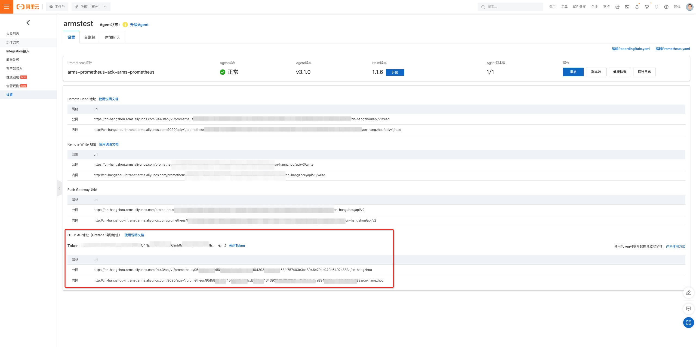
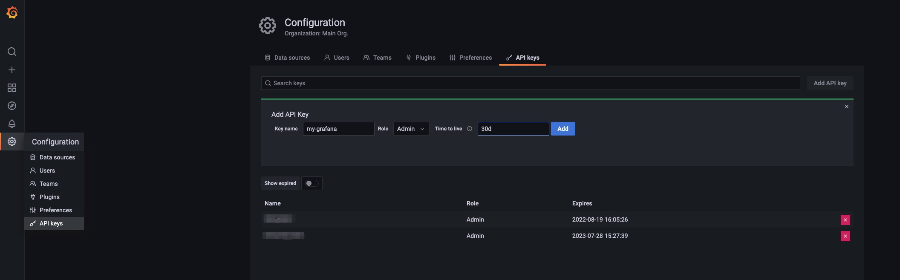
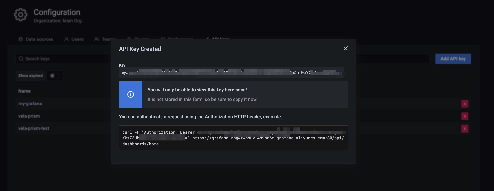

You might already have Prometheus or Grafana instances, built by other tools or run by a cloud provider. This page connects them to KubeVela's observability addons.

The definitions and config templates used here come from the `o11y-definitions` addon, which the observability addons install. Make sure your Grafana access is in place first: `kubectl get grafana default` should list it.

## Integrate Prometheus

To add an existing Prometheus server to the Grafana that the `grafana` addon installed, register it as a Grafana datasource.

### With basic auth, through a config

Store the server's address and credentials as a `prometheus-server` config. Configs are kept in Secrets in `vela-system`, so the password never sits in an Application:

```shell
vela config create my-prometheus -t prometheus-server url=<my-prometheus url> auth.username=<user> auth.password=<password>
```

Then install a datasource for every `prometheus-server` config with the `install-datasource-from-config` step:

```yaml
apiVersion: core.oam.dev/v1beta1
kind: Application
metadata:
  name: register-prometheus
  namespace: vela-system
spec:
  components: []
  workflow:
    steps:
      - name: install-datasources
        type: install-datasource-from-config
        properties:
          type: prometheus-server
```

The `grafana` addon runs the same step when it is enabled, so re-enabling the addon also picks up new configs.

### With a bearer token

There is no config template for a token, so the token goes in the Application, as part of the datasource's JSON model in `data`. The `grafana-datasource` component type comes from the `o11y-definitions` addon, which the `grafana` addon enables:

```yaml
apiVersion: core.oam.dev/v1beta1
kind: Application
metadata:
  name: register-prometheus
  namespace: vela-system
spec:
  components:
    - type: grafana-datasource
      name: my-prometheus
      properties:
        uid: my-prometheus
        data: |
          {
            "name": "MyPrometheus",
            "type": "prometheus",
            "access": "proxy",
            "url": "<my-prometheus url>",
            "jsonData": {
              "httpHeaderName1": "Authorization",
              "tlsSkipVerify": true
            },
            "secureJsonData": {
              "httpHeaderValue1": "Bearer <token of your prometheus access>"
            }
          }
```

`uid` names the datasource in Grafana, and `data` is the [Grafana datasource model](https://grafana.com/docs/grafana/latest/developers/http_api/data_source/) as a JSON string.

:::caution
The token is stored in the Application and in every ApplicationRevision, so anyone who can read Applications in that namespace can read it. Keep the Application in a namespace only administrators can read, such as `vela-system`.
:::

For example, if you are using the Prometheus service on Alibaba Cloud (ARMS), you can find the access URL and access token on the Prometheus settings page.



## Integrate Grafana

To manage an existing Grafana through KubeVela, create a `grafana` config with its endpoint and an API token:

```shell
vela config create my-grafana -t grafana endpoint=<my-grafana url> auth.token=<access token>
```

The `grafana` config template (from `o11y-definitions`) creates a Grafana object for that instance, and keeps the token out of an Application and its revisions. For a username and password instead, set `auth.username` and `auth.password`.

To get a token, go into your Grafana instance and configure API keys.



Then copy the token into the command above.



Check the registration:

```shell
kubectl get grafana
```
```shell
NAME         ENDPOINT                                                      CREDENTIAL_TYPE
default      http://grafana.o11y-system:3000                               BasicAuth
my-grafana   https://grafana-rngwzwnsuvl4s9p66m.grafana.aliyuncs.com:80/   BearerToken
```

Now you can manage the dashboards and datasources of that Grafana through the Kubernetes API as well.

```shell
# show all the dashboard you have
kubectl get grafanadashboard -l grafana=my-grafana
```
```shell
# show all the datasource you have
kubectl get grafanadatasource -l grafana=my-grafana
```

For more details, see [vela-prism](https://github.com/kubevela/prism#grafana-related-apis).

The [Grafana guide](/prism/guides/grafana) in the Prism section covers these objects in full.

## Integrate Other Tools or Systems

For other tools, use their own install. The `prometheus-scrape` trait (from the `prometheus-server` addon) creates a `<component>-prometheus-scrape` Service in front of the component and puts the `prometheus.io/scrape`, `prometheus.io/port` and `prometheus.io/path` annotations on it. Those annotations are all a collector reads, so the trait suits a tool that discovers targets from them, such as Datadog with its Prometheus annotation scraping turned on. prometheus-operator does not read those annotations: give it a `ServiceMonitor` or `PodMonitor` instead.
