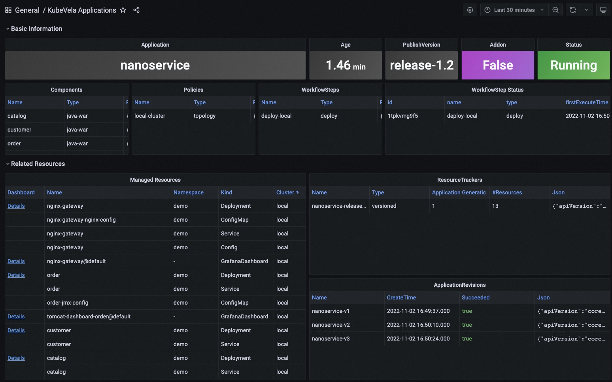
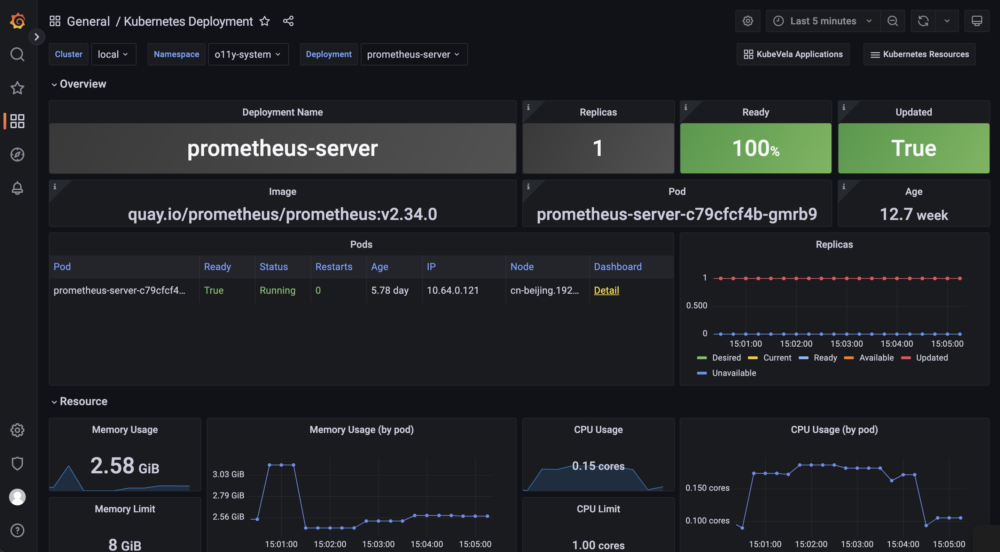
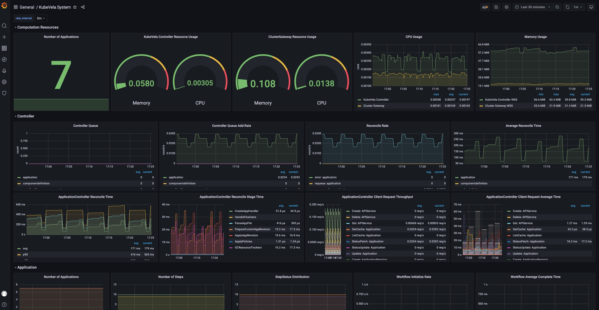
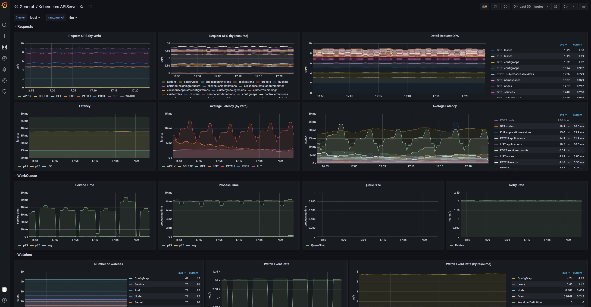

The `grafana` addon comes with a set of dashboards for KubeVela, its Applications and the Kubernetes resources they run. If you followed the [installation guide](./installation.md), they work with no further setup.

The URLs below assume the Grafana port-forward from step 6 of the [installation guide](./installation.md#quick-start) is running (`kubectl port-forward svc/grafana -n o11y-system 8080:3000`).

## Dashboards

### KubeVela Application

This dashboard shows the basic information for one application.

URL: http://localhost:8080/d/application-overview/kubevela-applications

:::info
  The KubeVela Application dashboard shows the overview of the metadata for the application. It directly accesses the Kubernetes API to retrieve the runtime application information, where you can use it as an entrance. You can navigate to detail information for application resources by clicking the `Details` link in the *Managed Resources* panel.

The **Basic Information** section extracts key information into panels and give you the most straightforward view for the current application.

The **Related Resources** section shows those resources that work together with the application itself, including the managed resources, the recorded ResourceTrackers and the revisions.

:::

### Kubernetes Deployment

This dashboard shows the overview of native deployments. You can navigate deployments across clusters.

URL: http://localhost:8080/d/kubernetes-deployment/kubernetes-deployment

:::info
  The Kubernetes Deployment dashboard gives you the detail running status for the deployment.

The **Pods** panel shows the pods that the deployment itself is currently managing.

The **Replicas** panel shows how the number of replicas changes, which can be used to diagnose when and how your deployment shifted to undesired state.

The **Resource** section includes the details for the resource usage (including the CPU / Memory / Network / Storage) which can be used to identify if the pods of the deployment are facing resource pressure or making/receiving unexpected traffics.

There are a list of dashboards for various types of Kubernetes resources, such as DaemonSet and StatefulSet. You can navigate to those dashboards depending on your workload type.

:::

### KubeVela System

This dashboard shows the overview of the KubeVela system: the controller and the cluster-gateway. Use it to see if the KubeVela controller is healthy.

URL: http://localhost:8080/d/kubevela-system/kubevela-system

:::info
The **Computation Resource** section shows the CPU and memory each core module uses. Memory that keeps climbing points to a leak; CPU that stays high means the module is under pressure. A module that hits its memory limit is killed and restarted, which means it needs more CPU or memory.

The **Controller** section holds the panels for finding the controller's bottleneck. See [Is the controller healthy?](#is-the-controller-healthy) for how to read them.

The **Application** section shows the number of Applications across the system and the workflow steps they use. **Workflow Average Complete Time** shows how long a whole workflow takes to finish.
:::

### Kubernetes APIServer

This dashboard shows the running status of all Kubernetes apiservers.

URL: http://localhost:8080/d/kubernetes-apiserver/kubernetes-apiserver

:::info
  The Kubernetes APIServer dashboard helps you to see the most fundamental part for your Kubernetes system. If your Kubernetes APIServer is not running healthy, all of your controllers and modules in your Kubernetes system will be abnormal and unable to handle requests successfully. So it is important to make sure everything is fine in this dashboard.

The **Requests** section includes a series of panels which shows the QPS and latency for various kind of requests. Usually your APIServer could fail to respond if it is flooded by too much requests. At this time, you can see which type of requests is causing trouble.

The **WorkQueue** section shows the process status of the Kubernetes APIServer. If the **Queue Size** is large, it means the number of requests is out of the process capability of your Kubernetes APIServer.

The **Watches** section shows the number of watches in your Kubernetes APIServer. Compared to other types of requests, WATCH requests will continuously consume computation resources in Kubernetes APIServer, so it will be helpful to keep the number of watches limited.

:::

## Is the controller healthy?

Four panels on the KubeVela System dashboard tell you most of what you need:

- **Controller Queue** and **Controller Queue Add Rate**: how much work is waiting. A short rise is fine. A queue that keeps growing means Applications are changing faster than the controller can reconcile them, and the queued work holds memory until the controller runs out of it.
- **Reconcile Rate** and **Average Reconcile Time**: how fast work is done. A steady reconcile rate with an average time under about 500ms (it depends on your Applications) is a healthy controller.

If the queue add rate rises and the reconcile rate does not follow it, the queue grows. Find which case you are in:

| Symptom | Panel to check | Likely cause | Fix |
| --- | --- | --- | --- |
| Queue keeps growing; reconciles succeed at a normal speed | Computation Resource (controller CPU and memory) | More Applications than the controller can keep up with | Give the controller more CPU and memory. See [performance fine-tuning](../../system-operation/performance-finetuning.md). |
| Many errors in **Reconcile Rate** | Reconcile Rate | Applications that fail on every reconcile: invalid configuration, or workflow steps that keep erroring | Find the failing Applications (`vela status <app> -n <namespace>`) and fix them. |
| Average reconcile time is high for all Applications | **ApplicationController Reconcile Time**, **ApplicationController Client Request Throughput**, **ApplicationController Client Request Average Time** | Not enough CPU, or the kube-apiserver rate limits the controller's requests | Add CPU if usage is high; otherwise see which requests are slow or excessive, and raise the controller's `--kube-api-qps` and `--kube-api-burst`. |
| p95 reconcile time is high, average is normal | **ApplicationController Reconcile Time** | A few large Applications that take long to reconcile | Find the large Applications. Splitting one into smaller Applications spreads the work. |

To narrow it down further, **ApplicationController Reconcile Stage Time** shows which stage of a reconcile takes the time. For example, a slow `GCResourceTrackers` stage means garbage collection of old resources is blocking.

