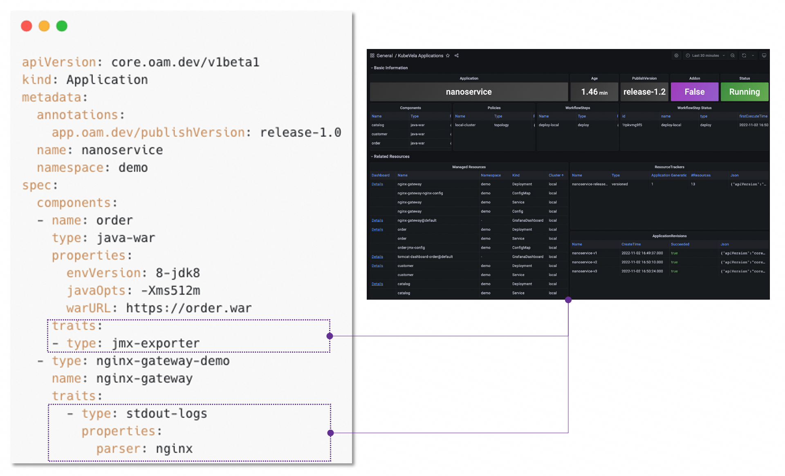

Five addons give you Prometheus, Loki and Grafana with dashboards for KubeVela and your apps. Traits then decide which apps' metrics and logs are collected.

Each piece (the addons, the scrape and log traits, the Grafana datasources and dashboards) is a KubeVela Application or definition, so you manage your observability stack the same way you manage apps.

## The addons

| Addon | What it gives you |
| :---- | :---------------- |
| `prometheus-server` | Stores metrics as time series and answers queries. |
| `kube-state-metrics` | Metrics about Kubernetes objects. |
| `node-exporter` | Metrics about the nodes. |
| `loki` | Stores the logs collected from pods and answers queries. |
| `grafana` | Dashboards for KubeVela and your apps, built on the Prometheus and Loki data. |

Once they are enabled, the [out-of-the-box dashboards](./o11y/out-of-the-box.md) fill with data straight away. See [Enable observability addons](./o11y/installation.md) to install them.

## Application observability

The scrape and log traits choose which apps are collected. Add one to a component and its metrics or logs go to Prometheus or Loki, ready to show on a Grafana dashboard.



You can write your own observability traits in CUE, the same as any other trait. See [Metrics collection](./o11y/metrics.md) and [Log collection](./o11y/logging.md).

## Controller metrics

The KubeVela controller serves Prometheus metrics on port 8080 at `/metrics`. How you collect them depends on which Prometheus you run.

**With the `prometheus-server` addon.** The `vela-core` pods carry the `prometheus.io/scrape`, `prometheus.io/port` and `prometheus.io/path` annotations, so the addon scrapes them with no setting. The KubeVela System dashboard reads these metrics.

**With prometheus-operator.** Set these Helm values on the `vela-core` chart. The chart only creates the Service and ServiceMonitor when the cluster has the `monitoring.coreos.com/v1` API.

| Helm value | Default | What it does |
| :--------- | :------ | :----------- |
| `core.metrics.enabled` | `false` | Creates a `<release>-metrics` Service in front of the controller's metrics port. |
| `core.metrics.serviceMonitor.enabled` | `false` | Creates a ServiceMonitor for that Service. Needs `core.metrics.enabled`. |
| `core.metrics.serviceMonitor.additionalLabels` | `{}` | Labels to add to the ServiceMonitor, for example the label your Prometheus selects ServiceMonitors by. |
| `multicluster.metrics.enabled` | `false` | Starts the controller with `--enable-cluster-metrics`, which exports per-cluster metrics: whether each cluster is connected, its worker and control-plane node counts, and its CPU, memory and pod capacity. A node counts as control plane if it has either the `node-role.kubernetes.io/control-plane` or the `node-role.kubernetes.io/master` label. |
| `multicluster.clusterGateway.serviceMonitor.enabled` | `false` | Creates a ServiceMonitor for the cluster-gateway. Needs `multicluster.metrics.enabled`. |
| `multicluster.clusterGateway.serviceMonitor.additionalLabels` | `{}` | Labels to add to that ServiceMonitor. |

For example:

```bash
helm upgrade kubevela kubevela/vela-core -n vela-system --reuse-values \
  --set core.metrics.enabled=true \
  --set core.metrics.serviceMonitor.enabled=true
```

### Application status metrics

The `EnableApplicationStatusMetrics` feature gate (alpha, off by default) adds one series per Application:

| Metric | Value |
| :----- | :---- |
| `kubevela_application_health_status` | `1` healthy, `0` unhealthy |
| `kubevela_application_phase` | The Application's phase as a number |
| `kubevela_application_workflow_phase` | The workflow's phase as a number |

Each carries the `app_name` and `namespace` labels. Turn it on with `--set featureGates.enableApplicationStatusMetrics=true`. [Application health and status metrics](../status/application_health_status_metrics.md) lists the phase numbers and the structured logs the gate also writes.

## What's next

- [**Enable observability addons**](./o11y/installation.md): install the addons into your KubeVela system.
- [**Out-of-the-box dashboards**](./o11y/out-of-the-box.md): use the bundled dashboards to watch your system and apps.
- [**Metrics collection**](./o11y/metrics.md): choose how your apps' metrics are collected.
- [**Log collection**](./o11y/logging.md): choose how your apps' logs are collected.
- [**Customize dashboards**](./o11y/dashboard.md): build dashboards for your apps.
- [**Integrate existing observability services**](./o11y/integration.md): connect the Prometheus or Grafana you already run.
