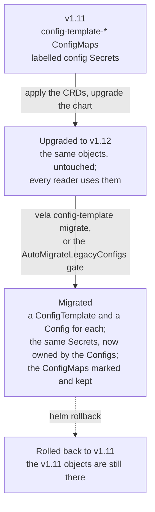

In v1.11 and earlier, the `vela` CLI stored each config template as a `config-template-<name>`
ConfigMap and each config as a labelled Secret. Since v1.12 they are `ConfigTemplate` and `Config`
resources, reconciled by the controller; see [Config Template](../../reference/config-template.md).

This guide covers upgrading a cluster that has v1.11 configs, moving them to the new resources, and
rolling back.

## Overview



- **Upgrading changes nothing on its own.** Your v1.11 objects keep working: the CLI lists, uses
  and deletes them, workflow steps read them, and Configs can use v1.11 templates. Applications see
  no change to the Secrets they use.
- **Migration is a separate, explicit step.** It adopts each v1.11 object in place: the Secret keeps
  its name, UID and data and gets a Config as its owner. The ConfigMap is kept, so a rollback finds
  everything where v1.11 expects it.
- **You can migrate when it suits you**: per template, per namespace, or for the whole cluster at
  controller startup.

## Step 1: Upgrade to v1.12

v1.12 adds the `ConfigTemplate`, `Config` and `SourceDefinition` CRDs and changes several
others. Helm does not upgrade the CRDs in a chart's `crds/` directory, so apply the chart's CRDs
first:

```bash
helm repo update
helm pull kubevela/vela-core --version 1.12.0 --untar
kubectl apply --server-side --force-conflicts -f vela-core/crds/
```

Then upgrade the chart:

```bash
helm upgrade -n vela-system --install kubevela kubevela/vela-core --version 1.12.0 --wait
```

Your configs are listed as before, with `SOURCE` showing they are v1.11 objects:

```bash
vela config list -n team-a
```

```console
NAME         ALIAS SOURCE PHASE DISTRIBUTION      TEMPLATE       CREATED-TIME                  DESCRIPTION
billing-db         legacy                         team-a/mysql   2026-11-06 14:51:36 +0530 IST
orders-db          legacy       local/team-a-prod team-a/mysql   2026-11-06 14:51:36 +0530 IST
payments-key       legacy                         team-a/api-key 2026-11-06 14:51:36 +0530 IST
```

New configs and templates you create from now on are `Config` and `ConfigTemplate` resources.
See [the v1.12 upgrade notes](./migration-from-old-version.md) for the behaviour changes to check
before you upgrade.

## Step 2: Preview the migration

`vela config-template migrate` migrates a template and every config made from it.
`--dry-run` prints the resources it would create and a report, and changes nothing:

```bash
vela config-template migrate mysql -n team-a --dry-run
```

```console
---
apiVersion: config.oam.dev/v1alpha1
kind: ConfigTemplate
metadata:
  annotations:
    config.oam.dev/grandfathered-configs: team-b/reports-db
  labels:
    config.oam.dev/created-by: migration
  name: mysql
  namespace: team-a
...
KIND      NAME       NAMESPACE RESULT      REASON
ConfigMap mysql      team-a    would adopt ConfigTemplate mysql created
Secret    billing-db team-a    would adopt Config billing-db created
Secret    orders-db  team-a    would adopt Config orders-db created
Secret    reports-db team-b    skipped     config template team-a/mysql is namespace-scoped: a config
                                           in team-b may use it only if its author can get it (grant
                                           get on configtemplates.config.oam.dev mysql in namespace
                                           team-a); the binding was not recorded when the template was
                                           migrated, and this run has no user to ask
adopted 3, skipped 1, conflict 0, failed 0
```

:::note
A dry run reports a config in another namespace as `skipped`, as `reports-db` is here. The real
run adopts it, because it records that binding first; see
[Configs in other namespaces](#configs-in-other-namespaces).
:::

## Step 3: Migrate

Migrate one template and its configs:

```bash
vela config-template migrate mysql -n team-a
```

```console
KIND      NAME       NAMESPACE RESULT  REASON
ConfigMap mysql      team-a    adopted ConfigTemplate mysql created
Secret    billing-db team-a    adopted Config billing-db created
Secret    orders-db  team-a    adopted Config orders-db created
Secret    reports-db team-b    adopted Config reports-db created
adopted 4, skipped 0, conflict 0, failed 0
```

Or every template in a namespace, and their configs, with `--all`:

```bash
vela config-template migrate --all -n team-a
```

```console
KIND      NAME         NAMESPACE RESULT   REASON
ConfigMap api-key      team-a    adopted  ConfigTemplate api-key created
Secret    payments-key team-a    adopted  Config payments-key created
ConfigMap legacy-cache team-a    skipped  opted out
Secret    old-cache    team-a    skipped  template team-a/legacy-cache opted out
ConfigMap mysql        team-a    skipped  already migrated
Secret    billing-db   team-a    skipped  already migrated
Secret    orders-db    team-a    skipped  already migrated
Secret    reports-db   team-b    skipped  already migrated
ConfigMap postgres     team-a    conflict ConfigTemplate postgres exists and was not created by
                                          migration
Secret    ledger-db    team-a    conflict template team-a/postgres: ConfigTemplate exists and was not
                                          created by migration
adopted 2, skipped 6, conflict 2, failed 0
Error: 2 object(s) in conflict; see the table above
```

`vela config migrate` does the same for configs only, by name or with `--all`. Use it for a config
created with an older CLI after its template was migrated:

```bash
vela config migrate inventory-db -n team-a
```

```console
KIND   NAME         NAMESPACE RESULT  REASON
Secret inventory-db team-a    adopted Config inventory-db created
adopted 1, skipped 0, conflict 0, failed 0
```

Both commands default to the `vela-system` namespace; pass `-n` for another. Running a command again
is safe: what is already migrated is reported as `skipped`, and a run that was interrupted is
completed.

### What migration does

- A template ConfigMap `config-template-<name>` becomes a ConfigTemplate `<name>` (the report
  shows the template name; Events are on the ConfigMap, under its full name), with `scope: system` in
  `vela-system` and `scope: namespace` elsewhere. The ConfigMap is kept, with the annotation
  `config.oam.dev/migrated-to` set to the ConfigTemplate's UID.
- A config Secret becomes a Config of the same name. The Secret itself is adopted: same name, UID
  and data, now owned by the Config and annotated `config.oam.dev/migrated-to`.
- A sensitive config's properties move to a `<config>-properties` Secret, which the Config reads
  through `propertiesFrom`:

  ```console
  $ kubectl -n team-a get config payments-key -o jsonpath='{.spec}'
  {"propertiesFrom":{"secretRef":{"name":"payments-key-properties"}},"templateRef":{"name":"api-key","namespace":"team-a"}}
  ```

- The objects a template's `outputs` created, and a config's distribution, get the Config as their
  owner.
- Each object gets an Event: `MigrationAdopted`, `MigrationSkipped`, `MigrationConflict` or
  `MigrationFailed`:

  ```console
  $ kubectl -n team-a get events --field-selector reason=MigrationConflict \
      -o 'custom-columns=KIND:.involvedObject.kind,NAME:.involvedObject.name,MESSAGE:.message'
  KIND        NAME                       MESSAGE
  ConfigMap   config-template-postgres   ConfigTemplate postgres exists and was not created by migration
  Secret      ledger-db                  template team-a/postgres: ConfigTemplate exists and was not created by migration
  ```

### Reading the report

| Result | Meaning |
|---|---|
| `adopted` | The resource was created and the v1.11 object adopted. |
| `skipped` | Nothing to do, or nothing migration may do: already migrated; opted out; a Secret KubeVela itself uses to cache a source; a template whose Nacos endpoint is in another namespace (apply it with `vela config-template apply` as a user who can read that endpoint); a config in another namespace that its template does not list (see [Configs in other namespaces](#configs-in-other-namespaces)); or not readable by you (see [Permissions](#permissions)). |
| `conflict` | A resource of that name exists that migration did not create, or the config writes `outputs` into another namespace. Nothing was changed. |
| `failed` | The v1.11 object could not be read or written, for example because data in it is not valid or you lack a permission. Nothing was changed. |

The command exits with status 1 when any row is `conflict` or `failed`, and 0 otherwise.

### Resolving a conflict

A conflict means a resource of that name already exists. In the example, someone created a
ConfigTemplate `postgres` by hand. Decide which one you want. To keep the v1.11 template, delete
the existing resource and migrate again:

```bash
kubectl -n team-a delete configtemplate postgres
vela config-template migrate postgres -n team-a
```

```console
KIND      NAME      NAMESPACE RESULT  REASON
ConfigMap postgres  team-a    adopted ConfigTemplate postgres created
Secret    ledger-db team-a    adopted Config ledger-db created
adopted 2, skipped 0, conflict 0, failed 0
```

### Opting out

To keep a template, and the configs made from it, as v1.11 objects, annotate the template
ConfigMap, or a single config's Secret:

```bash
kubectl -n team-a annotate configmap config-template-legacy-cache config.oam.dev/migrate=false
```

Opted-out objects keep working as before and are reported as `skipped`.

### Configs in other namespaces

v1.11 let a config in any namespace use a template from another namespace. Since v1.12, a Config
may use a namespace-scoped template from another namespace only if its author can `get` that
template; see [Scope](../../reference/config-template.md#scope-who-may-use-a-template).

Migration keeps the uses that already exist: the new ConfigTemplate lists them in its
`config.oam.dev/grandfathered-configs` annotation, and those Configs keep working.

```console
$ kubectl -n team-a get configtemplate mysql -o jsonpath='{.metadata.annotations}'
{"config.oam.dev/grandfathered-configs":"team-b/reports-db"}
```

The list can lose entries, but not gain them. Bindings are recorded when the template is migrated,
so migrate soon after the upgrade, before new cross-namespace configs are created with an older
CLI. A config in another namespace that the template does not list is reported as `skipped`, and
stays a working v1.11 config. To move it, create it again as a Config, as a user who can `get` the
template.

### Permissions

`migrate` runs as you. You need to read and write ConfigTemplates, Configs, Secrets, ConfigMaps
and Applications (for distributions) in every namespace it touches. A missing permission shows as
a `failed` row that names it, and the command exits with status 1:

```console
Secret    e-one team-e    failed  configs.config.oam.dev is forbidden: User
                                  "system:serviceaccount:team-e:noconfigs" cannot create
                                  resource "configs" in API group "config.oam.dev" in the
                                  namespace "team-e"
```

To find the configs that use a template, `migrate` lists config Secrets across the cluster. If you
may not list Secrets in every namespace, it migrates what you can see and reports one `skipped`
row for the rest, and exits with status 0:

```console
KIND      NAME   NAMESPACE RESULT  REASON
ConfigMap mysql  team-d    adopted ConfigTemplate mysql created
Secret    d-one  team-d    adopted Config d-one created
Secret    *      *         skipped configs in other namespaces were not listed: secrets is
                                   forbidden: User "system:serviceaccount:team-d:limited"
                                   cannot list resource "secrets" in API group "" at the
                                   cluster scope
adopted 2, skipped 1, conflict 0, failed 0
```

Run it again later as a user with cluster-wide read access to pick those up.

## Migrate automatically at startup

The `AutoMigrateLegacyConfigs` feature gate (Alpha, off by default) runs the same migration for the
whole cluster when the controller starts, as if `vela config-template migrate --all` ran in every
namespace. It runs with the controller's permissions, so nothing is skipped or fails for lack of
them:

```bash
helm upgrade -n vela-system kubevela kubevela/vela-core --version 1.12.0 --reuse-values \
  --set featureGates.autoMigrateLegacyConfigs=true --wait
```

- Only the leader runs it, once, after the webhook server is up. If rows fail, it tries again, up
  to three attempts 30 seconds apart.
- It writes the same Events, from the component `ConfigMigration`, and logs a summary.
- The metric `kubevela_config_migration_total` counts rows by `result`.
- It does not watch for v1.11 objects created later, for example by an older CLI. Run
  `vela config migrate` for those, or restart the controller.

The controller log shows the sweep and its result:

```console
"AutoMigrateLegacyConfigs is on; the legacy config migration sweep will run on the leader" waitForWebhook=true
"starting legacy config migration sweep" attempts=3 interval="30s"
"legacy config migration sweep attempt" attempt=1 adopted=5 skipped=12 conflict=0 failed=0 duration="1.025733083s"
"legacy config migration sweep finished" adopted=5 skipped=12 conflict=0 failed=0 attempts=1
```

```console
$ kubectl -n team-c get events --field-selector reason=MigrationAdopted \
    -o 'custom-columns=KIND:.involvedObject.kind,NAME:.involvedObject.name,SOURCE:.source.component'
KIND        NAME                    SOURCE
ConfigMap   config-template-mysql   ConfigMigration
Secret      metrics-db              ConfigMigration
Secret      search-db               ConfigMigration
```

## After migration

The lists show the resources, and the legacy list shows what was migrated:

```bash
vela config-template list -n team-a --config-mode legacy
```

```console
NAME         ALIAS      SCOPE   SENSITIVE SOURCE            CREATED-TIME
api-key      API key    project true      legacy (migrated) 2026-11-06 14:51:36 +0530 IST
legacy-cache Cache      project false     legacy            2026-11-06 14:52:08 +0530 IST
mysql        MySQL      project false     legacy (migrated) 2026-11-06 14:51:36 +0530 IST
postgres     PostgreSQL project false     legacy (migrated) 2026-11-06 14:52:08 +0530 IST
```

The legacy list shows the scope the v1.11 object was created with (`project` here). The resource's
scope, in `vela config-template list`, is the one that applies.

You can delete the migrated ConfigMaps once you no longer need to roll back. Do not delete the
migrated Secrets: they are the Configs' Secrets now.

## GitOps

If a GitOps tool applies your v1.11 objects, migration adopts them the same way. It recognises
objects managed by Argo CD (the `argocd.argoproj.io/tracking-id` annotation), Flux (the
`kustomize.toolkit.fluxcd.io/name` or `helm.toolkit.fluxcd.io/name` label) and Helm (the
`app.kubernetes.io/managed-by: Helm` label). An object with only an `app.kubernetes.io/instance`
label is reported as possibly managed by Argo CD's label tracking or another tool. For each, the
report row and a `MigratedGitOpsManaged` Event on the new resource name the tool and advise keeping
the new resource where the tool keeps the old object.

Migration writes with its own field manager, `kubevela-config-migration`, and does not change the
data the tool owns, so the tool shows no diff. After migrating:

- **Put the new ConfigTemplate and Config resources in git where the v1.11 objects were**, so the
  tool manages them too. Otherwise, pruning the old objects from git leaves resources that no tool
  owns.
- A Config that uses a template from another namespace, `vela-system` included, is refused until
  that template exists, so a sync that applies both may need to run twice. A Config whose template
  is in its own namespace waits for the template instead.
- Flux and Argo CD report a Config in `Error` as healthy, because the resources have no `Ready`
  condition yet. Check `status.phase` in your own health checks.
- Deleting a Config through the tool does not delete its entry in Nacos.

## Rolling back to v1.11

The v1.11 objects are kept by migration, so v1.11 finds every config after a rollback. Configs
created as resources after the upgrade remain visible to v1.11 through their Secrets.

The first `helm rollback` fails, because the v1.12 chart's admission webhook configuration is still
installed:

```bash
helm rollback kubevela -n vela-system --wait
```

```console
Error: no ComponentDefinition with the name "cron-task" found
```

Delete the webhook configuration and roll back again:

```bash
kubectl delete validatingwebhookconfiguration kubevela-vela-core-admission
helm rollback kubevela -n vela-system --wait
```

The CRDs and the ConfigTemplate and Config resources stay, but nothing reconciles them until you
upgrade again.

:::caution
After a rollback, do not delete Config resources unless you also want their Secrets gone. A
migrated Secret is still owned by its Config, so deleting the Config deletes the Secret, even
though v1.11 uses it.
:::
