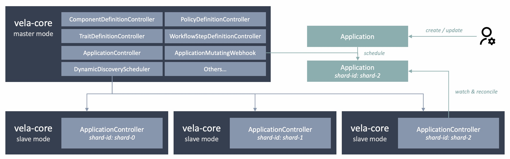

## Background

As many adopters start to choose KubeVela to manage large scale applications in their production, we have more and more scenarios and experiences on performance issue.

The typical Kubernetes controller usually run one controller to manage all related custom resources. The operator reconciliation is designed to be relatively lightweight. In KubeVela, to support customized delivery process and manage lifecycles of tens of resources in one application makes the reconciliation process heavier compared to typical controllers.

Although multiple replicas of KubeVela controller could provide high availability, in avoid of multiple concurrent reconciliation for the same application (which could lead to conflict problems), only one replica could work and this is achieved by acquiring the same leader-election lock.

So usually, users add more resources to KubeVela controller (more CPUs, Memory...) and set up more threads and larger rate limiter to support more applications in the system. This can lead to potential problems in different cases:
1. There are limitations for the growth of resources for a single KubeVela controller. If the Kubernetes cluster of the control plane uses lots of small machines, a single KubeVela controller can only run one of them, instead of spreading out.
2. The failure of the single KubeVela controller could block all the delivery process of applications. The failure could be caused by various reasons and some frequently seen reasons (like OOM or Crash due to some weird application input) are not recoverable by restarting controller.
3. In multi-tenancy scenario, there is no fairness that could be guaranteed if some users have a huge number of applications. They could make the controller run slow and users with a small number of applications could also be affected, due to the sharing of the single KubeVela controller.

Therefore, KubeVela core controller supports sharding since v1.8 which allows horizontal scaling and provides solutions to the above challenges.

## Architecture



When the KubeVela controller is running in sharding mode, multiple core controllers can work concurrently. Each one will focus on a specific subset of the applications, identified by `shard-id`. There will be one master controller and multiple slave controllers.

**Master controller**: The master controller will enable all the components, such as ComponentDefinitionController, TraitDefinitionController, ApplicationController, Webhooks, etc.

The application controller will only handle applications with the label `controller.core.oam.dev/scheduled-shard-id: master`, and only the applications, applicationrevisions and resourcetrackers that carries this label will be watched and cached.

By default, it will watch the pods within the same namespace as it runs. The pods with labels `app.kubernetes.io/name: vela-core` and carries `controller.core.oam.dev/shard-id` label key will be selected and their health status will be recorded. The selected ready pods will be registered as schedulable shards. The mutating Webhook will automatically assign shard-id for non-assigned applications when requests come in.

**Slave controller**: The slave mode controller will only start the ApplicationController and will not enable others like Webhook or ComponentDefinitionController. It is dedicated to applications that carries the matched labels `controller.core.oam.dev/scheduled-shard-id=<shard-id>`.

:::caution
Only the master controller serves the admission webhooks. While it is down, the API server can't call them, so no Application can be created or changed, whichever shard it belongs to. Run the master with `replicaCount` 2 or more (`--set replicaCount=2`) so a webhook server is always up.
:::

## Use Guide

### Installation

1. Install KubeVela with sharding enabled. The core controller runs in master mode.

```shell
helm install kubevela kubevela/vela-core -n vela-system --set sharding.enabled=true
```

By default the master discovers the shards it can schedule to from the running controller pods. To fix the list instead, name the shards when you install:

```shell
helm install kubevela kubevela/vela-core -n vela-system --set sharding.enabled=true \
  --set sharding.schedulableShards=shard-0\,shard-1
```

2. Deploy the slave mode application controllers.

```shell
vela addon enable vela-core-shard-manager nShards=3
```

This starts 3 slave controllers that run with the same configuration as the master controller. For example, if the master uses the flag `max-workflow-wait-backoff-time=60`, all slave controllers use it too.

You can set the resources each one gets:

```shell
vela addon enable vela-core-shard-manager nShards=3 cpu=1 memory=2Gi
```

### Run shards without the addon

The addon is one way to run slave controllers. You can also run them yourself:

1. Copy the master Deployment and change its shard labels and ID. This creates a copy of the master vela-core that runs a slave with shard-id `shard-0`:

```shell
kubectl get deploy kubevela-vela-core -oyaml -n vela-system | \
    sed 's/schedulable-shards=/shard-id=shard-0/g' | \
    sed 's/instance: kubevela/instance: kubevela-shard/g' | \
    sed 's/shard-id: master/shard-id: shard-0/g' | \
    sed 's/name: kubevela/name: kubevela-shard/g' | \
    kubectl apply -f -
```

2. Or write a Deployment of your own: run the controller with `--enable-sharding --shard-id=<shard-id>`, and give its pods the labels `app.kubernetes.io/name: vela-core` and `controller.core.oam.dev/shard-id: <shard-id>` so the master discovers them.

Shards don't need the same configuration. Different shards can have different resources, rate limits, or even image versions.

### Configuration

These settings change how the master schedules Applications to shards:

| Setting | Where | Default | What it does |
| --- | --- | --- | --- |
| `sharding.schedulableShards` | Helm value (`--schedulable-shards`) | empty | The shard IDs the master schedules to. Empty means it discovers them from the running pods. |
| `--sharding-slave-discovery-resync-period` | Controller flag | `5m` | How often the master re-lists the shard pods when it discovers them. |
| `featureGates.disableWebhookAutoSchedule` | Helm value (`DisableWebhookAutoSchedule` gate) | `false` | The mutating webhook stops assigning shards, so you assign them yourself (see [Extension](#extension)). |
| `featureGates.validateComponentWhenSharding` | Helm value (`ValidateComponentWhenSharding` gate) | `false` | The validating webhook checks components in sharding mode. It reads ApplicationRevisions from the API server, because the master doesn't cache them in sharding mode, so it costs extra requests. |

When both `sharding.enabled` and `authentication.enabled` are set, the chart also creates a `shard-scheduler` Role and RoleBinding (`kubevela-vela-core:shard-scheduler` for a release named `kubevela`), which let the controller's ServiceAccount get, list and watch pods in its namespace to discover shards.

### CLI

By default, the webhook in the master controller will automatically assign shard-id to applications. It will looks for available shards and set the `controller.core.oam.dev/scheduled-shard-id: <shard-id>` to the application. But there are cases it cannot handle.

1. If the application is created and no shard is available, the webhook will leave it unscheduled. Even if later shards joined, the webhook will not automatically schedule it unless the application is updated manually.
2. If an application is assigned to a shard which is later down, the webhook will not automatically reschedule it, unless the application is recreated.
3. For performance issue, user disable the usage of webhook.

For these cases, you can use the following command to reschedule the application manually.
```shell
vela up <app-name> -n <app-namespace> --shard-id <shard-id>
```

> Notice that not only applications are attached with the shard-id label, related system resources including ResourceTracker and ApplicationRevision are attached with the shard-id label as well. So when you call `vela up --shard-id` command, it will relabel all these system resources as well.

### Extension

Once you have understood the working mechanism of KubeVela's controller sharding, you will find that if you want to implement your own application scheduler, you only need to attach correct labels to applications and their related system resources (ResourceTracker and ApplicationRevision). Therefore, it is possible to design your own scheduler and let it run in the background to schedule applications with your customized strategies, like schedule applications by its owner or by the CPU usage of different shards.

## FAQ

Q: What will happen when the master one is down?
A: Applications scheduled to the master shard are not processed until it is back. Applications on other shards keep running. If the webhook is enabled, no Application can be created or changed until the master is back (see [Architecture](#architecture)). If the webhook is not enabled, users can still create and change Applications.

Q: What will happen when a slave mode controller is down?
A: For applications that are not scheduled to that shard, nothing will happen. For applications that are scheduled to the broken shard, succeeded applications will not run state-keep or gc but the delivered resources will not be touched. For applications that are still running workflow, they will not be handled but can be recovered instantly when the controller is restarted.

Q: What will happen if one user delete the sharding label while the application is already in running state?
A: If the webhook is enabled, this behaviour will be prevented. The sharding label will inherit the original one. If the webhook is not enabled, the application will not be handled anymore (no state-keep, no gc and no update).

### Reference

1. Design doc. https://github.com/kubevela/kubevela/blob/master/design/vela-core/sharding.md
2. Implementation. https://github.com/kubevela/kubevela/pull/5360
