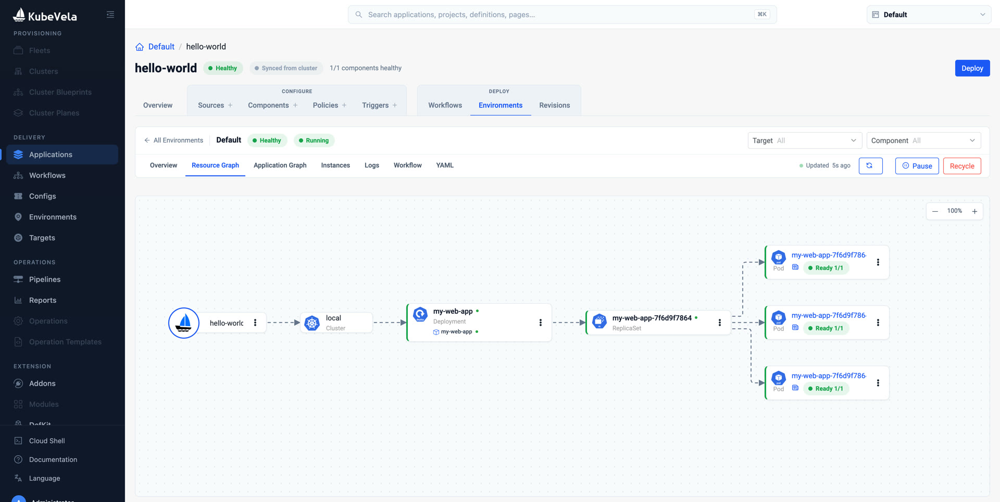

:::note
Before starting, install KubeVela by following [the installation guide](./install.mdx). The UI console section at the end also needs the VelaUX addon.
:::

This guide deploys a "Hello World" web service with KubeVela, checks on it, scales it with a trait, and then shows it in the UI console. It takes about ten minutes.

## Applications, components and traits

An **Application** describes everything your service needs to run. It is made of **components**, which say *what* to run (a web service, a worker, a Helm chart), and each component can carry **traits**, which say *how* to run it (scaling, ingress, storage).

```
Application (online-store)
├── Component: frontend (webservice)
│   ├── Trait: scaler (replicas: 3)
│   └── Trait: gateway (domain: store.example.com)
└── Component: backend (webservice)
    └── Trait: scaler (replicas: 2)
```

Component types and traits are definitions that your platform team can add to, so the same Application shape works for whatever your platform offers. [Core Concepts](./getting-started/core-concept.md) covers the model in full.

## Create the application

Save the following as `hello-world.yaml`:

```yaml
apiVersion: core.oam.dev/v1beta1
kind: Application
metadata:
  name: hello-world
spec:
  components:
    - name: my-web-app
      type: webservice
      properties:
        image: oamdev/hello-world
        ports:
         - port: 8000
           expose: true
```

- `type: webservice` uses the built-in [webservice](./end-user/components/references.md#webservice) component type, which runs a container as a Deployment.
- `image` is the container image to run.
- `ports` exposes port 8000 through a Service.

## Deploy it

```bash
vela up -f hello-world.yaml
```

<details>
<summary>expected output</summary>

```console
Applying an application in vela K8s object format...
✅ App has been deployed 🚀🚀🚀
    Port forward: vela port-forward hello-world
             SSH: vela exec hello-world
         Logging: vela logs hello-world
      App status: vela status hello-world
        Endpoint: vela status hello-world --endpoint
```
</details>

## Check its status

```bash
vela status hello-world
```

<details>
<summary>expected output</summary>

```console
About:

  Name:      	hello-world
  Namespace: 	default
  Created at:	2026-11-22 22:03:19 +0000 GMT
  Healthy:   	✅
  Details:   	running

Workflow:

  mode: DAG-DAG
  finished: true
  Suspend: false
  Terminated: false
  Steps
  - id: v2hq5rlmqw
    name: my-web-app
    type: apply-component
    phase: succeeded

Services:

  - Name: my-web-app
    Cluster: local
    Namespace: default
    Type: webservice
    Health: ✅
      Message: Ready:1/1
    No trait applied
```
</details>

There's no workflow in `hello-world.yaml`, so KubeVela made one: a step per component, applied in parallel.

## Open it

```bash
vela port-forward hello-world 8000:8000
```

This forwards port 8000 to your machine and, where it can, opens your browser. At http://localhost:8000 you'll see:

```
Hello KubeVela! Make shipping applications more enjoyable.
```

Press `Ctrl+C` to stop forwarding.

## Look around

```bash
# Logs from the application's containers
vela logs hello-world

# Run a command in its container
vela exec hello-world -- ls

# Every application in the current namespace
vela ls
```

## Scale it with a trait

Add the `scaler` trait to the component in `hello-world.yaml`:

```yaml
apiVersion: core.oam.dev/v1beta1
kind: Application
metadata:
  name: hello-world
spec:
  components:
    - name: my-web-app
      type: webservice
      properties:
        image: oamdev/hello-world
        ports:
         - port: 8000
           expose: true
      traits:
        - type: scaler
          properties:
            replicas: 3
```

Apply it again and check the status:

```bash
vela up -f hello-world.yaml
vela status hello-world
```

<details>
<summary>expected output</summary>

```console
...
Services:

  - Name: my-web-app
    Cluster: local
    Namespace: default
    Type: webservice
    Health: ✅
      Message: Ready:3/3
    Traits:
      Type: scaler
      Health: ✅
```
</details>

The component didn't change; the trait changed how it runs. The [traits reference](./end-user/traits/references.md) lists the rest of the built-in traits.

## Manage it in the UI console

With [VelaUX installed](./install.mdx), forward its port:

```bash
vela port-forward addon-velaux -n vela-system 8080:8000
```

Open http://localhost:8080. The first time, VelaUX asks you to set the password for the `admin` user; after that, you log in as `admin` with that password.

VelaUX only picks up applications from the cluster once the admin user exists, so apply `hello-world` again after setting the password (from another terminal, as the port-forward keeps running):

```bash
vela up -f hello-world.yaml
```

Open the `hello-world` application, then its **Default** environment, to see its health and the resources it made:



VelaUX keeps its own record of applications, alongside the controller's. Applications you manage with the CLI are synced into it automatically, and changes made from the CLI afterwards show up as a difference. Once you deploy an application from the UI console, though, that sync stops for it, since the UI is now its source of truth.

:::tip
An application synced from the CLI lands in the project whose environment is bound to its namespace, or the default project if there isn't one. See [Creating environments for the project](./how-to/dashboard/user/project.md#creating-environments-for-the-project) to choose which.
:::

So pick one way to manage each application: if you work with the CLI, YAML or GitOps, keep doing that and use the UI console as a dashboard.

## Clean up

```bash
vela delete hello-world -n default
```

<details>
<summary>expected output</summary>

```console
Are you sure to delete the application default/hello-world (y/n)y
Start deleting application default/hello-world
Delete application default/hello-world succeeded
```
</details>

Add `-y` to skip the prompt.

## Troubleshooting

<details>
<summary>The application isn't healthy</summary>

`vela status hello-world` shows each component's health and message. For the resources behind it:

```bash
vela status hello-world --tree --detail
```

A wrong image name shows up here as a Deployment that never becomes ready.
</details>

<details>
<summary>Port forwarding doesn't work</summary>

- Check the application is `running` in `vela status hello-world`.
- The second port must match the one in the application (8000).
- If something else already uses port 8000 on your machine, pick another local port: `vela port-forward hello-world 8081:8000`.
</details>

<details>
<summary>VelaUX isn't there</summary>

```bash
vela addon list | grep velaux
```

If it isn't enabled, `vela addon enable velaux`.
</details>

## Next steps

- [Deploy an Advanced Application](./getting-started/advanced-application.md): two environments, overrides and a manual approval.
- [Create Your First Component](./getting-started/first-component.md): write your own component type.
- [Core Concepts](./getting-started/core-concept.md): how it all fits together.
- [User Guide](./tutorials/webservice.mdx): more of what you can do with KubeVela.
