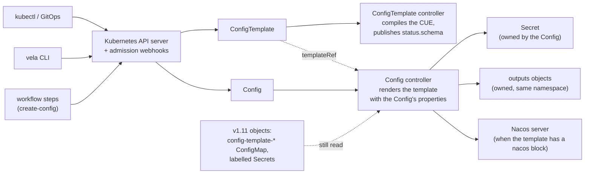

Many integrations need structured data: the address and credentials of an image registry, a
database connection, a Nacos server. A **config template** describes the shape of that data and how
to turn it into Kubernetes objects. A **config** fills a template with values.

Since v1.12, both are Kubernetes resources in the `config.oam.dev/v1alpha1` API group:
`ConfigTemplate` and `Config`. A controller renders each Config into a Secret, plus any other
objects the template declares, and can also publish it to a Nacos server. You can manage them with
`kubectl`, GitOps tools, the `vela` CLI or workflow steps.

:::note
In v1.11 and earlier, a config template was a `config-template-<name>` ConfigMap and each config a
labelled Secret, written by the `vela` CLI. Those objects keep working in v1.12: everything that
reads configs reads both forms, and new writes create the resources described here. To move them to
the new resources, see [Migrate Configs to ConfigTemplate and Config](../platform-engineers/system-operation/config-migration.md).
:::

## How it works



- The admission webhooks check a ConfigTemplate or Config before it is stored: the template's
  scope, who may use it, whether the properties match the template's schema.
- The ConfigTemplate controller compiles the CUE template and publishes the schema of its
  parameters in `status.schema`.
- The Config controller renders the template with the Config's properties and writes the result.
  It writes again whenever the Config, its template or its properties Secret changes.
- A Config's Secret, its `outputs` objects and its distribution are owned by the Config, so
  deleting the Config deletes them.

## ConfigTemplate

A ConfigTemplate holds a CUE template. This one describes a PostgreSQL connection:

```yaml
apiVersion: config.oam.dev/v1alpha1
kind: ConfigTemplate
metadata:
  name: postgres
  namespace: my-team
spec:
  alias: PostgreSQL
  description: Connection details for a PostgreSQL database
  template: |
    template: {
    	parameter: {
    		// +usage=The database host
    		host: string
    		// +usage=The database port
    		port: *5432 | int
    		// +usage=The user to connect as
    		user: string
    	}
    	output: {
    		apiVersion: "v1"
    		kind:       "Secret"
    		metadata: name: context.name
    		stringData: url: "postgres://\(parameter.user)@\(parameter.host):\(parameter.port)"
    	}
    	outputs: info: {
    		apiVersion: "v1"
    		kind:       "ConfigMap"
    		metadata: name: context.name + "-info"
    		data: host: parameter.host
    	}
    }
```

```bash
kubectl apply -f postgres-template.yaml
kubectl -n my-team get configtemplate
```

```console
NAME       SCOPE       PHASE       AGE
postgres   namespace   Available   3s
```

`ct` is the short name: `kubectl get ct`. Once the template compiles, `status.schema` holds the
OpenAPI v3 schema of its parameters, which the CLI and VelaUX use to show and check the fields:

```yaml
status:
  phase: Available
  schema:
    type: object
    required: [host, port, user]
    properties:
      host: {type: string, title: host, description: The database host}
      port: {type: integer, title: port, description: The database port, default: 5432}
      user: {type: string, title: user, description: The user to connect as}
  conditions:
  - type: Synced
    status: "True"
    reason: ReconcileSuccess
```

### ConfigTemplate fields

| Field | Description |
|---|---|
| `spec.template` | Required. The CUE template; see [The CUE template](#the-cue-template). |
| `spec.scope` | `namespace` (default) or `system`. A `system` template must live in `vela-system` and can be used from any namespace. A `namespace` template is meant for Configs in its own namespace. See [Scope: who may use a template](#scope-who-may-use-a-template). |
| `spec.sensitive` | When `true`, the properties of Configs made from this template are never returned by read operations. It can be turned on, never off. See [Sensitive templates](#sensitive-templates). |
| `spec.alias`, `spec.description` | Display name and description. |
| `status.phase` | `Available` once the template compiles, `Error` otherwise. |
| `status.schema` | The OpenAPI v3 schema of `template.parameter`. |
| `status.conditions` | `Synced`: `ReconcileSuccess`, or `ReconcileError` with the error. |

A template that does not compile is accepted and set to `Error`, with the compile error in its
`Synced` condition. Configs that use it report that the template is not available yet, and recover
when the template is fixed.

### The CUE template

The template has the same format as in earlier releases:

```cue
template: {
	// The properties a Config provides. KubeVela turns this into status.schema
	// and checks every Config against it.
	parameter: {...}

	// Optional. The Secret the config is stored in. Without it, the Secret
	// holds only the properties, as JSON, in its input-properties key.
	output?: #Secret

	// Optional. Any other objects to create from the config, by name.
	outputs?: {...}

	// Optional. Publish the config to a Nacos server.
	nacos?: {
		// The config made from the nacos-server template that holds the server
		// address. It cannot refer to the parameters.
		endpoint: {
			name:       string
			namespace?: string
		}
		format: "json" | "yaml" | "properties" | "toml"
		// Can refer to the parameters.
		metadata: {
			dataId:       string
			group?:       string
			appName?:     string
			namespaceId?: string
			tenant?:      string
			tag?:         string
		}
		content: {...}
	}

	// Optional. A check that runs when the config is rendered. A message in
	// validation.$returns rejects the config with that message.
	validation?: {...}
}
```

- `context.name` and `context.namespace` are the Config's name and namespace.
- `outputs` objects are always created in the Config's namespace, whatever namespace the template
  gives them.
- A Nacos block without `group` publishes to `DEFAULT_GROUP`. An endpoint `namespace`, when set,
  must be written as a fixed string, not computed from the parameters.

When you apply a template from a CUE file with `vela config-template apply`, the file also carries
a `metadata` block (`name`, `alias`, `description`, `scope`, `sensitive`); see the
[examples](#examples). `scope: "system"` becomes `spec.scope: system`, and any other value, such as
the older `"project"`, becomes `namespace`.

## Config

A Config fills a template with properties:

```yaml
apiVersion: config.oam.dev/v1alpha1
kind: Config
metadata:
  name: orders-db
  namespace: my-team
spec:
  templateRef:
    name: postgres
    namespace: my-team
  properties:
    host: orders.db.internal
    user: orders
```

```bash
kubectl apply -f orders-db.yaml
kubectl -n my-team get config
```

```console
NAME        TEMPLATE   PHASE       AGE
orders-db   postgres   Available   4s
```

`cfg` is the short name. The controller has rendered the template into the Secret `orders-db`,
with `port` taking its default:

```bash
kubectl -n my-team get secret orders-db -o jsonpath='{.data.url}' | base64 -d
```

```console
postgres://orders@orders.db.internal:5432
```

It has also created the ConfigMap `orders-db-info` from the template's `outputs`. Both are owned by
the Config.

### Config fields

| Field | Description |
|---|---|
| `spec.templateRef` | `name` and `namespace` of the template; `namespace` defaults to `vela-system`. If no ConfigTemplate of that name exists, a v1.11 `config-template-<name>` ConfigMap is used. Without a `templateRef`, nothing is rendered: the Secret holds the properties, as JSON, in its `input-properties` key. It cannot be changed after the Config is created: delete and recreate the Config to use another template. |
| `spec.properties` | The properties, inline. |
| `spec.propertiesFrom.secretRef` | Read the properties from a Secret in the Config's namespace instead: `name`, and `key` (default `properties`) holding a JSON object. A Config that uses it is always sensitive. |
| `spec.alias`, `spec.description` | Display name and description. |

Set either `properties` or `propertiesFrom`, not both.

### Config status

```yaml
status:
  phase: Available
  observedGeneration: 1
  secretRef:
    name: orders-db
  conditions:
  - type: Synced
    status: "True"
    reason: ReconcileSuccess
```

| Field | Description |
|---|---|
| `phase` | `Available` when the Secret and the `outputs` objects are written; `Error` when rendering or writing failed. The controller retries an `Error` every 30 seconds, and at once when the Config, its template or its properties Secret changes. |
| `observedGeneration` | The `metadata.generation` the rest of the status describes. A status is current when the two match. |
| `secretRef` | The Secret the config was written to. |
| `conditions` | `Synced`, with the error when the phase is `Error`. `NacosSynced` for a template with a `nacos` block. |
| `expandedWriter.nacos` | For a template with a `nacos` block: where the content was last confirmed in Nacos (`dataId`, `group`, `endpoint`, `lastSyncTime`) and hashes of the content and the endpoint. |

`NacosSynced` is `True` with reason `Published` (the controller published the content) or
`AlreadyCurrent` (Nacos already held it). It is `False` with reason `EndpointNotFound`,
`EndpointUnreadable`, `ReadFailed` or `PublishFailed`, and the error. A failed Nacos sync does not
change the phase, because the Secret is in place; the controller retries with backoff, and syncs
again at once when the endpoint config changes. See [Nacos](../how-to/dashboard/config/nacos.md).

### Properties from a Secret

Keep the properties in a Secret of your own, for example one managed by an external secret store:

```yaml
apiVersion: v1
kind: Secret
metadata:
  name: orders-login-input
  namespace: my-team
stringData:
  properties: '{"user":"orders","password":"s3cr3t"}'
---
apiVersion: config.oam.dev/v1alpha1
kind: Config
metadata:
  name: orders-login
  namespace: my-team
spec:
  templateRef:
    name: postgres-login
    namespace: my-team
  propertiesFrom:
    secretRef:
      name: orders-login-input
```

When the properties Secret changes, the Config is rendered again. A Config with `propertiesFrom` is
always sensitive: its Secret is marked `config.oam.dev/sensitive: "true"`, whatever the template
says.

## What the controller writes

For each Config, the controller:

- renders the template once, with the Config's properties checked against `parameter`;
- writes the Secret from `output`. It is labelled
  `config.oam.dev/catalog: velacore-config` and `config.oam.dev/type: <template name>`, and its
  type defaults to `/<template name>`, as in v1.11;
- writes each `outputs` object into the Config's namespace;
- publishes to Nacos when the template has a `nacos` block. It reads Nacos first and publishes only
  when the content differs.

The Secret and the `outputs` objects are owned by the Config. If a Secret or object of the same
name already exists and the Config does not own it, the Config goes to `Error` with `already
exists and is not owned by this Config`; the controller never takes over an object it did not
create. Deleting the Config deletes its Secret, its `outputs` objects and its distribution through
garbage collection. It does not delete anything from Nacos.

## Scope: who may use a template

Where a template lives decides who may use it:

| Template | A Config in namespace `N` may use it |
|---|---|
| In `N` | Always. |
| `system` scope (a ConfigTemplate in `vela-system` with `scope: system`, or a v1.11 template ConfigMap in `vela-system`) | Always. |
| `namespace` scope, in another namespace | Only if the user creating or changing the Config can `get` that ConfigTemplate. |

For example, to let `alice` create Configs in her own namespace from the `postgres` template in
the `shared` namespace:

```bash
kubectl create role use-postgres-template -n shared --verb=get \
  --resource=configtemplates.config.oam.dev --resource-name=postgres
kubectl create rolebinding alice-use-postgres-template -n shared \
  --role=use-postgres-template --user=alice
```

Without the grant, her Config is refused, and the message names the grant to make:

```console
admission webhook "validating.config.oam.dev.v1alpha1.configs" denied the request: config template shared/postgres is namespace-scoped: a config in my-team may use it only if its author can get it (grant get on configtemplates.config.oam.dev postgres in namespace shared); alice may not
```

- `scope: system` is accepted only in `vela-system`.
- A v1.11 template ConfigMap is system-scoped in `vela-system` and namespace-scoped anywhere else,
  whatever its `config.oam.dev/scope` label says.
- A template whose `nacos.endpoint` is in another namespace can be created only by a user who can
  `get` that endpoint's Secret.
- The `create-config` workflow step checks the Application's user when the
  `AuthenticateApplication` feature gate is on. With it off there is no user to check, so the step
  may use only a template in the Application's namespace or a system one.

Cross-namespace uses that existed before an upgrade from v1.11 are kept when the template is
migrated: they are listed in the template's `config.oam.dev/grandfathered-configs` annotation,
which can lose entries but not gain them.

## Sensitive templates

Set `spec.sensitive: true` on a template whose configs hold secrets:

```yaml
apiVersion: config.oam.dev/v1alpha1
kind: ConfigTemplate
metadata:
  name: postgres-login
  namespace: my-team
spec:
  sensitive: true
  template: |
    template: {
    	parameter: {
    		user:     string
    		password: string
    	}
    	output: {
    		apiVersion: "v1"
    		kind:       "Secret"
    		stringData: {
    			user:     parameter.user
    			password: parameter.password
    		}
    	}
    }
```

The rules:

1. **A sensitive template takes properties only from a Secret.** A Config with inline
   `properties` is refused:

   ```console
   admission webhook "validating.config.oam.dev.v1alpha1.configs" denied the request: config template my-team/postgres-login is sensitive: spec.properties must not be set, use spec.propertiesFrom instead
   ```

   `vela config create` handles this for you: it stores the properties in a `<config>-properties`
   Secret and points the Config at it.
2. **`sensitive` can be turned on, never off.**

   ```console
   The ConfigTemplate "postgres-login" is invalid: spec: Invalid value: sensitive cannot be changed from true to false
   ```

   Turning it on marks the existing Configs' Secrets sensitive at once. Configs with inline
   `properties` go to `Error` until they are moved to `propertiesFrom`.
3. **A Config with `propertiesFrom` is always sensitive**, whatever its template says.
4. **A sensitive mark stays.** A Secret marked sensitive is never unmarked.

Read operations never return a sensitive config's properties: `vela config` reads, the
`read-config` and `list-config` workflow steps, and CueX. Applications can still mount the Secret.

A sensitive config used as a Nacos endpoint must also carry the annotation
`config.oam.dev/nacos-endpoint: "true"`, set on its Config by its owner. Without it, Configs that
publish through that endpoint report `NacosSynced` `False` with reason `EndpointUnreadable`.

## Admission checks

With the admission webhooks enabled (the default), a ConfigTemplate or Config is refused before it
is stored when:

| Resource | Refused when |
|---|---|
| ConfigTemplate | `scope: system` outside `vela-system`; `sensitive` turned from `true` to `false`; the `nacos` block has no `endpoint.name` or `metadata.dataId` or an unknown `format`; the Nacos endpoint is in a namespace the user cannot read |
| Config | `templateRef` changed; both `properties` and `propertiesFrom` set; inline `properties` on a sensitive template; the user may not use the template; the properties do not match the template's schema, or the template fails to render with them; the `propertiesFrom` Secret or key does not exist |

For example:

```console
admission webhook "validating.config.oam.dev.v1alpha1.configs" denied the request: spec.properties and spec.propertiesFrom are mutually exclusive
```

With the webhooks disabled, the controller applies the same rules where it can and reports a
violation as `Error` in the status. Some checks only the webhooks can make: that `templateRef` does
not change, and anything that depends on who sent the request, such as using a template from
another namespace.

## Using the vela CLI

The `vela config-template` and `vela config` commands work as before; since v1.12 they write
ConfigTemplate and Config resources. They default to the `vela-system` namespace; pass `-n` for
another.

```bash
# Apply a template from a CUE file: creates or updates a ConfigTemplate
vela config-template apply -f postgres.cue -n my-team

# Show a template's parameters
vela config-template show postgres -n my-team
```

```console
+------+---------+------------------------+----------+---------+---------+
| NAME |  TYPE   |      DESCRIPTION       | REQUIRED | OPTIONS | DEFAULT |
+------+---------+------------------------+----------+---------+---------+
| host | string  | The database host      | true     |         |         |
| port | integer | The database port      | true     |         |    5432 |
| user | string  | The user to connect as | true     |         |         |
+------+---------+------------------------+----------+---------+---------+
```

```bash
# Create a config: creates a Config
vela config create orders-replica -t my-team/postgres -n my-team host=replica.db.internal user=orders

# Distribute a config to other clusters or namespaces, as <cluster>/<namespace>
vela config distribute orders-db -n my-team --target local/my-team-prod
```

The list commands show resources and v1.11 objects together, with a `SOURCE` column:

```bash
vela config-template list -n my-team
```

```console
NAME          	ALIAS     	SCOPE    	SENSITIVE	SOURCE	CREATED-TIME
postgres      	PostgreSQL	namespace	false    	crd   	2026-11-06 13:55:22 +0530 IST
postgres-login	          	namespace	true     	crd   	2026-11-06 13:55:38 +0530 IST
redis         	Redis     	project  	false    	legacy	2026-11-06 13:55:54 +0530 IST
```

```bash
vela config list -n my-team
```

```console
NAME          	ALIAS	SOURCE	PHASE    	DISTRIBUTION      	TEMPLATE              	CREATED-TIME                 	DESCRIPTION
orders-db     	     	crd   	Available	local/my-team-prod	my-team/postgres      	2026-11-06 13:55:25 +0530 IST
orders-login  	     	crd   	Available	                  	my-team/postgres-login	2026-11-06 13:55:41 +0530 IST
orders-replica	     	crd   	Available	                  	my-team/postgres      	2026-11-06 13:55:54 +0530 IST
cache         	     	legacy	         	                  	my-team/redis         	2026-11-06 13:55:54 +0530 IST
```

- `crd` is a ConfigTemplate or Config; `legacy` is a v1.11 object. `legacy (shadowed)` marks a
  v1.11 template that a ConfigTemplate of the same name now overrides.
- `--config-mode crd` or `--config-mode legacy` lists only one kind. In the legacy list, objects
  already migrated show as `legacy (migrated)`.
- `delete` removes a config or template of either kind. Deleting a config also removes its
  distribution.
- `vela config create` returns once the Config is stored, before the controller has written its
  Secret. Check `PHASE` in `vela config list`, or the Config's status, to see that it is
  `Available`.

## Workflow steps

The `create-config`, `read-config`, `list-config` and `delete-config` steps work with Config
resources and with v1.11 configs. `create-config` creates a Config owned by the Application and
waits until it is `Available`. See
[Read and write configs in the pipeline](../how-to/dashboard/config/read-write-config-in-pipeline.md).

## Examples

These templates are CUE files for `vela config-template apply -f <file>`. The three with
`scope: "system"` must be applied in `vela-system`, the CLI's default namespace, so they can be used
from any namespace.

### Image Registry

```cue
import (
	"encoding/base64"
	"encoding/json"
	"strconv"
)

metadata: {
	name:        "image-registry"
	alias:       "Image Registry"
	scope:       "project"
	description: "Config information to authenticate image registry"
	sensitive:   false
}

template: {
	output: {
		apiVersion: "v1"
		kind:       "Secret"
		metadata: {
			name:      context.name
			namespace: context.namespace
			labels: {
				"config.oam.dev/catalog": "velacore-config"
				"config.oam.dev/type":    "image-registry"
			}
		}
		if parameter.auth != _|_ {
			type: "kubernetes.io/dockerconfigjson"
		}
		if parameter.auth == _|_ {
			type: "Opaque"
		}
		stringData: {
			if parameter.auth != _|_ && parameter.auth.username != _|_ {
				".dockerconfigjson": json.Marshal({
					"auths": (parameter.registry): {
						"username": parameter.auth.username
						"password": parameter.auth.password
						if parameter.auth.email != _|_ {
							"email": parameter.auth.email
						}
						"auth": base64.Encode(null, (parameter.auth.username + ":" + parameter.auth.password))
					}
				})
			}
			if parameter.insecure != _|_ {
				"insecure-skip-verify": strconv.FormatBool(parameter.insecure)
			}
			if parameter.useHTTP != _|_ {
				"protocol-use-http": strconv.FormatBool(parameter.useHTTP)
			}
		}
	}

	parameter: {
		// +usage=Image registry FQDN, such as: index.docker.io
		registry: *"index.docker.io" | string
		// +usage=Authenticate the image registry
		auth?: {
			// +usage=Private Image registry username
			username: string
			// +usage=Private Image registry password
			password: string
			// +usage=Private Image registry email
			email?: string
		}
		// +usage=For the registry server that uses the self-signed certificate
		insecure?: bool
		// +usage=For the registry server that uses the HTTP protocol
		useHTTP?: bool
	}
}
```

### Nacos Server

```cue
metadata: {
	name:        "nacos-server"
	alias:       "Nacos Server"
	description: "Config the Nacos server connectors"
	sensitive:   false
	scope:       "system"
}

template: {
	parameter: {
		// +usage=Directly configure the Nacos server address
		servers?: [...{
			// +usage=the nacos server address
			ipAddr: string
			// +usage=nacos server port
			port: *8849 | int
			// +usage=nacos server grpc port, default=server port + 1000, this is not required
			grpcPort?: int
		}]
		// +usage=Discover the Nacos servers by the client.
		client?: {
			// +usage=the endpoint for get Nacos server addresses
			endpoint: string
			// +usage=the AccessKey for kms
			accessKey?: string
			// +usage=the SecretKey for kms
			secretKey?: string
			// +usage=the regionId for kms
			regionId?: string
			// +usage=the username for nacos auth
			username?: string
			// +usage=the password for nacos auth
			password?: string
			// +usage=it's to open kms,default is false. https://help.aliyun.com/product/28933.html
			openKMS?: bool
		}
	}
}

```

### Generic Nacos Config

```cue
metadata: {
	name:        "nacos-config"
	alias:       "Nacos Configuration"
	description: "Write the configuration to the nacos"
	sensitive:   false
	scope:       "system"
}

template: {
	nacos: {
		// The endpoint can not references the parameter.
		endpoint: {
			// Users must create a config base the nacos-server template firstly.
			name: "nacos"
		}
		format: parameter.contentType

		// could references the parameter
		metadata: {
			dataId: parameter.dataId
			group:  parameter.group
			if parameter.appName != _|_ {
				appName: parameter.appName
			}
			if parameter.namespaceId != _|_ {
				namespaceId: parameter.namespaceId
			}
			if parameter.tenant != _|_ {
				tenant: parameter.tenant
			}
			if parameter.tag != _|_ {
				tag: parameter.tag
			}
		}
		content: parameter.content
	}
	parameter: {
		// +usage=Configuration ID
		dataId: string
		// +usage=Configuration group
		group: *"DEFAULT_GROUP" | string
		// +usage=The configuration content.
		content: {
			...
		}
		contentType: *"json" | "yaml" | "properties" | "toml"
		// +usage=The app name of the configuration
		appName?: string
		// +usage=The namespaceId of the configuration
		namespaceId?: string
		// +usage=The tenant, corresponding to the namespace ID field of Nacos
		tenant?: string
		// +usage=The tag of the configuration
		tag?: string
	}
}

```

### Alibaba Cloud Provider

```cue
import "strings"

metadata: {
	name:        "terraform-alibaba"
	alias:       "Terraform Provider for Alibaba Cloud"
	sensitive:   true
	scope:       "system"
	description: "Terraform Provider for Alibaba Cloud"
}

template: {
	outputs: {
		"provider": {
			apiVersion: "terraform.core.oam.dev/v1beta1"
			kind:       "Provider"
			metadata: {
				name:      parameter.name
				namespace: "default"
				labels:    l
			}
			spec: {
				provider: "alibaba"
				region:   parameter.ALICLOUD_REGION
				credentials: {
					source: "Secret"
					secretRef: {
						namespace: "vela-system"
						name:      context.name
						key:       "credentials"
					}
				}
			}
		}
	}

	output: {
		apiVersion: "v1"
		kind:       "Secret"
		metadata: {
			name:      context.name
			namespace: context.namespace
		}
		type: "Opaque"
		stringData: credentials: strings.Join([creds1, creds2], "\n")
	}

	creds1: "accessKeyID: " + parameter.ALICLOUD_ACCESS_KEY
	creds2: "accessKeySecret: " + parameter.ALICLOUD_SECRET_KEY

	l: {
		"config.oam.dev/catalog":  "velacore-config"
		"config.oam.dev/type":     "terraform-provider"
		"config.oam.dev/provider": "terraform-alibaba"
	}

	parameter: {
		//+usage=The name of Terraform Provider for Alibaba Cloud, default is `default`
		name: *"default" | string
		//+usage=Get ALICLOUD_ACCESS_KEY per this guide https://help.aliyun.com/knowledge_detail/38738.html
		ALICLOUD_ACCESS_KEY: string
		//+usage=Get ALICLOUD_SECRET_KEY per this guide https://help.aliyun.com/knowledge_detail/38738.html
		ALICLOUD_SECRET_KEY: string
		//+usage=Get ALICLOUD_REGION by picking one RegionId from Alibaba Cloud region list https://www.alibabacloud.com/help/doc-detail/72379.htm
		ALICLOUD_REGION: string
	}
}
```

## Share templates through addons

An addon can ship config templates in its `config-templates/` directory; see
[Addon](../platform-engineers/addon/intro.md). In v1.12, enabling an addon still installs them as
v1.11 template ConfigMaps in `vela-system`, which every command and the controller read as system
templates.

## Known limitations

- **`outputs` objects are not watched.** An `outputs` object deleted or changed by hand is written
  again only the next time the Config is rendered: when the Config, its template or its properties
  Secret changes. The Secret itself is watched and restored at once.
- **Objects a template stops producing are kept.** When a template drops an `outputs` entry, or
  renders the Secret under a new name, the old object stays, still owned by the Config, until the
  Config is deleted.
- **Deleting a Config does not delete its Nacos entry.**
- **GitOps health.** Config and ConfigTemplate have no `Ready` condition yet, so Flux and Argo CD
  report a Config in `Error` as healthy. Check `status.phase`.
- **A migrated addon template stops following the addon.** If you migrate a template an addon
  installed, a later upgrade of that addon changes only the v1.11 ConfigMap, and the ConfigTemplate
  keeps overriding it. To pick up the change, delete the ConfigTemplate and run
  `vela config-template migrate <name> -n vela-system` again, or leave addon templates unmigrated.
