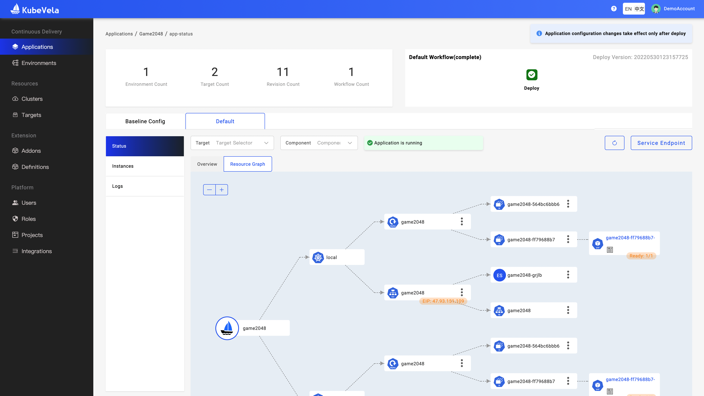

Read this when you add a CRD-based workload, in an addon or by hand, and VelaUX shows no Pods for it.

KubeVela finds the Pods and Services behind an Application by walking from each resource it applied to that resource's children, using rules like "a Deployment's children are ReplicaSets". VelaUX's topology view, `vela logs`, `vela exec`, `vela port-forward` and `vela status --endpoint` all depend on these rules. If a workload is a custom resource with no rule, those commands report `no pod found in your application`.

Here is the topology view of an application in VelaUX, built from these rules:



## Built-in rules

Built-in rules cover Deployment, ReplicaSet, StatefulSet, DaemonSet, Job, CronJob, Service, Flux HelmRelease and Kustomization. Add a rule only for other kinds.

| Parent | Children |
| --- | --- |
| `Deployment` (`apps`) | `ReplicaSet` |
| `ReplicaSet` (`apps`) | `Pod` |
| `StatefulSet` (`apps`) | `Pod` |
| `DaemonSet` (`apps`) | `Pod` |
| `Job` (`batch`) | `Pod` |
| `CronJob` (`batch`) | `Job` |
| `Service` (core) | `EndpointSlice`, `Endpoints` |
| `HelmRelease` (`helm.toolkit.fluxcd.io`) | `Deployment`, `StatefulSet`, `ConfigMap`, `Secret`, `Service`, `PersistentVolumeClaim`, `Ingress`, `HTTPRoute`, `Gateway`, `ServiceAccount`, `Role`, `RoleBinding` |
| `Kustomization` (`kustomize.toolkit.fluxcd.io`) | The same kinds as `HelmRelease` |

KubeVela keeps walking down while a child's kind has a rule of its own, so a Deployment leads to its ReplicaSets and on to their Pods.

## Add a rule

A rule is a ConfigMap in the `vela-system` namespace:

- It must carry the label `rules.oam.dev/resources: "true"`. KubeVela ignores ConfigMaps without it.
- The `rules` key under `data` holds a list of rules.
- The label `rules.oam.dev/resource-format` says how `rules` is written: `yaml` (the default when the label is missing) or `json`.

Each rule names one parent kind and the kinds of its children:

| Field | Meaning |
| --- | --- |
| `parentResourceType.group` | API group of the parent, for example `argoproj.io`. Use `""` for the core group. |
| `parentResourceType.kind` | Kind of the parent, for example `Rollout`. |
| `childrenResourceType[].apiVersion` | API version of a child kind, for example `apps/v1`. |
| `childrenResourceType[].kind` | Kind of the child, for example `ReplicaSet`. |
| `childrenResourceType[].defaultLabelSelector` | Optional. When `true`, KubeVela finds children with the parent's `spec.selector` and keeps the ones the parent owns or that have no owner. Otherwise it lists that kind in the parent's namespace and keeps the objects whose owner reference points at the parent. |

A rule for a kind that already has a built-in rule adds its children to that rule. KubeVela reads the rule ConfigMaps on every query, so a new rule takes effect without restarting anything.

## Example: Argo Rollouts

An [Argo Rollouts](https://argoproj.github.io/rollouts/) `Rollout` manages ReplicaSets, which manage Pods. KubeVela has a built-in rule from ReplicaSet to Pod, but none from Rollout to ReplicaSet, so it can't find the Pods.

Install Argo Rollouts, if you don't have it already:

```shell
kubectl create namespace argo-rollouts
kubectl apply -n argo-rollouts -f https://github.com/argoproj/argo-rollouts/releases/latest/download/install.yaml
```

Deploy a Rollout with the `k8s-objects` component:

```shell
cat <<EOF | vela up -f -
apiVersion: core.oam.dev/v1beta1
kind: Application
metadata:
  name: app-rollout
spec:
  components:
    - name: podinfo
      type: k8s-objects
      properties:
        objects:
          - apiVersion: argoproj.io/v1alpha1
            kind: Rollout
            metadata:
              name: podinfo
            spec:
              replicas: 2
              selector:
                matchLabels:
                  app: podinfo
              template:
                metadata:
                  labels:
                    app: podinfo
                spec:
                  containers:
                    - name: podinfo
                      image: stefanprodan/podinfo:6.5.4
                      ports:
                        - containerPort: 9898
              strategy:
                canary:
                  steps:
                    - setWeight: 50
                    - pause:
                        duration: 30s
EOF
```

The Pods are running, but KubeVela can't see them. VelaUX shows the Rollout with no children, and the CLI can't find a Pod:

```shell
$ vela logs app-rollout
Error: no pod found in your application
```

Add a rule from Rollout to ReplicaSet:

```shell
cat <<EOF | kubectl apply -f -
apiVersion: v1
kind: ConfigMap
metadata:
  name: argo-rollout-relation
  namespace: vela-system
  labels:
    rules.oam.dev/resources: "true"
    rules.oam.dev/resource-format: "yaml"
data:
  rules: |-
    - parentResourceType:
        group: argoproj.io
        kind: Rollout
      childrenResourceType:
        - apiVersion: apps/v1
          kind: ReplicaSet
EOF
```

The same rule written as JSON:

```yaml
apiVersion: v1
kind: ConfigMap
metadata:
  name: argo-rollout-relation
  namespace: vela-system
  labels:
    rules.oam.dev/resources: "true"
    rules.oam.dev/resource-format: "json"
data:
  rules: |-
    [
      {
        "parentResourceType": {
          "group": "argoproj.io",
          "kind": "Rollout"
        },
        "childrenResourceType": [
          {
            "apiVersion": "apps/v1",
            "kind": "ReplicaSet"
          }
        ]
      }
    ]
```

The parent is a `Rollout` in the `argoproj.io` group, and its children are ReplicaSets. The built-in rule takes it from there to the Pods.

VelaUX now shows the ReplicaSets and Pods under the Rollout, and `vela logs` and `vela exec` now work:

```shell
vela logs app-rollout
vela exec app-rollout -- sh
```

Do the same for a custom resource whose children include a Service, so `vela status --endpoint` finds it.

## Ship rules with an addon

An [addon](../platform-engineers/addon/intro.md) that installs a CRD operator should ship the rules for its kinds, so its users see the Pods without adding anything. Put the rule ConfigMap in the `outputs` field of the addon's `template.cue`:

```cue
package main

import "encoding/json"

output: {
	apiVersion: "core.oam.dev/v1beta1"
	kind:       "Application"
	spec: components: []
}

outputs: resourceTree: {
	apiVersion: "v1"
	kind:       "ConfigMap"
	metadata: {
		name:      "argo-rollout-relation"
		namespace: "vela-system"
		labels: {
			"rules.oam.dev/resources":       "true"
			"rules.oam.dev/resource-format": "json"
		}
	}
	data: rules: json.Marshal(_rules)
}

_rules: [{
	parentResourceType: {
		group: "argoproj.io"
		kind:  "Rollout"
	}
	childrenResourceType: [{
		apiVersion: "apps/v1"
		kind:       "ReplicaSet"
	}]
}]
```

See [auxiliary resources](../platform-engineers/addon/addon-cue.md#auxiliary-resources) for more on `outputs` in an addon.
