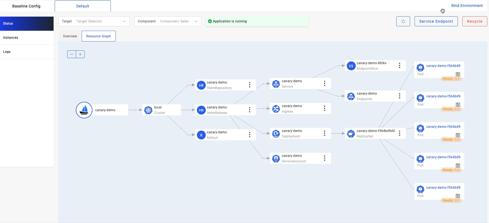
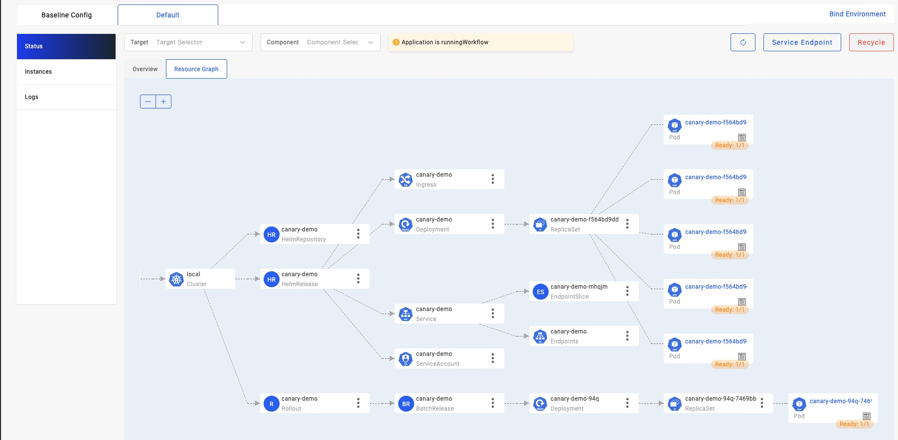

import Tabs from '@theme/Tabs';
import TabItem from '@theme/TabItem';

This guide rolls out a new version of an application gradually: a canary takes a share of the traffic, you check it, then you finish the rollout or roll back. It works the same for a Helm chart, inline Kubernetes objects and a `webservice` component; only the application YAML differs, so pick your tab where it does.

## Before starting

1. Know how to deploy the component type you're using: see [Deploy Helm Chart](./helm.md) or [Deploy Kubernetes Objects](./k8s-object.mdx).

2. Enable the [`kruise-rollout`](/addons/kruise-rollout) addon. Canary rollout is built on [OpenKruise Rollouts](https://github.com/openkruise/rollouts).
   ```shell
   vela addon enable kruise-rollout
   ```

3. Run ingress-nginx in the cluster. The demo routes traffic with an Ingress of class `nginx` (the Helm chart hard-codes it), so another ingress controller never serves it. If you don't have ingress-nginx, enable the [ingress-nginx](/addons/nginx-ingress-controller) addon:
   ```shell
   vela addon enable ingress-nginx
   ```

## Limitation

The canary rollout works when:

1. The chart or the objects contain a Service pointing at the workload, and an Ingress routing to that Service.
2. The workload is a Kubernetes Deployment, a StatefulSet or an [OpenKruise CloneSet](https://openkruise.io/docs/user-manuals/cloneset).

Any chart that `helm create` generates meets both.

## First deployment

Add the `kruise-rollout` trait on the first deployment. It takes effect on the next release.

<Tabs groupId="workload">
<TabItem value="helm" label="Helm chart">

```shell
cat <<EOF | vela up -f -
apiVersion: core.oam.dev/v1beta1
kind: Application
metadata:
  name: canary-demo
  annotations:
    app.oam.dev/publishVersion: v1
spec:
  components:
  - name: canary-demo
    type: helm
    properties:
      repoType: "helm"
      url: "https://wangyikewxgm.github.io/my-charts/"
      chart: "canary-demo"
      version: "1.0.0"
    traits:
    - type: kruise-rollout
      properties:
        canary:
          # First batch: 20% of the pods and 20% of the traffic go to the new version, then wait for approval.
          steps:
          - weight: 20
          # Second batch: 90% of the pods and 90% of the traffic.
          - weight: 90
          trafficRoutings:
          - type: ingress
EOF
```

This is a chart generated by `helm create`, with a Deployment of 5 replicas running `barnett/canarydemo:v1`, a Service and an Ingress. See its [source](https://github.com/wangyikewxgm/my-charts/tree/main/canary-demo).

</TabItem>
<TabItem value="k8s-objects" label="Kubernetes objects">

```shell
cat <<EOF | vela up -f -
apiVersion: core.oam.dev/v1beta1
kind: Application
metadata:
  name: canary-demo
  namespace: default
  annotations:
    app.oam.dev/publishVersion: v1
spec:
  components:
    - name: canary-demo
      type: k8s-objects
      properties:
        objects:
          - apiVersion: apps/v1
            kind: Deployment
            metadata:
              name: canary-demo
            spec:
              replicas: 5
              selector:
                matchLabels:
                  app: demo
              template:
                metadata:
                  labels:
                    app: demo
                spec:
                  containers:
                    - image: barnett/canarydemo:v1
                      name: demo
                      ports:
                        - containerPort: 8090
          - apiVersion: v1
            kind: Service
            metadata:
              labels:
                app: demo
              name: canary-demo
              namespace: default
            spec:
              ports:
                - name: http
                  port: 8090
                  protocol: TCP
                  targetPort: 8090
              selector:
                app: demo
          - apiVersion: networking.k8s.io/v1
            kind: Ingress
            metadata:
              labels:
                app: demo
              name: canary-demo
              namespace: default
            spec:
              ingressClassName: nginx
              rules:
                - host: canary-demo.com
                  http:
                    paths:
                      - backend:
                          service:
                            name: canary-demo
                            port:
                              number: 8090
                        path: /version
                        pathType: ImplementationSpecific
      traits:
        - type: kruise-rollout
          properties:
            canary:
              steps:
                # First batch: 20% of the pods and 20% of the traffic go to the new version, then wait for approval.
                - weight: 20
                # Second batch: 90% of the pods and 90% of the traffic.
                - weight: 90
              trafficRoutings:
                - type: ingress
EOF
```

The objects are a Deployment of 5 replicas running `barnett/canarydemo:v1`, a Service and an Ingress.

</TabItem>
<TabItem value="webservice" label="Webservice">

```shell
cat <<EOF | vela up -f -
apiVersion: core.oam.dev/v1beta1
kind: Application
metadata:
  name: canary-demo
  annotations:
    app.oam.dev/publishVersion: v1
spec:
  components:
    - name: canary-demo
      type: webservice
      properties:
        image: wangyikewyk/canarydemo:v1
        ports:
          - port: 8090
      traits:
        - type: scaler
          properties:
            replicas: 5
        - type: gateway
          properties:
            domain: canary-demo.com
            http:
              "/version": 8090
        - type: kruise-rollout
          properties:
            canary:
              steps:
                # First batch: 20% of the pods and 20% of the traffic go to the new version, then wait for approval.
                - weight: 20
                # Second batch: 90% of the pods and 90% of the traffic.
                - weight: 90
              trafficRoutings:
                - type: ingress
EOF
```

The `gateway` trait creates the Service and an Ingress of class `nginx`, both named `canary-demo`, which is where the `kruise-rollout` trait looks for them.

</TabItem>
</Tabs>

Here's what happens on the next upgrade with this trait configuration, in 3 steps:

1. A canary Deployment is created with `20%` of the replicas: the 5 old pods stay and `5 * 20% = 1` new pod serves `20%` of the traffic. The workflow then waits for your approval.
   - By default the share of replicas follows the share of traffic. You can set the replicas separately: see the [kruise-rollout addon](/addons/kruise-rollout).
2. After you approve, the second batch starts: `5 * 90% = 4.5`, rounded up to `5` new pods, take `90%` of the traffic, so there are `10` pods in all. The workflow waits for a second approval.
3. After the second approval, the workload itself is updated with its own rolling update. When that finishes, all the traffic goes to the workload and the canary Deployment is removed.

The first deployment is a normal deployment. Check the application is running before you go on:

```shell
vela status canary-demo
```

If you have enabled the [velaux](../reference/addons/velaux.md) addon, the application's topology graph shows all the `v1` pods ready.



### Get the ingress address

The `ingress-nginx` addon's Service is `ClusterIP` by default. Forward a local port to it, in a second terminal:

```shell
vela port-forward -n vela-system addon-ingress-nginx 9080:80
```

and use `localhost:9080` as the address:

```shell
export INGRESS=localhost:9080
```

If you enabled the addon with `serviceType=LoadBalancer` or `NodePort`, or run your own ingress-nginx, use its address instead: `vela status addon-ingress-nginx -n vela-system --endpoint` for the addon, or `kubectl get svc -A | grep ingress-nginx`.

Call the demo. Every answer is `Demo: V1`:

```shell
$ curl -H "Host: canary-demo.com" $INGRESS/version
Demo: V1
```

## Start the canary

Upgrade the application.

<Tabs groupId="workload">
<TabItem value="helm" label="Helm chart">

Change the chart version from `1.0.0` to `2.0.0`. The only difference between the two is the image tag: `2.0.0` runs `barnett/canarydemo:v2`.

```shell
cat <<EOF | vela up -f -
apiVersion: core.oam.dev/v1beta1
kind: Application
metadata:
  name: canary-demo
  annotations:
    app.oam.dev/publishVersion: v2
spec:
  components:
  - name: canary-demo
    type: helm
    properties:
      repoType: "helm"
      url: "https://wangyikewxgm.github.io/my-charts/"
      chart: "canary-demo"
      # Upgrade to version 2.0.0
      version: "2.0.0"
    traits:
    - type: kruise-rollout
      properties:
        canary:
          # First batch: 20% of the pods and 20% of the traffic go to the new version, then wait for approval.
          steps:
          - weight: 20
          # Second batch: 90% of the pods and 90% of the traffic.
          - weight: 90
          trafficRoutings:
          - type: ingress
EOF
```

</TabItem>
<TabItem value="k8s-objects" label="Kubernetes objects">

Change the image tag from `v1` to `v2`.

```shell
cat <<EOF | vela up -f -
apiVersion: core.oam.dev/v1beta1
kind: Application
metadata:
  name: canary-demo
  namespace: default
  annotations:
    app.oam.dev/publishVersion: v2
spec:
  components:
    - name: canary-demo
      type: k8s-objects
      properties:
        objects:
          - apiVersion: apps/v1
            kind: Deployment
            metadata:
              name: canary-demo
            spec:
              replicas: 5
              selector:
                matchLabels:
                  app: demo
              template:
                metadata:
                  labels:
                    app: demo
                spec:
                  containers:
                    - image: barnett/canarydemo:v2
                      name: demo
                      ports:
                        - containerPort: 8090
          - apiVersion: v1
            kind: Service
            metadata:
              labels:
                app: demo
              name: canary-demo
              namespace: default
            spec:
              ports:
                - name: http
                  port: 8090
                  protocol: TCP
                  targetPort: 8090
              selector:
                app: demo
          - apiVersion: networking.k8s.io/v1
            kind: Ingress
            metadata:
              labels:
                app: demo
              name: canary-demo
              namespace: default
            spec:
              ingressClassName: nginx
              rules:
                - host: canary-demo.com
                  http:
                    paths:
                      - backend:
                          service:
                            name: canary-demo
                            port:
                              number: 8090
                        path: /version
                        pathType: ImplementationSpecific
      traits:
        - type: kruise-rollout
          properties:
            canary:
              steps:
                # First batch: 20% of the pods and 20% of the traffic go to the new version, then wait for approval.
                - weight: 20
                # Second batch: 90% of the pods and 90% of the traffic.
                - weight: 90
              trafficRoutings:
                - type: ingress
EOF
```

</TabItem>
<TabItem value="webservice" label="Webservice">

Change the image tag from `v1` to `v2`.

```shell
cat <<EOF | vela up -f -
apiVersion: core.oam.dev/v1beta1
kind: Application
metadata:
  name: canary-demo
  annotations:
    app.oam.dev/publishVersion: v2
spec:
  components:
    - name: canary-demo
      type: webservice
      properties:
        image: wangyikewyk/canarydemo:v2
        ports:
          - port: 8090
      traits:
        - type: scaler
          properties:
            replicas: 5
        - type: gateway
          properties:
            domain: canary-demo.com
            http:
              "/version": 8090
        - type: kruise-rollout
          properties:
            canary:
              steps:
                # First batch: 20% of the pods and 20% of the traffic go to the new version, then wait for approval.
                - weight: 20
                # Second batch: 90% of the pods and 90% of the traffic.
                - weight: 90
              trafficRoutings:
                - type: ingress
EOF
```

</TabItem>
</Tabs>

The trait creates a canary and the workflow waits for your approval. Check the application:

```shell
$ vela status canary-demo
...
Workflow:

  mode: DAG
  finished: false
  Suspend: false
  Terminated: false
  Steps
  - id: 8adxa11wku
    name: canary-demo
    type: apply-component
    phase: running
    message: wait healthy

Services:

  - Name: canary-demo
    Cluster: local  Namespace: default
    ...
    Traits:
      ❌ kruise-rollout: Rollout is in step(1/1), and you need manually confirm to enter the next step
```

The status is `runningWorkflow`: the rollout hasn't finished.

The topology graph now shows a `v2` pod, created by the `kruise-rollout` trait, serving the canary traffic beside the `v1` pods.



Call the demo 20 times. About 1 answer in 5 is `Demo: V2`:

```shell
for i in $(seq 20); do curl -s -H "Host: canary-demo.com" $INGRESS/version; echo; done
```

## Continue the rollout

Once business metrics, logs and whatever else you check show the canary is good, resume the workflow to move to the second batch:

```shell
vela workflow resume canary-demo
```

Run the curl loop again. Now about 9 answers in 10 are `Demo: V2`.

## Finish the rollout

Resume once more to finish:

```shell
vela workflow resume canary-demo
```

Run the curl loop again. Every answer is `Demo: V2`.

## Roll back

If the canary looks wrong, suspend the workflow and roll back to the last revision that succeeded:

```shell
$ vela workflow suspend canary-demo
Rollout default/canary-demo in cluster  suspended.
Successfully suspend workflow: canary-demo
```

Then roll back:

```shell
$ vela workflow rollback canary-demo
Application spec rollback successfully.
Application status rollback successfully.
Rollout default/canary-demo in cluster  rollback.
Successfully rollback rolloutApplication outdated revision cleaned up.
```

Call the demo again. Every answer is `Demo: V1`:

```shell
$ curl -H "Host: canary-demo.com" $INGRESS/version
Demo: V1
```

A rollback in the middle of a running workflow goes back to the application's last revision that succeeded. So if `v1` succeeded, `v2` didn't, and you then upgraded to `v3`, rolling back `v3` takes you to `v1`.
