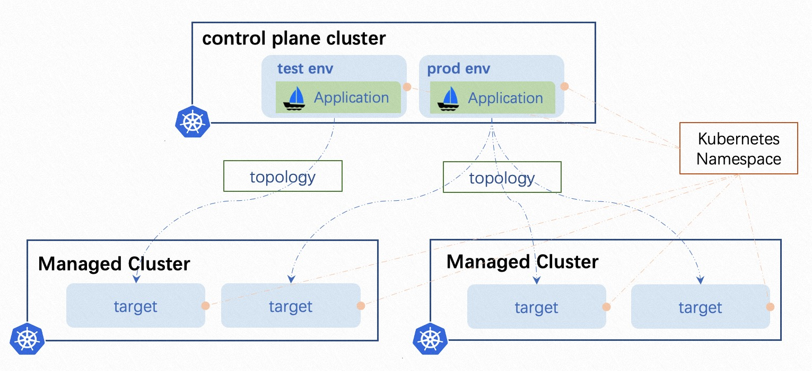

:::tip
This page covers environments in VelaUX. To deploy to several environments with YAML, see [multi-cluster delivery](../end-user/policies/multi-cluster.md): a topology policy per environment, each picking its clusters and namespace, does the same job.
:::

Environments represent where you deploy, logically: develop, test, production and so on. VelaUX (the UI of KubeVela) adds [environments and delivery targets](../how-to/dashboard/concepts.md) on top of KubeVela applications:

- A **target** is a cluster and a namespace to deploy to.
- An **environment** groups one or more targets, and belongs to a project. Only applications in that project can be bound to it.
- Each environment is bound to a namespace in the control plane cluster.

An application in VelaUX is a template until you bind it to an environment. Each environment an application is bound to is a separate Application CR in that environment's namespace, so environments deploy independently.



:::note
If you configure no target, VelaUX uses a default one: the `default` namespace in the control plane cluster.
:::

## Deploy an application to several environments

### 1. Create an environment

1. Open **Environments** in the left menu and click **New Environment**.
2. Fill in the form:
   - **Name**: the environment's name, for example `prod`.
   - **Alias** and **Description**: optional, for display.
   - **Environment Namespace**: the namespace in the control plane cluster that holds the environment's Application CRs. Leave it empty to let VelaUX choose one.
   - **Project**: the project the environment belongs to. Only that project's applications can be bound to it.
   - **Target**: one or more delivery targets. Click **New Target** to create one here.
3. Click **OK**.


:::note
You can also create an environment with `vela env init prod --namespace prod`, but VelaUX does not list it until an application in that namespace is synced to VelaUX.
:::

### 2. Bind the application to an environment

Pick one or more environments when you create an application, or edit the application later to bind more. When you bind an environment, VelaUX generates a workflow for it with one `deploy` step per target, run one after another. You can edit the workflow afterwards, for example to add a `suspend` step between two `deploy` steps.


### 3. Set different configuration per environment

Environments usually differ in environment variables, replicas or resource limits. Create an override policy for each difference, and choose the environments or targets it affects by picking the workflow and its steps.


See the [override policy](../end-user/policies/references.md#override) reference for its parameters.

### 4. Deploy

Each environment deploys on its own: when you click **Deploy**, you pick the environment. To chain environments, for example to deploy production only after test succeeds, use a [custom trigger](../how-to/dashboard/trigger/overview.md):

1. On the application, create a trigger of type **Custom** for the production environment's workflow, and copy its webhook URL. It ends in `/api/v1/webhook/<token>`.
2. Edit the test environment's workflow and add a `webhook` step at the end, with the trigger's URL and a body that tells VelaUX to run the workflow:

   ```yaml
   - name: deploy-production
     type: webhook
     properties:
       url:
         value: http://velaux-server.vela-system:8000/api/v1/webhook/<token>
       data:
         action: execute
   ```

   The step runs in the KubeVela controller, so the URL must be reachable from inside the cluster. The URL above uses the in-cluster `velaux-server` Service from the VelaUX addon; keep the token from the URL you copied.

3. Deploy the test environment. When its last `deploy` step succeeds, the webhook step calls the trigger, and production's **Revisions** list shows a new revision triggered by the webhook.
