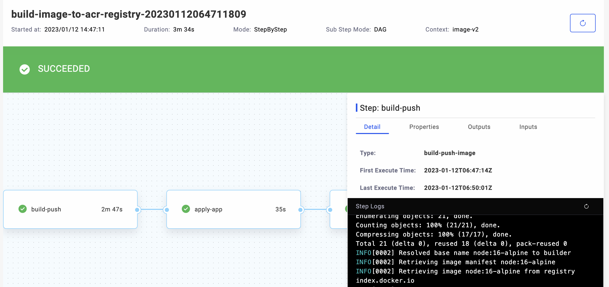

## Overview

From code to application, one of the indispensable step is to build image. This section will introduce how to orchestrate image build, image push and application delivery in KubeVela.

## How to use

### Use standalone workflow

KubeVela introduced [standalone workflow](/workflow/next/workflowrun) in version v1.6 that can be used **independently**, which can be used to orchestrate the process between CI steps and application delivery. Different from the workflow in the KubeVela application, it is **one-time** and does not manage resources. Even if the workflow is deleted, the created resources will not be deleted.

:::tip
Please make sure that you have enabled workflow addon with `vela addon enable vela-workflow`.
:::

#### Create the registry secret

The build step pushes to your image registry, so it needs your registry credentials. Create them as a Secret in the namespace the workflow runs in:

```shell
kubectl create secret docker-registry image-secret \
  --docker-server=https://index.docker.io/v1/ \
  --docker-username=<your-username> \
  --docker-password=<your-password>
```

If the Git repository is private, also create a Secret with a Git token:

```shell
kubectl create secret generic git-token --from-literal='GIT_TOKEN=<your-token>'
```

and add it under the step's `credentials`, next to `image`:

```yaml
credentials:
  image:
    name: image-secret
  git:
    name: git-token
    key: GIT_TOKEN
```

#### Run the workflow

Apply the following workflow:

```yaml
apiVersion: core.oam.dev/v1alpha1
kind: WorkflowRun
metadata:
  name: build-push-image
  namespace: default
spec:
  context:
    image: my-registry/test-image:v2
  workflowSpec:
   steps:
    - name: build-push
      type: build-push-image
      inputs:
        - from: context.image
          parameterKey: image
      properties:
        # use your kaniko executor image like below, if not set, it uses the default image ghcr.io/osscontainertools/kaniko:v1.29.1 (pinned by digest)
        # kanikoExecutor: gcr.io/kaniko-project/executor:latest
        # you can use context with git and branch or directly specify the context, please refer to https://github.com/GoogleContainerTools/kaniko#kaniko-build-contexts
        context:
          git: github.com/FogDong/simple-web-demo
          branch: main
        # Note that this field will be replaced by the image in inputs
        image: my-registry/test-image:v1
        # specify your dockerfile, if not set, it will use default dockerfile ./Dockerfile
        # dockerfile: ./Dockerfile
        credentials:
          image:
            name: image-secret
        # buildArgs:
        #   - key="value"
        # platform: linux/arm
    - name: apply-app
      type: apply-app
      inputs:
        - from: context.image
          parameterKey: data.spec.components[0].properties.image
      properties:
        data:
          apiVersion: core.oam.dev/v1beta1
          kind: Application
          metadata:
            name: my-app
          spec:
            components:
              - name: my-web
                type: webservice
                properties:
                  # Note that this field will be replaced by the image in inputs
                  image: my-registry/test-image:v1
                  imagePullSecrets:
                    - image-secret
                  ports:
                    - port: 80
                      expose: true
```

The workflow has two steps:

| Step | What it does | What to change |
| --- | --- | --- |
| `build-push` | Builds the image with [Kaniko](https://github.com/GoogleContainerTools/kaniko) from the Git repository and branch in `context`, and pushes it with the `image-secret` credentials. Its `image` comes from `context.image` through `inputs`, so the `image` under `properties` is replaced. | `context.git` and `context.branch` (or a plain [Kaniko build context](https://github.com/GoogleContainerTools/kaniko#kaniko-build-contexts)), `dockerfile`, and `spec.context.image` for the tag to push. |
| `apply-app` | Applies the Application `my-app`, with the component's `image` set from `context.image`, so it deploys the image the first step pushed. | The Application under `data`. |

To build a new version, change `spec.context.image` and apply the WorkflowRun again under a new name: a WorkflowRun runs once.

#### Check it worked

Follow the build while it runs:

```shell
vela workflow logs build-push-image --step build-push
```

The WorkflowRun reports `succeeded` once both steps finish:

```shell
kubectl get workflowrun build-push-image
```

Then check the Application it deployed, and open it on port 8080:

```shell
vela status my-app
vela port-forward my-app 8080:80
```

If you configure the process in VelaUX's Pipeline, you can directly see the status and sequence of all steps on the page, including step logs, input and output, etc.



### Use Application workflow

You can also build the image in an Application's workflow, and deploy the new image with the component. The `image` in the `build-push` step must match the component's `image`: the step pushes that tag, and `apply-component` deploys the component as written. This example uses the `image-secret` created above. Apply the following application:

```yaml
apiVersion: core.oam.dev/v1beta1
kind: Application
metadata:
  name: my-web-build
  namespace: default
spec:
  components:
  - name: my-web
    type: webservice
    properties:
      image: my-registry/test-image:v1
      ports:
        - port: 80
          expose: true
  workflow:
    steps:
    - name: build-push
      type: build-push-image
      properties:
        # use your kaniko executor image like below, if not set, it uses the default image ghcr.io/osscontainertools/kaniko:v1.29.1 (pinned by digest)
        # kanikoExecutor: gcr.io/kaniko-project/executor:latest
        # you can use context with git and branch or directly specify the context, please refer to https://github.com/GoogleContainerTools/kaniko#kaniko-build-contexts
        context:
          git: github.com/FogDong/simple-web-demo
          branch: main
        image: my-registry/test-image:v1
        # specify your dockerfile, if not set, it will use default dockerfile ./Dockerfile
        # dockerfile: ./Dockerfile
        credentials:
          image:
            name: image-secret
        # buildArgs:
        #   - key="value"
        # platform: linux/arm
    - name: apply-comp
      type: apply-component
      properties:
        component: my-web
```

In the application above, the first step in the workflow will use the `build-push-image` step to build the image, and the second step will deploy the component with the newly built image.