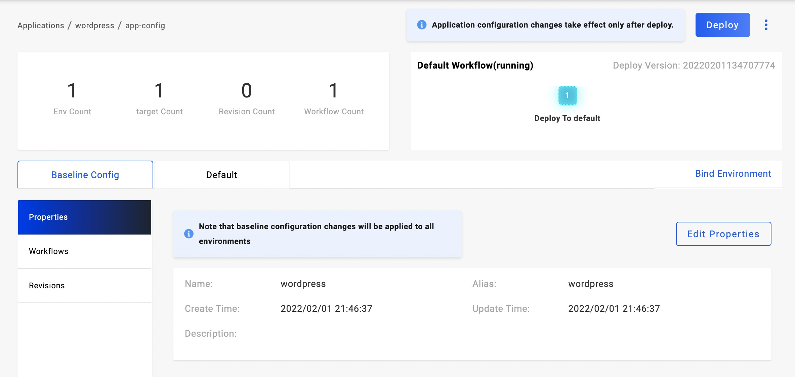
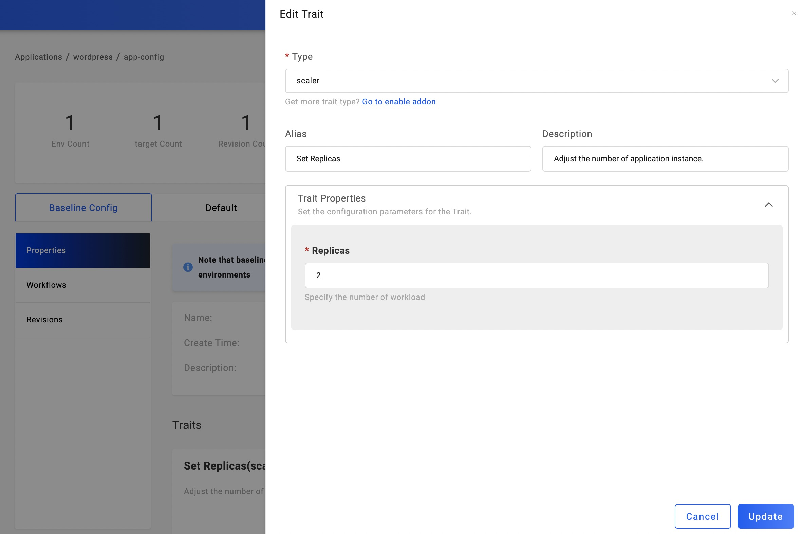
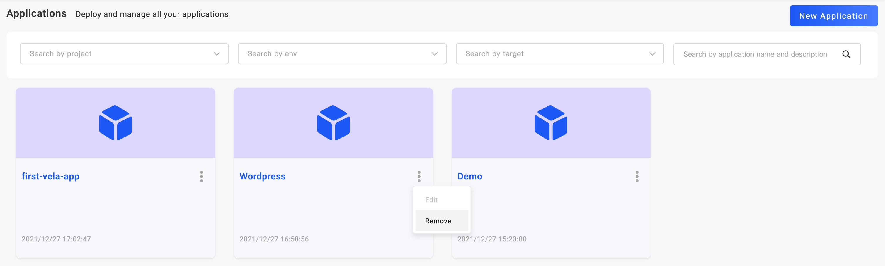

This guide deploys a private container image, exposes it, then updates and rolls back the image. It picks up where [Quick Start](../quick-start.md) leaves off.

This guide uses `oamdev/testapp:v1`, a small Node.js app listening on 8080.

## Before starting

- KubeVela installed, with the `vela` CLI pointing at your cluster.
- To pull from a private registry, add the registry first: see [Image registry configuration](../how-to/dashboard/config/image-registry.md).
- For the VelaUX steps, the [VelaUX addon](/velaux/getting-started/install) enabled:
  ```shell
  vela addon enable velaux
  ```

## Deploy with the CLI

Deploy the image as a `webservice` component:

```shell
cat <<EOF | vela up -f -
apiVersion: core.oam.dev/v1beta1
kind: Application
metadata:
  name: webservice-app
spec:
  components:
    - name: frontend
      type: webservice
      properties:
        image: oamdev/testapp:v1
        cmd: ["node", "server.js"]
        ports:
          - port: 8080
            expose: true
        cpu: "0.5"
        memory: "512Mi"
      traits:
        - type: scaler
          properties:
            replicas: 1
EOF
```

You can also save the YAML as `webservice-app.yaml` and deploy it with `vela up -f webservice-app.yaml`.

:::note
Applications you create with the CLI show up in VelaUX, where you can view and edit them. Once you deploy one from VelaUX, VelaUX becomes its source of truth: make later changes there, since changes applied with the CLI are not shown in VelaUX and the next VelaUX deploy replaces them.
:::

Check the status with `vela status webservice-app`:

```
About:

  Name:      	webservice-app
  Namespace: 	default
  Created at:	2022-04-21 12:03:42 +0800 CST
  Status:    	running

...snip...

Services:

  - Name: frontend
    Cluster: local  Namespace: default
    Type: webservice
    Healthy Ready:1/1
    Traits:
      ✅ scaler
```

The application is delivered when the workflow is finished and the status is `running`. If the status stays `rendering`, or a service is not healthy, read the error in `kubectl get application webservice-app -o yaml` (`status.conditions` and `status.workflow`). `vela ls` lists every application with its status:

```shell
vela ls
```

### Access the application

Forward a local port to the app:

```shell
vela port-forward webservice-app 8080:8080
```

The command opens your browser on the app. From another terminal you can also call it directly:

```shell
curl http://127.0.0.1:8080
```

:::tip
To reach the app from outside the cluster without port-forwarding, set `exposeType: NodePort` or `exposeType: LoadBalancer` on the component, or add an [expose](../end-user/traits/references.md#expose) or [gateway](../end-user/traits/references.md#gateway) trait. `vela status webservice-app --endpoint` lists the endpoints.
:::

### Update the image

Change the image to `oamdev/testapp:v2` and deploy again:

```shell
cat <<EOF | vela up -f -
apiVersion: core.oam.dev/v1beta1
kind: Application
metadata:
  name: webservice-app
spec:
  components:
    - name: frontend
      type: webservice
      properties:
        image: oamdev/testapp:v2
        cmd: ["node", "server.js"]
        ports:
          - port: 8080
            expose: true
        cpu: "0.5"
        memory: "512Mi"
      traits:
        - type: scaler
          properties:
            replicas: 1
EOF
```

Each deploy creates a new application revision. List them:

```shell
vela revision list webservice-app
```

### Roll back

Deploy the first revision again to go back to `oamdev/testapp:v1`:

```shell
vela up webservice-app --revision webservice-app-v1
```

See [Version control](../end-user/version-control.md) for more on revisions and rollback.

## Deploy with VelaUX

The same steps in the UI. Your VelaUX version decides the tab names: on VelaUX v1.9.5 the application page has an **Application Config** tab, with **Properties**, **Revisions** and **Workflows** under it, and one tab per environment to its right.

:::note
The next VelaUX release replaces this layout with one row of tabs: **Overview**, **Sources**, **Components**, **Policies**, **Triggers**, **Workflows**, **Environments** and **Revisions**.
:::

### Create the application

1. Open **Applications** in the left menu and click **New Application**.
2. Enter a name, for example `webservice-app`, and optionally an alias and a description.
3. Pick the `webservice` type.
4. Pick an environment. The `default` environment exists from the start; to add more, see [Environments](/velaux/guides/applications/operations#bind-environments).
5. Click **Next Step**.
6. Enter the image, `oamdev/testapp:v1`. VelaUX loads the image details from the registry; for an image in a private registry you added, it fills in the **Secret** field for you.
7. Set the CPU and memory limits, and under **Service Ports** add port `8080`. To override the image's command, open the **CMD** row.
8. Click **Create**. VelaUX opens the application page.


### Deploy it

Click **Deploy** at the top right and pick a workflow. Each environment of the application has its own workflow.

Open the environment's tab to see its status and instances.



With several targets in the environment, the **Instances** list shows them all. Click **Check the details** to follow the deployment. If an instance is pending, click the `+` at the start of its row to see why.

### Update the image and the replicas

1. Open **Application Config**, click the component name, change the image to `oamdev/testapp:v2` and save.
2. To change the replicas, open **Properties**. The component has a **Set Replicas** trait by default: click it and set the number.

   

3. Your changes are saved but not deployed. Click **Deploy** to roll them out to the environment.

To roll back, open **Revisions** and roll back to the revision you want.

### Clean up

1. Open each environment's tab and click **Recycle**. This removes the application from that environment and leaves it undeployed there.
2. Once every environment is recycled, go back to the application list, hover over the menu icon to the right of the application name and click **Remove**.



[How to manage applications](/velaux/guides/applications/operations) covers the rest of the VelaUX application pages.

## What you did

You deployed a container image as a `webservice` component, reached it through a port-forward, updated the image and rolled it back.

## Next steps

* [Webservice reference](../end-user/components/references.md#webservice) for every field.
* [Trait reference](../end-user/traits/references.md) for the traits a webservice can use.
* [Multi-cluster delivery](../end-user/policies/multi-cluster.md) to deploy the image to several clusters.
