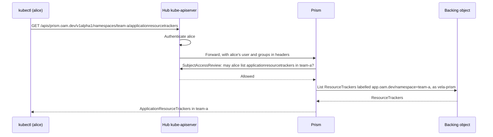

Every Prism API is a projection: a Kubernetes-shaped view of something that is stored somewhere else. Prism keeps no copy, so what you read is always what is in the backing object at that moment, and deleting Prism loses nothing.

## The request path

Two identities are involved, and it helps to keep them apart:

* **The caller's** is checked once, against the Prism resource: `applicationresourcetrackers` in `team-a`, `clusters`, `grafanadashboards`. Hub RBAC decides, through a SubjectAccessReview, exactly as for a built-in resource.
* **Prism's own ServiceAccount** (`vela-prism`) does the reading and writing of the backing object. The caller needs no access to ResourceTrackers, Secrets or Grafana at all.

That second point is what makes Prism useful, and it is also the thing to be careful with: whoever may use a Prism resource gets what Prism's ServiceAccount can do with the object behind it. A user who can `get grafanas` reads the Grafana credential; a user who can `create grafanadashboards` writes to Grafana as whatever account the `Grafana` object holds.

## What each API is backed by

| API | Scope | Backed by | Verbs |
| --- | --- | --- | --- |
| `applicationresourcetrackers` | Namespaced | ResourceTrackers labelled `app.oam.dev/namespace=<namespace>` | `get`, `list` |
| `clusters` | Cluster | `local`, plus cluster Secrets in the storage namespace and OCM ManagedClusters | `get`, `list` |
| `grafanas` | Cluster | Secret `grafana.<name>` in the observability namespace (`o11y-system`) | `get`, `list`, `create`, `update`, `patch`, `delete` |
| `grafanadashboards` | Cluster | Grafana's `/api/dashboards` and `/api/search` | `get`, `list`, `create`, `update`, `patch`, `delete` |
| `grafanadatasources` | Cluster | Grafana's `/api/datasources` | `get`, `list`, `create`, `update`, `patch`, `delete` |

None of them supports `watch`: `kubectl get -w` fails with `MethodNotAllowed`. A Role can still list `watch` among its verbs; it just never applies.

## How names map

| API | Prism name | Backing name |
| --- | --- | --- |
| `ApplicationResourceTracker` | `hello-v1` in namespace `team-a` | ResourceTracker `hello-v1-team-a` |
| `Cluster` | `member` | Secret `member` in `vela-system`, or ManagedCluster `member` |
| `Grafana` | `default` | Secret `grafana.default` in `o11y-system` |
| `GrafanaDashboard` | `team-a-overview@default` | Dashboard with uid `team-a-overview` in the Grafana named `default` |
| `GrafanaDatasource` | `prometheus@default` | Datasource with uid `prometheus` in the Grafana named `default` |

Dashboards and datasources take a compound name, `<uid>@<grafana>`. Without the `@<grafana>` part, Prism uses the Grafana named `default`. A list goes to one Grafana at a time, picked with a label selector: `kubectl get grafanadashboards -l grafana=my-grafana`.

## What projected objects don't have

Because nothing is stored, some of the usual object machinery is missing, and it shows in a few places:

* **No resourceVersion or creationTimestamp on Grafana dashboards and datasources**, and `uid` is `-`. `kubectl apply` warns that the last-applied annotation is missing on every update, because there is nowhere to keep it; the update still goes through.
* **Labels and annotations on dashboards and datasources are not kept**, except the two folder labels Prism reads and writes itself (see the [API reference](../reference/api.md#grafanadashboard)).
* **No status, finalizers or owner references** that mean anything. KubeVela knows this: when an Application applies a Prism object, it doesn't expect the object it reads back to carry what it wrote.
* **ApplicationResourceTracker's spec is the ResourceTracker's**, and KubeVela compresses that by default (`spec.compression`), so `kubectl get apprt -o yaml` shows a zstd blob rather than a list of resources. `vela status --tree` decodes it.

## Where Prism looks

Two namespaces are flags on the Prism binary, fixed when it starts:

| Flag | Default | Used for |
| --- | --- | --- |
| `--storage-namespace` | `vela-system` | Cluster Secrets, the same namespace KubeVela's `vela cluster join` writes to. |
| `--observability-namespace` | `o11y-system` | The `grafana.<name>` Secrets behind `Grafana` objects. |

The addon sets `--storage-namespace` to its `namespace` parameter and leaves `--observability-namespace` at its default. [Configuration](../operate/configuration.md) has the rest.
