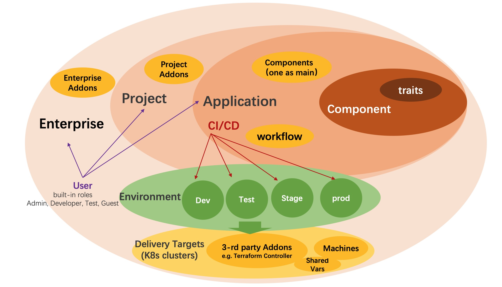

VelaUX is the UI console for KubeVela, and a ready-made platform for the people who ship applications on it. On top of KubeVela's own model it adds a few concepts for working as a team: projects, environments and delivery targets, and a lifecycle for applications.

## Project

A project is where a team manages its applications and works together. Each project is its own scope, kept apart from other projects.

## Environment

An environment is a stage such as development, testing or production, and groups the delivery targets for that stage. By default an application's workflow for an environment deploys to every target in it, so applications in one environment can share resources there, as far as the clusters' network and RBAC allow. Edit that workflow to deploy to only some of the targets.

You can bind an application to several environments, and set different parameters for each one.

## Delivery target

A delivery target is where an application's resources are actually delivered: one Kubernetes cluster and namespace. For cloud providers it can also describe a region or VPC, with its shared variables and machine resources.

Within one target, the credentials of any cloud resources created are delivered to the Kubernetes cluster for you.

## Application

An application in VelaUX has a lifecycle on top of the KubeVela Application:

- **Create** records the application's metadata and binds it to one or more environments. Nothing runs in a cluster yet.
- **Deploy** creates the application's resources in a bound environment's clusters.
- **Recycle** deletes the running instance and removes its resources from the clusters.
- **Delete** removes the application's metadata.

Everything else about a VelaUX application works as it does in KubeVela.

## Applications from outside VelaUX

VelaUX watches every Application in the cluster, not only the ones it created. An Application you apply with `vela up` or `kubectl apply` is synced into VelaUX: it lands in the `default` project, in an environment named after its namespace (a namespace already bound to an environment keeps that environment), with a delivery target for each cluster and namespace it deploys to. Addon Applications in `vela-system` land in a project of their own, shown as **System**.

A synced application lists its components, revisions and workflow in VelaUX like any other. [Sync an application from the CLI](../examples/sync-cli-application.md) shows it end to end.
