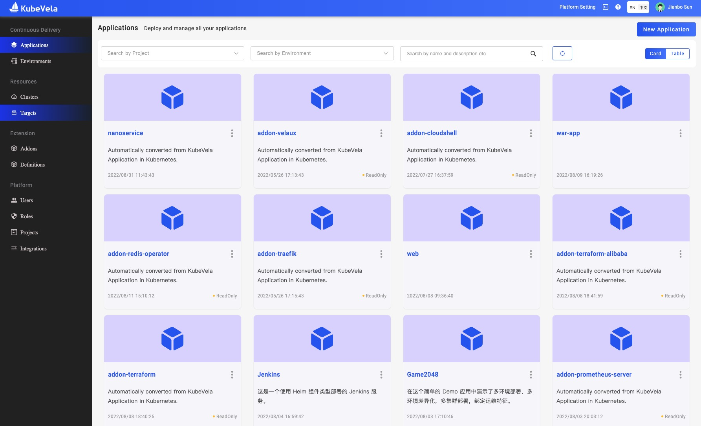
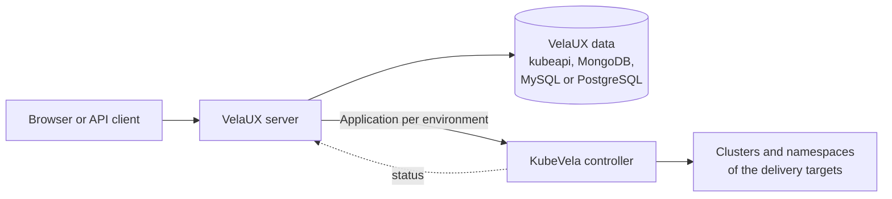

VelaUX is the web console for KubeVela. It gives the people who ship applications a place to create them, deploy them to their environments, watch them run and roll them back, without writing Application YAML or running `vela` themselves. Platform teams get users, projects, roles and single sign-on on top, so one KubeVela install can serve many teams.

These pages describe VelaUX 1.9.5, the version the `velaux` addon installs.

## Who it's for

| You are | VelaUX gives you |
| --- | --- |
| An application developer | A form for each component type, one-click deploys per environment, the workflow as it runs, logs, pods and revisions to roll back to. |
| A platform engineer | Projects to keep teams apart, delivery targets that pin where each environment deploys, addons and definitions managed from one page, and UI schemas to shape the forms your definitions get. |
| A CI pipeline | A webhook per application (a trigger) to redeploy on a new image, and the REST API behind every screen. |

## How it relates to KubeVela

VelaUX is an addon. It runs as one server in `vela-system` beside the KubeVela controller, and it never deploys anything itself: what you build in the console becomes a KubeVela `Application`, and the controller does the rest.

- **VelaUX keeps its own records** of projects, environments, targets, users and applications. By default they are stored in the cluster itself (`dbType=kubeapi`); see [Install options](../operate/install-options.md#use-an-external-database) for a database.
- **Each environment an application is bound to becomes one `Application`** in the environment's namespace. Deploying runs that Application's workflow.
- **Applications you create with `vela` or `kubectl` show up too.** VelaUX syncs them into a project, so the console and the CLI can work side by side.
- **The forms come from the definitions.** VelaUX builds each component, trait and workflow step form from the definition's parameter schema, so a new definition gets a form without any VelaUX change.

## What 1.9.5 doesn't cover

VelaUX 1.9.5 predates KubeVela 1.12. It doesn't show sources or modules, has no UI for the ConfigTemplate CRD, ignores the `+ui` parameter markers, and can't edit a config Secret that 1.12 adopted. Everything else works with KubeVela 1.12; see [Versions](../reference/versions.md).

## Next steps

- [Install VelaUX](install.md), then follow the [Quick Start](quick-start.md) to deploy your first application from it.
- [Concepts](../concepts/overview.md) explains projects, environments, delivery targets and the application lifecycle.
