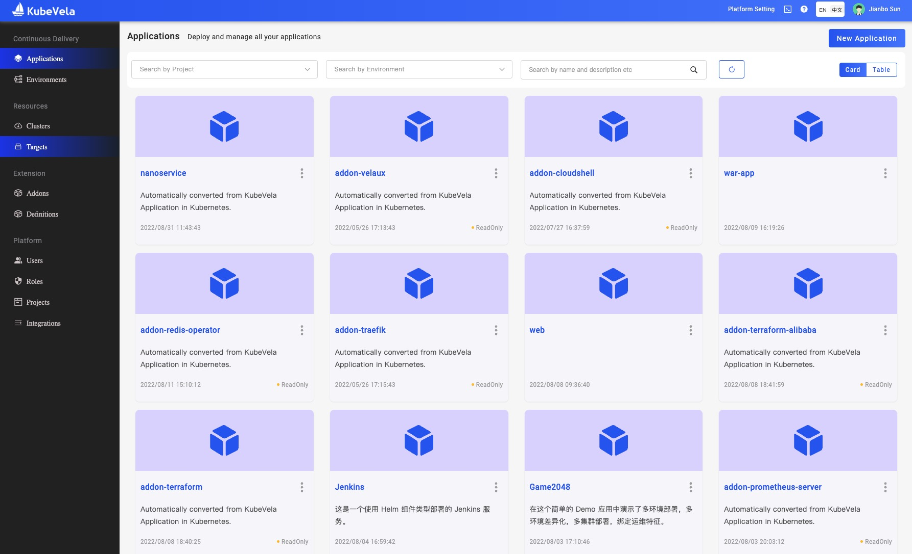

import Tabs from '@theme/Tabs';
import TabItem from '@theme/TabItem';

VelaUX is the UI console for KubeVela.

:::note
The `velaux` addon in the default registry installs VelaUX v1.9.5 (addon version v1.9.5). That release predates KubeVela 1.12, so its screens don't cover the 1.12 additions: it does not show sources or modules, there is no UI for the ConfigTemplate CRD, the `+ui` parameter markers don't change its forms, and it can't edit a config Secret that 1.12 adopted.
:::



## Install

```shell script
vela addon enable velaux
```

Expected output:

```
Addon: velaux enabled Successfully.
```

VelaUX needs authentication. The first time you open it, it asks you to create the administrator account: a username, a password and an email. After that, log in with that username and password.

By default VelaUX is not exposed outside the cluster.

## Parameters

Pass these to `vela addon enable velaux` as `name=value`.

| Parameter | Default | Description |
| --- | --- | --- |
| `serviceType` | `ClusterIP` | Service type: `ClusterIP`, `NodePort` or `LoadBalancer`. |
| `nodePort` | `30000` | Node port to use when `serviceType=NodePort`; ignored otherwise. |
| `domain` | | Domain to serve VelaUX on. Creates an Ingress (or a traefik route, see `gatewayDriver`). |
| `gatewayDriver` | `nginx` | `nginx` or `traefik`. |
| `secretName` | | Name of the TLS certificate Secret. Set it to serve VelaUX over HTTPS. |
| `dbType` | `kubeapi` | Where VelaUX stores its data: `kubeapi`, `mongodb`, `mysql` or `postgres`. |
| `dbURL` | | Connection URL for the database. Not used with `kubeapi`. |
| `database` | | Database name. With `kubeapi`, the namespace VelaUX stores its data in. |
| `repo` | | Image registry to pull the VelaUX image from, in place of Docker Hub. |
| `imagePullSecrets` | | Names of image pull Secrets for a private registry, for example `imagePullSecrets={a,b}`. |
| `replicas` | `1` | Number of VelaUX server replicas. |
| `serviceAccountName` | `kubevela-ux` | ServiceAccount the VelaUX server runs as. |
| `enableImpersonation` | `false` | Send requests to the Kubernetes API as the signed-in user, rather than as VelaUX's ServiceAccount. |

## Visit VelaUX by port-forward

Port forwarding opens VelaUX on a local port, with nothing exposed outside the cluster.

```
vela port-forward addon-velaux -n vela-system
```

When asked, pick `local | velaux | velaux`.

Everything the UI does goes through the VelaUX REST API, which you can call yourself; see [VelaUX REST API](reference/rest-api.md).

## Expose VelaUX with a Service type

The `serviceType` parameter takes the Kubernetes Service types `ClusterIP` (the default), `NodePort` and `LoadBalancer`.

- `LoadBalancer` needs a cloud load balancer in your cluster.
  ```shell script
  vela addon enable velaux serviceType=LoadBalancer
  ```
- `NodePort` needs you to reach the Kubernetes node IPs. VelaUX listens on node port `30000` unless you set `nodePort`.
  ```shell script
  vela addon enable velaux serviceType=NodePort
  ```

Then get the address with `vela status`:

```
vela status addon-velaux -n vela-system --endpoint
```

Expected output:

```
+----------------------------+----------------------+
|  REF(KIND/NAMESPACE/NAME)  |       ENDPOINT       |
+----------------------------+----------------------+
| Service/vela-system/velaux | http://<IP address> |
+----------------------------+----------------------+
```

## Expose VelaUX on a domain

If your cluster has an ingress controller and a domain pointing at it, set `domain`:

```bash
vela addon enable velaux domain=example.domain.com
```

Expected output:

```
I0112 15:23:40.428364   34884 apply.go:106] "patching object" name="addon-velaux" resource="core.oam.dev/v1beta1, Kind=Application"
I0112 15:23:40.676894   34884 apply.go:106] "patching object" name="addon-secret-velaux" resource="/v1, Kind=Secret"
Addon: velaux enabled Successfully.
Please access the velaux from the following endpoints:
+----------------------------+---------------------------+
|  REF(KIND/NAMESPACE/NAME)  |         ENDPOINT          |
+----------------------------+---------------------------+
| Ingress/vela-system/velaux | http://example.domain.com |
+----------------------------+---------------------------+
```

If you enabled the traefik addon, set `gatewayDriver=traefik` to use the Gateway API instead:

```shell script
vela addon enable velaux domain=example.domain.com gatewayDriver=traefik
```

To serve VelaUX over HTTPS:

1. Create the certificate configuration. The certificate must match the domain.

```shell
vela config create velaux-cert -t tls-certificate -n vela-system cert=<CERT_BASE64> key=<KEY_BASE64>
```

The `tls-certificate` config template comes with the `traefik` addon, which `gatewayDriver=traefik` needs anyway.

2. Enable VelaUX with the domain and the certificate:

```shell
vela addon enable velaux domain=example.domain.com gatewayDriver=traefik secretName=velaux-cert
```

## Use an external database

VelaUX stores its data in Kubernetes by default (`dbType=kubeapi`). For production, use a MongoDB, MySQL or PostgreSQL database that you run or rent, and pass its URL in `dbURL`.

<Tabs className="unique-tabs" groupId="db">
<TabItem label="MongoDB" value="mongodb">

```shell script
vela addon enable velaux dbType=mongodb dbURL=mongodb://<MONGODB_USER>:<MONGODB_PASSWORD>@<MONGODB_HOST>:<MONGODB_PORT>
```

</TabItem>
<TabItem label="MySQL" value="mysql">

Create the database first.

```shell script
vela addon enable velaux dbType=mysql dbURL=mysql://<MYSQL_USER>:<MYSQL_PASSWORD>@<MYSQL_HOST>:<MYSQL_PORT>/<MYSQL_DB_NAME>
```

The URL takes the [Go MySQL driver's connection parameters](https://github.com/go-sql-driver/mysql#parameters).

</TabItem>
<TabItem label="PostgreSQL" value="postgresql">

Create the database first.

```shell script
vela addon enable velaux dbType=postgres dbURL=postgres://<POSTGRESQL_USER>:<POSTGRESQL_PASSWORD>@<POSTGRESQL_HOST>:<POSTGRESQL_PORT>/<POSTGRESQL_DB_NAME>
```

</TabItem>
</Tabs>

## Pull the image from your own registry

The image comes from Docker Hub by default. To pull it from your own registry, copy the image there and set `repo`:

```
vela addon enable velaux repo=your-registry.example.com
```

The VelaUX image then becomes `your-registry.example.com/oamdev/velaux:<version>`. Add `imagePullSecrets` if the registry needs credentials.

## Next steps

## Compatibility

VelaUX v1.12.0 runs on KubeVela 1.10, 1.11 and 1.12. A few features need a newer KubeVela. Where the cluster is too old for the resync interval or a workflow restart, VelaUX hides them, and its API refuses them with an error naming the version they need. Sources are the exception: the page stays, with an empty list.

| Feature | KubeVela |
| --- | --- |
| Everything not listed below | 1.10 or later |
| Resync interval and workflow restart on an application | 1.11 or later |
| Sources (SourceDefinitions) | 1.12 or later. Earlier versions have no SourceDefinition CRD, so the Sources list is empty rather than hidden. |

VelaUX reads the KubeVela version from the vela-core image tag. If it can't tell (a branch build, or an image pinned by digest), it assumes every feature is there.

New to VelaUX? See [VelaUX concepts](overview.md) for projects, environments, delivery targets and the application lifecycle.
