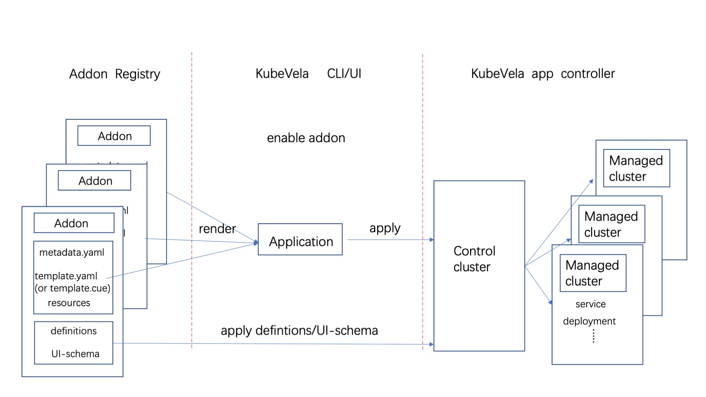

:::tip
Here's a blog introduces [how to build addon from scratch using redis operator as example](/blog/2022/10/18/building-addon-introduction), you can read it as an end to end tutorial!

To build an addon from an existing Helm chart without the detail, start with the [Quick start](#quick-start).
:::

## Quick start

This builds an addon that installs [podinfo](https://github.com/stefanprodan/podinfo) from its Helm chart, published in an OCI registry.

### 1. Create the scaffold

```shell
vela addon init podinfo --helm-repo oci://ghcr.io/stefanprodan/charts --chart podinfo --chart-version 6.11.2
```

```console
Scaffold created in directory podinfo. What to do next:
- Check out our guide on how to build your own addon: https://kubevela.io/docs/platform-engineers/addon/intro
- Review and edit what we have generated in podinfo
- To enable this addon, run: vela addon enable podinfo
```

The directory holds a starting point for every part of an addon:

```shell
$ ls podinfo
README.md     definitions   metadata.yaml parameter.cue resources     schemas       template.cue  views
```

The chart is installed by `resources/helm.cue`, a component of the `helm` type:

```cue
output: {
	name: "addon-podinfo"
	type: "helm"
	properties: {
		repoType: "oci"
		url:      "oci://ghcr.io/stefanprodan/charts"
		chart:    "podinfo"
		version:  "6.11.2"
	}
}
```

The `helm` component type comes from the [fluxcd](../../reference/addons/fluxcd.md) addon, so the scaffold lists `fluxcd` under `dependencies` in `metadata.yaml`, and enabling `podinfo` enables `fluxcd` first. The addon's version is set to the chart version, `6.11.2`.

The other files (`definitions/mytrait.cue`, `schemas/myschema.yaml`, `views/my-view.cue`, `resources/myresource.cue`) are samples. Edit them or delete them; pass `--no-samples` to leave them out.

### 2. Enable it from the local directory

```shell
vela addon enable ./podinfo
```

```console
Addon podinfo enabled successfully.
```

The CLI prints any endpoints the addon's Application exposes after that line.

### 3. Check it

```shell
vela addon status podinfo
```

```console
podinfo: enabled (6.11.2)
==> Installed Clusters
[local]
==> Registry Name
local
```

`local` as the registry means the addon was enabled from a directory. The chart itself is a HelmRelease in `vela-system`, so `vela status addon-podinfo -n vela-system` shows its health like any other Application.

To pick up an edit, run `vela addon enable ./podinfo` again. To remove it, run `vela addon disable podinfo`.

### Other starting points

You can also base an addon on Kubernetes objects at remote URLs, such as CRDs. The scaffold adds a `ref-objects` component that reads them:

```shell
vela addon init my-addon --url https://example.com/crd1.yaml --url https://example.com/crd2.yaml
```

The flags combine, so one addon can start from a Helm chart and remote objects together.

## Basic Concept 

An addon is a directory with three kinds of files: metadata (`metadata.yaml`, `README.md`), definitions and UI schemas, and an Application that installs the operator behind them. The second kind covers [definitions](../../getting-started/definition.md), [UI schemas](../../reference/ui-schema.md) and [topology rules](../../reference/topology-rule.md). The Application is an ordinary KubeVela [Application](../../getting-started/core-concept.md): when the addon is enabled, the Application controller delivers it to your clusters.

The picture below shows what happens when an addon is enabled:

* An [addon registry](./addon-registry.md) stores addons so they can be shared. It can be a Git repository or a Helm chart repository.
* When you enable an addon from the CLI or VelaUX, KubeVela reads its files from the registry, assembles them into an Application and applies it.
* The Application controller then delivers that Application to the clusters like any other.



To make an addon, you should follow some basic rules. You need to create an addon directory to place addon resource files.

Typically, the directory hierarchy is as follows:

```shell
├── resources/
│   ├── xxx.cue
│   └── xxx.yaml
├── definitions/
├── schemas/
├── config-templates/
│   ├── xxx.cue
├── views/
│   ├── xxx.cue
├── README.md
├── metadata.yaml
├── parameter.cue
└── template.yaml(or template.cue)
```

You can use `vela addon init <addon-name>` command to create a basic structure of addon.

Not all of these directories or files are necessary, let's explain them one by one.

### Basic information file

:::caution
This type of file is required in an addon.
:::

#### metadata.yaml

A `metadata.yaml` describes the basic information of an addon, such as the name, version, description, etc. With this file, an addon can be recognized by UX/CLI, an example is as follows:

```yaml
name: example
version: 1.0.0
description: Example addon.
icon: xxx
url: xxx

tags:
  - only_example

deployTo:
  runtimeCluster: false

dependencies:
- name: addon_name
  version: ">= 1.0.0, < 2.0.0"

system:
  vela: ">=v1.4.0"
  kubernetes: ">=1.19.0-0"

invisible: false
```

Here's the usage of every field:

|          Field          | Required |                Type                 |                                                                                                                   Usage                                                                                                                    |
| :---------------------: | :------: |:-----------------------------------:|:------------------------------------------------------------------------------------------------------------------------------------------------------------------------------------------------------------------------------------------:|
|          name           |   yes    |               string                |                                                                                                           The name of the addon.                                                                                                           |
|         version         |   yes    |               string                |                                                                       The version of addon, increase for every change and follow [SemVer](https://semver.org/) rule.                                                                       |
|       description       |   yes    |               string                |                                                                                                         Description of the addon.                                                                                                          |
|          icon           |    no    |               string                |                                                                                            Icon of the addon, will display in addon dashboard.                                                                                             |
|           url           |    no    |               string                |                                                                                           The official website of the project behind the addon.                                                                                            |
|          tags           |    no    |              []string               |                                                                                                The tags to display and organize the addon.                                                                                                 |
|      dependencies[]     |    no    |          array of objects           | Addons which this addon depends upon. KubeVela will make sure these dependencies are enabled before installing this addon.                                                                                                                 |
|   dependencies[].name   |   yes    |               string                | Name of the addon dependency.                                                                                                                                                                                                              |
| dependencies[].version  |    no    |               string                | Required version constraints for the dependency. You can specify a range like ">= 1.0.0, < 2.0.0". KubeVela will select the latest version matching the constraints. If no constraint is given, KubeVela will select the latest version.   |
|       system.vela       |    no    |               string                |                                                         Required version of vela controller, vela CLI will block the installation if vela controller can't match the requirements.                                                         |
|    system.kubernetes    |    no    |               string                |                                                          Required version of Kubernetes, vela CLI will block the installation if Kubernetes cluster can't match the requirements.                                                          |
| deployTo.runtimeCluster |    no    |                bool                 |        By default, the addon will not be installed in the managed clusters. If it's `true`, it will be delivered to all managed clusters automatically. (This field only take effect when application template file is YAML typed)         |

#### README.md (Required)

The README will be displayed in the dashboard for end user who's going to install this addon. So you should let them understand the basic knowledge of the addon which contains:

* What is the addon?
* Why to use this addon? The use case and scenarios.
* How to use this addon? It is the `end user` who should understand. An end to end demo is recommended.
* What will be installed? The definitions along with the CRD controllers behind.

There is no restrict rules for an [experimental addon](https://github.com/kubevela/catalog/tree/master/experimental/addons), but if the addon want to be [verified](https://github.com/kubevela/catalog/tree/master/addons), the README is the most important thing.

### Definitions and UI schemas

:::tip
This type of file is optional in an addon.
:::

#### Definition files (`definitions/` folder)

The `definitions/` folder is used to store `Definition`, which can be a YAML file of ComponentDefinition, TraitDefinitions or WorkflowStepDefinitions Kubernetes CustomResource. It can also be a CUE file that defines KubeVela [Definitions](../../getting-started/definition.md), which will be rendered into the corresponding Kubernetes objects and applied to the cluster when enabling the addon.

:::note
These definitions will only be applied to the control plane.
:::

#### UI-Schema (`schemas/` folder)

The `schemas/` folder is used to store the [UI schema](../../reference/ui-schema.md) files corresponding to `Definition`, which is used to enhance the display effect when displaying the parameters required by `Definition` in UX.

### Application description file

:::tip
This type of file is optional in an addon.
:::

Through the above introduction, we know that the Definition of an addon usually should be supported by a Kubernetes operator. The operator should be defined in a KubeVela application and installed by KubeVela application controller. So the function of application description file is describing this application. Application description file contains two types of file: application template file (template.yaml or template.cue) and resources files which under `resources/` folder.

The content of a YAML typed file must be a Kubernetes object manifest, so you can use the simplest way to define a KubeVela application that may contain several components, policies, or workflow. If you choose to use CUE to define application description files the addon will have these abilities:

* Utilize the flexible and concise syntax of the CUE language, rich built-in functions and its parameter verification capabilities, to render and deploy the application and auxiliary resources with parameters and metadata of addon.
* An addon may contain multiple Definitions and CRD Operators, they can be selectively installed according to parameters of addon.

[YAML application description file](./addon-yaml.md) will introduce how to use YAML define application of addon.
[CUE application description file](./addon-cue.md) will introduce how to use CUE define the application of addon.

The above is a complete introduction to how to make an addon, you can find the complete description of the above-mentioned addon in [catalog](https://github.com/kubevela/catalog/tree/master/experimental/addons/example).

### Other description file

#### Views (`views/` folder)

The `views/` folder is used to store the [VelaQL View](../system-operation/velaql.md) files.

#### Config Templates (`config-templates/` folder)

The `config-templates/` folder is used to store the [Config Template](../../reference/config-template.md) files.


## Install Addon Locally

You can install the addon from local to debug your own addon:

```
vela addon enable ./your-addon-dir/
```

## Known Limits

- An addon can't be installed on managed clusters only. vela-core renders every resource on the hub, so any [CRD](https://kubernetes.io/docs/concepts/extend-kubernetes/api-extension/custom-resources/) the addon's definitions use must also be installed on the hub, or rendering fails with `no matches for kind`.

## Extend Terraform Addon

*  We have built some tools to extend cloud resource as addons  for convenience, you can refer to the [extend terraform addon docs](./terraform.md).

## Contribution

Besides uploading the addon resource files to your addon repository, you can also submit a pull request to KubeVela [community addon repository](https://github.com/kubevela/catalog/tree/master/addons) and [experimental addon repository](https://github.com/kubevela/catalog/tree/master/experimental/addons) to contribute your addons to the community. Once your pull request is merged, other KubeVela users will be able to discover and utilize your addons.

Please abide by the following rules when making a contribution:

- A new addon should be accepted as experimental one first with the following necessary information:
    - An accessible icon url and source url defined in addon's `metadata.yaml`.
    - A detail introduction include a basic example about how to use and what's the benefit of this addon in `README.md`.
    - It's more likely to be accepted if useful examples are provided in example [dir](https://github.com/kubevela/catalog/tree/master/examples/).

- An experimental addon must meet these conditions to be promoted as a verified one.
    - This addon must be tested by addon's [e2e-test](https://github.com/kubevela/catalog/tree/master/test/e2e-test/addon-test) to guarantee this addon can be enabled successfully.
    - Provide an introduction in KubeVela [official addon documentation](../../reference/addons/overview.md).

- If you come across with any addon problems, feel free to raise a github issue or just send pull requests to fix them. Please make sure to update the addon version in your pull request.
