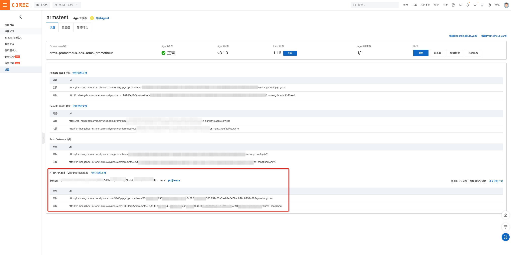
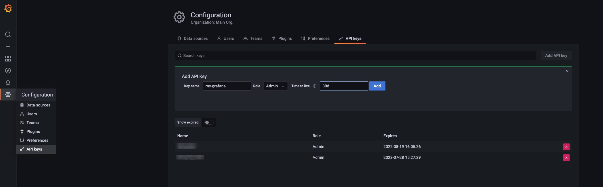
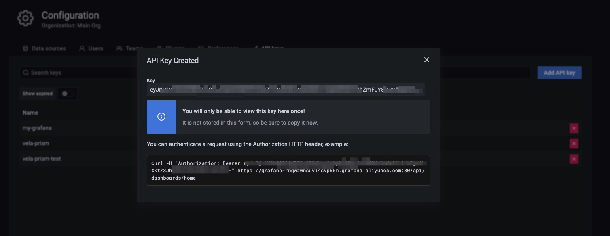

Sometimes, you might already have Prometheus & Grafana instances. They might be built by other tools, or come from cloud providers. Follow the below guide to integrate with existing systems.

## Integrate Prometheus

If you already have external prometheus service and you want to connect it to Grafana (established by vela addon), you can create a GrafanaDatasource to register it through KubeVela application.

```yaml
apiVersion: core.oam.dev/v1beta1
kind: Application
metadata:
  name: register-prometheus
  namespace: vela-system
spec:
  components:
    - type: grafana-datasource
      name: my-prometheus
      properties:
        uid: my-prometheus
        data: |
          {
            "name": "MyPrometheus",
            "type": "prometheus",
            "access": "proxy",
            "url": "<my-prometheus url>",
            "jsonData": {
              "httpHeaderName1": "Authorization",
              "tlsSkipVerify": true
            },
            "secureJsonData": {
              "httpHeaderValue1": "Bearer <token of your prometheus access>"
            }
          }
```

`uid` names the datasource in Grafana, and `data` is the [Grafana datasource model](https://grafana.com/docs/grafana/latest/developers/http_api/data_source/) as a JSON string.

:::caution
The token is stored in the Application and in every ApplicationRevision, so anyone who can read Applications in that namespace can read it. Keep the Application in a namespace only administrators can read, such as `vela-system`.
:::

For example, if you are using the Prometheus service on Alibaba Cloud (ARMS), you can go to the Prometheus setting page and find the access url & access token.



> You need to ensure your grafana access is already available. You can run `kubectl get grafana default` and see if it exists.

## Integrate Grafana

If you already have existing Grafana, similar to Prometheus integration, you can create a Grafana access through KubeVela application.

```yaml
apiVersion: core.oam.dev/v1beta1
kind: Application
metadata:
  name: register-grafana
  namespace: vela-system
spec:
  components:
    - type: grafana-access
      name: my-grafana
      properties:
        name: my-grafana
        endpoint: <my-grafana url>
        token: <access token>
```

To get your grafana access, you can go into your Grafana instance and configure API keys.



Then copy the token into your grafana registration configuration.



After the application is successfully dispatched, you can check the registration by running the following command.

```shell
kubectl get grafana
```
```shell
NAME         ENDPOINT                                                      CREDENTIAL_TYPE
default      http://grafana.o11y-system:3000                               BasicAuth
my-grafana   https://grafana-rngwzwnsuvl4s9p66m.grafana.aliyuncs.com:80/   BearerToken
```

Now you can manage your dashboard and datasource on your grafana instance through the native Kubernetes API as well.

```shell
# show all the dashboard you have
kubectl get grafanadashboard -l grafana=my-grafana
```
```shell
# show all the datasource you have
kubectl get grafanadatasource -l grafana=my-grafana
```

For more details, you can refer to [vela-prism](https://github.com/kubevela/prism#grafana-related-apis).

## Integrate Other Tools or Systems

For other tools, use their own install. The `prometheus-scrape` trait (from the `prometheus-server` addon) creates a `<component>-prometheus-scrape` Service in front of the component and puts the `prometheus.io/scrape`, `prometheus.io/port` and `prometheus.io/path` annotations on it. Those annotations are all a collector reads, so the trait suits a tool that discovers targets from them, such as Datadog with its Prometheus annotation scraping turned on. prometheus-operator does not read those annotations: give it a `ServiceMonitor` or `PodMonitor` instead.