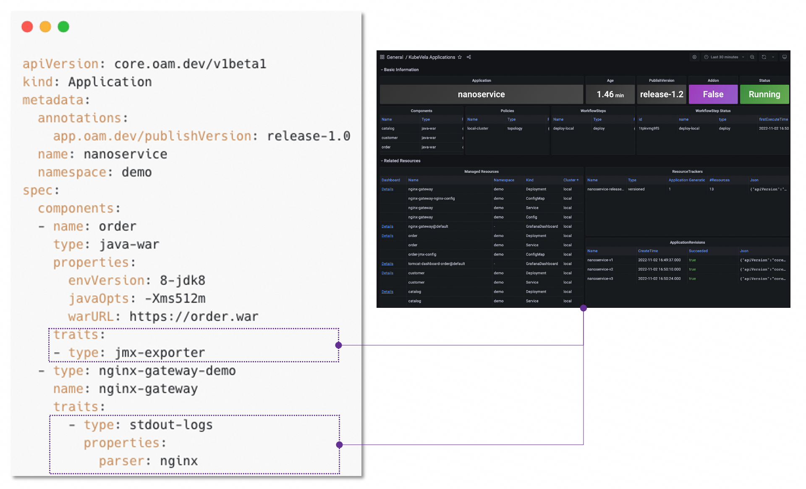

Five addons give you Prometheus, Loki and Grafana with dashboards for KubeVela and your apps. Traits then decide which apps' metrics and logs are collected.

## Build observability infrastructure automatically

To help users build their own observability system from scratch with just one click, KubeVela provides a list of addons, including

**Metrics**
- `prometheus-server`: A server records metrics in time series with flexible queries supported.
- `kube-state-metrics`: A metrics collector for the Kubernetes system.
- `node-exporter`: A metrics collector for the running Kubernetes nodes.

**Logging**
- `loki`: A logging server which stores collected logs of Kubernetes pods and provide query interfaces.

**Dashboard**
- `grafana`: A web application that provides analytics and interactive visualizations.

After these addons enabled, out-of-box dashboard will be generated with real time data collecting.

> More addons for alerting & tracing will be introduced in later versions.

## Application Observability

KubeVela provides traits for application observability. Add one to a component and its metrics or logs are collected and shown on the Grafana dashboards.

More than that, you can easily define your own observability traits with CUE.

## Observability as Code

Each piece (the addons, the scrape and log traits, the Grafana datasources and dashboards) is a KubeVela Application or definition, so you manage your observability stack the same way you manage apps.

## What's Next

- [**Enable Observability Addons**](./o11y/installation.md): Guide for how to install observability addons in your KubeVela system.

- [**Out-of-Box Dashboards**](./o11y/out-of-the-box.md): Guide for how to use pre-installed dashboards to monitor your system and applications.

- [**Metrics Collection**](./o11y/metrics.md): Guide for customizing the process of collecting metrics for your application.

- [**Log Collection**](./o11y/logging.md): Guide for how to customize the log collecting rules for your application.

- [**Customize Dashboard**](./o11y/dashboard.md): Guide for creating your customized dashboards for applications.

- [**Integration Existing Observability Service**](./o11y/integration.md): Guide for integrating your existing infrastructure to KubeVela, when you already have Prometheus or Grafana before installing addons.