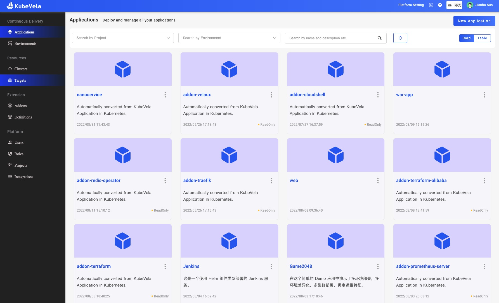
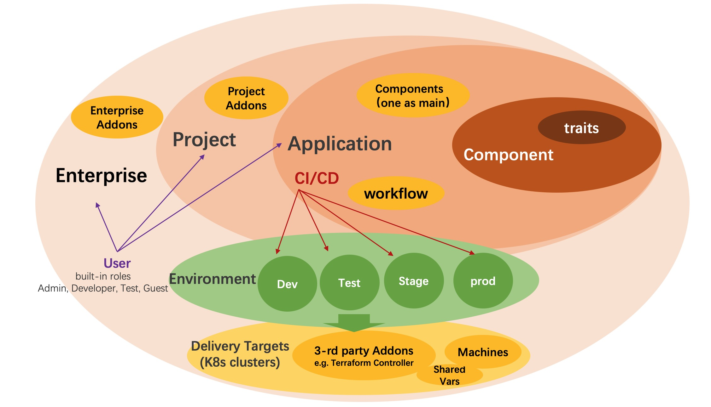

import Tabs from '@theme/Tabs';
import TabItem from '@theme/TabItem';

VelaUX provides the UI console of KubeVela.



## Install

```shell script
vela addon enable velaux
```

expected output:

```
Addon: velaux enabled Successfully.
```

VelaUX needs authentication. The default username is `admin` and the password is **`VelaUX12345`**. Please must set and remember the new password after the first login.

By default VelaUX is not exposed outside the cluster.

## Visit VelaUX by port-forward

Port forward will work as a proxy to allow visiting VelaUX dashboard by local port.

```
vela port-forward addon-velaux -n vela-system
```

When asked, pick `local | velaux | velaux`.

## Setup with Specified Service Type

There are three service types for VelaUX addon which aligned with Kubernetes service, they're `ClusterIP`, `NodePort` and `LoadBalancer`.

By default the service type is ClusterIP for security.

If you want to expose your VelaUX dashboard for convenience, you can specify the service type.

- `LoadBalancer` type requires your cluster has cloud LoadBalancer available.
  ```shell script
  vela addon enable velaux serviceType=LoadBalancer
  ```
- `NodePort` type requires you can access the Kubernetes Node IP/Port.
  ```shell script
  vela addon enable velaux serviceType=NodePort
  ```

After the service type specified to `LoadBalancer` or `NodePort`, you can obtain the access address through `vela status`:

```
vela status addon-velaux -n vela-system --endpoint
```

The expected output:

```
+----------------------------+----------------------+
|  REF(KIND/NAMESPACE/NAME)  |       ENDPOINT       |
+----------------------------+----------------------+
| Service/vela-system/velaux | http://<IP address> |
+----------------------------+----------------------+
```

## Setup with Ingress domain

If you have ingress and domain available in your cluster, you can also deploy VelaUX by specify a domain like below:

```bash
vela addon enable velaux domain=example.domain.com
```

The expected output:

```
I0112 15:23:40.428364   34884 apply.go:106] "patching object" name="addon-velaux" resource="core.oam.dev/v1beta1, Kind=Application"
I0112 15:23:40.676894   34884 apply.go:106] "patching object" name="addon-secret-velaux" resource="/v1, Kind=Secret"
Addon: velaux enabled Successfully.
Please access the velaux from the following endpoints:
+----------------------------+---------------------------+
|  REF(KIND/NAMESPACE/NAME)  |         ENDPOINT          |
+----------------------------+---------------------------+
| Ingress/vela-system/velaux | http://example.domain.com |
+----------------------------+---------------------------+
```

If you enabled the traefik addon, you can set the `gatewayDriver` parameter to use the Gateway API.

```shell script
vela addon enable velaux domain=example.domain.com gatewayDriver=traefik
```

If you want to enable VelaUX with SSL:

1. Create the certificate configuration:

```shell
vela config create velaux-cert -t tls-certificate -n vela-system cert=<CERT_BASE64> key=<KEY_BASE64>
```

The `tls-certificate` config template comes with the `traefik` addon, which `gatewayDriver=traefik` needs anyway.

Please make sure the certificate matches the domain.

2. Enable VelaUX with domain

```shell
vela addon enable velaux domain=example.domain.com gatewayDriver=traefik secretName=velaux-cert
```

## Setup with the database

VelaUX stores its data in Kubernetes by default (`dbType=kubeapi`). For production, use a MongoDB, MySQL or PostgreSQL database that you run or rent, and pass its URL in `dbURL`.

<Tabs className="unique-tabs" groupId="db">
<TabItem label="MongoDB" value="mongodb">

```shell script
vela addon enable velaux dbType=mongodb dbURL=mongodb://<MONGODB_USER>:<MONGODB_PASSWORD>@<MONGODB_HOST>:<MONGODB_PORT>
```

</TabItem>
<TabItem label="MySQL" value="mysql">

Create the database first.

```shell script
vela addon enable velaux dbType=mysql dbURL=mysql://<MYSQL_USER>:<MYSQL_PASSWORD>@<MYSQL_HOST>:<MYSQL_PORT>/<MYSQL_DB_NAME>
```

The URL takes the [Go MySQL driver's connection parameters](https://github.com/go-sql-driver/mysql#parameters).

</TabItem>
<TabItem label="PostgreSQL" value="postgresql">

Create the database first.

```shell script
vela addon enable velaux dbType=postgres dbURL=postgres://<POSTGRESQL_USER>:<POSTGRESQL_PASSWORD>@<POSTGRESQL_HOST>:<POSTGRESQL_PORT>/<POSTGRESQL_DB_NAME>
```

</TabItem>
</Tabs>

## Specify the addon image

The image comes from Docker Hub by default. To pull it from your own registry, copy the image there and set `repo`:

```
vela addon enable velaux repo=your-registry.example.com
```

The VelaUX image then becomes `your-registry.example.com/oamdev/velaux:<version>`.

## Concept of VelaUX

VelaUX is an addon on top of KubeVela, it works as UI console for KubeVela, while it's also an out-of-box platform for end-user.

We add some more concepts for enterprise integration.



### Project

Project is where you manage all the applications and collaborate with your team member. Project is one stand alone scope that separates it from other project.

### Environment

Environment refers to the environment for development, testing, and production and it can include multiple Delivery Targets. Only applications in the same environment can visit and share resource with each other.

- <b>Bind Application with Environment</b> The application can be bound to multiple Environments, and for each environment, you can set the unique parameter difference for each environment.

### Delivery Target

Delivery Target describes the space where the application resources actually delivered. One target describes one Kubernetes cluster and namespace, it can also describe a region or VPC for cloud providers which includes shared variables and machine resources.

Kubernetes cluster and Cloud resources are currently the main way for KubeVela application delivery. In one target, credentials of cloud resources created will automatically delievered to the Kubernetes cluster.

### Application

An application in VelaUX is a bit different with KubeVela, we add lifecycle includes:

- <b>Create</b> an application is just create a metadata records, it won't run in real cluster.
- <b>Deploy</b> an application will bind with specified environment and instantiate application resource into Kubernetes clusters.
- <b>Recycle</b> an application will delete the instance of the application and reclaim its resources from Kubernetes clusters.
- <b>Delete</b> an application is actually delete the metadata.

The rest concept in VelaUX Application are align with KubeVela Core.
