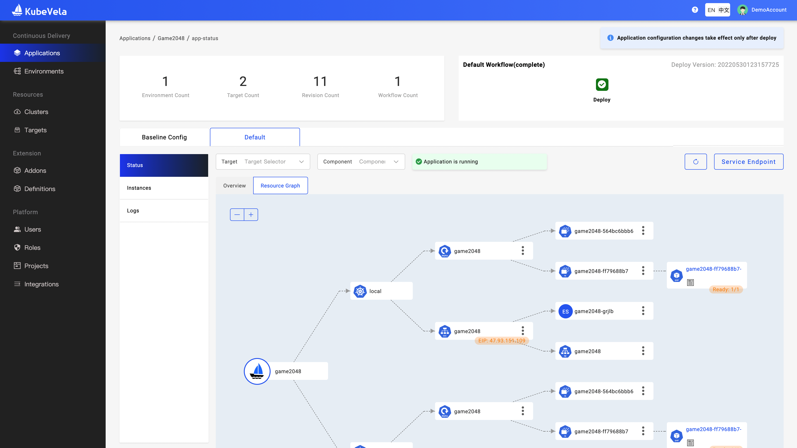
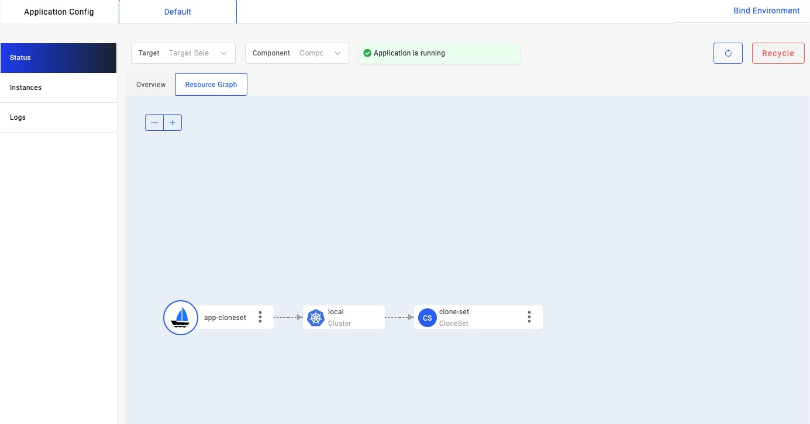
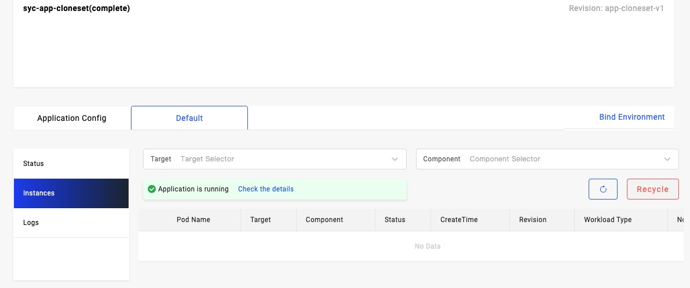
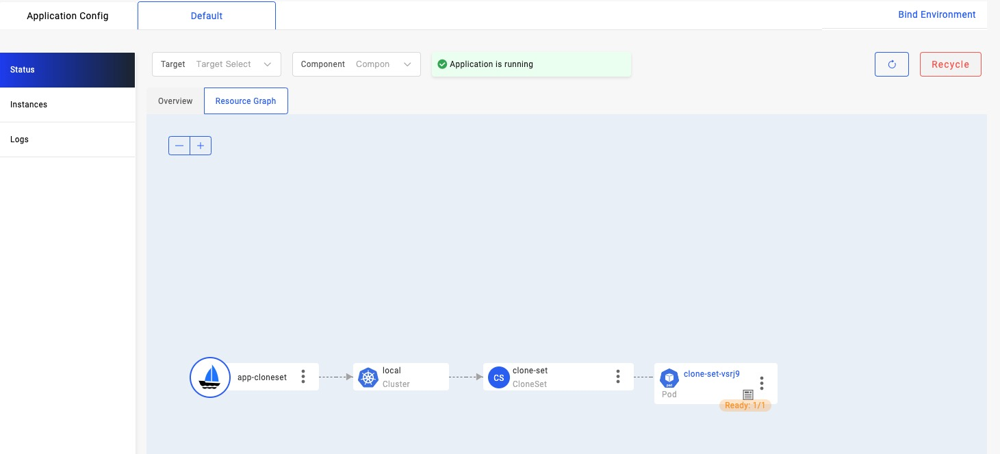
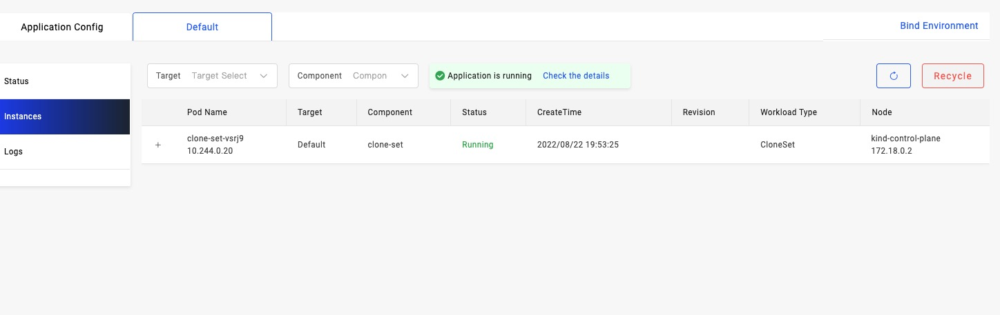

KubeVela finds the Pods and Services behind an Application by walking from each resource it applied to that resource's children, using rules like "a Deployment's children are ReplicaSets". VelaUX's topology view, `vela logs`, `vela exec`, `vela port-forward` and `vela status --endpoint` all depend on these rules. If a workload is a custom resource with no rule, those commands report `no pod found in your application`.

For each rule, KubeVela lists objects of the child kind in the parent's namespace and keeps the ones that belong to the parent. Here is the topology view of an application in VelaUX, built from these rules:



## Add more rules

The built-in rules cover the common Kubernetes workloads. If you add a CustomResourceDefinition to your cluster, add a rule for it by creating a ConfigMap.

The example below uses the [kruise](https://github.com/kubevela/catalog/tree/master/experimental/addons/kruise) addon, an experimental addon. Enable it with:

```shell
vela addon registry add experimental --type=helm --endpoint=https://kubevela.github.io/catalog/experimental/
vela addon enable kruise
```

Once it's enabled you have the `cloneset` component type, whose workload type is `clonesets.apps.kruise.io`. The CloneSet controller creates the Pods for the application.

```shell
$ vela components
NAME                    DEFINITION                      DESCRIPTION                                                 
cloneset                autodetects.core.oam.dev        Describes long-running, scalable, containerized services    
                                                        that have a stable network endpoint to receive external     
                                                        network traffic from customers. If workload type is skipped 
                                                        for any service defined in Appfile, it will be defaulted to 
                                                        `webservice` type.
```

Then create a `cloneset` application:

```shell
cat <<EOF | vela up -f -
apiVersion: core.oam.dev/v1beta1
kind: Application
metadata:
  name: app-cloneset
spec:
  components:
    - name: clone-set
      type: cloneset
      properties:
        cmd:
          - ./podinfo
          - stress-cpu=1
        image: stefanprodan/podinfo:4.0.3
        port: 8080
        updateStrategyType: InPlaceOnly
EOF
```

In VelaUX's topology view the CloneSet has no children, and the instance list is empty:






`vela logs` and `vela exec` fail too:

```shell
$ vela logs app-cloneset
Error: no pod found in your application
```

```shell
$ vela exec app-cloneset
Error: no pod found in your application
```

KubeVela has no rule for the CloneSet kind, so it doesn't know where to look for its children. Apply a ConfigMap that adds one:

```yaml
apiVersion: v1
kind: ConfigMap
metadata:
  name: clone-set-relation
  namespace: vela-system
  labels:
    "rules.oam.dev/resource-format": "yaml"
    "rules.oam.dev/resources": "true"
data:
  rules: |-
    - parentResourceType:
        group: apps.kruise.io
        kind: CloneSet
      childrenResourceType:
        - apiVersion: v1
          kind: Pod
```

The ConfigMap must be in the `vela-system` namespace and carry the label `"rules.oam.dev/resources": "true"`; KubeVela ignores ConfigMaps without it. The `"rules.oam.dev/resource-format": "yaml"` label says the rules in `data.rules` are written in YAML. You can write them in JSON instead:

```yaml
apiVersion: v1
kind: ConfigMap
metadata:
  name: clone-set-relation
  namespace: vela-system
  labels:
    "rules.oam.dev/resource-format": "json"
    "rules.oam.dev/resources": "true"
data:
  rules: |-
    [
      {
        "parentResourceType": {
          "group": "apps.kruise.io",
          "kind": "CloneSet"
        },
        "childrenResourceType": [
          {
            "apiVersion": "v1",
            "kind": "Pod"
          }
        ]
      }
    ]
```

The two ConfigMaps do the same thing.

In this example the parent is a `CloneSet` in the `apps.kruise.io` group, and its children are Pods.

Check the topology view and instance list in VelaUX again:





`vela logs` and `vela exec` now work:

```shell
$ vela logs app-cloneset
+ clone-set-vsrj9 › clone-set
clone-set 2022-08-22T11:53:46.005267600Z {"level":"info","ts":"2022-08-22T11:53:46.002Z","caller":"podinfo/main.go:123","msg":"Starting podinfo","version":"4.0.3","revision":"a2f9216fe43849c3b4844032771ba632307d8738","port":"9898"}
```

Do the same for a custom resource whose children include a Service, so `vela status --endpoint` finds it.

## Built inside with Addon

A KubeVela [addon](../platform-engineers/addon/intro.md) may install a CRD operator. KubeVela has no rules for that operator's kinds, so the addon should ship them: put the rule ConfigMap in the `outputs` field of the addon's application template, for example:

```cue
package main

import "encoding/json"

output: {
	apiVersion: "core.oam.dev/v1beta1"
	kind:       "Application"
	spec: {
		
	}
	... 
}

outputs: resourceTree: {
	apiVersion: "v1"
	kind:       "ConfigMap"
	metadata: {
		name:      "resource-tree"
		namespace: "vela-system"
		labels: {
			"rules.oam.dev/resources":       "true"
			"rules.oam.dev/resource-format": "json"
		}
	}
	data: rules: json.Marshal(_rules)
}

_rules: {...}
```

See [auxiliary resources](../platform-engineers/addon/addon-cue.md#auxiliary-resources) for more on `outputs` in an addon.