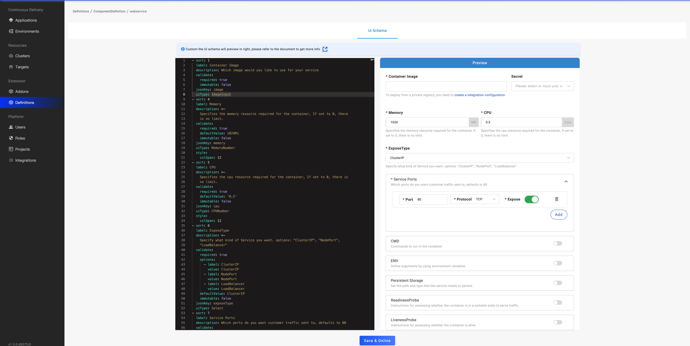
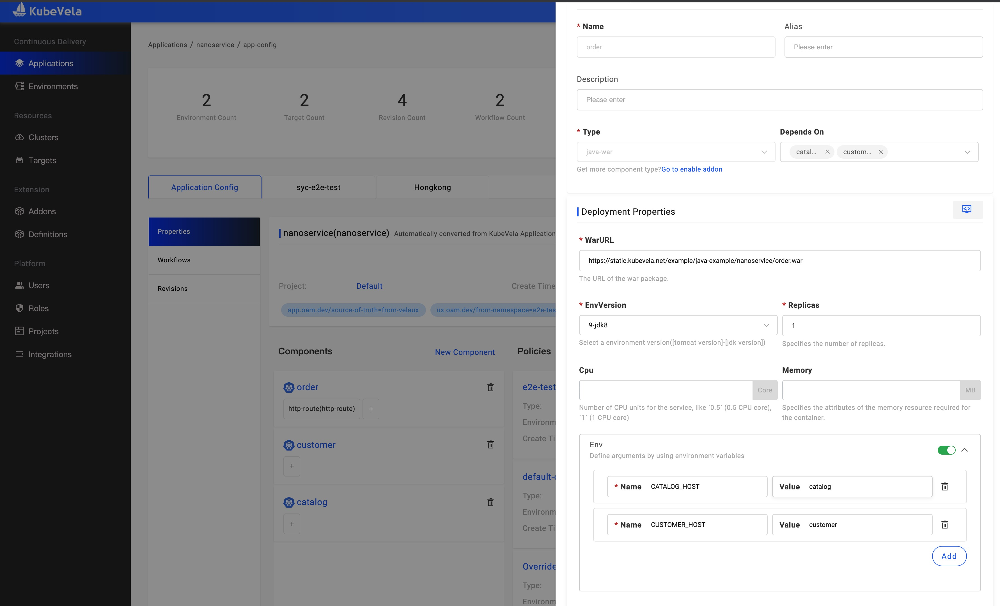

This guide is for platform engineers. It shows two ways to give your developers a simpler component type: hide fields in the VelaUX form, or write a new ComponentDefinition. You need permission to create definitions in `vela-system`.

## Simplify the `webservice` type

The default [webservice](../end-user/components/references.md#webservice) component type has more than 10 properties. Your developers may only need to set the image and the resource limits, with the team choosing defaults for the rest.

### Hide fields in the VelaUX form

This only changes the form in VelaUX; the CLI and YAML still accept every field.



On the definition's detail page in VelaUX, edit its UI schema. For example, to hide the `exposeType` field, set `disable: true` on it:

```yaml
- jsonKey: exposeType
  uiType: Select
  label: ExposeType
  disable: true
```

See [UI Schema](../reference/ui-schema.md) for every option.

### Remove or add fields in the definition

To remove or add fields for everyone, edit the ComponentDefinition itself. This part needs some CUE. See [CUE basics](../platform-engineers/cue/basic.md).

```bash
vela def get webservice > custom-webservice.cue
```

Edit `custom-webservice.cue` (the [Component Definition](../platform-engineers/components/custom-component.md) guide explains its parts), then apply it:

```bash
vela def apply custom-webservice.cue
```

## Create a component type for WAR packages

If your team ships Java applications as WAR packages, give them a component type that takes a WAR URL and a Tomcat version, and nothing else they don't need.

### Before you start

The example application below routes traffic with the `http-route` trait, from the Traefik addon, and deploys into its own namespace:

```bash
vela addon enable traefik
kubectl create ns nanoservice
```

### Write the definition

Save this as `java-war.cue`:

```cue
import "list"

"java-war": {
	type:        "component"
	description: "Deploy a Java WAR package on Tomcat."
	attributes: workload: definition: {
		apiVersion: "apps/v1"
		kind:       "Deployment"
	}
}

template: {
	output: {
		apiVersion: "apps/v1"
		kind:       "Deployment"
		spec: {
			replicas: parameter.replicas
			selector: matchLabels: "app.oam.dev/component": context.name
			template: {
				metadata: labels: "app.oam.dev/component": context.name
				spec: {
					// Download the WAR into the shared webapps volume before Tomcat starts.
					initContainers: [{
						name:  "prepare-war"
						image: "busybox"
						if parameter.deployToRoot {
							command: ["wget", "-O", "/usr/local/tomcat/webapps/ROOT.war", parameter.warURL]
						}
						if !parameter.deployToRoot {
							command: ["wget", "-P", "/usr/local/tomcat/webapps/", parameter.warURL]
						}
						volumeMounts: [{name: "webapps", mountPath: "/usr/local/tomcat/webapps"}]
					}]
					// Tomcat serves whatever WAR the init container left in webapps.
					containers: [{
						name:  context.name
						image: "tomcat:" + parameter.envVersion
						ports: [{containerPort: 8080, name: "webapp"}]
						if parameter.cpu != _|_ || parameter.memory != _|_ {
							resources: {
								if parameter.cpu != _|_ {
									limits: cpu:   parameter.cpu
									requests: cpu: parameter.cpu
								}
								if parameter.memory != _|_ {
									limits: memory:   parameter.memory
									requests: memory: parameter.memory
								}
							}
						}
						let _custom = *parameter.env | []
						let _javaOpts = [if parameter.javaOpts != _|_ {name: "JAVA_OPTS", value: parameter.javaOpts}]
						env: list.Concat([_custom, _javaOpts])
						volumeMounts: [{name: "webapps", mountPath: "/usr/local/tomcat/webapps"}]
					}]
					volumes: [{name: "webapps", emptyDir: {}}]
				}
			}
		}
	}

	outputs: service: {
		apiVersion: "v1"
		kind:       "Service"
		metadata: name: context.name
		spec: {
			selector: "app.oam.dev/component": context.name
			ports: [{port: 8080}]
		}
	}

	parameter: {
		// +usage=The URL of the WAR package
		warURL: string
		// +usage=The Tomcat and JDK version, as [tomcat version]-[jdk version]
		envVersion: *"8-jdk8" | "9-jdk8" | "10-jdk8" | "8-jdk11" | "9-jdk11" | "10-jdk11" | "8-jdk17" | "9-jdk17" | "10-jdk17"
		// +usage=The number of replicas
		replicas: *1 | int
		// +usage=Environment variables for the Tomcat container
		env?: [...{
			name:   string
			value?: string
		}]
		// +usage=The JAVA_OPTS for Tomcat
		javaOpts?: string
		// +usage=CPU units, like `0.5` (half a core) or `1`
		cpu?: string
		// +usage=Memory, like `512Mi`
		memory?: =~"^([1-9][0-9]{0,63})(E|P|T|G|M|K|Ei|Pi|Ti|Gi|Mi|Ki)$"
		// +usage=Deploy the WAR as ROOT.war, served at /
		deployToRoot: *false | bool
	}
}
```

What it does:

- **`output`** is a Deployment with two containers sharing an `emptyDir` volume mounted at `/usr/local/tomcat/webapps`. The init container, `prepare-war`, downloads the WAR from `warURL` into that volume. Tomcat, from the `tomcat:<envVersion>` image, then starts and serves the WAR it finds there. With `deployToRoot: true` the WAR is saved as `ROOT.war`, so it is served at `/`.
- **`outputs.service`** is a Service on port 8080, so other components reach it by its name.
- **`parameter`** is all a developer sees: the WAR URL, the Tomcat and JDK version, replicas, environment variables, `JAVA_OPTS`, CPU and memory.

Apply it:

```bash
vela def apply java-war.cue
```

### Check it

`vela show` prints the parameters your developers will fill in:

```bash
vela show java-war
```

```
# Specification
+--------------+----------------------------------------------------------------+------------------------------------------------------------------------------------------------------+----------+---------+
|     NAME     |                          DESCRIPTION                           |                                                 TYPE                                                 | REQUIRED | DEFAULT |
+--------------+----------------------------------------------------------------+------------------------------------------------------------------------------------------------------+----------+---------+
| warURL       | The URL of the WAR package.                                    | string                                                                                               | true     |         |
| envVersion   | The Tomcat and JDK version, as [tomcat version]-[jdk version]. | "8-jdk8" or "9-jdk8" or "10-jdk8" or "8-jdk11" or "9-jdk11" or "10-jdk11" or "8-jdk17" or "9-jdk17"  | false    | 8-jdk8  |
|              |                                                                | or "10-jdk17"                                                                                        |          |         |
| replicas     | The number of replicas.                                        | int                                                                                                  | false    |       1 |
| env          | Environment variables for the Tomcat container.                | [[]env](#env)                                                                                        | false    |         |
| javaOpts     | The JAVA_OPTS for Tomcat.                                      | string                                                                                               | false    |         |
| cpu          | CPU units, like `0.5` (half a core) or `1`.                    | string                                                                                               | false    |         |
| memory       | Memory, like `512Mi`.                                          | string                                                                                               | false    |         |
| deployToRoot | Deploy the WAR as ROOT.war, served at /.                       | bool                                                                                                 | false    | false   |
+--------------+----------------------------------------------------------------+------------------------------------------------------------------------------------------------------+----------+---------+


## env
+-------+-------------+--------+----------+---------+
| NAME  | DESCRIPTION |  TYPE  | REQUIRED | DEFAULT |
+-------+-------------+--------+----------+---------+
| name  |             | string | true     |         |
| value |             | string | false    |         |
+-------+-------------+--------+----------+---------+
```

Now a developer can describe a whole application with WAR URLs. Save this as `app.yaml`:

```yaml
apiVersion: core.oam.dev/v1beta1
kind: Application
metadata:
  name: nanoservice
  namespace: nanoservice
spec:
  components:
    - name: catalog
      type: java-war
      properties:
        envVersion: 8-jdk8
        warURL: https://kubevela.io/example/java-example/nanoservice/catalog.war
    - name: customer
      type: java-war
      properties:
        envVersion: 8-jdk8
        warURL: https://kubevela.io/example/java-example/nanoservice/customer.war
    - name: order
      type: java-war
      dependsOn:
        - catalog
        - customer
      properties:
        envVersion: 8-jdk8
        javaOpts: -Xms512m -Xmx512m -Xss256K
        env:
          - name: CATALOG_HOST
            value: catalog
          - name: CUSTOMER_HOST
            value: customer
        warURL: https://kubevela.io/example/java-example/nanoservice/order.war
      traits:
        - type: http-route
          properties:
            domains:
              - nanoservice.example.com
            rules:
              - path:
                  type: PathPrefix
                  value: /order
                port: 8080
  policies:
    - name: topology-local
      type: topology
      properties:
        clusters:
          - local
        namespace: nanoservice
  workflow:
    steps:
      - name: deploy-local
        type: deploy
        properties:
          policies:
            - topology-local
```

The `order` component depends on `catalog` and `customer`, and reaches them through their Services by name. Developers only choose the WAR URL and the Tomcat/JDK version, which is what a Java developer already knows. Upload the WAR to an artifact repository, such as JFrog Artifactory, and use its download URL as `warURL`.

Render it without deploying:

```bash
vela dry-run -f app.yaml
```

The output has a Deployment and a Service for each component, plus the HTTPRoute for `order`. The first Deployment, trimmed:

```yaml
---
# Application(nanoservice with topology topology-local) -- Component(catalog)
---

apiVersion: apps/v1
kind: Deployment
metadata:
  name: catalog
  namespace: nanoservice
spec:
  replicas: 1
  template:
    spec:
      containers:
      - env: []
        image: tomcat:8-jdk8
        name: catalog
        ports:
        - containerPort: 8080
          name: webapp
        volumeMounts:
        - mountPath: /usr/local/tomcat/webapps
          name: webapps
      initContainers:
      - command:
        - wget
        - -P
        - /usr/local/tomcat/webapps/
        - https://kubevela.io/example/java-example/nanoservice/catalog.war
        image: busybox
        name: prepare-war
...
```

Deploy it with `vela up -f app.yaml`.



You can build a component type for JAR packages or other binaries the same way.
