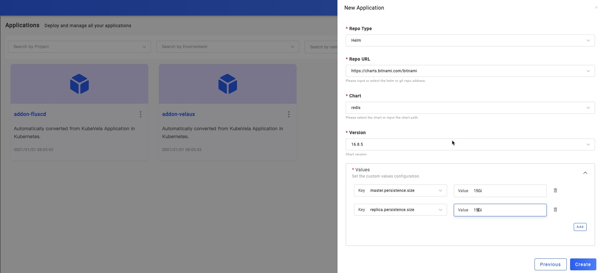
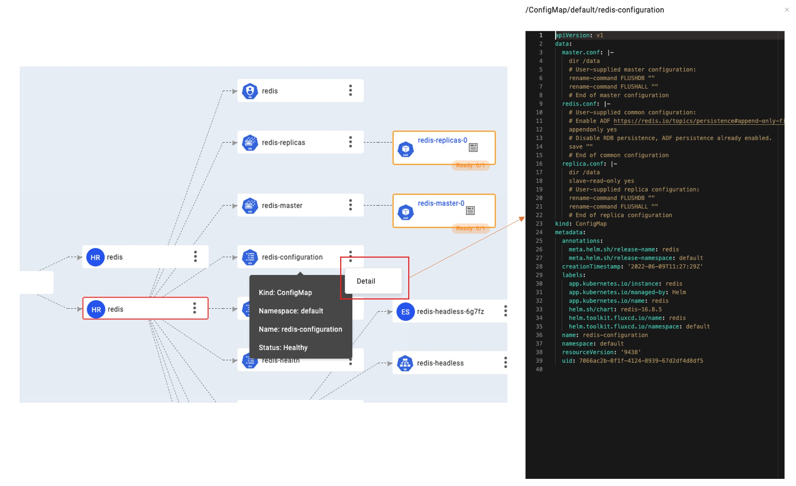

This guide deploys a Helm chart as a component, with the `helm` type from the fluxcd addon.

## Before starting

- The example uses the [podinfo](https://github.com/stefanprodan/podinfo) chart. It needs no storage, so any local cluster (k3d, kind) works.
- For the UI console, enable the VelaUX addon. If you only use the CLI, skip to [Deploy a Helm chart](#deploy-a-helm-chart).
  ```shell
  vela addon enable velaux
  ```

## Enable the fluxcd addon

The `helm` type comes from the `fluxcd` addon, so enable it first. See [addon management](../end-user/components/more.md) for more on addons.

```shell
vela addon enable fluxcd
```

When the addon status is `enabled`, it's ready to deliver charts.

## Deploy a Helm chart

Enabling `fluxcd` adds the `helm` definition. Check its parameters with:

```shell
vela show helm
```

The [fluxcd addon](../reference/addons/fluxcd.md) docs cover it in more detail.

This application deploys the `podinfo` chart with two replicas:

```yaml
apiVersion: core.oam.dev/v1beta1
kind: Application
metadata:
  name: helm-podinfo
spec:
  components:
    - name: podinfo
      type: helm
      properties:
        repoType: "helm"
        url: "https://stefanprodan.github.io/podinfo"
        chart: "podinfo"
        version: "6.17.0"
        values:
          replicaCount: 2
```

Save it as `app.yaml` and deploy it with:

```shell
vela up -f app.yaml
```

Then check the application with `vela status helm-podinfo`. Once the chart is fetched and the release installed, the application's status is `running` and the `podinfo` service reports `Healthy`.

> The application also shows up in VelaUX. An application created from the CLI is synced to the UI, read-only.

## Deploy a Helm chart from the UI console

Deploying a chart in the UI works like [container image delivery](../tutorials/webservice.mdx): select `helm` as the component type.

> The `helm` component type shows up once the fluxcd addon is enabled.

Then select a Target and open the deployment parameters page.



Fill in:

- Repo Type: Git and Helm are supported. Choose Helm.
- Repo URL: `https://stefanprodan.github.io/podinfo`. If you've configured the Helm repo in [Integration](../how-to/dashboard/config/helm-repo.md), you can choose it from the list.
- Chart: once the repo URL is filled in, the field lists the repo's charts. Choose `podinfo`.
- Version: once the chart is chosen, the field lists its versions. Choose `6.17.0`.
- Values: once the version is chosen, the form lists the chart's parameters. Set `replicaCount` to `2`.

:::tip
Charts that request persistent volumes need a default StorageClass on the target cluster, and some clouds set a minimum volume size. Size the volumes for the cluster you deploy to.
:::

Click `Create` to create the application and open its configuration page. From here, the steps are the same as in [Deploy First Application](../quick-start.md).

### Modify deployment parameters

Click the component name to open its configuration page. For a Helm chart component, the Values options are generated from the chart's `values.yaml`, and you can set a custom value for any of them.

In VelaUX, a value key looks like `resources.limits.memory=256Mi`, and is converted to YAML:

```yaml
values:
  resources:
    limits:
      memory: 256Mi
```

After you change the parameters, run the environment's workflow to apply them. Each run is saved as a revision, so earlier parameters stay in the history.

### Visualize the resources created by Helm Release

It's often unclear what a chart creates, which makes it hard to troubleshoot. VelaUX shows the resources a Helm release created as a graph, with their relationships and status. Click the `Detail` action button to view a resource's YAML.


Hover over a resource to check its health, or click the icon on its right to get its YAML for debugging.



## Specify different value file

Set `valuesFiles` to use another values file in the chart instead of the default `values.yaml`.

The `podinfo` chart ships two values files:

```
podinfo
├── Chart.yaml
├── README.md
├── templates
├── values-prod.yaml
└── values.yaml
```

Without `valuesFiles`, the chart renders with `values.yaml`. Switch to `values-prod.yaml`, which also turns on the autoscaler and deploys Redis beside podinfo, with:

```shell
cat <<EOF | vela up -f -
apiVersion: core.oam.dev/v1beta1
kind: Application
metadata:
  name: podinfo-prod
spec:
  components:
    - name: podinfo
      type: helm
      properties:
        repoType: "helm"
        url: "https://stefanprodan.github.io/podinfo"
        chart: "podinfo"
        version: "6.17.0"
        valuesFiles:
          - "values-prod.yaml"
EOF
```

The files in `valuesFiles` are merged in list order, so a later file overrides an earlier one. Here `values-prod.yaml` overrides any key it shares with `values.yaml`:

```yaml
        valuesFiles:
          - "values.yaml"
          - "values-prod.yaml"
```

## Specify OCI registry

If your chart is stored in an [OCI registry](https://helm.sh/docs/topics/registries/), create the application like this:

```yaml
apiVersion: core.oam.dev/v1beta1
kind: Application
metadata:
  name: oci-app
  namespace: default
spec:
  components:
    - name: test-helm
      type: helm
      properties:
        repoType: "oci"
        url: oci://ghcr.io/stefanprodan/charts
        chart: podinfo
        version: '6.1.*'
```

:::note
Your fluxcd addon version must be `1.3.1+`.
:::

## Next steps

- Deploy the chart to several clusters with a [topology policy](../case-studies/multi-cluster.md).
- Roll it out gradually with a [Canary rollout](./helm-rollout.md).
