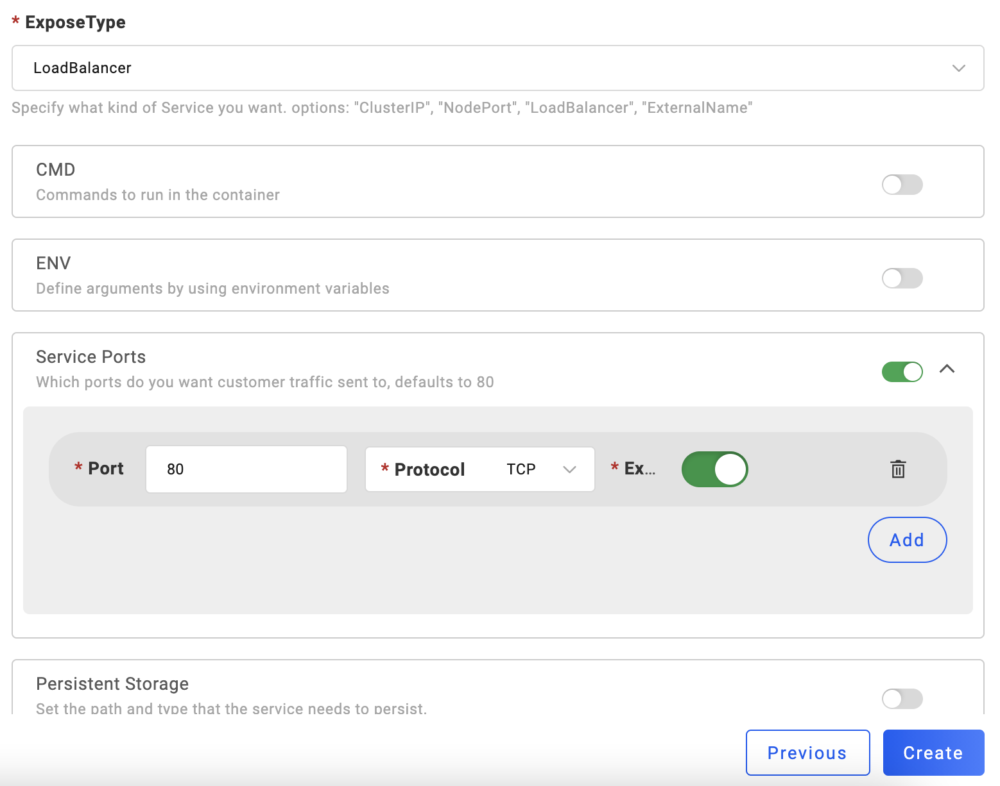
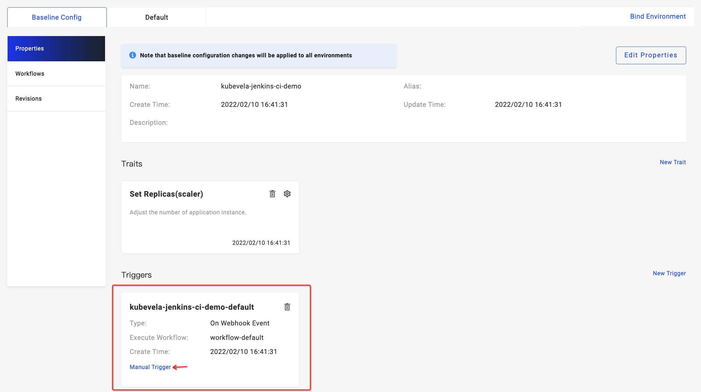
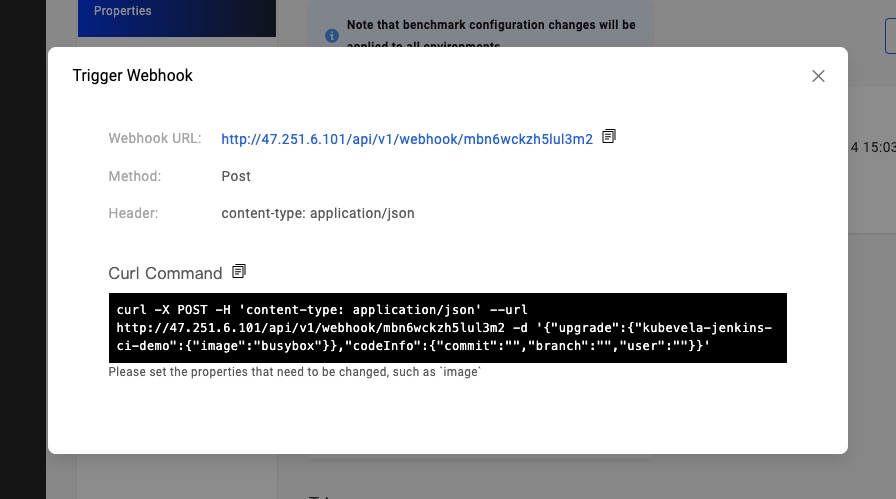
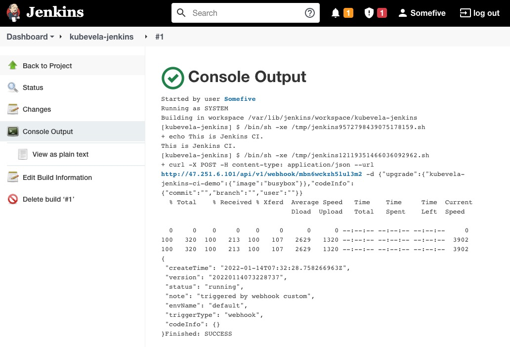

### Introduction

The workflow execution of KubeVela application can be triggered by webhooks. Therefore, it is rather easy for user to integrate KubeVela with existing Continuous Integration platforms, such as Jenkins or Gitlab.

From KubeVela 1.2, [VelaUX](../reference/addons/velaux.md#install) provides webhook triggers for applications to use. Only a simple curl command in Jenkins pipeline is needed to bridge CI and CD systems.

In this section, we will demonstrate how to integrate KubeVela with Jenkins in details.

### Prerequisite

The following requirements are needed to be ensured before starting this tutorial
- KubeVela v1.2.0+ with VelaUX installed.
- Jenkins installed.
- VelaUX can be accessed by Jenkins. (If KubeVela is installed in an offline environment, you need to check this condition.)

### Create Application

To use triggers, we need to create a new application on VelaUX first. For example, let's deploy a new WebService type application and use LoadBalancer to expose port 80 for access.



### Setup Webhook Trigger for Jenkins

In the application view, we can see a default trigger as below



Click **Manual Trigger**, we can see the Webhook URL and the Curl Command. Either one is available to copy and use into Jenkins pipeline script.



### Use Webhook in Jenkins

The webhook URL lets anyone who has it deploy the application. Store it as a Jenkins `Secret text` credential (here with the ID `velaux-webhook-url`) and read it with `withCredentials`, rather than pasting it into the job:

```groovy
stage('Deploy') {
    steps {
        withCredentials([string(credentialsId: 'velaux-webhook-url', variable: 'VELAUX_WEBHOOK_URL')]) {
            sh '''#!/bin/bash
                set -e
                curl -X POST -H 'content-type: application/json' --url "$VELAUX_WEBHOOK_URL" -d '{"upgrade":{"kubevela-jenkins-ci-demo":{"image":"busybox"}},"codeInfo":{"commit":"'"$GIT_COMMIT"'","branch":"'"$GIT_BRANCH"'","user":""}}'
            '''
        }
    }
}
```

Replace `kubevela-jenkins-ci-demo` with your component's name and `busybox` with the image your build produced. In a *Freestyle* project, tick **Use secret text(s) or file(s)** under **Build Environment**, bind the credential to `VELAUX_WEBHOOK_URL`, then add an **Execute Shell** build step with the same `curl` command.
Now when Jenkins runs these build steps, it tells KubeVela to run the application workflow.


