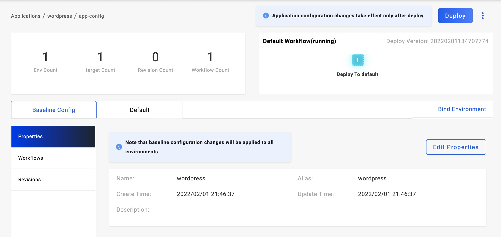
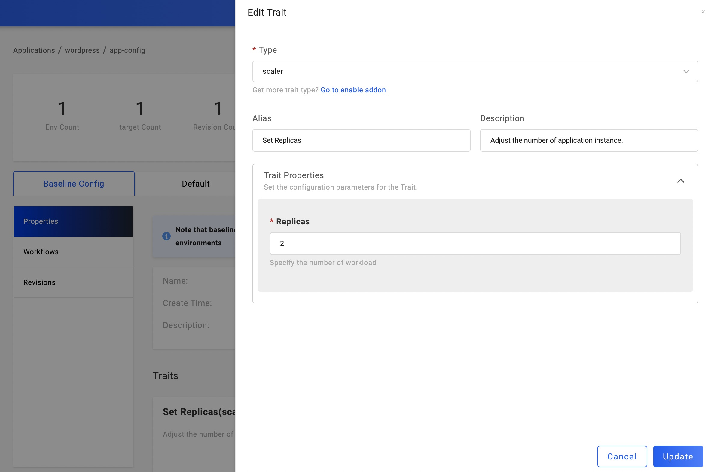
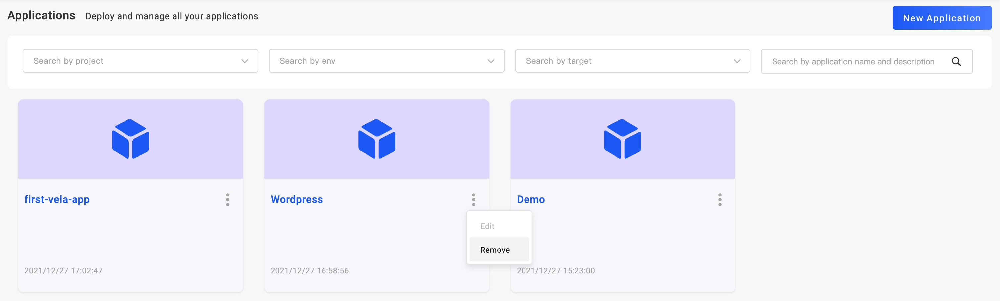

In this section, we will introduce how to deploy a container-based application with KubeVela. The guide will run the whole process with UI console as it's quite the same with the [quick start](../quick-start.md) if you're using CLI.

This guide uses `oamdev/testapp:v1`, a small Node.js app listening on 8080.

## Before starting

- Make sure you have [VelaUX addon](../reference/addons/velaux.md) enabled.
  ```
  vela addon enable velaux
  ```

## Creating an application

Enter the page of Application on the left, and click `New Application` to create. Pick your name, alias, and description; Select type of `webservice`; Decide your environment, Default environment is already available in the first place. You could also enter the page of Environments to set up new.

Click `Next Step` so to the configuration page. Set the image to `oamdev/testapp:v1`, and set the resources limit. If you want to set up a command for the image, open up the row `CMD`.

If you want to deploy the private image, please create the registry integration configuration. refer to: [Image registry configuration](../how-to/dashboard/config/image-registry.md)

After inputting the Image address, the system will load the Image info from the registry. If the image belongs to the private image registry, the `Secret` field will be automatically assigned values.

You could refer to their information to configure the `Service Ports` and `Persistent Storage`.


Done by clicking `Create` and then we enter the management page.

## Deploying the application

Click the `Deploy` button on the upper right and select a workflow. Note that each Environment of the application has its workflow. On the right of the `Application Config` tab is the environments. Check out the status of the environment and its instance information as you wish.



When it has several targets in this environment, you may find them all in the `Instances` list. If you want to look at the process of application deployment, click `Check the details` to reveal.

In the `Instances` list, you may find some of them are in pending status. Click `+` in the beginning to figure out the reason in more detail.

## Update image

After the first deployment, our business keeps evolving and the following updates come along.

Click `Application Config` and you can see the all components. Then click the component name and open the configuration page, you can update your latest requirements for image, version, and environment variable.

## Update replicas

If your business requires more than one replica, enter the `Properties` page under `Application Config`. By default, The component has a `Set Replicas` trait. Click it so that you can update the replicas.



## Upgrading the application

Your changes are saved but not deployed. Click **Deploy** to roll them out to the environment.

## Application recycling and deletion

If you need to delete the application after testing, you need to recycle all the deployed environments first. Click the environment name to enter the environment instance list, and click the `Recycle` button to recycle the deployment of the application in that environment. After it's done, the application in this environment rolls back as an undeployed one.

After all of the environments have been recycled, the application can be deleted. Currently, the entry for application deletion is on the application list page. Back to the application list page, mouse on the menu icon on the right side of the application name, and click the `Remove` option.



You can refer to [how to manage applications](../how-to/dashboard/application/create-application.md) to learn the details about the UI console operations.

## Deploy via CLI

You also can deploy the application via CLI.

```yaml
cat <<EOF | vela up -f -
# YAML begins
apiVersion: core.oam.dev/v1beta1
kind: Application
metadata:
  name: webservice-app
spec:
  components:
    - name: frontend
      type: webservice
      properties:
        image: oamdev/testapp:v1
        cmd: ["node", "server.js"]
        ports:
          - port: 8080
            expose: true
        cpu: "0.5"
        memory: "512Mi"
      traits:
        - type: scaler
          properties:
            replicas: 1
# YAML ends
EOF
```

:::note
Applications you create with the CLI show up in VelaUX, where you can view and edit them. Once you deploy one from VelaUX, VelaUX becomes its source of truth: make later changes there, since changes applied with the CLI are not shown in VelaUX and the next VelaUX deploy replaces them.
:::

You can also save the YAML file as webservice-app.yaml and use the `vela up -f webservice-app.yaml` command to deploy.

Next, check the deployment status of the application through `vela status webservice-app`

```
About:

  Name:      	webservice-app
  Namespace: 	default
  Created at:	2022-04-21 12:03:42 +0800 CST
  Status:    	running

...snip...

Services:

  - Name: frontend
    Cluster: local  Namespace: default
    Type: webservice
    Healthy Ready:1/1
    Traits:
      ✅ scaler
```

The application is delivered when the workflow is finished and the status is `running`. If the status stays `rendering`, or a service is not healthy, read the error in `kubectl get application webservice-app -o yaml` (`status.conditions` and `status.workflow`). `vela ls` lists every application with its status:

```shell
vela ls
```

Forward a local port to the app:

```shell
vela port-forward webservice-app 8080:8080
```

The command opens your browser on the app. From another terminal you can also call it directly:

```shell
curl http://127.0.0.1:8080
```

:::tip
To reach the app from outside the cluster without port-forwarding, set `exposeType: NodePort` or `exposeType: LoadBalancer` on the component, or add an [expose](../end-user/traits/references.md#expose) or [gateway](../end-user/traits/references.md#gateway) trait. `vela status webservice-app --endpoint` lists the endpoints.
:::

## What you did

You deployed a container image as a `webservice` component, in VelaUX and with the CLI, and reached it through a port-forward.

## Next steps

* [Webservice reference](../end-user/components/references.md#webservice) for every field.
* [Trait reference](../end-user/traits/references.md) for the traits a webservice can use.
* [Multi-cluster delivery](../case-studies/multi-cluster.md) to deploy the image to several clusters.
