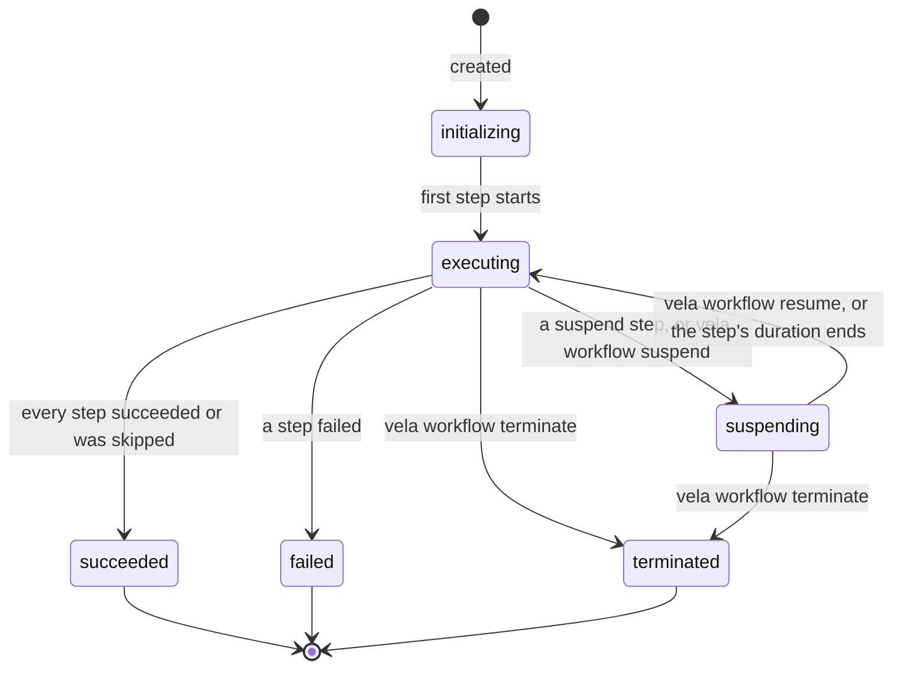

A WorkflowRun goes through a short life: it starts, runs its steps, may stop to wait, and finishes. Its phase is in `status.status`, and each step's in `status.steps`.

## WorkflowRun phases

| Phase | Meaning |
| :---: | --- |
| `initializing` | The WorkflowRun has been created and no step has started. |
| `executing` | A step is running. |
| `suspending` | A step is suspended, waiting for `vela workflow resume` or its `duration`. |
| `terminated` | The WorkflowRun was terminated. |
| `failed` | Every step has finished and at least one failed. |
| `succeeded` | Every step has finished and each one succeeded or was skipped. |

`kubectl get workflowrun` shows the phase in its `PHASE` column.

## Step phases

| Phase | Meaning |
| :---: | --- |
| `running` | The step is running. |
| `suspending` | The step is suspended. |
| `pending` | The step is waiting for something before it can run, such as its inputs. |
| `succeeded` | The step succeeded. |
| `failed` | The step failed. |
| `skipped` | The step was skipped. |

A failed step has a `message` with the error and a `reason`:

| Reason | Meaning |
| :---: | --- |
| `Execute` | The step failed while running. |
| `Terminate` | The step was terminated. |
| `Output` | The step failed to write one of its `outputs`. |
| `FailedAfterRetries` | The step failed and hit the retry limit. |
| `Timeout` | The step ran past its `timeout`. |
| `Action` | The step's definition called [op.#Fail](../guides/authoring/cue-actions.md#fail). |

## Waiting and retrying

A step that waits for a condition, such as a Deployment becoming ready, stays `running` and is tried again after a backoff. A step that fails is retried too, up to a limit, and then fails with `FailedAfterRetries`. The backoff times and limits, and the flags that change them, are in [Workflow Working Mechanism](../operate/working-mechanism.md).

## Once a run has finished

A WorkflowRun runs once. When it reaches `succeeded`, `failed` or `terminated`, `status.finished` is `true` and the controller stops reconciling it:

- **Editing the spec does nothing.** The steps don't run again. To run them again, use `vela workflow restart`, or delete the WorkflowRun and create it again.
- **Deleting it deletes only the WorkflowRun.** The objects its steps created stay where they are, since nothing owns them.
- **Restart starts from the top**, or from one step with `--step`: see [Workflow Operations](../guides/operations.md#restart-workflow).

An Application's workflow is different: vela-core runs it again whenever the Application changes, and keeps what it applied in place in between.
