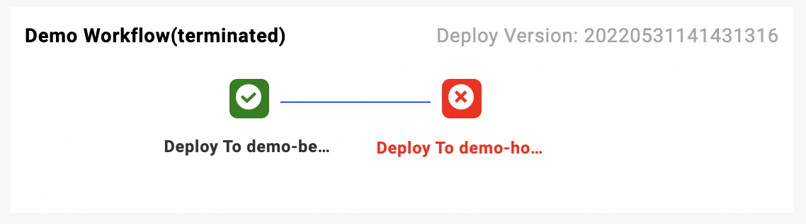

:::info
These are the docs for KubeVela Workflow 0.7, the workflow engine in KubeVela 1.11. A WorkflowRun runs the same engine without an Application: see [K8S API for Pipeline](../guides/workflowrun.md).
:::

Without a workflow, KubeVela applies every component at once, apart from the order that dependencies set: `dependsOn` and `inputs` each hold a component back until what it waits on is ready. A workflow lets you choose the order, wait for approval, branch on conditions and pass data from one step to the next.

A workflow consists of multiple steps, and typical workflow steps include step groups (containing a series of sub-steps), human review, multi-cluster publishing, notifications, etc. You can view all built-in workflow steps provided by default in KubeVela in [built-in workflow steps](../reference/built-in-steps.md). If the built-in workflow steps don't meet your needs, you can also [custom workflow steps](../guides/authoring/step-definition.md).

`Workflow` consists of steps, you can either use KubeVela's [built-in workflow steps](../reference/built-in-steps.md) like `suspend`, `notification`, `deploy`, `step-group` etc, or [customize your own `WorkflowStepDefinition`](../guides/authoring/step-definition.md).

In fact, if you only use components in the Application and do not declare a workflow, KubeVela will automatically create a default workflow for deploying the components when running the Application.

VelaUX shows each step's state; here the first step succeeded and the second failed:



## Execution order

In the workflow, all the steps will be executed sequentially and the next step will be executed after the previous one succeeded. If a step is of type `step-group`, it can contain a series of sub-steps, all of which are executed together when the step group is executed.

In KubeVela 1.5.0+, you can explicitly specify the execution mode of steps, such as:

```yaml
workflow:
  mode:
    steps: StepByStep
    subSteps: DAG
```

There're two modes of execution: StepByStep and DAG.
 
If you do not explicitly declare the execution mode, by default steps are executed sequentially in StepByStep and subSteps are executed in parallel in DAG.

## State of Application and Workflow

|    Application     |  Workflow  |                                                   Description                                                    |
| :----------------: | :--------: | :--------------------------------------------------------------------------------------------------------------: |
|  runningWorkflow   | executing  |                 When the workflow is executing, the status of the application is runningWorkflow                 |
| workflowSuspending | suspending |               When the workflow is suspended, the status of the application is workflowSuspending                |
| workflowTerminated | terminated |               When the workflow is terminated, the status of the application is workflowTerminated               |
|   workflowFailed   |   failed   | When a step in the workflow fails and the workflow is completed, the status of the application is workflowFailed |
|      running       | succeeded  |        When all steps in the workflow are executed successfully, the status of the application is running        |

## What you can do with a workflow

| I want to... | Page |
| :--- | :--- |
| Wait for approval before carrying on | [Suspend and Resume](../guides/steps/suspend.md) |
| Run steps in parallel, or in a set order | [Dependency](../guides/steps/dependency.md) |
| Group steps together | [Sub Steps](../guides/steps/step-group.md) |
| Run a step only when an earlier one failed, or skip it | [If Conditions](../guides/steps/if-condition.md) |
| Pass a value from one step to the next | [Data Passing](../guides/steps/inputs-outputs.md) |
| Stop a step that hangs | [Timeout of Step](../guides/steps/timeout.md) |
| Suspend, resume, terminate or restart a running workflow | [Workflow Operations](../guides/operations.md) |
| Find out why a step failed | [Debug Workflow](/docs/platform-engineers/debug/debug) |
